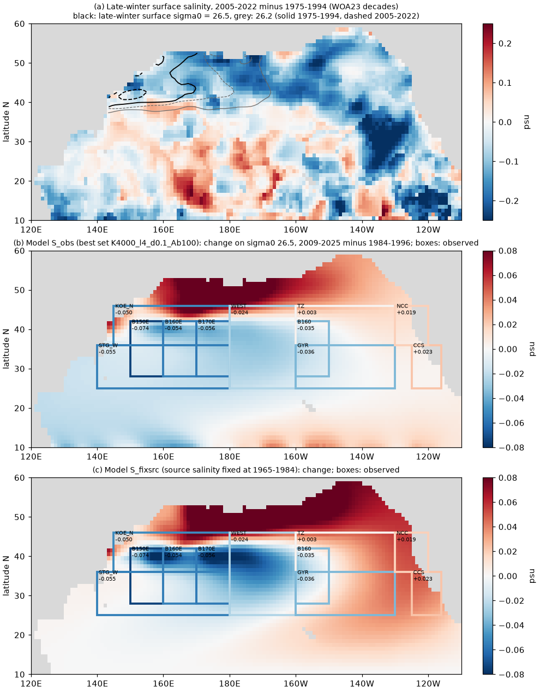
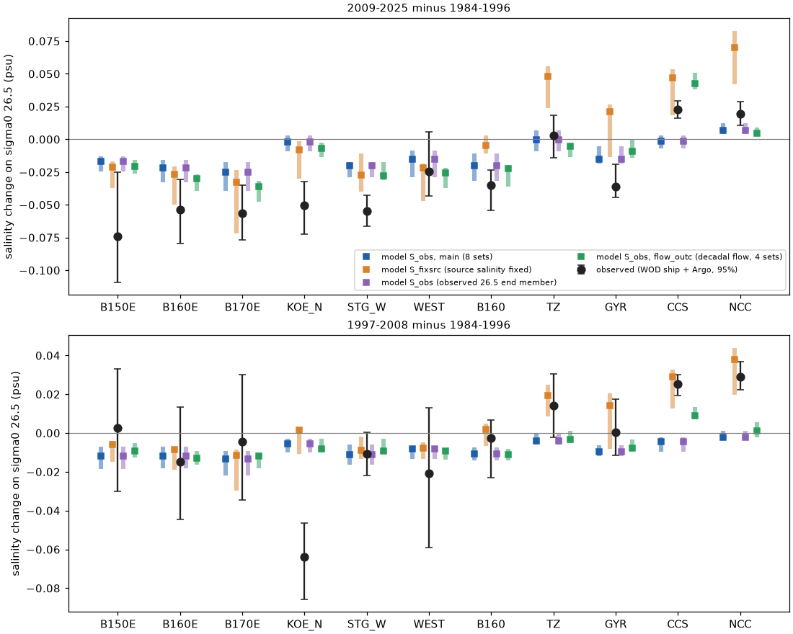
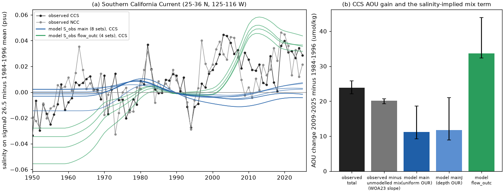

# Isopycnal salinity supports the sigma0 26.5 ventilation model of the North Pacific west of 150 W; the model misses the 1997-2025 salt gain off California, which gives 3-9 of the 24 umol/kg AOU gain there

Job sci-1107-dell-earth-and-ocean-sciences-b86e3143a230, campaign 11_07_2026, topic earth-and-ocean-sciences, machine dell, account claude-olen. Analysis and text by the model Claude Opus 5.5 (claude-opus-5-5) in Claude Code. The signing key is a campaign-machine key. It is not a personal authorship claim.

## Summary

Earlier campaign work found that oxygen (O2) on the sigma0 = 26.5 kg/m3 surface fell across the North Pacific from about 1990 and reached California. The loss followed the shrinking late-winter outcrop of this density class. A two-dimensional ventilation model on the 26.5 surface, calibrated only with CFC-12/SF6 ages, gave AOU gains of the observed size (sci:sha256:4525c37f...). But off southern California (CCS, 25-36 N, 125-116 W) the observed gain was larger than the model gain, and the decadal flow change raised the CCS gain by bringing more water from the south. That study compared the model with AOU only. AOU cannot separate a change of water mass from a change of respiration.

On an isopycnal surface, salinity also fixes temperature ("spice"), and it is conservative. Thus it is an independent test of the water-mass change in the model. We added salinity tracers to the published model without change to the model or its 8 parameter sets. We compared the model salinity change on 26.5 with the observed change (World Ocean Database ship casts and Argo, published in sci:b4d3d3f5 and sci:84f111c0) in 11 pre-set regions. The plan (`files/code/analysis_plan_salinity.md`) was written before any model salinity value was calculated.

Main results (changes are 2009-2025 minus 1984-1996 on sigma0 26.5 unless stated; observed 95% cruise-bootstrap intervals in brackets):

1. **West of 150 W the water on 26.5 became fresher, and the model gives this.** The observed change was -0.024 to -0.074 psu in all 7 western regions (140 E-150 W), for example -0.054 (-0.079 to -0.030) at 28-42 N, 160-170 E. The primary model tracer (S_obs, chosen by the pre-set rule of test T0) had the observed sign in all of them for the ensemble median, and in 55 of the 56 region-set cases. Pre-registered tests T1 (sign in at least 8 of 11 regions) and T2 (r > 0.5 and RMSE below the zero-change RMSE) passed: 10-11 of 11 regions; ensemble-median r = 0.77, RMSE 0.031 against 0.044 psu. But this tracer gives only 4-63% (median 41%) of the observed western freshening. The tracer with the late-winter surface salinity as source value (S_main) gives the western size (-0.026 to -0.058).
2. **In the model, about half of the western freshening comes from fresher source water and half from ventilation in fresher water.** The late-winter surface water near the 26.5 outcrop became fresher (Fig. 1a). In the model (S_main), this gives -0.013 to -0.053 psu in the western regions. The other part (-0.005 to -0.033) comes from the change of where and how much ventilation occurs: the ventilation moved north into fresher water. The southern boundary gives less than 0.004.
3. **East of 140 W the water on 26.5 became saltier, and the model does not give this.** Off California (CCS) the observed change was +0.023 (+0.016 to +0.029) psu, and in the northern California Current (NCC, 36-46 N, 130-120 W) +0.019 (+0.011 to +0.029). In 1997-2008 it was already +0.025 and +0.029. The 13-year running mean at CCS stayed within -0.012 to +0.010 psu of the 1984-1996 mean in 1956-1990 and was +0.02 to +0.03 in 2003-2019 (Fig. 4a). The tracers S_main, S_fixbnd and S_obs with the fixed flow gave -0.020 to +0.012 at CCS and NCC in both epochs. Only S_fixsrc, which holds the source salinity at its 1965-1984 value against the observed fresher winter surface, gives a salt gain there. In the model, the fresher source water (-0.07 to -0.08) and the smaller outcrop-water fraction (+0.05 to +0.07) almost cancel in the east.
4. **The decadal flow change gives the CCS salt gain with the wrong timing and no NCC gain (T4).** With the WOA23 decadal flow, the 4 sets gave +0.038 to +0.051 at CCS in 2009-2025 (above the observed interval) but only +0.007 to +0.013 in 1997-2008 (observed +0.025). At NCC they gave +0.003 to +0.009, farther from the observation than with the fixed flow in all 4 sets (pre-set rejection rule met for NCC 2009-2025, not for CCS).
5. **The salt gain that the model does not have gives 3-9 of the 23.9 umol/kg CCS AOU gain (T5).** With the WOA23 spatial AOU-salinity slope on 26.5 off California (157 umol/kg per psu, 95% 134-186), the unmodelled water-mix term is 3.2-4.7 umol/kg; with the CalCOFI slope of sci:ea67ca59 (314), it is 6.3-9.3. The ratio observed/model of the CCS AOU gain (fixed flow) falls from 1.28-2.59 (median 2.15) to 1.12-2.16 (median 1.78) or 0.95-1.73 (median 1.42). Thus the eastern salt gain explains part, but not all, of the California AOU excess. The remainder is a gain inside water types.

Interpretation: the water-mass change that the outcrop-ventilation model makes west of 150 W agrees with the independent salinity data. This supports the model there. Off California, a salt gain that started in the late 1990s is outside the model. The model's southern boundary (10.5 N) adds almost nothing, and the flow change gives the wrong timing. The salt gain thus needs a source that the 1-degree isopycnal model does not resolve, for example more water from the south in the California Undercurrent, or a change in the North Pacific Current bifurcation. This salt gain is the same water-mix change that made most of the 1997-2008 CalCOFI O2 decline in sci:ea67ca59. It explains 13-39% of the 2009-2025 CCS AOU gain.

## Question, hypotheses and tests

Plan: `files/code/analysis_plan_salinity.md` (SHA-256 in `analysis_plan_salinity.sha256`), written before any model salinity value was calculated. At that time we had seen the published observed salinity and AOU epoch changes and the published model AOU, age and fout tables of sci:4525c37f. Items marked "(added)" are post hoc.

| Test | Hypothesis | Rule | Result |
|---|---|---|---|
| T0 climatology | Source definition S_main is usable | steady 1950 S_main RMSE vs WOA23 decav S on 26.5 below the RMSE of a constant map (0.285) in all sets | Failed: RMSE 0.132-0.298; the set K4000, lam0 1, delta 0.6 gives 0.298. By the pre-set rule, S_obs is the primary tracer (RMSE 0.070-0.087) |
| T1 sign | Model sign agrees in >= 8 of 11 regions | best set and ensemble median | Passed (S_obs): best 11, median 10 (CCS fails at the median; CCS agrees in 3 of 8 sets, KOE_N in 7 of 8), per set 10-11. S_main: 7 of 11 (fails TZ, WEST, CCS, NCC) |
| T2 pattern | r > 0.5 and RMSE < zero-change RMSE | ensemble median | Passed (S_obs): r 0.77, RMSE 0.031 vs 0.044. S_main: r 0.71, RMSE 0.023 |
| T3 attribution | (descriptive) | S_main minus S_fixsrc and S_fixbnd | West: source -0.013 to -0.034, geometry -0.008 to -0.033; east: source -0.065 to -0.080, geometry +0.021 to +0.070; boundary <= 0.004 everywhere |
| T4 flow | Flow mechanism not supported at CCS/NCC | flow_outc outside observed interval and farther than main, all 4 sets | NCC 2009-2025: rejected (4 of 4). CCS: not rejected (flow is closer than main in 3 of 4 sets, but above the interval in 2009-2025 and below it in 1997-2008) |
| T5 CCS AOU | (reconciliation) | b x (dS_obs - dS_model) | 3.2-4.7 (WOA23 slope) or 6.3-9.3 umol/kg (CalCOFI slope) of 23.9 |
| P0 (added) | Model gives 1950-1983 minus 1984-1996 | as T1/T2 | S_obs: 8 of 11, r -0.18 (fails T2); S_main: 8 of 11, r 0.44 (fails T2) |
| P2 T1/T2 (added) | 1997-2008 minus 1984-1996 | as T1/T2 | S_obs: 8 of 11, r 0.26, RMSE 0.024 vs null 0.024 (fails T2); S_main: 5 of 11 |

## Data

- **Model and calibration (sci:sha256:4525c37f931fcc02716ce375b6298fd52bf114ed7b62eaa47a5f3ecbd5190c08)**: model code (`files/code/from_4525c37f/`, unchanged), the fields file `files/results/fields/fields_sigma265.npz` (WOA23 geostrophic flow on 26.5 by decade, late-winter surface sigma0 maps of sci:bf71cd68, region masks; read from that bundle, not duplicated; SHA-256 in `files/provenance/provenance.json`), the 8 parameter sets with tracer-age score <= 0.45 (copy: `files/results/inputs/age_calib_nearoutcrop_4525c37f.csv`) and the published epoch changes of age, fout and AOU (`epoch_changes.csv`, used for the reproduction check and T5).
- **WOA23** (NOAA NCEI, public): annual T and S of the decades 1955-1964 to 2015-2022 and decav91C0, 0-1500 m; January-April monthly T and S at 0 m of the same decades. OPeNDAP, 2026-11-11. URL and array SHA-256: `files/provenance/woa23_fetch_log.json`, `woa23_winter_log.json`.
- **Observed changes on sigma0 26.5**: epoch changes with 95% cruise-bootstrap intervals from sci:b4d3d3f5 (`files/results/main/epochs_26.5.csv`, `bands/epochs_26.5.csv`: TZ, GYR, WEST, CCS, NCC, B180-B120; group ALL = WOD ship casts plus Argo T/S for salinity) and sci:84f111c0 (`files/results/west/epochs_26.5.csv`: B140E-B170E, KOE_N, STG_W, N145E-N170E; ship only). Collected in `files/results/inputs/obs_epochs_26.5.csv`. Annual CCS and NCC salinity anomalies for Fig. 4a: sci:b4d3d3f5 `files/results/main/series_26.5.csv`.
- Terms and attribution: `files/NOTICE_external_data.md`.

## Methods

1. **Salinity fields** (`salinity_fields.py`). TEOS-10 (gsw 3.6.23). For each WOA23 decade: practical salinity on sigma0 26.5 (first downward crossing, linear; the routine of sci:4525c37f `fields.py`), and the late-winter surface salinity S_w = 0 m salinity in the January-April month with the largest 0 m sigma0. Our recomputed late-winter sigma0 maps and depths of 26.5 are identical to those in the published fields file (maximum difference 0).
2. **Salinity tracers** (`salinity_runs.py`). The model is ModelR of sci:4525c37f: 2-D upwind advection and diffusion on 26.5 with near-outcrop ventilation rate lam = lam0 exp(-max(26.5 - sigma_w, 0)/delta), implicit steps of 1/36 yr, start from the steady state of the 1950 forcing, run 1950-2025. Each salinity tracer relaxes toward a reset value at the rate lam and has a fixed value at the southern row (10.5 N):
   - S_main: reset S_w(t); boundary = WOA23 salinity on 26.5 at 10.5 N (t).
   - S_fixsrc: reset and boundary fixed at the mean of 1965-1974 and 1975-1984.
   - S_fixbnd: reset S_w(t); boundary fixed.
   - S_obs: reset = WOA23 salinity on 26.5 in the same cell (t); boundary as S_main.
   Decade maps are linearly interpolated in time between decade midpoints (constant before 1959.5 and after 2018.5), as for sigma_w. Experiments: main (decav91C0 flow, time-varying sigma_w; 8 sets), flow_outc (decadal flow; 4 best sets), control (fixed forcing; best set).
3. **Reproduction check.** The age and fout tracers are carried in the same runs. In 143 region-set-experiment cases, the fout change equals the published value of sci:4525c37f within 1e-4 (`files/results/tests/reproduction_check.csv`). In the control run, fout and S_fixsrc changes are 0 (< 1e-10).
4. **Comparison** (`analyze_salinity.py`). Cosine-latitude weighted regional means of annual model values; epoch means P1 1984-1996, P2 1997-2008, P3 2009-2025 (and P0 1950-1983, added); changes against P1. Region boxes are those of the observations (half-open on 1-degree cell centres).
5. **T5.** b = least-squares slope of WOA23 'all' AOU on WOA23 decav91C0 salinity, both on 26.5, in 20-46 N, 135-115 W (397 cells, r = 0.91; 95% interval from a 5-degree block bootstrap). Unmodelled water-mix AOU = b (dS_obs - dS_model) with the primary tracer. The model AOU gains are the published values of sci:4525c37f for the same sets (main: uniform OUR; mainJ: depth-dependent OUR; flow_outc).

## Results

### Salinity change by region (`files/results/tests/salinity_comparison.csv`, Fig. 2)

2009-2025 minus 1984-1996, psu. Model values: median of 8 sets (main) or 4 sets (flow_outc), range in brackets.

| Region | Observed (95%) | S_obs main | S_main main | S_fixsrc main | S_obs flow_outc |
|---|---|---|---|---|---|
| B150E 28-42 N, 150-160 E | -0.074 (-0.109, -0.025) | -0.017 (-0.024, -0.013) | -0.039 | -0.021 | -0.021 |
| B160E 28-42 N, 160-170 E | -0.054 (-0.079, -0.030) | -0.022 (-0.033, -0.016) | -0.045 | -0.027 | -0.030 |
| B170E 28-42 N, 170-180 E | -0.056 (-0.077, -0.035) | -0.025 (-0.040, -0.017) | -0.058 | -0.033 | -0.036 |
| KOE_N 36-46 N, 145-180 E | -0.050 (-0.072, -0.032) | -0.002 (-0.009, +0.003) | -0.026 | -0.008 | -0.007 |
| STG_W 25-36 N, 140-180 E | -0.055 (-0.066, -0.043) | -0.020 (-0.029, -0.017) | -0.052 | -0.027 | -0.028 |
| WEST 25-46 N, 180-160 W | -0.024 (-0.043, +0.006) | -0.015 (-0.029, -0.009) | -0.054 | -0.022 | -0.025 |
| B160 28-42 N, 160-150 W | -0.035 (-0.054, -0.024) | -0.020 (-0.031, -0.011) | -0.054 | -0.005 | -0.022 |
| TZ 36-46 N, 160-130 W | +0.003 (-0.014, +0.018) | -0.001 (-0.009, +0.007) | -0.017 | +0.048 | -0.005 |
| GYR 25-36 N, 160-130 W | -0.036 (-0.045, -0.019) | -0.015 (-0.018, -0.005) | -0.043 | +0.021 | -0.009 |
| CCS 25-36 N, 125-116 W | +0.023 (+0.016, +0.029) | -0.001 (-0.007, +0.003) | -0.019 | +0.047 | +0.043 |
| NCC 36-46 N, 130-120 W | +0.019 (+0.011, +0.029) | +0.007 (+0.004, +0.012) | -0.007 | +0.070 | +0.005 |

1997-2008 minus 1984-1996: the observed salt gain was +0.025 (CCS), +0.029 (NCC), +0.035 (B130, 28-42 N, 130-125 W), +0.020 (B140, 140-130 W) and +0.014 (TZ). All fixed-flow tracers gave -0.022 to -0.002 there; flow_outc gave +0.007 to +0.013 at CCS.

### California (`T4_flow.csv`, `T5_ccs_aou.csv`, Fig. 4)

| Case | Model AOU gain (8 or 4 sets) | Obs/model | Obs/model after removing the unmodelled mix term (WOA23 slope / CalCOFI slope) |
|---|---|---|---|
| main (uniform OUR 3.2) | 9.2-18.6 | 1.28-2.59 (median 2.15) | 1.12-2.16 (1.78) / 0.95-1.73 (1.42) |
| mainJ (depth-dependent OUR) | 8.9-21.0 | 1.13-2.69 (2.04) | 0.99-2.31 (1.72) / 0.84-1.94 (1.35) |
| flow_outc | 32.3-44.0 | 0.54-0.74 (0.71) | (model already too salty: 0.60-0.83 / 0.65-0.95) |

Observed CCS AOU gain: 23.9 (22.1-25.8) umol/kg (ship). With the fixed flow, the model is too fresh and has too little AOU gain. With the decadal flow, it is too salty after 2009 and has too much AOU gain. Neither case gives the timing of the observed salt gain, which reached its full size by about 2003 (Fig. 4a).

## Robustness

- Observations with ship data only (group SHIP): S_obs main T1 10 of 11, r 0.78, RMSE 0.031 against 0.045.
- All 8 sets: T1 10-11 of 11, r 0.67-0.87 (`T1_T2_per_set.csv`). The 4 flow_outc sets: 11 of 11, r 0.74-0.81.
- The eastern failure does not depend on the source definition: S_main, S_fixbnd and S_obs all give -0.020 to +0.012 at CCS and NCC with fixed flow. Only S_fixsrc (source salinity held at its 1965-1984 value, which the observed fresher winter surface contradicts) gives a salt gain there, and it is 2-4 times too large and makes TZ and GYR wrong.

## Limitations

- One isopycnal (26.5) and a 1-degree model calibrated with tracer ages at four sections. The coastal California Undercurrent and eddy transports are not resolved. The 8 parameter sets differ in sensitivity by a factor of about 3.
- WOA23 decadal fields are smoothed objective analyses with few data in some decades and regions; the late-winter surface salinity is from monthly climatologies of each decade, not from individual winters.
- Neither source definition is complete. S_main (winter surface salinity) failed the pre-set climatology test in one set and is too fresh on average (bias -0.10 to +0.10 psu). S_obs uses the observed 26.5 salinity at the ventilation site, which already contains part of the result near the outcrop, and it gives only 4-63% (median 41%) of the western freshening.
- The observed epoch changes are published aggregates with few cruises in some regions after 2008 (for example 3 ship cruises with O2 in TZ in 2009-2025; salinity there includes Argo). We did not reprocess casts.
- T5 assumes that the unmodelled salt gain at CCS is mixing with water of the regional AOU-salinity relation. The two slopes differ by a factor of 2, so the mix term is uncertain by a factor of 2. T5 is a reconciliation, not a test.
- P0 and the P2 report are post hoc; both fail T2. The model does not reproduce the 1950-1983 western salinity (0.02-0.12 psu saltier than 1984-1996).

## Reproduction

`bash files/code/run_all.sh WORK CAMPAIGN_DIR PYLIB` with an empty local WORK folder, CAMPAIGN_DIR holding the cited ZIPs (4525c37f..., b4d3d3f5..., 84f111c0...) and PYLIB holding gsw 3.6.23 (`pip install --no-deps --target PYLIB gsw==3.6.23`). It fetches the WOA23 subsets (about 0.3 GB) into WORK/scratch, runs 13 model runs (2-3 min each on the Dell host) and writes results and figures into WORK. Software: Python 3.12.15, numpy 2.5.4, scipy 1.18.1, pandas 3.1.1, matplotlib 3.11.2, netCDF4 1.7.5.1, gsw 3.6.23 (`files/provenance/provenance.json`). The bundled model run outputs are in `files/results/model_runs/` (annual regional means of every tracer; maps of the best set).

## Files

- `files/code/`: our scripts, the analysis plan, `run_all.sh`; `from_4525c37f/`: unchanged model code of sci:4525c37f.
- `files/results/salinity_fields.npz`: WOA23-derived salinity on 26.5 and late-winter surface salinity by decade on the model grid.
- `files/results/model_runs/`: annual regional tracer means per run (`sal_<exp>_<set>.csv`), epoch-mean maps and steady 1950 maps of the best set.
- `files/results/tests/`: test tables and `tests.json`.
- `files/results/inputs/`: observed epoch changes and the parameter-set table.
- `files/provenance/`: input hashes, WOA23 fetch logs, software versions.
- `files/NOTICE_external_data.md`: sources, terms and attribution of external data.
