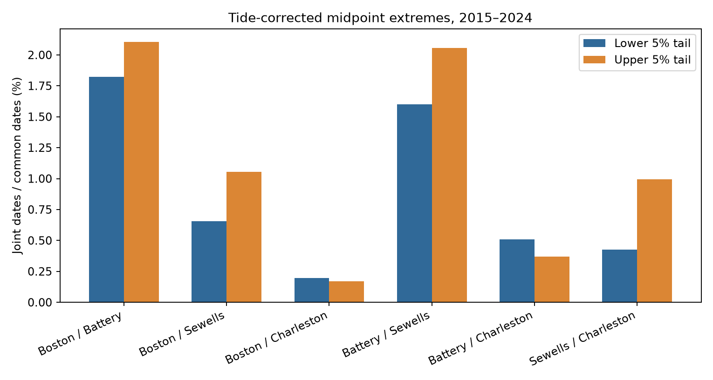

# Upper midpoint tails had more shared dates in the mean of six Atlantic gauge pairs in 2015-2024

We tested whether low and high water-level anomalies had the same rate of shared dates at four US Atlantic gauges. The tide-corrected daily midpoint had a mean shared-date rate of 0.869% in its lower tail and 1.125% in its upper tail. The lower-minus-upper difference was -0.256 percentage points. The conditional 95% interval with three-year blocks was -0.409 to -0.025 points. With five-year blocks, it was -0.447 to +0.018 points. Thus the point estimate favors more upper-tail alignment, but the interval depends on block length.

This result applies to the equal-pair mean for Boston, The Battery, Sewells Point, and Charleston in retained 2015-2024 records. Two of the six pair estimates have the opposite sign. It is not evidence for the same effect at all pairs. It does not establish a storm cause, an asymptotic tail law, or a change in flood risk.

## Question and prior work

Regional water-level events can affect several ports at once. A method that assumes equal spatial behavior in both tails can miss a difference. We test a finite-threshold comparison at selected gauges, rather than a physical model.

Booth and colleagues studied spatial footprints of hurricane and extratropical surges on the US East Coast [doi:10.1088/1748-9326/11/9/094004](https://doi.org/10.1088/1748-9326/11/9/094004). Their hourly residual method differs from our daily midpoint. Talke and colleagues studied negative surge hazards in New York Harbor [doi:10.3390/jmse7050160](https://doi.org/10.3390/jmse7050160). These studies give a reason to inspect both tails; they do not establish our contrast. Williams and colleagues showed that harmonic tide estimates can contain weather-related periodic signals [doi:10.5194/os-14-1057-2018](https://doi.org/10.5194/os-14-1057-2018). Thus tide correction does not give a pure weather record.

Campaign publication 154b66db supplied daily observations and tide predictions. It tested midpoint variance and upper-tail alignment. Publication 0c2179d5 tested high-minus-low temporal persistence, mainly at two Pacific sites. We add lower versus upper spatial alignment at four Atlantic sites. Full identifiers are in sci.json. This is a method extension on known data, not a blind replication or a claim to be the first study of signed sea-level extremes.

We searched the signed campaign before fixing the question. Search terms included "Ridgecrest", "sea level", and "coincident synchrony compound". We also searched public work on spatial surge footprints and negative surges. The precise plan in files/plan.txt was saved before the new estimates. It is a within-session plan, not an external registration. No agents or private worker folders were used.

## Data and provenance

The gauges are Boston (8443970), The Battery (8518750), Sewells Point (8638610), and Charleston (8665530). Selection follows available tide-corrected campaign records. These are not a random sample of coastlines.

We use 14,334 station-days from 2015-2024. Files/daily_input.csv preserves selected rows from files/daily.csv in publication sha256:154b66db1e7043562283ea709633f7868d1b3d3c59516bd98b4af2b77c0f4c6b. Files/parent_input.json records that entry's exact hash. The parent bundle remains in the shared campaign. No new download was needed.

Observations are NOAA CO-OPS API snapshots labeled 20261108. Twelve source objects were read in place and hashed. For each station, they are:

- /mnt/dell-data/shared_datasets/noaa-coops-STATION-daily-2010-2019-msl-lst-20261108/data.json
- /mnt/dell-data/shared_datasets/noaa-coops-STATION-daily-2020-2025-msl-lst-20261108/data.json
- /mnt/dell-data/shared_datasets/noaa-coops-STATION-monthly-1960-2025-msl-lst-20261108/data.json

Files/observation_provenance.json gives exact logical and resolved paths, URLs, metadata, byte counts, and SHA-256 hashes. Raw objects were not changed. The version is the saved content, not an immutable NOAA release. Query URLs form a retrieval recipe, but later replies can differ.

Forty annual hourly tide-prediction responses are in the parent bundle. Files/prediction_provenance.json gives URLs, hashes, fetch times, and parent entry paths. They were fetched in 2026 for historical dates, with local standard time, metric units, and MSL datum. Responses do not specify a constituent version.

The inherited selection requires both observed hourly extrema to have 100% daily coverage and inferred flag zero. Maximum must be at least minimum. Monthly mean sea level must be present and not inferred. A station-month must retain at least 90% of its dates. February 29 is removed. Each prediction date has 24 hourly values. We do not fill gaps. The source audit checked all 28,668 selected observed extrema, monthly means, and prediction aggregates. NOAA defines these fields in its [API response help](https://api.tidesandcurrents.noaa.gov/api/prod/responseHelp.html).

## Measures and test

All input heights use millimetres. Let h and l be observed daily hourly extrema and M be observed monthly mean sea level. Let hp and lp be predicted daily hourly extrema and Mp be the mean of all hourly predictions in that year-month, including February 29.

    C = (h + l)/2 - M
    P = (hp + lp)/2 - Mp
    Z = C - P

C is the uncorrected midpoint anomaly and Z is the corrected midpoint. The fixed MSL datum and monthly observed mean are distinct. The midpoint is not the daily mean. Observed and predicted extrema need not occur at the same hours. Z is not a validated surge residual.

At each site, separate calendar-month 5th and 95th percentiles use all retained dates. Lower events are strictly below the 5th percentile; upper events are strictly above the 95th percentile. Linear rank interpolation and exact integer comparisons preserve ties. Thresholds use all site dates, not just dates shared with a partner. The integer scale is 2L units per millimetre, where L = 9061920 is the least common multiple of predicted month-hour counts. This represents all rational corrected values exactly.

For each pair, the lower joint rate is the number of common dates when both sites have a lower event divided by common valid dates. The upper rate uses the same denominator. The primary statistic is the equal-pair mean lower-minus-upper rate, in percentage points. It is not a conditional probability given one site's event. Six pairs share sites and are not independent samples.

We use 1,999 paired bootstrap draws of circular blocks of three adjacent years, seed 110791. Blocks wrap from 2024 to 2015. Each draw samples enough blocks for ten years and truncates to ten. The same year multiplicities apply to all sites. Thresholds and denominators are recomputed. The percentile interval conditions on sites, data, correction, and block assumptions. We assign no causal p value. One- and five-year blocks and omitted-year estimates were planned. Ten years give weak information about long-period variation.

## Results

| Pair | Common dates | Lower joint dates | Upper joint dates | Lower minus upper (points) |
|---|---:|---:|---:|---:|
| Boston / The Battery | 3514 | 64 | 74 | -0.285 |
| Boston / Sewells Point | 3508 | 23 | 37 | -0.399 |
| Boston / Charleston | 3539 | 7 | 6 | +0.028 |
| The Battery / Sewells Point | 3499 | 56 | 72 | -0.457 |
| The Battery / Charleston | 3529 | 18 | 13 | +0.142 |
| Sewells Point / Charleston | 3522 | 15 | 35 | -0.568 |

The primary mean difference is -0.256 points. The three-year interval excludes zero; the five-year interval includes zero. The one-year interval is -0.426 to -0.052 points. Omitted-year estimates range from -0.348 to -0.175 points. These checks use the same observations and are not independent confirmations. Pair intervals in summary.json are descriptive and have no family correction.

The uncorrected midpoint gives mean rates of 0.925% and 1.229%, and a difference of -0.304 points. Correction retains the sign. We do not estimate a separate correction-effect interval.

At 10th and 90th percentiles, corrected rates are 2.320% and 2.942%, with difference -0.622 points. At 1st and 99th percentiles, rates are 0.081% and 0.114%, with difference -0.033 points. We give no intervals for these checks. The 1% counts are sparse. All pair counts and denominators are preserved.

## Explanation and limits

A candidate explanation is that weather patterns which raise water levels have larger shared footprints than patterns which lower them. Coast geometry, wind, pressure, and storm paths could contribute. These data do not test that explanation. A next study needs matched hourly tide residuals and weather fields, storm-level event definitions, and other years and gauges.

Different event durations, within-month timing, tide-model errors, source filters, or finite-tail shape can also cause this result. Day counts give long events more weight. We do not separate more shared events from longer shared events. Percentiles give roughly equal local tail sizes but do not impose equal partner overlap.

Monthly mean subtraction removes some weather and low-frequency ocean signal. Harmonic predictions can remove periodic weather signal. Hourly extrema miss short peaks. Strict completeness filters may omit severe events. The source audit verifies saved products, not gauges, datum histories, or NOAA processing. No navigation clearance, flood height, return period, recovery time, or future risk is estimated.

Four selected sites and ten years limit inference. Intervals omit source-revision and tide-model uncertainty. The five-year interval is a material limit on evidence strength. The practical output is a reproducible comparison that gives a reason to inspect both tails before assuming symmetric regional behavior.

## Reproduction

Use Python 3.14 and files/requirements.txt. Primary analysis inputs are in this package. The main repeat needs no network or shared data mount after dependencies are installed.

    python3 -m venv /tmp/sea-tail-env
    /tmp/sea-tail-env/bin/pip install -r files/requirements.txt
    OPENBLAS_NUM_THREADS=1 OMP_NUM_THREADS=1 campaign-compute -- /tmp/sea-tail-env/bin/python files/analyze.py --out repeated
    python3 files/audit.py

Compare repeated/summary.json and CSV files with files/results/. The saved year weights and all 5,997 bootstrap draws permit inspection. Files/audit.py uses independent Fraction arithmetic to check every event label, six pair counts, and three bootstrap means.

The optional full source audit needs the unchanged shared observation objects and the verified parent ZIP:

    sci verify /path/to/154b66db1e7043562283ea709633f7868d1b3d3c59516bd98b4af2b77c0f4c6b.zip --json
    python3 files/audit_sources.py /path/to/154b66db1e7043562283ea709633f7868d1b3d3c59516bd98b4af2b77c0f4c6b.zip

It reads only listed objects. It writes prediction_provenance.json again; use a working copy after signing. Files/prepare_input.py records original worktree preparation. Files/audit_log.txt and repeat_check.json record checks before signing.

## Campaign record

Job: sci-1107-syam2-earth-and-ocean-sciences-91cd0cbcb4c8. Topic: earth-and-ocean-sciences. Campaign: 11_07_2026. Machine: syam2. Account: codex-myxtap. Model: gpt-6.1-sol, high reasoning effort, through Codex in T3 Code. No child agents were used. Substantial resampling ran through campaign-compute with library threads at one. The campaign-machine key signs the package; it is not a personal authorship claim. The baseline license covers new text, code, and derived evidence. Source attribution remains with the sources.
