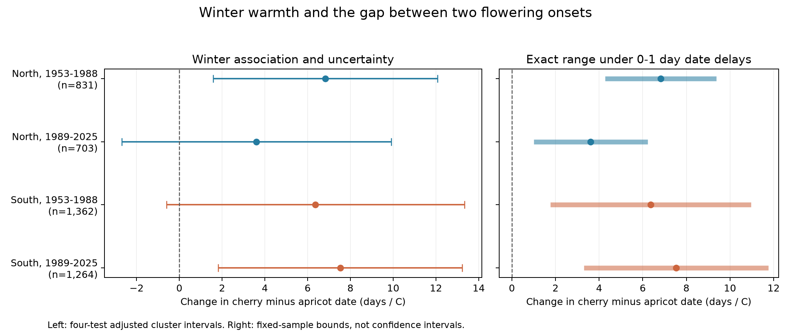

# A one day reporting delay limit kept winter slopes positive for Japanese apricot to cherry bloom gaps in four Japan samples, 1953-2025

We tested whether winter warmth was linked to the gap between Japanese apricot and cherry first flowers. We used 4,160 paired station-years at 66 Japanese stations in 1953-2025. Four separate North and South, early and late models held station, year and spring temperature fixed. January-February slopes were +6.83, +3.61, +6.37 and +7.52 days per C. Two adjusted sampling intervals excluded zero. All four intervals included zero when years were grouped into five-year blocks. Exact bounds kept all four fitted slopes positive if each date was reported at most one day late. A two-day limit allowed a nonpositive fitted slope in three samples; three days did so in all four. The data do not estimate actual reporting delay. These bounds concern fitted coefficients, not population confidence intervals. Missing visits, selected specimen trees, coarse weather, site changes and weather windows after some events limit interpretation. We do not establish a causal climate, pollution or pollinator effect. The package includes raw-source hashes, code, source records, weather extracts, exact endpoint assignments, a figure and independent numerical checks.

## Question and prior work

Japanese apricot (Prunus mume; ume) and cherry (mainly the cultivar Somei-yoshino) flower at different points in winter and spring. A change in one date need not give the same change in the other. Their date gap describes part of the sequence of flowering in a place. It does not measure overlap in nectar supply, flower life, pollination or a species interaction.

We ask whether January-February warmth has a repeated link to cherry date minus Japanese apricot date after March-April temperature is held fixed. We also test a possible observation explanation: could short, unequal reporting delays remove the positive fitted slope? This is an exploratory analysis. files/design.json records choices made before model fitting. It is not a registered protocol.

Earlier work already links winter and spring weather to both species. [Matsumoto (2025)](https://doi.org/10.11227/seikisho.61.55) describes regional changes in Japanese apricot flowering and temperature. [Nitta and colleagues (2025)](https://doi.org/10.14866/ajg.2025s.0_209) compare spatial date patterns with principal components and clusters. Their abstract reports ume results and leaves the cherry comparison to the meeting. [The 2023 cherry study](https://doi.org/10.1016/j.agrformet.2023.109571) distinguishes winter chilling from spring forcing along a latitude gradient. Our monthly date-gap model cannot identify these mechanisms. Our added results are four separate conditional gap slopes and exact reporting-delay bounds, not a claim to have first found a temperature response in these trees.

The campaign cherry-interval study, SCI sha256:c3e401776f715e16b8498500ab5f1cefbde18638eaee001bb4c5f4bc414dd65c, tests first flowers to full bloom within cherry. It has uncertain regional replication. We use a different outcome: first flowers in two species. The ginkgo study, SCI sha256:a760f4dbf8854d509208c7a8cf9893d7e3f64848ea08a03cee2804c1eaa6678d, gives the station-name and gridded-weather matching approach used here. We read both as verified published bundles. We read no private worker workspace. The source files were read anew. A targeted metadata screen of 626 published bundles found no apricot or plum match in titles, abstracts or keywords. This is not a systematic or full-text novelty search. files/literature.json records the search scope and verified subset search.

## Data and selection

The [JMA cumulative archive](https://www.data.jma.go.jp/sakura/data/download_ruinenchi.html), snapshot downloaded on 8 November 2026, supplies files 001.csv and 004.csv. Both current event definitions use the first day when a specimen tree has about five or six open flowers. JMA uses fixed specimen trees and common rules. This helps standardize observation but does not prove that daily detection is complete. The definitions are in [the ume method](https://www.data.jma.go.jp/sakura/data/ume2020.pdf) and [the cherry method](https://www.data.jma.go.jp/sakura/data/sakura2020.pdf).

We decode the tables as CP932. We keep regular-species codes 8 and 9. Substitute-species codes 6 and 7 are excluded. Code 8 denotes station grounds; code 9 denotes a nearby site. JMA notes that some nearby records before 1988 have code 8. We use seasonal years 1953-2025 and exclude incomplete 2026 and future columns. The [table guide](https://www.data.jma.go.jp/sakura/data/pdf/mikata.pdf) states that a winter or spring event before 1 January is placed in the next year's column. We therefore assign October-December date codes to the preceding calendar year. Forty-five retained ume dates are before 1 January. No retained cherry date is in that case. We keep negative interspecies gaps. Twenty-one pairs have cherry before ume. No gap cap or order filter is applied.

We match station names exactly, after removal of outside spaces, to unique names in the current JMA AMeDAS station table. We omit ambiguous and unmatched names. files/station_matches.csv records the audit. These current coordinates are approximate weather locations, not verified historical tree positions. We require at least 15 complete pairs per station in both 1953-1988 and 1989-2025. The same 66 stations occur in both periods. North is latitude at least 36 N (24 stations); South is below 36 N (42 stations). The four samples have separate station sets or year sets. Their weather is spatially related, and stations recur across periods. They are not fully independent experiments.

NOAA PSL, Boulder, Colorado, USA, supplied GHCN-CAMS monthly air temperature through [its data service](https://psl.noaa.gov/data/gridded/data.ghcncams.html). We use version 3.01, shared snapshot noaa-psl-ghcncams-air-mon-mean-20261105. The file spans January 1948 to October 2026. We select the nearest 0.5-degree cell to each matched station and change Kelvin to C. January and February monthly means have equal weight, as do March and April. The saved extract includes all months and prior December for checks. The primary windows do not depend on annual event dates.

Complete-pair coverage is 831/864 and 703/888 possible station-years in North, and 1,362/1,512 and 1,264/1,554 in South. A year with no valid pair can reflect no report, station activity, or a species code outside the rule. We do not assign an ecological absence to it. files/coverage.csv gives each phase combination. We do not model missing dates.

The exact stable shared paths are:

- /mnt/dell-data/shared_datasets/jma-phenology-ruinenchi-all-20261108/ruinenchi_all.zip
- /mnt/dell-data/shared_datasets/jma-amedas-station-table-20261108/amedastable.json
- /mnt/dell-data/shared_datasets/noaa-psl-ghcncams-air-mon-mean-20261105/air.mon.mean.nc

files/provenance.json records full source URLs, source metadata, resolved object paths and SHA-256 hashes. We verified only the files we used. No shared data were changed or downloaded for this study. The raw sources retain their source terms. The SCI baseline license covers our text, code, figures and derived evidence.

## Model and uncertainty

Each region and period has its own model:

`cherry day - apricot day = station effect + year effect + beta * Jan-Feb temperature + gamma * Mar-Apr temperature + error`.

The outcome uses actual days relative to 1 January of the seasonal year. A positive beta means a wider signed gap in warm winters. Station effects remove fixed differences in sites and trees. Year effects remove the annual component common to a region. The slope thus uses local departures from the regional annual weather pattern. It is not the response to a uniform national warming, and it is not a long-term trend estimate. We assume a linear conditional response within each sample. Every paired station-year has equal weight.

We remove station and year means by alternating projections. The covariance uses the largest winter-slope variance from station clustering, year clustering, or station plus year minus their intersection. Each cluster component has its G/(G-1) factor. We then apply (N-1)/(N-K), where K counts the fitted slope terms and absorbed effects. A t reference uses the smaller cluster count minus one degrees of freedom. The four primary intervals use 98.75% marginal coverage for nominal 95% family coverage by Bonferroni, if the cluster approximation is valid. Taking the largest of these variances does not guarantee valid coverage under all spatial or serial dependence. No main variance is negative.

A planned check groups years into five-year calendar blocks, while retaining annual effects in the mean model. It accounts for more temporal dependence across stations and has few time clusters. Further checks add station trends, use station-by-paired-code effects, restrict both records to code 8, change winter to prior December-February, separate March and April and control prior December, omit prior-December bloom records, or use consecutive-year differences followed by station and ending-year effects. Each check's four intervals use its own four-test adjustment. The checks are not independent replications and have no joint coverage across all models. We also omit each station in turn.

## Exact reporting-delay test

Assume a reported onset date equals its true date plus a delay between zero and D days. Allow a different delay for every species, station and year. The data do not estimate D or show that any particular cap is true. Let w be the partial slope weights for winter temperature after all controls. For a fixed sample and fixed controls, the true-date fitted slope lies exactly between:

`beta - D * sum(abs(w))` and `beta + D * sum(abs(w))`.

Both ends are attainable by assigning delays to cherry or ume according to the sign of each weight. files/delay_bounds.md gives the proof. files/delay_endpoints.csv supplies assignments for D=1. At integer D the extremal dates are on the integer calendar. The real-valued threshold is beta/sum(abs(w)). Its ceiling gives the smallest integer cap that allows a nonpositive slope. We do not claim that exact zero is attainable on the integer grid.

These are bounds on a fitted coefficient, not confidence intervals. They contain no sampling uncertainty. A common delay for both species within every pair cancels exactly, but the archive does not establish that condition. The test does not cover early reporting, wrong dates, changed trees, failed flowering or missing reports.

## Results

The table gives winter slopes in days per C. A positive value means a larger cherry-minus-ume date gap.

| Region | Years | Pairs | Stations | Days per C | Adjusted sampling interval | Exact range at D=1 | Real delay threshold | Smallest integer cap for a nonpositive slope |
| --- | --- | ---: | ---: | ---: | --- | --- | ---: | ---: |
| North | 1953-1988 | 831 | 24 | +6.83 | +1.58 to +12.08 | +4.39 to +9.27 | 2.80 days | 3 days |
| North | 1989-2025 | 703 | 24 | +3.61 | -2.69 to +9.91 | +1.11 to +6.11 | 1.44 days | 2 days |
| South | 1953-1988 | 1362 | 42 | +6.37 | -0.60 to +13.34 | +1.88 to +10.85 | 1.42 days | 2 days |
| South | 1989-2025 | 1264 | 42 | +7.52 | +1.81 to +13.23 | +3.40 to +11.64 | 1.83 days | 2 days |

All four point estimates are positive. Only early North and later South have primary adjusted sampling intervals above zero. All four intervals include zero with five-year time clusters. Thus the data do not establish a clear population association in all four samples. We did not test equivalence or a formal difference between period slopes.

The primary phase-date slopes help describe the gap. Ume slopes range from -8.40 to -3.91 days per C. Cherry slopes range from -1.57 to +0.84. The positive gap slopes mainly reflect a stronger earlier ume date in warm winters in this model. The phase-slope difference equals the gap slope to numerical precision. These secondary coefficients do not by themselves prove chilling or forcing mechanisms.

All planned alternative gap point estimates remain positive. Removing each station also keeps the signs: omission ranges are +5.72 to +8.01, +2.43 to +4.43, +5.39 to +7.67, and +6.81 to +8.10 days per C in table order. The northern information is concentrated: the largest station supplies about 31% and 41% of squared partial slope weight. The largest southern shares are about 8%. The conditional winter temperature standard deviations are only 0.16-0.26 C. Coefficients per C therefore scale relatively small local contrasts, and wide intervals are expected.

The one-day delay ranges are positive in all four samples. This only rules out reversal of these fitted signs under that particular cap. The two-day cap permits a nonpositive slope in later North and both South samples. The three-day cap permits it in all four. Visit histories are absent, so actual delay could exceed either cap. The delay exercise does not rescue uncertain sampling evidence.

The descriptive mean gap changes from 27.01 to 30.68 days in North and from 52.87 to 51.96 in South. These unbalanced sample means are not a test of a trend or a climate-change effect. A positive conditional winter slope does not imply a rising long-term gap.

## Interpretation and limits

This study finds a repeated positive fitted sign under a small reporting-delay scenario. It also shows how little unequal delay is needed to remove that sign. The sampling evidence is incomplete and is sensitive to temporal dependence. We therefore do not claim a confirmed widening under climate change.

Paired dates, fixed station sets, species-code restrictions, station effects and reporting-setting checks address some sources of observation bias. They do not remove changes in specimen identity, cultivar, tree age, tree condition, pruning, irrigation, observers, visit intervals, urban heat or exact observation locations. The archive contains monitored trees, not a random sample of wild communities. Complete-pair and long-record selection can change the weather and biological conditions represented.

The winter mean extends beyond ume onset in 26-41% of northern pairs and 86-93% of southern pairs. March-April extends beyond cherry onset in 95-100% of pairs. These are retrospective seasonal associations, not forecasts or strictly prior-exposure effects. Coarse monthly cells can differ from tree temperature and hide heat, frost, drought and chilling. Shared trends, seasonal weather correlations and unmeasured conditions can produce conditional patterns. We do not identify a causal response from this model.

Air pollution, species ranges, community diversity, flowering success and pollinators were not measured. This work addresses ecological timing within the broad campaign objective. A stronger follow-up would use historical specimen and visit records, daily local temperatures, explicit chilling and forcing models, and another observation network. That would test whether the same interspecies timing pattern survives a different measurement process.

## Verification and reproduction

files/REPRODUCE.md gives offline and raw-source instructions. The bundle preserves source rows, the monthly weather extract, selected pairs, code, design, all estimates, sensitivity results, extreme delay assignments, a proof and a figure. A second raw rebuild gave byte-identical panel, event-register, weather-extract, coverage and station-match files. A separate indicator-variable calculation reproduced all four primary slopes and all endpoint coefficients within 1.9e-10. General linear programs reproduced the delay endpoints within 4.0e-15. The independent source check matched 8,320 phase dates and codes to the shared raw ZIP. These are numerical checks, not independent ecological replications.

## Worker record

Campaign: 11_07_2026. Job: sci-1107-hp-climate-pollution-biodiversity-66b24faaa67a. Topic: climate-pollution-biodiversity. Machine: hp. Account: codex-myxtap. Model: gpt-6.1-sol with high reasoning effort, through the Codex harness in T3 Code. Analysis date: 2026-11-08 UTC. The campaign-machine signing key is not a personal authorship claim. The bundle is signed without a timestamp and stored locally. It is not submitted to a remote archive or index. No private key is included.
