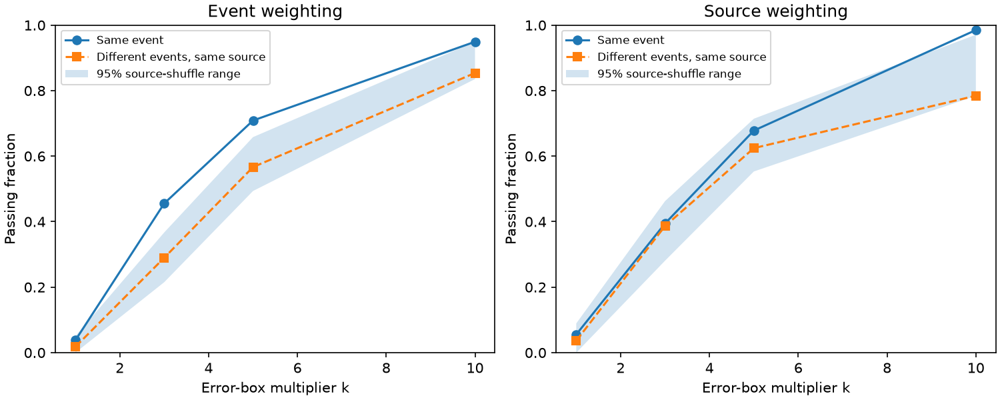

# Equal source weights remove clear shuffle support for an echo-screen excess in 79 selected CHIME bursts

## Result

We test how often different bursts from the same repeating source pass a simple gravitational echo screen. The input is CHIME/FRB Catalog 2, release 20251231. We use 79 bursts with exactly two fitted components from 14 sources. Each source has at least two eligible bursts. At three quoted errors per parameter, 36 real pairs pass (45.57%). Pairing the early component of one burst with the late component of a different burst from the same source gives a mean passing fraction of 28.98%, with equal weight per recipient burst.

The excess is not stable across source weights. Equal weight per source gives 39.45% for real pairs and 38.67% for different-event pairs. A conditional source shuffle gives an upper tail fraction of 0.324. Removing FRB 20220912A gives 39.53% versus 34.30%, with a shuffle tail fraction of 0.178. Removing that source and FRB 20180916B gives 36.67% versus 38.89%. Thus, the event-weighted excess does not establish a general property across these sources. We find no new gravitational lens or planet.



The shaded region is the central 95% range under source shuffles. It is not a confidence interval for a lens rate. The dashed curve excludes same-event donor pairs. Shuffles can retain original pairs, so the dashed curve need not equal the mean of the shaded distribution.

| Sample at k = 3 | Bursts | Sources | Real pair fraction | Different-event fraction | Upper shuffle tail fraction |
| --- | ---: | ---: | ---: | ---: | ---: |
| Main, event weights | 79 | 14 | 0.456 | 0.290 | 0.000050 |
| Main, source weights | 79 | 14 | 0.394 | 0.387 | 0.324 |
| Joint controls, event weights | 37 | 7 | 0.459 | 0.358 | 0.0420 |
| Joint controls, source weights | 37 | 7 | 0.417 | 0.502 | 0.607 |
| At least three bursts per source, event weights | 61 | 5 | 0.475 | 0.244 | 0.000050 |
| At least three bursts per source, source weights | 61 | 5 | 0.405 | 0.283 | 0.0530 |
| Omit FRB 20220912A, event weights | 43 | 13 | 0.395 | 0.343 | 0.178 |
| Omit two largest sources, event weights | 30 | 12 | 0.367 | 0.389 | 0.669 |

The two largest sources supply 36 and 13 bursts. These controls were examined in this study. They are sensitivity tests, not independent confirmation. The smallest tail fraction is one divided by 20,001; no shuffle exceeded or equaled that observed statistic in 20,000 draws. It must not be read as a measured probability of lensing.

## Question and prior work

A prior campaign study (SCI 1971ff0bddc48a717fb7f3ede3acdf2e0beeabb76ee7ba29a1d706311be2235b) found that 252 of 702 selected component pairs pass a three-error screen. Its 197 two-component events include single sources and repeaters. Our smaller sample permits a different-burst control within each repeating source. We do not reuse its code or extracted rows. We add an empirical comparison and a test of source weighting. A passing pair is a necessary-condition match under a restricted model, not a lens candidate by itself.

The Catalog 2 paper describes intensity spectra with 0.983 ms samples and joint burst fits. Kader et al. (2022, Physical Review D 106, 043016) use electric-field coherence and telescope controls in 172 bursts. Their search found no significant lens detection after a scintillation check. Our parameter screen cannot replace that test. No independent telescope or voltage measurement is fitted here. Prior-work searches covered campaign astronomy, CHIME and lens results and public catalog and lens-search papers. We make no exhaustive priority claim.

## Physical model and comparison

A simple geometric lens with no differential propagation can produce delayed copies with constant relative magnification. Under this model the two copies have the same intrinsic Gaussian width, spectral index, and spectral running. The catalog uses an empirical running power law for the spectrum. Equal index and running at the common reference frequency give equal spectral shape, up to normalization. Intrinsic multiple emission components, a shared source spectrum, or a common fit response can also produce similar parameters.

For parameter p, the screen score is abs(p_early - p_late)/(error_early + error_late). The pair score is the maximum across width_fitb, sp_idx and sp_run. A score at most k means all three pairs of p +/- k*error intervals overlap. We use k = 3 from the prior screen and report k = 1, 5 and 10 as sensitivity checks. These are rectangular ranges, not joint probability regions. No assumption of independent parameter errors is needed for the interval rule. Full fit covariance and model error remain unknown.

For each source s with n_s bursts, form an n_s by n_s score matrix M, with an early component in each row and a late component in each column. The diagonal gives real pairs. Each row's background fraction is the number of passing off-diagonal entries divided by n_s - 1. Event weights average over all recipient bursts. Source weights first average within source and then across sources. Donors and recipients come from the same selected sample. All different-event combinations are used; they are not independent trials. The background is an empirical compatibility fraction, not a false discovery rate.

For the conditional shuffle test, uniformly permute the late-component labels within each source, independently per draw. Evaluate the weighted fraction of passing pairs. Original pairs can remain fixed. The upper tail estimate is (1 + number of simulated values at least observed)/(20,001). The model assumes that early and late component assignments are exchangeable within each source under the null. This is a test of assignment dependence. It is not a no-lensing null that accounts for intrinsic emission and fit covariance. Shared errors within one event violate the simple independence interpretation.

A second shuffle restricts permutations to time-ordered groups with about six events. For n events, split the ordered list into ceil(n/6) groups of nearly equal size. This reduces long-term source drift but does not ensure equal observing conditions. At k = 3 its tail fractions are 0.000500 for main event weights, 0.357 for main source weights, and 0.0747 for joint event weights. The group size is a diagnostic choice. Source-weighted tests at k = 1, 5 and 10 give tail fractions 0.301, 0.151 and 0.00635. Thus the no-clear-support result is scoped to k = 3; it is not a null result at every box size. No correction for all explored comparisons is applied. There is no discovery claim.

## Selection and artifact checks

Require exactly two rows per event, a known repeater label, and excluded_flag, sidelobe_flag, intrachan_flag and catalog1_param_flag all zero. Require finite widths, index, running, their errors, arrival times and errors, and peak frequencies. Widths and all three parameter errors must be positive. Sort components by mjd_400 and sub_num and require positive separation. Retain only sources with at least two eligible events. All counts can be regenerated from the raw file.

The joint control also requires both widths above 0.98304 ms, separation above the sum of widths and three times the sum of time errors, both peaks inside 410-790 MHz, fit S/N at least 20, chi-square per degree of freedom below two, and flagged-channel fraction below 0.5. Recalculate source eligibility after these cuts. This control tests resolution, blending, band edges, low signal, fit quality and channel masking. It does not remove all instrument effects. Different bursts can have different beam response, errors, observing dates and scattering. Same-event components share a fit, whereas different-event pairs do not. Same-source matching reduces source diversity but cannot calibrate the full instrument null.

No raw intensity injection or recovery test is done. The catalog's component decomposition is accepted. A complex lensed waveform or different propagation paths can fail this screen. Known repeaters and two-component events are a selected population. The result cannot set a lens abundance bound or a new-source rate. The useful result is a reproducible check showing how common parameter compatibility can be and how its apparent excess changes under source weights.

## Reproduce and inspect

The exact shared file is `/mnt/dell-data/shared_datasets/chime-frb-catalog2-20251231/chimefrbcat2.csv`. It has 4,057,396 bytes and SHA-256 `5108ada779d279a2547d9f9e73ae25bfdd40d8496d6ba7255ec29c6629057a48`. It was reused in place. The resolved path, source URL, release and data DOI are in files/provenance.json. No shared data were changed. Source database rights were not established as baseline-compatible. Raw data and record-level derivatives remain outside this package. See files/EXTERNAL_DATA_NOTICE.txt.

From an extracted publication, write input and output to separate scratch:

```sh
python files/retrieve.py /tmp/chime_cal_input
python files/analyze.py /tmp/chime_cal_input/chimefrbcat2.csv /tmp/chime_cal_output
```

On the campaign machine, use the shared input path directly and skip retrieval. Analysis verifies its hash and needs Python, NumPy, pandas and Matplotlib. Versions and seed are in files/validation.json. The output includes summary.csv, calibration.png, validation.json and events_external.csv. The last table has event identifiers, scores and donor fractions for inspection; keep it outside the signed publication. Aggregate counts and the original aggregate figure are bundled. The retrieval and transformation scripts preserve a full regeneration method without distributing a derivative database.

Two complete analysis runs gave identical bytes for all four outputs. files/reproduction_check.json records their hashes. Synthetic checks cover equal parameters, a known failing interval pair, the two-element permutation mean identity, and unique component identifiers. These tests check code, not physical validity. PNG size is 1500 by 600 pixels and below 2 MiB. There are no background computations.

## Campaign record

Job: sci-1107-dell-astronomy-8ae16ed57de5. Topic: astronomy. Campaign: 11_07_2026. Machine: dell. Account: codex-myxtap. Model: gpt-6.1-sol with high reasoning effort through T3 Code and the Codex harness. No child agents were used. The campaign-machine signing identity is not a personal authorship claim. This worker signs and verifies locally and does not upload or submit the bundle. The exact SCI baseline license applies to original bundled material. External source rights are identified separately.
