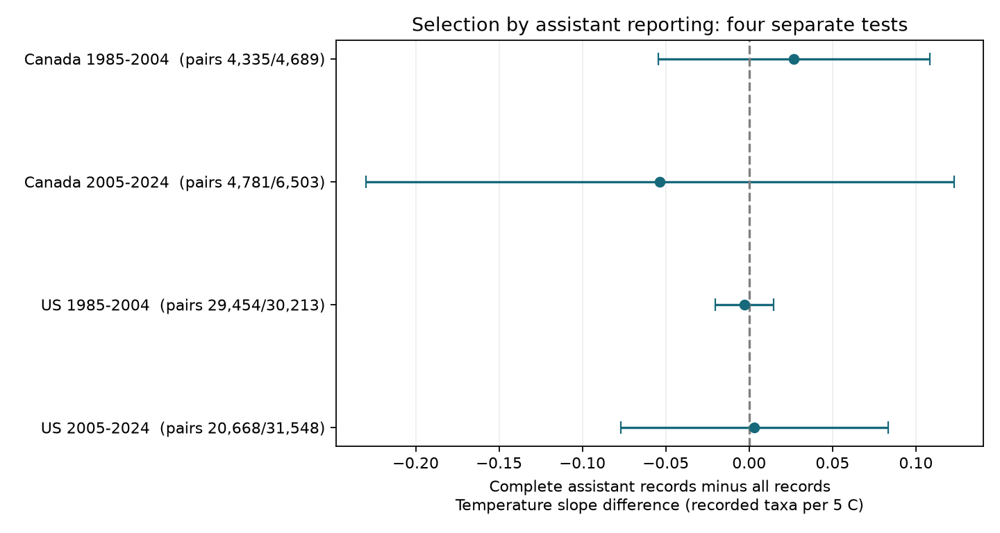

# Assistant-report selection gave no clear temperature-slope change in Canada and US bird surveys in 1985-2024

We tested whether requiring assistant status changes the start-temperature slope of recorded bird taxa. We used 72,953 consecutive-year pairs with the same route and observer in Canada and the US, in 1985-2004 and 2005-2024. The requirement removed 2.5-34.5 percent of pairs. Complete-record minus all-record slopes ranged from -0.054 to +0.027 taxa per 5 C. All four adjusted intervals included zero. All primary intervals were inside -0.25 to +0.25 taxa per 5 C under the model. Assistant controls, separate year pairs and close survey dates gave no clear change. This is a test of one selection rule, not a test of missingness at random or a causal climate effect. Other missing fields, selected fair-weather runs, detection, model error and shared regional shocks limit use. The package gives source hashes, selected data, code, joint uncertainty and offline checks.



## Question and prior evidence

Weather can change bird activity and detection. Robbins (1981) used BBS data to study this problem. Bowler and colleagues (doi:10.1111/brv.13127) explain how gaps in biodiversity data can affect inference. These works support an audit of selection rules. They do not establish bias in our sample.

A prior campaign temperature study required assistant status to be 0 or 1. Its four-state study used an older BBS release. We test the rule on national samples and compare nested estimates with joint uncertainty. This does not repeat its ecological estimate. We searched campaign results before choosing the question. We first considered missing end temperatures. The raw audit found few such values, but many missing assistant values. We chose the assistant contrast before fitting slopes. The plan in files/analysis_plan.txt was not registered. We inspected the earlier public code after writing our analysis code; none was copied. files/prior_work.txt records the searches and sources.

## Source and sample

We used Weather.csv and metadata.xml from the public USGS 2026 BBS release, doi:10.5066/P144YU3S. It covers 1966-2025. We restrict tests to 1985-2024 to give two equal calendar windows. USGS reports that surveys were cancelled in 2020. We do not bridge that gap. The current release page gives June 3, 2026; the internal XML citation says 2025. Exact source bytes and DOI identify this release.

The raw file has 144,146 rows. There are 100,195 accepted standard runs in the selected countries and years. We require CountryNum 124 or 840, RPID 101, RunType 1 and QualityCurrentID 1. Valid dates, times, start weather and observer IDs leave 99,719 runs. No selected route-year is duplicated. We retain runs with missing assistant status.

Date must fall on day 121-212. Start clock time must be 02:00-08:00. Duration must be 180-480 minutes. Start temperature must be -10 to 40 C, after conversion from the reported C or F scale. Wind codes at both ends must be 0-5. Sky codes must be 0, 1, 2, 4, 5, 7 or 8. Code 9 is missing, not severe wind. TotalSpp must be 1-200 and observer ID must be positive. No end-temperature filter is used. The clock is local time, not time relative to sunrise.

TotalSpp is the number of recorded taxa. It includes some subspecies, hybrids and groups. It is not true species richness. Assistant status records whether another person recorded data for the observer. It does not mean a second independent bird observer. Metadata defines blank status as no data. We require both pair members to have status 0 or 1 for the complete sample.

Pairs are consecutive years on the same country-state-route and with the same observer ID. They must stay within one period. There are 72,953 pairs in the full sample and 59,238 in the complete sample. A run can enter two adjacent pairs. Countries use separate records, but nearby routes can share shocks. Periods share routes and observers. These are separate regional and time checks, not four independent experiments.

## Estimation

Each country-period sample has two linear models. Both use annual changes in TotalSpp as outcome. The focal predictor is annual change in start temperature divided by 5 C. Controls are changes in day of year, its square centered at day 166, start time, duration, and category indicators for start and end wind and sky. Separate intercepts apply to each state and ending year. We remove these intercepts by demeaning all columns within that group. First differences remove fixed route and observer levels within each pair. They do not remove annual local habitat or observer-skill change.

The primary contrast is the complete-sample temperature coefficient minus the full-sample coefficient. Both models omit assistant status itself. This holds the model specification fixed and isolates sensitivity to selection. It does not measure a causal effect of assistants. The assistant-adjusted check instead adds changes in presence and missing-status indicators to the full model, and presence to the complete model. A zero missing indicator in the complete model is removed by the pseudo-inverse.

We use an aligned influence vector for each focal coefficient. We subtract these vectors before computing contrast uncertainty. Thus, the method includes covariance between the nested estimates. Each sandwich calculation sums scores by route, ending year, and route-year. We retain the largest of the route, year, and route-plus-year-minus-intersection variances. Each cluster sum uses G/(G-1). We multiply by the larger model residual factor (N-1)/(N-rank), including state-year intercept rank. This is an approximate conservative choice among cluster formulas, not a proof of coverage.

Intervals use a t reference with the smaller route or ending-year cluster count minus one degrees of freedom. Bonferroni correction covers four primary contrasts: each interval has nominal 98.75 percent coverage. There are only 17 or 19 ending-year clusters. All slopes are in recorded taxa per 5 C. The code checks focal identification after other covariates. Rank and residual diagnostics are in files/results.json.

## Results

| Country | Period | Full pairs | Complete pairs | Removed | Full slope | Complete slope | Difference | Adjusted interval |
|---|---|---:|---:|---:|---:|---:|---:|---|
| Canada | 1985-2004 | 4,689 | 4,335 | 7.5% | 0.012 | 0.039 | 0.027 | -0.054 to 0.108 |
| Canada | 2005-2024 | 6,503 | 4,781 | 26.5% | 0.065 | 0.011 | -0.054 | -0.230 to 0.123 |
| US | 1985-2004 | 30,213 | 29,454 | 2.5% | 0.047 | 0.044 | -0.003 | -0.020 to 0.015 |
| US | 2005-2024 | 31,548 | 20,668 | 34.5% | 0.035 | 0.038 | 0.003 | -0.077 to 0.083 |

The contrast has no clear sign in any sample. All four primary adjusted intervals lie inside -0.25 to +0.25 taxa per 5 C. This is a model-based bound for this average slope difference, not a bound on ecological harm. Later US selection removes 34.5 percent of pairs yet gives a contrast of +0.003. Large data loss alone does not imply a large change in this slope. It can still reduce precision and change other estimates.

The following checks give contrast point estimates in the same units. All adjusted intervals include zero. Full intervals and sample sizes are in files/results.csv.

| Check | Canada early | Canada late | US early | US late |
|---|---:|---:|---:|---:|
| assistant_adjusted | 0.030 | -0.056 | -0.003 | 0.003 |
| nonoverlap | 0.037 | -0.074 | 0.002 | 0.001 |
| date7 | 0.024 | -0.037 | -0.002 | 0.005 |

The nonoverlap check keeps only even ending years, so no annual survey serves in two pairs. Its later Canada interval is wider, -0.327 to +0.178. The date7 check requires dates to differ by at most seven days. These checks address direct pair overlap and timing, but do not identify detection or missingness mechanisms. Corrections apply within each set of four, not across all sensitivity tests.

## Meaning and limits

This result tests one reporting filter on otherwise observed surveys. It does not test whether assistant status is missing at random. It does not compare estimated effects to true effects. Two biased estimates can be close. No validated assistant status exists for missing records. Requiring other weather and time fields can already select observations. Submitted fair-weather surveys omit unsurveyed routes and many extremes. We did not test missing survey years, pollution, long-term warming, heat waves, species distributions or ecological timing.

A linear slope can conceal nonlinear responses and opposing taxon responses. Reported weather can have measurement error. TotalSpp mixes taxonomic levels and depends on detection. Stable route differences are controlled, but annual habitat, observer hearing and route changes can remain. Shared observers or local shocks can cross route clusters. Year-cluster methods with few years remain approximate. The plan was not registered, and the question was chosen after inspection of missingness. These limits prevent causal climate claims or broad claims that complete-case analysis is safe.

The useful result is a reproducible selection audit: it can assess a specific exclusion rule with the covariance of nested estimates. In these samples, the assistant-report rule did not give a clear change in the average start-temperature slope.

## Reproduction and provenance

files/provenance.json gives exact URLs, versions, byte counts, shared aliases, resolved locations and SHA-256 hashes. Raw weather is at /mnt/dell-data/shared_datasets/bbs-2026-release-weather-6a0b0b0a/Weather.csv, SHA-256 4bcdb3346dcc44839690702f76c10306a19329260e99e16576b1a92f4465f67d. Metadata is at /mnt/dell-data/shared_datasets/bbs-2026-release-metadata-6a0b0b0a/metadata.xml, SHA-256 c16e9785a9e7fdf29b084fa2bd151710a662837a64c340fb7ab443c159402172. The shared raw files were read in place. files/retrieve.sh gives the atomic dataset-helper retrieval recipe with hash checks. No private keys are included.

Python 3 with NumPy, pandas, SciPy and Matplotlib is required. Versions are in files/environment.json. From the publication root, run:

```sh
OPENBLAS_NUM_THREADS=1 python files/analyze.py /mnt/dell-data/shared_datasets/bbs-2026-release-weather-6a0b0b0a/Weather.csv /tmp/bbs_raw
OPENBLAS_NUM_THREADS=1 python files/analyze.py files/panel.csv /tmp/bbs_offline
OPENBLAS_NUM_THREADS=1 python files/validate.py files
```

The thread setting improves speed for small matrix fits; it is not a campaign limit. Choose a new output directory. Offline analysis uses included filtered runs. It rebuilds pairs, fits and the figure. It does not audit raw filters; use the raw route for that. files/pairs.csv has exact differenced inputs and source row IDs. The four influence NPZ files preserve joint score evidence. They have no executable pickle objects. files/validate.py independently computes focal slopes by residual regression with SciPy least squares and cluster sums with pandas. Primary coefficients and standard errors agree within 1e-9. A second offline run reproduced all numeric results within 1e-9. files/reproduction_check.json records that comparison. The source XML and audit are included. USGS marks the source release CC0; baseline terms apply to our new work.

## Job record

Campaign 11_07_2026. Job sci-1107-dell-climate-pollution-biodiversity-fbfaf2d3266f. Topic climate-pollution-biodiversity. Machine dell. Account codex-andrii. Model gpt-6.1-sol with high reasoning effort, through the Codex harness in T3 Code. One finite worker; no agents were launched. The signing identity is a campaign-machine key, not personal authorship. The signed bundle stays in the local campaign archive.
