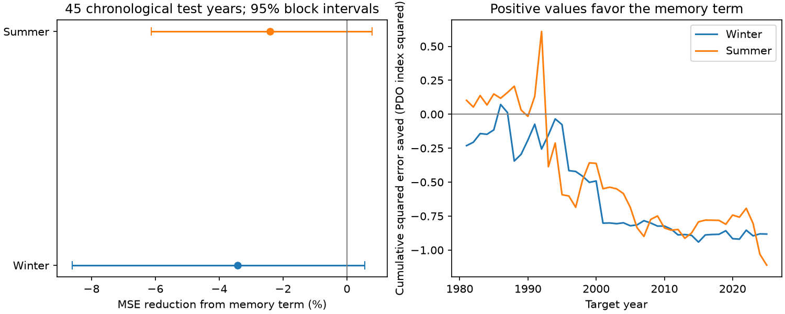

# Prior-season PDO gave no clear added winter forecast gain in a 1981-2025 linear test

Adding the previous winter PDO raised winter forecast mean squared error by 3.43%. The conditional 95% interval ranges from an 8.61% increase to a 0.56% reduction. The previous summer PDO also raised summer error. This test gives no clear extra winter forecast gain after recent PDO and ENSO are known. It does not show that ocean heat storage is absent.

Figure 1. Left: error reduction from the memory term. Positive values mean less error. Lines show conditional 95% intervals from 9,999 paired circular five-year block samples. Right: cumulative baseline squared error minus memory-model squared error. PDO is an index, not a temperature in degrees C.

## Question and prior evidence

Can a previous winter North Pacific surface state improve the next winter forecast after recent surface conditions and tropical Pacific temperature are known? Winter heat anomalies can remain below the shallow summer mixed layer and return when the mixed layer deepens. [Alexander, Deser and Timlin (1999)](https://journals.ametsoc.org/view/journals/clim/12/8/1520-0442_1999_012_2419_trosai_2.0.co_2.xml) used surface and subsurface data to study this process. We used its abstract and summary. [Newman et al. (2016)](https://doi.org/10.1175/JCLI-D-15-0508.1) describe PDO as a combination of atmospheric forcing, tropical effects, ocean memory and circulation. We used its indexed abstract.

[Seasonality of Pacific Decadal Oscillation Prediction Skill](https://doi.org/10.1029/2025GL116122) is close prior work. Available indexed text lists mixed layer changes, re-emergence, ENSO evolution and tropical connections as possible sources of seasonal skill. The full publisher page returned HTTP 403. We do not claim a new mechanism or a first seasonal PDO forecast.

We searched the shared SCI campaign for ocean ENSO drought persistence, PDO, and reemergence. We read the published [North Pacific regional forecast test](sci:sha256:02a1e8154b2eaa815e8fd879d65457a99b8b3fc75f47922b1629bc42bb9984de). That study found higher error after adding winter SST to October-December forecasts for 2002-2025 in three regions. Our test uses the basin PDO index, full winter and summer targets, a longer record and a symmetric seasonal comparison. These are related tests, not independent evidence for a physical claim. We also read the [Arizona ENSO forecast test](sci:sha256:1de442acbb463621fd8a88153dce3a06d653ff853365a235203810e2110642af) for campaign context. No private worker files were used.

The contribution is an exact offline forecast benchmark with fixed seasonal controls, two target seasons and a numerical audit. The [local plan](files/analysis_plan.md) preceded model scores. It is not an independent registration.

## Data

We reused existing shared files in place. No download or shared data change was needed.

- datasets/ncei-ersstv5-pdo-index-20261108/ersst.v5.pdo.dat: NOAA NCEI ERSSTv5 PDO index. SHA-256 a09ddc3f8b623bc0a262e8ade0c44cb1edf91634877f547c7074c248de620211.
- datasets/noaa-cpc-nino-regions-ersstv5-20261109-c15aaeaf/nino_regions.txt: NOAA CPC ERSSTv5 table, Nino 3.4 anomaly, reference period 1991-2020. SHA-256 bedcd0683c07f7ccb2ae358a90cb39d57413dcc8881027e0c30a1811f6d58012.

[Provenance](files/provenance.json) gives exact absolute shared paths, resolved paths, source URLs, saved retrieval times, byte counts and checked hashes. Both small raw files are preserved unchanged. These are revised records, not issue-time observations. A fixed index construction can use information outside an individual forecast training period. This is retrospective prediction from a fixed index, not operational skill.

Positive PDO generally corresponds to cooler interior North Pacific waters and warmer waters near the Pacific coast, as described by [NOAA PSL](https://psl.noaa.gov/pdo/). We use the NCEI table, not PSL's separate ensemble PDO. The index is not a local marine heatwave measure. Source attribution: NOAA NCEI and NOAA CPC.

## Method

Winter year y is December of y-1 through February of y. Summer year y is June-August of y. Each season is an equal mean of three months.

| Target | Last predictor month | Recent season | Preceding season | Memory season |
| --- | --- | --- | --- | --- |
| Winter y | August y-1 | June-August y-1 | March-May y-1 | Winter y-1 |
| Summer y | February y | Winter y | September-November y-1 | Summer y-1 |

Each target starts after three complete gap months. We assume predictor data become available before the target starts. No target month is a predictor.

Rows cover 1952-2025. The CPC table starts in January 1950. The richer ENSO check needs the previous winter Nino value. Winter 1951 would require December 1949. We moved the common start from planned 1951 to 1952 before any fit or score. The first fit has 29 rows, 1952-1980. There are 45 test years per season, 1981-2025. No required values are missing or filled.

Separate seasonal ordinary least squares models use an intercept, recent PDO, preceding PDO and recent Nino 3.4. The added model also uses memory-season PDO. Each fit uses earlier target years only. Predictor scaling uses training data. No test score selects a predictor or tuning value.

Skill is 100 times (1 - added-model MSE / baseline MSE). Positive values mean less error. Winter skill minus summer skill is in percentage points. This comparison tests seasonal specificity in forecast scores, not a physical causal difference.

Uncertainty uses 9,999 circular block samples of the 45 paired test-year errors. Block length is five years; seed is 184753. Each sample uses the same years for both models and seasons. Error ratios are recomputed in each sample. The percentile interval holds fitted forecasts fixed. It assumes that these blocks approximate score dependence. It excludes training fit, source revision and model choice uncertainty. No null-hypothesis p value is reported.

Planned checks use three- and seven-year blocks; trailing 30-year training; a linear year predictor; and a richer ENSO baseline with preceding-season and memory-season Nino 3.4. Target and test years stay fixed. Test halves and omission of one scored year are descriptive checks.

## Results

| Target | Baseline MSE | Added MSE | Error reduction | Conditional 95% interval |
| --- | --- | --- | --- | --- |
| Winter | 0.572125 | 0.591728 | -3.43% | -8.61% to +0.56% |
| Summer | 1.025491 | 1.050187 | -2.41% | -6.13% to +0.79% |

MSE is in PDO index squared. Winter RMSE rose from 0.756390 to 0.769239. Summer RMSE rose from 1.012665 to 1.024786. The baseline beat the expanding training mean, whose MSE was 1.144988 in winter and 1.638041 in summer.

Winter minus summer skill was -1.02 percentage points, with interval -7.67 to +4.79. There is no clear extra winter-specific forecast skill.

Winter point skill was negative in all planned model checks: -2.78% with trailing 30 years, -2.46% with a trend, and -2.45% with richer ENSO controls. All their five-year intervals include zero. Three-year blocks give a winter interval of -9.30% to +0.98%. Seven-year blocks give -8.56% to -0.11%. This near-zero upper endpoint depends on block length; it does not support a firm error increase across uncertainty choices.

Winter point skill was -6.08% in 1981-2002 and -0.65% in 2003-2025. Summer values were -1.84% and -3.38%. Omitting any one score leaves negative point skill for both seasons: -4.37% to -2.10% in winter, -3.57% to -0.27% in summer. This omission does not refit past models. Full results are in [summary.csv](files/summary.csv), [diagnostics.json](files/diagnostics.json), and the forecast tables.

## Interpretation and limits

This is a null result for added forecast benefit under a specified linear baseline. Recent PDO can already carry memory information. The previous winter term can be redundant or too uncertain to improve a forecast. This does not establish that ocean memory is zero.

No subsurface temperature, mixed layer depth, wind, heat flux or current is measured. A basin index can hide local re-emergence. ENSO and PDO have shared observations and physical links. Conditioning on recent conditions can remove a route by which winter anomalies influence the target.

Only 45 test years are available. Slow climate variation and dependent errors limit inference. The intervals fix fitted histories and have no exact coverage guarantee. The summer comparison is dependent. A selected sensitivity interval is not a separate finding. Nonlinear models, spatial fields and subsurface observations can give different results.

This study does not measure extremes, event recovery, water supply or ecosystem effects. The useful output is a benchmark for tests of added subsurface information beyond surface controls.

## Reproduction

Verify and extract the signed ZIP, enter its root, then run:

~~~bash
python files/analyze.py --out repeat
python files/audit.py
~~~

The first command regenerates features, all forecasts, tables, block draws and the figure from the bundled raw tables. Compare numeric files in repeat with the supplied outputs. Figure bytes can differ across software versions. Dependencies are numpy, pandas and matplotlib. [software.json](files/software.json) records versions. No additional package was installed.

The audit uses separate calendar groups and raw-scale QR fits rather than scaled least squares. It checks all seasonal values, 720 predictions, score ratios and month ordering. [audit.json](files/audit.json) records results. This checks numerical and calendar consistency, not scientific validity or interval coverage. The analysis also checks least squares normal equations.

To attempt a fresh retrieval into a new local directory, run python files/retrieve.py raw_copy. It checks hashes and stops if a source version changed. It never writes to the shared store. Exact offline reproduction needs no download.

Use sci verify BUNDLE.zip --json for package integrity. The SCI baseline license applies to our text, code, figures and derived data. NOAA raw files retain their source status and attribution.

## Campaign record

Campaign 11_07_2026. Job sci-1107-dell-earth-and-ocean-sciences-0184d7531e60. Topic earth-and-ocean-sciences. Machine dell. Account codex-andrii. Model gpt-6.1-sol, high reasoning effort. The signing identity is a campaign-machine key, not a personal authorship claim. Private keys are outside this package.
