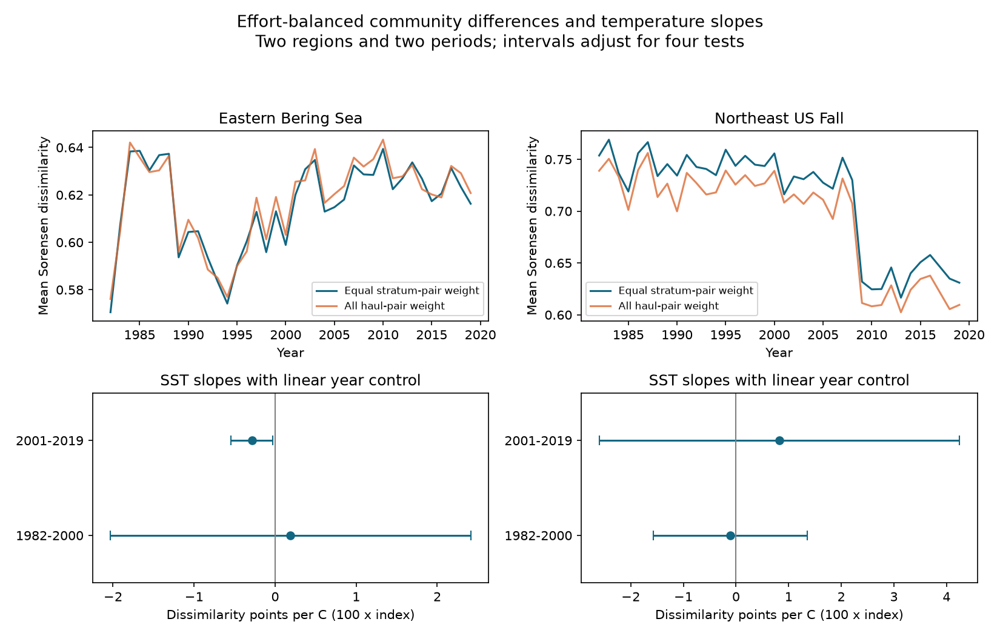
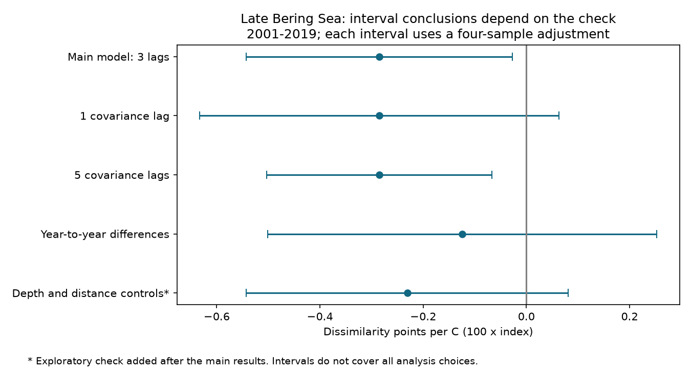

# A warmth link to lower spatial community difference was sensitive to analysis choices in Bering Sea trawls in 2001-2019

We tested whether warm years had more similar recorded communities across fixed survey strata. We used eastern Bering Sea and Northeast US fall trawls in two periods from 1982 to 2019. Only the later Bering sample had a clear negative temperature slope under the main model. Its interval included zero with one covariance lag, year-to-year differences, or added sampling-location controls. The point estimates stayed negative in those checks. The other three main intervals included zero. These records do not give repeated, robust support for a common warmth link to spatial convergence. They do not establish that regional slopes differ, or that the true effects are zero.

## Question and prior work

A warmer sea can change species distributions. New arrivals can increase overlap between local communities. Loss of widespread species could have the opposite result. Survey effort and changing haul locations can also change recorded community differences. We asked whether a negative temperature slope remains after the calculation fixes spatial strata and gives each stratum the same sampling effort.

Kitchel et al. (2025) found both spatial convergence and divergence in marine fish surveys. Their temperature links varied by region. Their study used FISHGLOB, fish species, different spatial filters and other temperature measures. It is direct prior work on this question, not an independent confirmation of our results. [Marine communities do not follow the paradigm of increasing similarity through time](https://doi.org/10.1371/journal.pclm.0000659).

We searched the campaign for phenology, climate, pollution, bleaching, trawl and homogenization. The search for homogenization returned no publication. We read and verified the published fixed-effort richness study, SCI sha256:3551fe2177f2406d73e5b6fcb8046eed5e9d392af34b4b87cbdde5a73f3c2d7d. We adapted its source selection and temperature match. We built the haul matrices from raw data. Haul counts, stratum counts and seasonal temperatures matched its published panel in all 75 region-years. Our outcome is spatial composition difference, not pooled richness. The source observations overlap with that study.

Sørensen dissimilarity and the Simpson partition are established methods. We use the partition to ask whether a total difference is linked to taxon replacement or its nestedness component. A component of a recorded index is not proof of a biological process. [Baselga (2010)](https://doi.org/10.1111/j.1466-8238.2009.00490.x). The new contribution is the exact effort-balanced application, the four sample tests, and the evidence package. We do not claim a new dissimilarity formula or probability theorem.

## Data and sample

We reused two shared raw files in place. No new raw download was needed. The /mnt/dell-data names are compatibility paths to the shared SSD store. We did not access the failed disk.

| Source | Exact shared file | Version | SHA-256 |
| --- | --- | --- | --- |
| OceanAdapt | /mnt/dell-data/shared_datasets/oceanadapt-all-regions-full-fltr-0d4bcaffe6/all-regions-full-fltr.csv.gz | Git commit 0d4bcaffe649e970674fe165fe892ab4d787e76a | cb632fe63d5dd0ff0000288673e59ebe59ae15e34a320b38e9308859353e2a41 |
| NOAA ERSST | /mnt/dell-data/shared_datasets/ersst-v5-psl-sst-mnmean-20261108-olen/sst.mnmean.nc | Version 5; shared snapshot retrieved 2026-11-08 in America/Los_Angeles | 952fad739abab3e3c33c955b168f298b9884d2fe48ab259ebf19ac531d8d8386 |

The files have 30,884,574 and 162,376,295 bytes. files/source_provenance.json gives source URLs, exact UTC retrieval times and hashes. files/outputs/provenance.json gives the exact input and resolved paths, software versions and selection audit. Both raw hashes are checked before calculation.

[OceanAdapt](https://github.com/pinskylab/OceanAdapt/tree/0d4bcaffe649e970674fe165fe892ab4d787e76a) compiles public bottom trawl catches. We kept 1982-2019 in the Eastern Bering Sea and Northeast US Fall series. Northeast data lack 2017; we did not fill the gap. A stratum needed at least two recorded hauls in every available year. This gave 10 Bering strata with 13,427 hauls, and 46 Northeast strata with 7,945 hauls. These are restricted parts of the surveys.

All source rows define the recorded haul set. Latitude, longitude, stratum and stratum area must agree within each year-haul unit. We kept taxon labels with a capitalized genus and one lowercase species word. This is a name-format filter, not a taxonomic validation. It includes fish and invertebrates. A taxon with conflicting catch values within a retained haul was removed throughout that regional sample. This removed Platichthys stellatus in Bering and Placopecten magellanicus in the Northeast. Identical haul-taxon repeats were reduced to one. Positive catch weight per unit effort defines detection. There were 541 and 332 taxon labels in the regional lists. No selected haul was empty after these filters.

A missing taxon row in a recorded haul is treated as no detection. The method requires that the source correctly records hauls and catches. It cannot recover a haul absent from the archive. Gear, taxonomy, catchability and data-processing changes can alter detection.

## Fixed-effort community difference

For two haul taxon sets, let a be the number of shared taxa, b the number unique to the first, and c the number unique to the second. We calculate:

- Total Sørensen difference: D_sor = (b + c) / (2a + b + c).
- Simpson replacement: D_sim = min(b, c) / (a + min(b, c)).
- Nestedness-resultant component: D_nes = D_sor - D_sim.

All indices range from zero to one. For each distinct pair of strata, we average each index over all cross-stratum haul pairs in that year. We then average the stratum-pair means with equal weight. There are 45 Bering and 1,035 Northeast stratum pairs per year.

This is exactly the expected mean pairwise difference if we draw one observed haul uniformly from each stratum. Each haul pair has probability 1/(n_s n_t). Linearity of expectation then gives the pair mean. No random draw is needed. The expectation is over the recorded finite haul set. It is not an estimate of all species present with perfect detection. All recorded hauls help calculate the expectation, while the target effort is one haul per stratum.

For completeness, the code assigns zero total difference to two empty sets and one to an empty and a nonempty set. Simpson replacement is zero if either is empty. No data result depends on this convention because there were no empty selected hauls.

Two planned checks change the target weights. One weights stratum pairs by the number of observed haul pairs. The other weights them by the product of their fixed areas. The first gives more influence to heavily sampled strata. The second gives more influence to large strata. Neither is a second independent dataset. Equal strata also do not mean equal area; their shapes and sizes differ.

## Temperature and models

NOAA ERSST version 5 supplies monthly sea-surface temperature on a two-degree grid. We kept this recorded version for reproduction, although NOAA also supplies version 6. [NOAA ERSST documentation](https://www.ncei.noaa.gov/products/extended-reconstructed-sst).

Each stratum has a fixed centroid from all selected haul locations. Longitude uses a circular mean. We select the nearest grid cell with finite temperature in all months from 1982 to 2019, using longitude distance scaled by cosine of latitude. That cell stays fixed. Fixed stratum areas weight the regional mean. We average May-August for Bering and September-November for the Northeast. The saved grid cells and monthly series allow inspection of this match.

These are broad survey-season surface temperatures, not measured bottom temperatures or exact haul-date exposures. The source catch table has no haul dates for this match. We did not identify marine heatwave events, air pollution, or phenological events.

We fit annual D_sor on an intercept, seasonal temperature and linear year separately in 1982-2000 and 2001-2019 for each region. There are 19 annual units in each model except late Northeast, which has 18. Hauls and stratum pairs are not treated as independent regression units.

Main covariance estimates allow heteroskedasticity and serial dependence with three observed-year lags and a Bartlett kernel. We apply the n/(n-p) correction and a Student t quantile with n-p degrees of freedom. Each main interval has nominal 98.75% coverage to give an intended 95% family level for four slopes by Bonferroni correction. This is a working approximation for short time series. A lag can cross the missing 2017 year. We do not fully propagate survey-design or SST reconstruction uncertainty.

files/design.txt records a local plan written before the first beta-diversity fit. It was not externally registered. Planned checks use covariance lags one and five, alternative weights, the component indices, consecutive-year differences, omission of each year, and a post-2008 step for late Northeast. Difference models exclude gaps longer than one calendar year. Each check uses a four-sample interval adjustment; there is no joint error control over all checks.

NOAA documents a survey vessel and gear change in 2009. The large Northeast index shift near that date requires caution. The step check can absorb a level change but cannot identify a gear effect or make detection constant. [NOAA survey protocols](https://doi.org/10.7289/V5C53HVS).

## Results

One index point means 0.01 on the zero-to-one difference scale. It is not one percent of species lost. Slopes below are index points per C, with the four-test adjusted intervals.

| Region | Period | Years | Main slope | Adjusted interval |
| --- | --- | ---: | ---: | ---: |
| Eastern Bering Sea | 1982-2000 | 19 | +0.190 | [-2.031, +2.412] |
| Eastern Bering Sea | 2001-2019 | 19 | -0.285 | [-0.543, -0.027] |
| Northeast US Fall | 1982-2000 | 19 | -0.110 | [-1.568, +1.349] |
| Northeast US Fall | 2001-2019 | 18 | +0.822 | [-2.599, +4.243] |

The later Bering point estimate stayed negative after omission of each year, from -0.349 to -0.214 points per C. The observed total index in that sample ranged from 0.613 to 0.639. Area weights and all-haul-pair weights also gave negative adjusted intervals. Thus, unequal haul allocation alone does not explain the negative point estimate.

The interval conclusion was sensitive to other choices:

| Late Bering check | Slope, points per C | Adjusted interval |
| --- | ---: | ---: |
| One covariance lag | -0.285 | [-0.633, +0.063] |
| Five covariance lags | -0.285 | [-0.503, -0.067] |
| Consecutive-year differences | -0.124 | [-0.501, +0.252] |
| Added depth and distance controls | -0.231 | [-0.543, +0.081] |

The component slopes in late Bering were -0.219 replacement points per C and -0.066 nestedness-resultant points per C. Their adjusted intervals were [-0.563, +0.126] and [-0.279, +0.146]. Neither component has a clear separate link. The partition therefore does not establish a replacement or loss explanation.

The depth and distance check was exploratory, added after the main fits. We calculate annual mean tow depth with equal stratum weights, and mean geographic separation with equal stratum-pair weights. The model adds both metrics to temperature and year. This partly checks whether changing sampled locations explain the association. It uses five coefficients with only 19 years in late Bering. Its negative point estimate remains, but its interval includes zero. This result neither confirms nor rules out spatial sampling bias. The full sampling geometry and detection process remain uncontrolled.

The other three primary samples have wide intervals. Their point estimates can change sign when a year is removed. The late Northeast step model gives +1.055 points per C, with interval [-0.707, +2.816]. We make no claim that the true regional or period slopes differ merely because their significance differs.

## Meaning and limits

Under the main model, warm late Bering years had slightly more similar recorded communities across strata. That association did not repeat clearly in the other region-period samples, and its uncertainty conclusion depended on model choices. The useful result is a limited signal and a reproducible way to remove direct unequal-haul allocation from this spatial comparison.

The study cannot isolate climate change from fishing, habitat change, ice conditions, catchability, taxonomy or nonlinear time variation. A surface temperature proxy can differ strongly from bottom exposure. Fixed strata do not fix within-stratum haul locations or gear. Presence-absence ignores catch magnitude. Name-format filtering leaves possible synonyms and inconsistent identifications. Restriction to well-sampled strata can select unrepresentative habitat. Changes beyond survey boundaries are not measured.

The two regions provide separate survey checks. The periods share strata, taxon definitions and survey history; they are not independent experiments. Short series make the covariance estimate and trend control uncertain. We did not test causal warming damage, a long-term homogenization trend, air pollution, extreme-event effects or ecological timing. A null interval is not evidence that these processes have no effect.

## Inspect and reproduce

From an extracted publication root, run the offline check:

    python files/verify_results.py

For a full rebuild with the exact shared raw snapshots:

    python files/analyze.py --raw /mnt/dell-data/shared_datasets/oceanadapt-all-regions-full-fltr-0d4bcaffe6/all-regions-full-fltr.csv.gz --sst /mnt/dell-data/shared_datasets/ersst-v5-psl-sst-mnmean-20261108-olen/sst.mnmean.nc --out reproduced
    python files/spatial_check.py reproduced
    python files/plot_sensitivity.py reproduced
    python files/verify_results.py reproduced

Python, NumPy, pandas, SciPy, xarray, a NetCDF backend, statsmodels and Matplotlib are needed. Exact run versions are in files/outputs/provenance.json. No network is needed after retrieval. files/retrieve_raw.py gives a private-scratch retrieval recipe and verifies hashes. The NOAA URL changes as months are added, so a later download can fail the snapshot hash check. The saved monthly series and haul matrices preserve the evidence needed to check this publication without the full raw files. Use the campaign dataset helper for any new reusable shared download; never replace the shared snapshots.

files/outputs/presence.npz holds one binary haul-by-taxon matrix per region-year. files/outputs/hauls.csv.gz gives row identities and sampled locations. files/outputs/taxa.csv gives column labels. files/outputs/pairs.csv.gz gives each stratum-pair mean and weight. annual.csv is the model panel; models.csv and spatial_models.csv hold estimates and intervals. The other CSV files give monthly temperature, grid matches, omitted-year fits and location controls.

The checker recomputes every pair mean with an independent SciPy distance routine, checks random pairs with direct taxon sets, verifies the one-haul expectation by complete enumeration in a small synthetic example, rebuilds seasonal temperature, and checks model coefficients and covariance by matrix formulas. It also recomputes geographic distance with three-dimensional unit vectors. All checks passed. These checks do not validate upstream records or establish causal identification.

The SCI baseline license covers our original text, figures, code and derived outputs. It does not replace upstream terms. files/ATTRIBUTION.txt gives code and data attribution. The publication includes no private key and no remote archive submission.

Job: sci-1107-hp-climate-pollution-biodiversity-1ee57a15cede. Topic: climate-pollution-biodiversity. Campaign: 11_07_2026. Machine: hp. Account: codex-myxtap. Model: gpt-6.1-sol with high reasoning effort. Analysis date: 2026-11-09 UTC. One finite worker; no agents were launched. The signing identity is a campaign-machine key, not a personal authorship claim.
