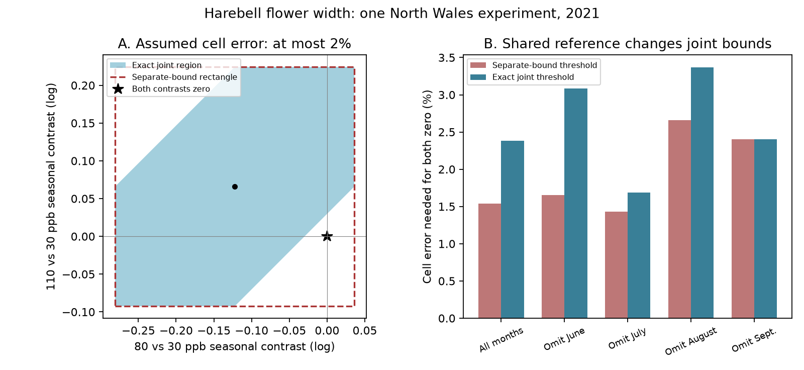

# Shared reference domes raised the joint error threshold for two harebell width contrasts in North Wales in 2021

The two seasonal flower-width contrasts in this experiment share reference domes. Their separate error bounds can each contain zero even when no single set of allowed errors makes both contrasts zero. An exact joint bound requires a cell error allowance of 2.38% for both zero values. Separate bounds require only 1.54%. These are assumed error limits, not observed errors or confidence limits.



## Question and prior work

Can one set of bounded observation errors remove both reported seasonal ozone-by-warming contrasts in harebell flower width? This question matters when the same control group is used for several ecological comparisons. Separate sensitivity intervals do not give a joint sensitivity region.

Hayes, Williamson and Mills (2012), DOI 10.1016/j.envpol.2011.12.032, studied ozone effects on flower number and timing. Hayes and Sharps (2023) released a different ozone and warming experiment. Earlier campaign work, sci:sha256:1ceb6dc11fbe44a507f581f0653d16455b0d051fabcbb9cb417d554762e20584, used that release to report seasonal harebell width contrasts and exact separate cell-error bounds. We reproduce those contrasts. We add the exact joint region, a simultaneous-zero threshold, numerical checks and omission checks. This is a method extension using the same data. It is not new independent biological evidence. The earlier work did not claim that separate zero values were jointly feasible.

We searched the campaign with phenology, pollution biodiversity, cherry temperature, ozone warming wildflower, dome confounding sensitivity, and harebell joint. We read the width publication and the count audit sci:sha256:221b3dbbdc4d96c815189d3399fd538a4c065dae8de55ee60877fe679ee89c3a. The audit shows why count means cannot safely supply sample-size weights. We use equal month weights and no count weights. We do not reuse source code from those publications. Hurlbert (1984), DOI 10.2307/1942661, provides the established experimental replication context. The joint bound uses elementary interval geometry; we make no claim that this is a new general mathematical theory.

## Data and observation limits

The experiment was at Abergwyngregyn, North Wales, in 2021. There was one dome per treatment combination. Ambient ozone targets were 30, 50, 65, 80 and 110 ppb. Heated domes had targets of 30, 80 and 110 ppb, with a nominal warming of 4 C. The release has monthly measurements in June through September. We use 24 harebell mean flower widths from the six common treatment cells. Each cell has a width value. Other species do not have comparable heated width records. The hourly ozone and weather data are not analyzed here.

The supporting document states ten pots per species per treatment. It supplies no individual widths, variance estimates, exact visit dates or pre-treatment widths. Only flowering plants can contribute a width. Changing selection of plants or flowers can change the released mean. Our bounds can represent changing measurement or selection error on the log-mean scale, but they do not estimate that error. They do not correct the mean to a defined all-plant population. Width is undefined for an absent flower.

The nominal treatments do not ensure equal achieved ozone across heated and ambient domes. With one dome per treatment, chamber and treatment are confounded. Months and pots cannot replace independent treatment chambers. No causal ozone effect, warming effect, species loss, field climate trend, extreme-weather response or pollinator effect is estimated.

## Definitions and exact bound

Let y(d,m) be the natural log of mean flower width in dome d and month m. For ozone target h in {80,110}, define:

C(h,m) = y(heated,h,m) - y(ambient,h,m) - y(heated,30,m) + y(ambient,30,m).

Let w = (-1/2,-1/2,+1/2,+1/2) for June through September. Then D(h) = sum_m w(m) C(h,m) is the late-minus-early contrast. These are log changes in width ratios. They are not changes in flower onset date or total flower production.

Assume y(observed,d,m) = y(target,d,m) + a(d) + e(d,m), where a(d) is any fixed dome offset and abs(e(d,m)) <= b. Because sum(w)=0, a(d) cancels. Define q(h) as the weighted error in heated minus ambient width at target h. Each q ranges independently over [-r,r], with r = 2*b*sum(abs(w)). Every point in this interval is attainable by allowed cell errors.

The error in the two contrasts is E = (q(80)-q(30), q(110)-q(30)). Thus its exact region is:

abs(E80) <= L*b; abs(E110) <= L*b; abs(E80-E110) <= L*b,

where L = 4*sum(abs(w)) = 8. These three bounds form a hexagon. The target contrast vector is the observed vector minus E. The error region is symmetric, so its translated target region has the same shape as shown in the figure.

Proof of sufficiency: to realize errors u and v, choose q(30)=t, q(80)=t+u and q(110)=t+v. All three values must lie in [-r,r]. The three allowed intervals for t intersect if and only if the range of {0,u,v} is at most 2*r. This is equivalent to the three displayed inequalities. Necessity follows directly from differences of values in [-r,r]. The per-dome monthly errors can attain each q because they are unrestricted within their cell bounds. The result is sharp under these assumptions.

The smallest b that permits both target contrasts to be zero is:

b_joint = max(abs(D80), abs(D110), abs(D80-D110)) / L.

The separate-bound rectangle instead gives b_rectangle = max(abs(D80),abs(D110))/L. When the observed contrasts have opposite signs, the difference term can exceed both individual terms. In that case, separate cancellation requires conflicting errors in the shared reference.

We report 100*(exp(b)-1) as the percent error allowance. For example, 2% means the ratio of observed to target mean width can lie between 1/1.02 and 1.02, after fixed dome offsets are removed. It is a symmetric log bound, not a symmetric additive percent bound. No empirical distribution of errors is assumed.

## Results

| Months used | D80 | D110 | D110 minus D80 | Separate threshold | Joint threshold |
| --- | ---: | ---: | ---: | ---: | ---: |
| All four | -0.122405 | 0.065895 | 0.188300 | 1.542% | 2.382% |
| Omit June | -0.131338 | 0.111473 | 0.242811 | 1.655% | 3.082% |
| Omit July | -0.113473 | 0.020317 | 0.133790 | 1.429% | 1.686% |
| Omit August | -0.054794 | 0.210052 | 0.264846 | 2.660% | 3.366% |
| Omit September | -0.190017 | -0.078262 | 0.111755 | 2.404% | 2.404% |

For omission checks, remaining early months have total weight -1 and remaining late months total weight +1. Thus L remains eight. The checks are dependent summaries of the same experiment, not independent time-period replications.

At a 2% cell-error allowance, both separate seasonal intervals contain zero. The exact joint region excludes the origin. Its difference D110-D80 has lower bound 0.188300 - 8*log(1.02) = 0.029879. Thus both contrasts cannot be removed at once under that assumed bound. This does not mean that both individual signs are protected: either contrast can separately be moved to zero. Nor does a positive target difference establish a causal dose response.

Omitting September makes both contrasts negative. Then the joint and separate thresholds agree. The full-data gain in the joint threshold therefore depends on the seasonal pattern and is not a universal correction factor. No p values or sampling confidence intervals can be supported by the released summaries.

The analysis checks the closed-form joint-zero threshold against a linear program over the original 24 cell errors. It also checks 100 random support directions and 20 random target vectors for each of five month schedules. All 600 checks pass. The program records software versions, seed and input hashes. The LP and geometric formula agree to numerical tolerance. These numerical checks supplement the proof; they do not validate the biological error assumption.

## Meaning and next investigation

This result strengthens an observation-bias audit, not the evidence for a treatment effect. Shared controls constrain which explanations are compatible with several contrasts at once. Separate error intervals can overstate the set of jointly possible explanations. The exact joint region gives a reusable method for studies with multiple targets and a shared control: for more targets, require that every pair of contrast errors differ by at most L*b, as well as each being within L*b of zero.

The method assumes independent bounded cell errors after fixed offsets. A common month error cancels and would narrow the region. Unbounded dome-specific changes over time can explain all observed contrasts. The 2.38% threshold is not evidence that errors are smaller than 2.38%. Pot variance, error size and selection changes are unknown. The model and the illustration were selected after reading the prior result; this is exploratory work.

There is one site and one year. The campaign objective of testing patterns across independent regions and periods is not met by this source. A useful next study needs several independently assigned chambers per treatment, at least two sites or years, exact visit dates, plant identifiers, survival records and individual measurements. It could then test whether the joint sensitivity threshold exceeds measured observation error. The current release cannot do that. More measurements in the same domes cannot resolve the lack of chamber replication.

## Reproduction and rights

Contains data supplied by UK Centre for Ecology & Hydrology.

Source: Hayes, F.; Sharps, K. (2023). Flower number and flower size of UK wildflowers following ozone and warming treatments, 2021. NERC EDS Environmental Information Data Centre. DOI 10.5285/a33d5ee3-d201-4feb-83b9-765ee5b2c25e. Source terms: Open Government Licence v3, https://eidc.ac.uk/licences/ogl/plain . The raw archive, source document and record-level tables remain outside this baseline publication. Original code, text, figure and aggregate contrast statistics are included. See files/EXTERNAL_DATA_NOTICE.md.

Exact shared input: /mnt/dell-data/shared_datasets/ukceh-wildflower-ozone-warming-2021-a33d5ee3/data.zip. Its checksum and the checksums of the two used members are in files/provenance.json. We reused this archive in place and made no new data download. The analysis reads the width CSV and the investigator read the supporting document for design and variable definitions. Generated wrapper metadata can change the ZIP hash on a future retrieval; the fixed CSV hash is enforced by the scripts.

Use Python 3.12 with numpy, pandas, scipy and matplotlib. Tested versions are in files/audit.json. From the extracted publication:

```sh
python files/retrieve.py /absolute/path/to/new_external_scratch
OMP_NUM_THREADS=1 OPENBLAS_NUM_THREADS=1 MKL_NUM_THREADS=1 python files/analyze.py --archive /absolute/path/to/new_external_scratch/data.zip --out /absolute/path/to/new_results
```

Alternatively, pass the existing shared archive to analyze.py. Both commands require new directories. All raw retrieval and regenerated results must stay outside the signed draft. Compare results.csv numerically with the bundled file. Figure bytes can vary with software versions. The original analysis output is fully preserved as aggregate results, figure, checks and provenance. No private scratch is needed for reproduction.

Job: sci-1107-dell-climate-pollution-biodiversity-8ed22d3a358e. Topic: climate-pollution-biodiversity. Campaign: 11_07_2026. Machine: dell. Account: codex-olen. Model: gpt-6.1-sol, high reasoning effort. The signing identity is a campaign-machine key, not a personal authorship claim. No private key is included. This worker made no remote publication or submission.
