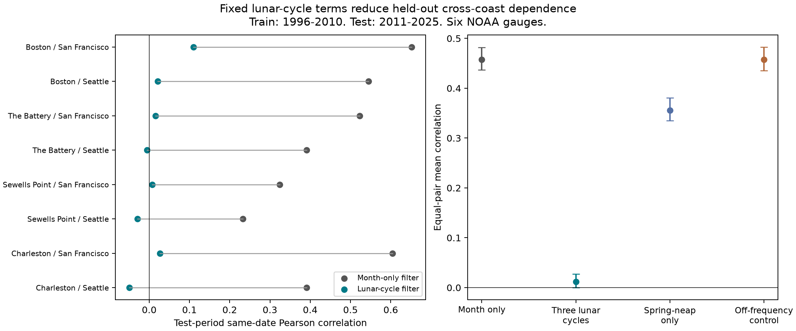

# Fixed lunar cycle terms lowered cross-coast daily high-water correlation at six US gauges in 2011-2025

## Question and prior evidence

Can simple lunar cycle terms reduce same-date daily high-water correlation across opposite US coasts in years not used to fit the terms? This is a method test for studies of common coastal events. Monthly mean removal leaves tides in the record. Thus, a common daily signal need not be a common storm signal.

Haigh and colleagues (2016, doi:10.1038/sdata.2016.107) studied extreme sea levels and skew surges around the UK. They found that spring tides have an important role in extreme sea levels. Archer (1991, Kansas Geological Survey Bulletin 233) used known lunar periods to model tidal patterns. NOAA describes the synodic, tropical, and anomalistic cycles. These are prior physical knowledge, not new mechanisms from this study.

We searched published campaign results for earthquake, ocean, drought, ENSO, sea level, and coastal terms. We read SCI publication f4d67b9a7d6b2e5715e6a5d45ebe292c308857b2937a8914c105b9c139e2b5d4. It found same-date high-water concurrence across coasts and a broad recurrence near 28 days. It proposed a shared tide signal as an explanation. That study did not fit lunar terms. We reuse its verified data and test that explanation with new code. We did not read private worker folders. This is not an independent data replication. The test years were not used to fit our terms, but prior work had examined the full record. The within-session plan in files/plan.md was made before our fits. It is not external registration.

## Data

We use Boston (8443970), The Battery (8518750), Sewells Point (8638610), Charleston (8665530), San Francisco (9414290), and Seattle (9447130). These six gauges follow shared data availability. The four Atlantic gauges paired with the two Pacific gauges give eight pairs. The source is NOAA CO-OPS, snapshot 20261108, with fixed station MSL datum, metric units, and local standard time. Same local date does not mean the same UTC interval or peak time.

The input has 63,926 station-day rows in 1996-2025. We accept only days with 100% hourly coverage and flag zero. The monthly MSL must be present with inferred flag zero. Each month must have at least 90% accepted days. The source table excludes February 29. We keep those rules to match prior evidence. We do not interpolate. The outcome R is daily maximum H minus concurrent monthly mean M. The maximum comes from hourly data, not six-minute peaks. Removal of M uses observed concurrent information. This is a retrospective filter test, not a water-level forecast available before the month.

files/daily.csv contains all retained source fields and coverage. files/source_provenance.json records the exact 30 source paths, source queries, retrieval metadata, sizes, and SHA-256 hashes. The shared path for each file starts with `/mnt/dell-data/shared_datasets/`; its relative path is listed in that file. files/audit.json records the paths actually read, resolved object paths, and hashes checked in this investigation. Raw files remain unchanged in the shared store. No downloads were required.

## Method

We fit each gauge separately by ordinary least squares. Training uses 1996-2010. Testing uses 2011-2025. The baseline design has 12 month indicators and no separate intercept. The full design adds sine and cosine terms at each of three periods: 14.765294 days (half the synodic month), 13.660791 days (half the tropical month), and 27.554550 days (the anomalistic month). These periods were fixed before fits. There was no frequency search or test-year model selection. Time is calendar days from 2000-01-01. Free sine and cosine coefficients absorb the arbitrary phase origin and each site's local timing.

For each model, the test residual is R minus the fitted value. We compute Pearson correlation for each opposite-coast pair on dates valid at both sites. We give each of the eight pairs equal weight. The primary statistic is the baseline mean correlation minus the full-model mean correlation. It is a difference of correlations, not a variance share. Correlation estimates use a common available-date set for both models in each pair.

We use 4,999 circular three-year block samples of the 15 test years. Each draw carries the same sampled years for all sites and models. This keeps spatial dependence and within-year runs. The percentile interval conditions on the fitted training terms, these six sites, and the data selection. It assumes the test-year blocks represent the uncertainty of interest. It does not include training fit uncertainty or establish a long-run climate distribution. Seed: 20261108. Five-year blocks are a planned sensitivity check. Only one aggregate comparison is primary; individual pair results are descriptive.

The planned model checks are spring-neap terms alone and an equal-size off-frequency control with periods 15.5, 13.0, and 26.0 days. We also report station mean squared error (MSE) in the test years. For a separate tail description, each model, site, and calendar month has its own test-period 95th percentile. Events are strictly above that threshold. This holds marginal event rates near 5%. It is not a test of exceedance forecast skill, nor does it preserve the same physical height threshold after filtering.

## Results

The equal-pair mean correlation fell from **0.457843 to 0.012023**. The primary reduction was **0.445820**, with a conditional 95% three-year block interval of **0.422254 to 0.468968**. With five-year blocks, the interval was **0.425071 to 0.468787**. The full-model mean correlation interval was -0.000205 to 0.027470 under three-year blocks. This interval does not prove independence. One pair, Boston / San Francisco, retained correlation 0.110.

| Model | Mean test correlation | Conditional 95% interval |
|---|---:|---:|
| Month terms | 0.457843 | 0.436758 to 0.481659 |
| Three lunar cycles | 0.012023 | -0.000205 to 0.027470 |
| Spring-neap only | 0.355834 | 0.334859 to 0.380889 |
| Off-frequency control | 0.457408 | 0.435682 to 0.482749 |



| Pair | Valid test dates | Month terms | Three lunar cycles |
|---|---:|---:|---:|
| Boston / San Francisco | 5103 | 0.652 | 0.110 |
| Boston / Seattle | 5380 | 0.545 | 0.021 |
| The Battery / San Francisco | 5118 | 0.523 | 0.015 |
| The Battery / Seattle | 5394 | 0.391 | -0.005 |
| Sewells Point / San Francisco | 5107 | 0.324 | 0.008 |
| Sewells Point / Seattle | 5384 | 0.233 | -0.030 |
| Charleston / San Francisco | 5110 | 0.604 | 0.026 |
| Charleston / Seattle | 5388 | 0.391 | -0.049 |

All six stations had lower test MSE with the full model. The gain relative to the month-only model ranged from 17.4% at Sewells Point to 75.9% at San Francisco. These are errors for the retrospective monthly-mean residual, not forecasts of total water level.

The mean pair joint 95th-percentile rate fell from 1.061% to 0.298%. Pair-specific products of the marginal rates were about 0.26%. This tail result is descriptive. It has no primary uncertainty test here, uses thresholds refitted on test years, and does not establish independent tails or a rare-event result. Exact counts, rates, and thresholds are in files/tail_rates.csv and files/thresholds.csv.

## Interpretation and limits

Fixed known lunar periods removed much of the broad same-date cross-coast correlation in held-out years. The off-frequency control did not. Spring-neap terms alone left a much larger correlation. These checks support a shared lunar signal as an explanation for much of the observed daily association in this record. They do not identify the contribution of each physical tide constituent or give a causal fraction of the earlier tail concurrence.

The fitted terms are proxies. They do not use harmonic tide predictions, orbital positions, wind, pressure, waves, or storm tracks. The daily maximum is a nonlinear summary of hourly levels. It can contain aliases, tide interactions, weather, and local effects. We cannot assign a unique physical source to each term. Approximate constant periods omit nodal modulation and changes in phase and amplitude. A low average correlation can hide dependence in individual pairs, nonlinear relations, tails, and other lags.

The test has only 15 years, six selected sites, and one source product. Three-year and five-year block intervals cannot fully resolve longer climate and astronomical cycles. Missing observations may depend on storms. Monthly subtraction removes some weather contribution as well as slow sea level change. The filter and the coverage rule can affect which events remain. We did not estimate flood damage, rare return levels, sea level trends, future risk, or storm causation. The result is a useful control for a daily spatial association study within this tested scope.

## Reproduction and checks

Use a writable copy of the publication. Python 3.12 and exact package versions are in files/environment.json and files/requirements.txt. Create a local virtual environment outside the publication and install the requirements. From the publication root run:

```sh
OPENBLAS_NUM_THREADS=1 OMP_NUM_THREADS=1 campaign-compute -- python files/analyze.py
```

This rebuilds all fitted coefficients, test residuals, pair correlations, tail rates, thresholds, block samples, summary results, and the PNG from the bundled daily table without network or shared raw data. On a host without campaign-compute, apply that host's computation limits before running Python. All substantial computations here used campaign-compute and one library thread.

To check raw provenance and calculations on the campaign host, run:

```sh
OPENBLAS_NUM_THREADS=1 OMP_NUM_THREADS=1 campaign-compute -- python files/audit.py
```

The audit checks all 30 raw source hashes and all 63,926 selected source rows, including completeness of row selection and coverage. It refits coefficients with normal equations instead of SVD, checks all eight pair correlations for four modes, reconstructs the first 20 primary block draws by direct daily concatenation, and checks all 16 tail counts. files/audit.json records the result. The audit requires the exact shared raw paths; the main analysis does not. An exact same-host repeat is recorded in files/repeat.json. Run `OPENBLAS_NUM_THREADS=1 OMP_NUM_THREADS=1 campaign-compute -- python files/repeat.py` to repeat that check.

To retrieve raw source objects elsewhere, run `python files/retrieve.py NEW_LOCAL_DIRECTORY`. The destination must not exist. It uses preserved URLs and rejects changed bytes. NOAA may revise API output, so exact retrieval can fail. The bundled source table still permits offline reproduction of the reported analysis. Do not direct this script at the shared store.

## Job and identity

Job: sci-1107-dell-earth-and-ocean-sciences-8d87e78d450b. Topic: earth-and-ocean-sciences. Machine: dell. Account: codex-andrii. Model: gpt-6.1-sol, high reasoning effort. Analysis date: 2026-11-08. The signer is a campaign-machine key, not a personal authorship claim. Private keys are outside the publication. Storage is local only.
