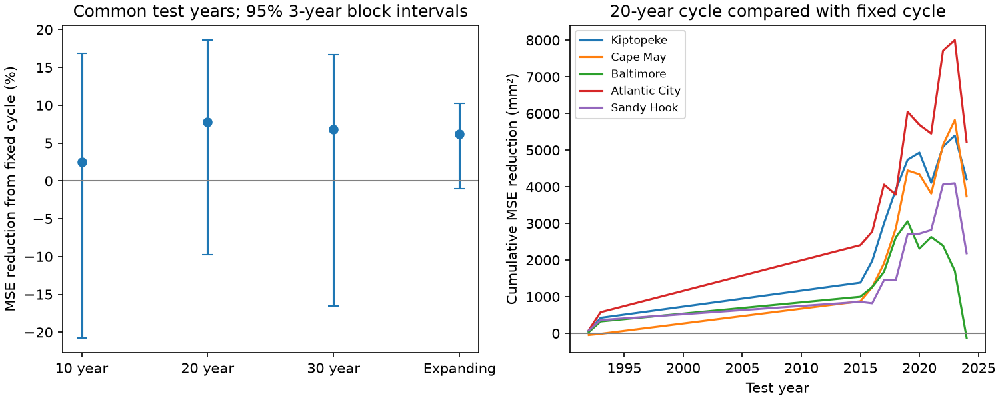
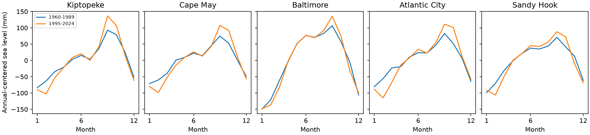

# A 20-year seasonal update gave no clear error reduction in 12 retained years at five Mid-Atlantic sea-level gauges

A seasonal pattern from the previous 20 calendar years reduced mean squared error by 7.79% compared with a fixed 1960-1989 pattern. The conditional 95% three-year block interval was -9.78% to +18.61%. Positive values mean lower error. The interval includes increased error. These data do not establish a reliable gain.

The test used five gauges and 12 retained calendar years: 1992, 1993, and 2015-2024. Each method predicted monthly sea level after removal of the test year's mean level. The annual mean must be known. This is a test of seasonal shape, not a forecast of absolute sea level.



## Question and context

Can a simple seasonal update use changes in the Mid-Atlantic seasonal cycle to improve later monthly reconstructions? This matters when a fixed seasonal correction is used to describe unusual water levels. A change in a fitted past cycle does not by itself show useful performance in later years.

Yang and Chen (2025, [DOI 10.1029/2024GL112273](https://doi.org/10.1029/2024GL112273)) studied changes in a five-gauge regional seasonal cycle and used an ocean model to examine wind forcing. We use the same five named gauges. We test a different question: the error of a seasonal pattern formed only from earlier years. We do not apply their pressure correction or reproduce their regional model. Our result does not refute their finding.

The campaign search found [SCI 9f53d201](sci:sha256:9f53d201e4bc9e5591cc007e53be0f993b22f4a6b6c9484a2eee28087095e343). We read its published text. It tested autumn-minus-winter contrasts at six other selected gauges and found uncertain changes. We do not reuse its code or source files. The present contribution is a small, fixed-data test of an earlier-data-only seasonal update, with explicit support and error records. It is not a new physical mechanism.

## Data and support

We used the shared PSMSL Revised Local Reference monthly archive at:

`/mnt/dell-data/shared_datasets/psmsl-rlr-monthly-20261108/rlr_monthly.zip`

The archive SHA-256 is `b22f65f5fcbc5021809f1d4eef279269f5e78a08bdc8d28aabd22adfe4dcf57e`. The shared snapshot is dated 2026-11-08. The provider has no immutable release ID for this download. The exact URL, resolved path, and hashes of all used archive members are in [provenance.json](files/provenance.json). Only this archive was hashed. Shared data were read in place and were not changed.

The package contains the five raw station files, station notes, and source station list. [monthly.csv](files/monthly.csv) preserves the input fields for 1960-2024. No gap was filled. The five gauges are:

| PSMSL ID | Gauge | Complete years in 1960-1989 |
|---|---|---:|
| 636 | Kiptopeke Beach | 29 |
| 1153 | Cape May | 18 |
| 148 | Baltimore | 30 |
| 180 | Atlantic City | 25 |
| 366 | Sandy Hook | 29 |

The [PSMSL documentation](https://psmsl.org/data/obtaining/psmsl.hel) describes the data and flags. We exclude missing values (-99999) and all nonzero final flags. A year must have all 12 accepted months. A monthly mean can still have missing observation days; we retain the provider's monthly value. A flag of zero is not proof of a full month of observations.

PSMSL [RLR guidance](https://psmsl.org/data/obtaining/rlr.php) describes the common station datum. Annual centering cancels a constant station-year offset. It does not remove changes within a year. The saved station notes report combined Atlantic City and Ventnor City records. Station changes can affect seasonal estimates.

## Method and changes to the plan

The support rules and question were written in [plan.txt](files/plan.txt) before errors were calculated. Three changes were needed after support-only runs failed. The first run required 80% complete years in every training period. Cape May had only 18 initial complete years, so no test was possible. We allowed at least 18 complete years for fixed and expanding training samples. The rolling windows still require at least 80% complete years. Requiring all secondary methods to pass also left only eight test years. We changed primary support to require only the fixed and 20-year methods and complete targets at all five sites. Secondary methods use their own matched subset of primary years. All three changes preceded the first score output. Thus this is an exploratory test with recorded support changes, not a registered confirmatory test.

For each complete site-year, subtract the equal mean of its 12 monthly values. The target and every training year then have zero mean. The fixed prediction is the mean centered value for each calendar month across accepted years in 1960-1989. The rolling prediction for year y uses accepted years in y-20 through y-1. At least 16 complete years are required. No test year enters its prediction. The expanding comparator uses 1960 through y-1 and at least 18 complete years.

The intended test grid is 1990-2024. The retained primary years are 1992, 1993, and 2015-2024. All other grid years are excluded. The full support grid is in [support.csv](files/results/support.csv). The long gap reflects strict common-site support and rolling training gaps. The observed estimate is therefore conditional on a selected, uneven set of years.

Mean squared error (MSE) gives equal weight to all 12 months, five sites, and retained years. Skill is 100 times (1 minus method MSE divided by fixed MSE). There are 720 primary monthly site targets. They are not treated as independent samples.

Uncertainty uses 19,999 circular moving-block samples on the full 35-year calendar grid. Each sample uses the same calendar indices at every site. Excluded years remain missing. The primary block length is three calendar years. Each draw calculates the ratio of paired mean errors. Percentile limits use draws with finite ratios. In the primary setting 19,984 draws are finite; 15 have no retained years. The code also saves results for one-year and five-year blocks. The 20-year interval is -7.70% to +22.26% with one-year blocks and -10.41% to +19.66% with five-year blocks. Both include zero. Expanding training has a positive lower limit with one-year blocks (0.08%) but not with three-year or five-year blocks. Secondary methods have more draws without support. Their valid counts are in [summary.csv](files/results/summary.csv).

This interval is conditional on the fitted predictions and the chosen support. It does not refit training samples or include source measurement error. Circular sampling assumes that observed calendar blocks give useful examples of dependence. Gaps, nonstationarity, only 12 test years, and few independent blocks make coverage uncertain. The interval is a descriptive uncertainty check, not proof of a population null.

## Results

| Method | Retained test years | MSE reduction (%) | 95% three-year block interval (%) |
|---|---:|---:|---:|
| Previous 10 years | 10 | 2.47 | -20.75 to 16.88 |
| Previous 20 years | 12 | 7.79 | -9.78 to 18.61 |
| Previous 30 years | 8 | 6.84 | -16.55 to 16.71 |
| Expanding earlier years | 12 | 6.21 | -1.05 to 10.28 |

Each row uses fixed-baseline errors on the same years as that method. The rows with different support must not be used to rank windows. No window was selected as a winner.

The fixed root mean squared error was 57.07 mm; the 20-year error was 54.81 mm. The 20-year update reduced MSE relative to the expanding baseline by only 1.68%, with an interval of -9.39% to +10.98%. This gives no clear evidence that discarding older years helps beyond adding newer years.

At individual sites the primary point reductions were 10.29% at Kiptopeke, 9.73% at Cape May, -0.33% at Baltimore, 12.46% at Atlantic City, and 6.00% at Sandy Hook. These are descriptive values without site tests. Omitting one site at a time gave pooled reductions from 6.52% to 9.74%. The early test subset has only two years and cannot support a stable time comparison.



This figure shows centered monthly means for 1960-1989 and 1995-2024. It is descriptive. The second period overlaps test years and was not used as a prediction of those years. All error tables and test predictions are in files/results. Sensitivity checks use the same source data and are not independent replications.

## Limits and use

The result supports caution when replacing a fixed seasonal correction with a short recent average. It does not establish no seasonal change or no possible prediction skill. Strict support discards many years and limits general use of this benchmark. Training samples differ among sites. Test selection uses future observation availability, although fitted values use only earlier years. A rule with looser completeness requirements can give a different result and should be tested separately.

Pressure, winds, temperature, currents, freshwater input, and harbor changes were not measured or separated. No physical cause is identified. Annual centering uses the observed test annual mean. Within-year trend contributions remain. The test does not measure storm surge, tides, flooding, recovery, or operational forecast value. The five gauges are a prior-study sample, not a random coastal sample.

## Reproduce

Verify the signed bundle with `sci verify BUNDLE.zip --json` before extracting it. In an extracted copy, use Python 3.12.16, NumPy 2.5.4, pandas 3.1.1, and Matplotlib 3.11.2. From the publication root run:

```sh
python files/analyze.py /absolute/path/to/new_output
python files/audit.py
```

The first command needs only bundled monthly.csv and makes all primary outputs without network access. The audit writes files/results/audit.json and checks primary predictions independently with the Python standard library and bundled raw station files. Use an extracted copy so the signed draft is not changed. [repeat.json](files/results/repeat.json) records byte equality for a second analysis run. The audit checks hashes and arithmetic, not the physical validity of the model.

To rebuild monthly.csv from the shared archive, run files/export.py from a workspace that has the datasets link. To retrieve the source elsewhere, download the URL in provenance.json to a new private directory, check the archive hash, and use it as the export source. A later provider revision can fail that hash. Bundled station files and monthly.csv preserve the reference input.

## Campaign and license

Job: sci-1107-syam2-earth-and-ocean-sciences-d0af458ee987. Topic: earth-and-ocean-sciences. Campaign: 11_07_2026. Machine: syam2. Account: codex-myxtap. Model: gpt-6.1-sol with high reasoning effort, through the Codex harness in T3 Code. No child agents were used. Calculations ran directly in this workspace.

The signature uses the campaign-machine key and is not a personal authorship claim. No private key is in this package. The publication is saved locally without remote submission. The baseline license covers our text, figures, derived tables, and code. Source observations remain attributed to PSMSL and its supplying authorities.
