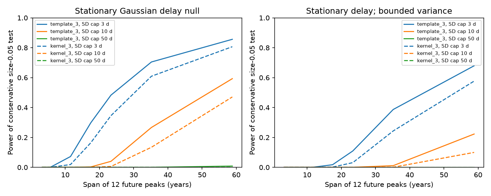
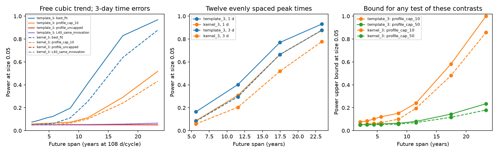

# Forty future ASASSN-14ko peaks with 3-day errors give less than 25% power against delays with SD below 10 days for two fixed kick fits after cubic trend removal

Job sci-1107-dell-astronomy-9b3eac0ebdb5. Topic astronomy. Campaign 11_07_2026.
Machine dell. Account codex-myxtap. Model gpt-6.1-sol, high reasoning effort,
through the Codex harness in T3 Code. Date 2026-11-10. The signing key is a
campaign-machine key. It is not a personal authorship claim.

## Question

Can a feasible set of future flare times distinguish random changes of orbital
period from a common emission delay? We study ASASSN-14ko. We do not add
observations or claim to identify its physical clock. The result is a test
method, a proof of its scope, and a numerical study of future observing designs.

The prior SCI result caa44342 showed that a stationary Gaussian delay can fit
the existing times and can approach the period-kick distribution after the
unknown clock trend is removed. Its long-memory limit has an increasing delay
amplitude. Here we ask what a finite amplitude cap changes, and how a forecast
based only on the best fit can overstate the power to identify the noise source.

## Main result

Forty consecutive future peak times span about 11.5 years at 108 days per
cycle. With 3-day independent time errors and a free cubic clock, some delay
laws from the historic profile set have SD below 10 days and are close to
each fitted kick distribution. Pinsker's inequality gives test-power upper
bounds of **0.2404** (template kick fit) and **0.1945** (kernel kick fit), at
size 0.05. These bounds apply to any test of the specified future timing
contrasts that controls size for the whole allowed delay family. They do not
rely on the power of our chosen test or on Monte Carlo tail estimates.

A single allowed null covariance supplies each upper bound. We do not need
to find the least-power null or exhaust all possible delay parameters. The
bounds assume the fixed historical kick parameters, Gaussian laws, the stated
measurement errors, and removal of a free cubic clock. They do not restrict
a joint analysis with historical times, an external orbital marker, or an
independent physical constraint that excludes these delay laws.

For a fixed contrast x=v't that removes a polynomial clock, a delay with
per-cycle SD at most D has

    Var(x) <= D^2 ||v||_1^2 + e^2 + smax^2 = B.

The unit vector v is set before future observations. The last two terms bound
independent measurement error and white timing scatter. No delay memory law
is required. Under a Gaussian null, |x|>sqrt(3.84146 B) is a test with false
rejection probability at most 0.05 for the whole bounded-delay family. With
only second moments, the threshold sqrt(20 B) gives the same size bound.
The source of the delay can remain common to all photometric markers.

For fixed nonzero period-kick SD q and a fixed number of well-spaced peaks,
the largest trend-free kick variance grows as the cube of the cycle span.
The bound B stays finite. Thus these fixed contrasts separate bounded delays
from continued kicks in the long-span limit, even with a free cubic clock.
The proof is in files/PROOF.md. It uses standard variance bounds and Gaussian
likelihood theory. We claim this scoped flare-clock construction and its
numerical application, not a new general probability inequality.

For stationary delays there is a sharper, memory-free bound:

    Var(x) <= D^2 sup_w |sum_i v_i exp(i n_i w)|^2 + e^2 + smax^2.

A stationary Gaussian random sine and cosine process attains the exact
spectral bound. We use a uniform frequency grid and an explicit derivative
bound to obtain a conservative numerical upper bound on the supremum.
The calculation includes stationary and unrestricted covariance cases.
The proof and numerical certificate are in files/PROOF.md.

This limit can be slow. For twelve evenly spaced peaks, a free cubic clock,
3-day independent measurement error, and a white-scatter cap of 3 days, the
stationary Gaussian test with D=10 days has power below 0.000001 at an
11.5-year span for both peak definitions. At a 58.8-year span its power is
0.59 (template kick fit) or 0.47 (kernel kick fit). Without stationarity the
latter values fall to 0.50 and 0.36. These are powers of these conservative
tests, not upper bounds on all tests or a minimum required observing time.
A useful independent physical delay cap has not been measured in this study.

Stationary Gaussian null; twelve peaks; cubic trend; 3-day time errors.

| Peak definition | Delay SD cap (d) | Span (yr) | Test power |
| --- | ---: | ---: | ---: |
| template | 3 | 5.6 | 0.00026 |
| template | 10 | 5.6 | 1.84e-26 |
| template | 50 | 5.6 | 0 |
| template | 3 | 11.5 | 0.0724 |
| template | 10 | 11.5 | 1.92e-07 |
| template | 50 | 11.5 | 6.47e-145 |
| template | 3 | 23.4 | 0.483 |
| template | 10 | 23.4 | 0.0401 |
| template | 50 | 23.4 | 4.72e-24 |
| template | 3 | 58.8 | 0.856 |
| template | 10 | 58.8 | 0.593 |
| template | 50 | 58.8 | 0.00838 |
| kernel | 3 | 5.6 | 1.09e-05 |
| kernel | 10 | 5.6 | 1.27e-37 |
| kernel | 50 | 5.6 | 0 |
| kernel | 3 | 11.5 | 0.0187 |
| kernel | 10 | 11.5 | 9.53e-12 |
| kernel | 50 | 11.5 | 1.24e-246 |
| kernel | 3 | 23.4 | 0.346 |
| kernel | 10 | 23.4 | 0.00582 |
| kernel | 50 | 23.4 | 4.4e-42 |
| kernel | 3 | 58.8 | 0.807 |
| kernel | 10 | 58.8 | 0.471 |
| kernel | 50 | 58.8 | 0.000373 |

## Inputs and the future-only design

We reuse the four fixed kick fits and stationary-delay likelihood profiles
from verified SCI caa44342. They were fitted to the same 30 prior ASASSN-14ko
peak times. The two peak definitions are sensitivity checks on shared
observations. They are not independent measurements. We retain quadratic
and cubic clock means. These means describe local timing trends; they are
not the exact published constant dimensionless-Pdot ephemeris.

The source aggregate fits are preserved under their baseline license in
source_summary.json and source_profiles.csv. Their exact hashes and original
SCI bundle path are in provenance.json. No raw observations are used here.
No shared dataset is used. We do not refit the historical times or check raw
photometry. Input uncertainties are therefore not reduced by this study.

The first design measures every flare in sequences of 8, 12, 16, 20, 30, 40,
60 or 80 peaks. The second measures twelve peaks at rounded equal intervals
over spans of 19, 39, 59 or 79 cycles. The complete cycle vectors are fixed
in the code. We use independent time errors of 1 or 3 days and a reference
108-day period to convert cycle span to years. The latter is only a time
scale, not an extrapolated ephemeris.

All calculations use future times alone. We remove their unknown epoch,
period, and quadratic or cubic trend. This avoids relying on a known orbital
phase or on extrapolation of a historical polynomial. It discards useful
historical conditioning and cannot show the power of a complete joint future
and past analysis. Period kicks before the future window contribute only an
initial time and slope, which these contrasts remove. Stationary delays start
in their stationary distribution.

## Fixed-pair power and sensitivity to allowed delay memory

We compute Gaussian likelihood-ratio power at nominal size 0.05 between each
fixed kick law and three kinds of delay law: the historic best grid fit; a
40-cycle-memory law at the same innovation SD and white scatter as the kick
law; and a low-information choice from the historic profile grid. We include
all profile points within 3.84 in twice the negative log likelihood of the
historic best delay fit. This is a stated sensitivity set, not a confidence
region. It contains only the source profile optima at each memory value,
not every parameter pair in a likelihood region.

For each design we choose the grid alternative with the smallest forward
KL divergence from the kick law, with delay SD caps of 10 days, 50 days, or
no cap. These caps are assumptions, not physical measurements. Minimum KL
is not necessarily minimum power. The tabulated test is the best test of its
particular fixed pair, not a test with controlled size for a composite delay
family. All parameters are treated as known. Parameter fitting, model drift,
and marker offsets can reduce real performance.

Upper bounds for a size-0.05 test against the stated 10-day-SD delay family:

| Kick fit | Future peaks | Span (yr) | Selected delay memory (cycles) | Power upper bound |
| --- | ---: | ---: | ---: | ---: |
| template | 12 | 3.3 | 6.31 | 0.0845 |
| template | 20 | 5.6 | 6.31 | 0.1206 |
| template | 40 | 11.5 | 6.31 | 0.2403 |
| template | 80 | 23.4 | 6.31 | 1.0000 |
| kernel | 12 | 3.3 | 7.94 | 0.0565 |
| kernel | 20 | 5.6 | 7.94 | 0.0689 |
| kernel | 40 | 11.5 | 7.94 | 0.1945 |
| kernel | 80 | 23.4 | 7.94 | 0.8575 |

For the uncapped profile family, a 1000-cycle-memory null gives upper bounds
below 0.05011 even for 80 future peaks (23.4 years). Its delay SD is 15,356 days
for the template fit and 11,375 days for the kernel fit. These extreme values
are mathematical examples, not plausible measured transport delays. The
10-day examples above give a more restricted, finite-amplitude result.

The covariance calculation uses exact discrete cycles, including gaps. The
stationary delay obeys d_n=2r d_(n-1)-r^2 d_(n-2)+epsilon_n, with
r=exp(-1/L). We evaluate the second-difference covariance at 60-digit precision
and sum it through the same discrete response as the period kicks. This
avoids cancellation of large stationary variances. It is the source model,
not a demonstrated radiation-transfer law.

The generalized covariance eigenvalues give the exact likelihood-ratio
sampling law as a weighted sum of squared normal variables. The selected 40-peak nulls have delay SDs of 9.9342 and 9.1245 days, with
memory parameters 6.3096 and 7.9433 cycles. We use 100,000
draws for each calibration and each evaluation, with a fixed seed. Separate
draws check the null size. Maximum binomial evaluation SE is 0.00159; threshold
estimation adds error. power.csv includes both test directions, independent
size checks, KL and its Pinsker power upper bound. All power statements are
conditional on the specified parameter values and mean model.

## Validation

An independent calculation projects the full stationary lag covariance and
agrees with the second-difference construction to better than 6e-12 on the
tested grids. Direct simulated period increments agree with the gap covariance
to 1.23% in relative matrix norm over 100,000 draws. Direct Gaussian KL and
the eigenvalue formula agree to 1.5e-15. The contrast removes the cubic columns
to 4.2e-16. A Gaussian delay covariance that saturates the amplitude bound
has measured null rejection rate 0.05001 over 200,000 draws. This check
allows nonstationary covariance, as the proof does. A separate stationary
random sinusoid checks the spectral upper bound and its null size; a local
frequency refinement lies inside the certified spectral interval. All 480 KL values agree exactly in a separate offline replay. Across the
480 fixed-pair simulations, independent size checks range from 0.04755 to
0.05248. Values slightly above a theoretical power bound at very small KL
are Monte Carlo noise, including calibration error. The checks and their seeds
are preserved in validate.py and validation.json.

## Physical meaning and limits

This work does not select a universal clock for ASASSN-14ko, eRASSt J0456-20,
AT2023uqm or AT2018fyk. The general amplitude test applies to an event train
with known cycle labels and the stated mean and variance bounds. Its numerical
power applies only to the fitted ASASSN-14ko laws. We do not infer a stellar
mass, an energy conversion efficiency, or a mass-loss rate.

An independent upper bound on common emission-delay variation changes the
identification problem. Relative lags between bands do not by themselves
supply that bound. A physical pericentre marker, or a constrained transport
model, could do so. The Gaussian delay model has unbounded tails; D is its
standard deviation, not a hard delay range or a maximum lag.

The fixed-degree mean and continued independent kicks are strong extrapolation
assumptions. The star may change or cease to flare before a long-span test is
possible. Missing or wrong cycle labels, seasonal gaps, evolving marker means,
non-Gaussian errors, or a new clock trend can invalidate specific calculations.
The amplitude test rejects a bounded-delay model; it does not uniquely prove
orbital kicks, since other sources of accumulated phase noise remain possible.
Low power of the displayed uniform test does not prove that no better design
or test exists. No adaptive observation policy is assessed.

## Prior work

SCI 9398601f and 9817499f measured late peaks and explored period noise. SCI
c9cc95cf tested kicks against independent scatter; caa44342 studied correlated
delays and the finite-grid identification limit. We build on its aggregate
fits and proof. Linial and Quataert, MNRAS 527, 4317 (2024),
doi:10.1093/mnras/stad3470, motivate the physical distinction between orbital
and emission clocks. Yousefi et al., arXiv:2211.11624, and its journal version
doi:10.1007/s00362-023-01436-x, study Gaussian-process discrimination designs.
KL and likelihood-ratio design are established methods. The contribution here
is their future-only flare-clock application, the bounded-delay test, and the
explicit comparison of fixed-fit power with delay-family uncertainty.

## Reproduce

Use Python 3.12 with numpy, scipy, pandas, matplotlib, mpmath and threadpoolctl.
Exact versions are in environment.json. From an extracted publication run:

    python files/analyze.py --out /path/to/separate-scratch --draws 100000
    python files/bounded.py --out /path/to/separate-scratch
    python files/bounded_figure.py --out /path/to/separate-scratch
    python files/validate.py --out /path/to/separate-scratch/validation.json

To redraw only the design figure, run `python files/plot_design.py --out
/path/to/separate-scratch` after creating power.csv.

The first two commands can instead use --campaign /path/to/campaign to verify
and read the original signed input bundle. The default mode is fully offline
and uses the included aggregate copies. Computed outputs must stay outside
the signed draft. Code, aggregates, contrast coefficients, results, proof and
validation are preserved here. No private scratch or remote raw data is needed.
