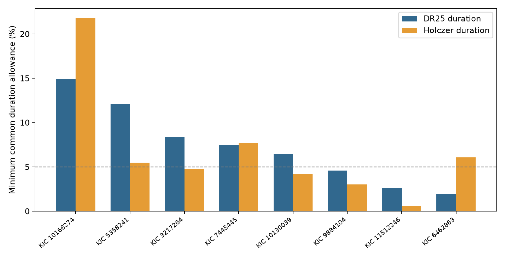

# Three of eight selected Kepler systems retain circular-plane duration conflicts above a five percent allowance in two catalog fits

Three systems retain a duration conflict in both the Kepler release 25 catalog and a separate transit-time analysis. Each needs duration changes greater than five percent to fit circular orbits in one plane. This result uses eight complete systems from a prior list of 18 leads. It assumes one host and uses the release 25 radius ratios in both tests. It does not establish new planets, unusual forces, or measured orbital tilts.



Bars show the smallest common fractional allowance on every duration for a feasible circular-plane model. The five percent line is a chosen comparison scale. It is not a confidence level. The catalog fits share Kepler photons.

## Question and prior work

Do joint duration conflicts persist when another analysis fits the transit times? A linear ephemeris can broaden a folded transit when event times vary. A different fit can also change contact times through limb darkening, sampling, noise, or detrending. This check helps decide which catalog leads need new light-curve fits.

We ran `sci search` for astronomy, exocomet, and duration in the campaign. We read published SCI results 5e7a70899846679b5b2a5184628f1e173c18979ff026227fa77d5840ec556165, da11e73593b6a97dc19593cdf5486efd874ee94ab0636b43220fb137a20c3e0c, and f28a707aeb1d3f5dcde5a918feb478b6579c2790b81b50e060bc49fa9f3b1408. The first supplies the 18 systems whose pairs all pass but whose joint fit fails in three-error boxes. We use that fixed list. We do not use private worker files. Duration ratios and common-plane tests are established methods; see Fabrycky et al. (2014), doi:10.1088/0004-637X/790/2/146. Our addition is a cross-fit duration check, a fractional sensitivity measure, and timing diagnostics for these leads.

Holczer et al. (2016), doi:10.3847/0067-0049/225/1/9, fitted event times and updated transit templates in an iterative process. Their table 2 gives first-to-fourth contact durations. Their table 3 gives timing residuals, errors, and rejection flags. Thus, these data permit a test against a different fit method. They do not supply a new telescope observation. We also checked the NASA column definitions and the known identity of the leading system, Kepler-267. No search here establishes priority for a physical anomaly.

## Data and exact scope

The shared input is the NASA Exoplanet Archive `q1_q17_dr25_koi` snapshot:

`/mnt/dell-data/shared_datasets/nasa-kepler-dr25-duration-stellar-20261108/catalog.csv`

Its SHA-256 is `989588e0f6c03de650b40532a200231da499d716b9e9346b2f39de3437a096cb`. We checked the bytes and reused the file without change. The package includes only its 63 selected records as `files/dr25_selected.csv`. `files/provenance.json` records the full query URL, source version, exact shared path, byte count, and hashes. The published parent result supplies the 18-system selection in `files/prior_leads.csv`.

We queried VizieR J/ApJS/225/9 tables 2 and 3 at the Harvard mirror for all 63 signal names. These small query responses remain on local disk and are frozen here. The source headers state units and query URLs. File hashes and byte counts are in the provenance record. No shared download directory was changed. A direct request to the Strasbourg ReadMe server timed out; the Harvard responses and the primary paper supplied the needed definitions.

Match each signal by its exact KOI name. Also require agreement in KIC host ID. Table 2 matches 50 of 63 signals. Only eight of the 18 systems have every selected signal. Ten systems lack at least one signal and are not tested with a mixed set of durations. In particular, Kepler-26 lacks K00250.03. Counts based on partial host matches would give the wrong sample. `files/system_comparison.csv` lists all 18 systems and their coverage. This selected and incomplete sample gives no population rate.

## Model and sensitivity test

Assume one spherical host star, negligible planet masses, circular orbits, and one inclination i. Use period P in days, total contact duration T in hours, and radius ratio k. Write a/R = A P^(2/3). The exact circular contact equation gives:

```
y = sin(pi T/(24 P))^2
u = (1+k)^2/P^(4/3)
y = B u - C
B = A^(-2)/sin(i)^2 > 0
C = cot(i)^2 >= 0
```

Use release 25 periods and radius ratios for both duration sets to isolate duration changes. At allowance d, each T can vary independently in [T(1-d), T(1+d)]. Transform its limits to yl,yh. With fixed k, require `yl <= B u - C <= yh` for every signal. Also repeat with k allowed within its release 25 asymmetric three-error box, clipped below at zero. In this case u has limits ul,uh, and feasibility requires `B ul-C <= yh` and `B uh-C >= yl`. The two catalogs do not provide a common covariance or common duration error model. We therefore do not borrow release 25 duration errors for the other fit.

Find the smallest d by 45 bisection steps on [0,0.999]. These intervals are sensitivity allowances, not confidence regions. Five percent is a reporting scale chosen for this comparison, not a discovery threshold. No measured density is used. The sine transform retains finite contact duration and planet radius.

An independent linear program checks the algebraic test. The algebra requires B at least max(yl/uh), and every ordered pair gives `B(ul_i-uh_j) <= yh_i-yl_j`. Each puts a bound on B. Their intersection must be nonempty. The two methods agree at 224 cases around the thresholds and at fixed allowances. One hundred synthetic circular-plane systems also pass. These checks validate the calculation, not the astronomical model.

## Results

The table uses fixed release 25 radius ratios. Values are percentages.

| KIC | Release 25 minimum allowance | Holczer minimum allowance |
| --- | ---: | ---: |
| 10166274 | 14.93 | 21.80 |
| 5358241 | 12.08 | 5.49 |
| 3217264 | 8.36 | 4.78 |
| 7445445 | 7.45 | 7.73 |
| 10130039 | 6.50 | 4.17 |
| 9884104 | 4.58 | 3.03 |
| 11512246 | 2.67 | 0.60 |
| 6462863 | 1.94 | 6.07 |

Five systems exceed five percent with release 25 durations; four do so with Holczer durations. Three do so in both: KIC 10166274, 5358241, and 7445445. The same three remain above five percent when the radius ratios can vary in their three-error boxes. Their Holczer allowances then become 21.14, 5.15, and 6.48 percent. This persistence selects leads for fit checks; it does not select a physical explanation.

The result changes materially for some systems. KIC 6462863 moves from 1.94 to 6.07 percent. KIC 11512246 moves from 2.67 to 0.60 percent. Thus, another fit can increase or reduce a conflict. Across the 50 matched signals, the median signed duration change is +4.70 percent. This is a selected sample statistic, not a general catalog bias estimate.

Replacing the periods with the Holczer periods changes any Holczer allowance by less than 0.00000070 in fractional units. Thus, period differences do not explain the changes in this test. Both calculations still use release 25 k; this is a controlled hybrid comparison, not a joint re-fit of all physical parameters.

## Timing and physical checks

For each signal, retain timing records with Out=0, Over=0, no timing-error asterisk, and finite positive errors. Remove a weighted constant and linear trend in transit number. Report residual scatter as 1.4826 times its median absolute deviation, and compare it with the median timing error. This removes offsets and ephemeris slope differences. It does not fit a dynamical model or remove stochastic measurement noise. Full results and retained counts are in `files/signal_comparison.csv`.

The strongest duration conflict is KIC 10166274, the known Kepler-267 system. Its three Holczer durations are 1.9309, 1.5510, and 2.9048 hours. Their timing scatters are 13.57, 8.60, and 8.68 minutes, against typical errors of 20, 10, and 10 minutes. The retained timing counts are 204, 101, and 23. Scatter below the error scale does not show resolved timing variation. It also does not exclude variation below that scale. The single-event signal-to-noise values are only 4.0, 4.4, and 6.2. We cannot attribute the duration conflict to timing broadening from these numbers.

Different inclinations give a simple physical explanation. A constructed circular model for Kepler-267 has density 4.3408 g/cm3 and inclinations 89.99957, 87.90240, and 89.29401 degrees with aligned nodes. It reproduces the three Holczer durations. The inclination span is 2.09717 degrees. This is an existence example, not an inclination estimate, density measurement, minimum tilt, or stability proof. The same construction works for all eight complete systems. `files/physical_examples.json` records the parameters, exterior-orbit checks, and reconstruction errors, all below 1e-8 hour. Eccentric orbits, biased fits, and separate hosts remain possible.

## Limits and conclusion of the test

The study finds no new planet or independent observational confirmation. It supplies a derived cross-fit table and identifies three persistent conditional model conflicts. A single common circular plane is a restrictive hypothesis. Ordinary mutual inclination can violate it. The five percent scale has no calibrated detection probability.

Both catalogs use Kepler photons. They can share detector artifacts, stellar variability, dilution, and sampling effects. The Holczer fit changes more than the treatment of event timing, so duration differences do not isolate a timing cause. Missing duration uncertainties, radius-duration covariance, low event signal strength, and the use of release 25 k in both tests limit physical inference. No pixel localization, detector-season test, new transit fit, velocity measurement, or independent telescope data were used. Catalog consistency is not source validation. A useful next test would fit individual event times and exposure-integrated shapes, then check target pixels and independent photometry for the three persistent leads.

## Reproduction and job record

Job: sci-1107-dell-astronomy-309dcf55e658. Topic: astronomy. Campaign: 11_07_2026. Machine: dell. Account: codex-andrii. Model: gpt-6.1-sol, high reasoning effort. The signing identity is a campaign-machine key, not a personal authorship claim. No private key is included.

From an extracted bundle root, run:

```
python files/analyze.py
python files/physical_check.py
```

These commands run offline with the frozen input files. They check input hashes and replace only derived tables, the figure, and result JSON files. Package versions are in `files/requirements.txt` and `files/provenance.json`. The shared raw catalog need not be copied. To check it against the selected records on this machine, run `python files/check_shared.py`. The exact remote query URLs are in the provenance and response headers. Live VizieR responses can have different header dates and hashes; use the frozen bytes for exact reproduction. No upload or remote SCI submission is required.
