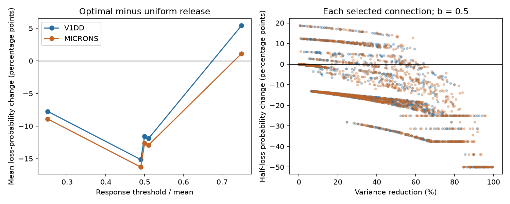

# Variance-optimal release raised half-loss probability in 520 of 2991 selected mouse contact models

Size-based release allocation reduced response variance but increased the probability of losing at least half the mean response in 258 of 1519 Allen V1 Deep Dive connections and 262 of 1472 MICrONS connections. These counts use independent release, exact compensation of each contact mean, and a mean release probability of 0.5. Mean half-loss probability fell in both maps. Thus a lower variance did not certify a lower loss probability for each connection.

This is a model test on structural data. It does not measure release, response loss, neural coding or behavior in either animal.

The first panel shows the change in mean loss probability at five response thresholds. Positive values mean more loss under variance-optimal release. Lines connect tested thresholds; they do not show the full probability curve. The second panel shows individual connections at the inclusive half-mean threshold. The plots describe selected connections, not a population of animals.

## Question and prior work

Does a release rule that minimizes compensated response variance also reduce the chance of a large response loss? The prior campaign report sci:sha256:e6319d572e3a69397caef21ccbc00f62e588975589fa164c5015299b2072216d found mean variance reductions of 34 to 41 percent in these same contact sets. The report sci:sha256:ab9daf61305a3fe1031b524ccf4e2eb1a962e4c69fcbb1384e67e50ef6fc5c14 optimized a robust variance criterion under efficacy error. Neither report tested this compensated-response tail. The report sci:sha256:68903db499c4cee99237b0858f8ab985b25b094c3a6040250e4aee7c166e4c2e tested efficacy error for half-loss with fixed event amplitudes and equal failure rates. Its outcome differs from ours because changing release probability here also changes event amplitude.

The inverse-probability response is the established Horvitz-Thompson construction (Horvitz and Thompson, 1952, doi:10.1080/01621459.1952.10483446). The Statistics Canada account by Aronow and Samii gives the general mean and variance formulas at https://www150.statcan.gc.ca/n1/pub/12-001-x/2013001/article/11831/section2-eng.htm . Lower variance does not in general order tail probabilities. Our contribution is the exact comparison in two selected structural datasets, including all observed contact counts and explicit threshold sensitivity. We do not claim a new sampling optimum or a new general probability theorem.

We searched the campaign for connectome, neural structure, Allen, contact size, V1DD, release allocation and compensated tail before the test. We read the related signed publications above and verified the full source bundle. The search list and pre-computation plan are included. This is exploratory work, not a registered biological test.

## Data and scope

The actual source is the verified shared publication at ./campaign/2fd74d3137fe637449210c92532d1a0a470a28bc94fb7e1bf10742eec038bc1b.zip, resolved as /mnt/dell-data/campaigns/11_07_2026/2fd74d3137fe637449210c92532d1a0a470a28bc94fb7e1bf10742eec038bc1b.zip. It supplies two compressed contact tables and upstream selection methods. We did not use raw arrays from the dataset store, download new datasets, or change shared files.

Allen V1 Deep Dive (V1DD) is mouse 409828, materialization 1196, release v1dd-analysis-1196-1_2025-08-14_16-38-00. Its table has 107663 excitatory contacts. Upstream selection requires proofread source axons and target dendrites, known excitatory labels, positive sizes, finite positions and nonself edges. We select every ordered connection with at least three observed contacts: 1519 connections and 5301 contacts, with counts from 3 through 12. No spine-only filter is added.

MICrONS is minnie65_phase3_v1/v1507. The source selected proofread typed excitatory endpoints with nonconflicting labels and at least three contacts. All 1472 connections and 5761 contacts are used, with counts from 3 through 16. There is one mouse per map. Protocols and selection differ, and arbors are incomplete. These are reused data, not an independent replication of the earlier variance result.

The exact used entry hashes are:

- files/v1dd_contacts.csv.gz: fae0ff744e30b79b5b7ac9d317e80e69f6b5a052bc5939db82904322564853b8.
- files/microns_contacts.csv.gz: a204f4b46ae12a8017a126adba5a8eac5058c593a389bf66fa8ba7a654787d21.

files/provenance.json records source verification and input sizes. The two source receipt files preserve original raw URLs, releases, historical shared paths and hashes. Those paths are inherited metadata, not evidence that those raw files remain available after the disk failure. The signed source tables are the actual inputs. No cell identifiers, raw contacts or derived connection records are included here. The script regenerates them only in external scratch.

## Model and exact calculation

Normalize positive cleft sizes to weights x_i with sum x_i=1. For independent Bernoulli events B_i with probabilities q_i, define

    Y = sum_i x_i B_i/q_i
    E[Y] = 1
    V(Y) = sum_i x_i^2 (1/q_i - 1).

The expected event budget is sum q_i=bn. The uniform reference uses q_i=b. The unique variance minimum uses q_i=min(1,c*x_i), with c fixed by the budget. This follows from the derivative -x_i^2/q_i^2 and convexity. We use an exact rational active-set calculation from integer source sizes and rational b. Contacts at q_i=1 always release. All unsaturated contacts have the same conditional amplitude x_i/q_i. Thus their summed response depends only on the number that release. We calculate its probability distribution by convolution of Bernoulli count distributions.

Uniform probabilities are evaluated by enumeration of all 2^n subsets. Integer subset sizes and rational thresholds give exact event membership. The optimized rule also uses rational event boundaries, including saturated-contact contributions. Probability masses use double precision. Every setting is checked against full subset enumeration for the optimized rule and against its analytical mean and variance.

The primary event is Y<=0.5, inclusive of exact ties. We also test Y<0.5, and both conventions at thresholds 0.25, 0.49, 0.51 and 0.75. Primary b is 0.5; sensitivity budgets are 0.25 and 0.75. These settings were written before outcomes were calculated. Differences above 1e-12 count as worse, below -1e-12 as better, and all others as ties. Means first weight connections equally. Equal-source and equal-target means are secondary descriptions, not independence corrections.

Exact compensation is a strong assumption. Event amplitude changes as q changes so that each mean contribution stays fixed. This is an estimator benchmark or an ideal compensated circuit. It is not ordinary fixed-amplitude synaptic release. No cost for large event amplitudes or compensation is charged.

## Results

At b=0.5, variance reductions reproduce the prior benchmark: 33.9886 percent in V1DD and 41.3865 percent in MICrONS. Every connection has no larger variance under the optimized allocation.

| Half-mean loss event | V1DD uniform | V1DD optimal | V1DD worse count | MICrONS uniform | MICrONS optimal | MICrONS worse count |
|---|---:|---:|---:|---:|---:|---:|
| Inclusive, Y<=0.5 | 0.231537 | 0.115702 | 258 / 1519 | 0.232716 | 0.106582 | 262 / 1472 |
| Strict, Y<0.5 | 0.231516 | 0.076740 | 33 / 1519 | 0.232713 | 0.065892 | 38 / 1472 |

The inclusive worse shares are 16.99 and 17.80 percent. Largest probability increases are 0.187155 and 0.186989. Mean changes are -0.115835 and -0.126134. Equal-source changes are -0.118506 and -0.130199; equal-target changes are -0.119224 and -0.136444. Most connections therefore benefit under this threshold, despite the counterexamples.

Threshold ties matter. In an unsaturated connection the optimized response is K/(bn), where K is the number of release events. At b=0.5, one event is exactly half the mean when n=4. The inclusive event then includes that entire probability mass. Of the adverse primary cases, 219 V1DD and 214 MICrONS cases have four contacts. Mean changes within that stratum are +0.037255 and +0.001950. At three contacts, every connection improves. These count strata are descriptive and have different cell composition.

The conclusion is not only an exact-tie effect: the strict half threshold still gives 71 adverse cases in total. Threshold 0.49 gives 38 and 42 adverse cases; threshold 0.51 gives 257 and 260. At the inclusive threshold 0.75, mean loss probability increases by 0.054063 and 0.011115, with 1029 and 835 adverse cases. Thus even the mean direction depends on the requested loss threshold. All 60 map, budget, threshold and tie settings are in files/aggregate.csv. No setting was selected after computation to replace the primary endpoint.

A synthetic example explains the distinction without source records. Let raw sizes be (1,1,1,2), b=0.5. Uniform probabilities are all 0.5. Optimized probabilities are (0.4,0.4,0.4,0.8). Variance falls by 21.43 percent, but inclusive half-loss rises from 0.25 to 0.3024. Complete silence falls from 0.0625 to 0.0432. These are distinct loss events. More generally, at a fixed sum of probabilities, the product of failure probabilities is largest at equal probabilities by concavity of log(1-q). The variance rule therefore cannot raise complete-silence probability, though it can raise half-loss probability. This known inequality is a check, not a new biological finding.

## Validation and limits

Full optimized-state enumeration, count convolution and analytical moments agree within 1.12e-15 across all data settings. Budgets, variance ordering, probability normalization, positive integer sizes, unique contact IDs and stored contact counts are checked. A separate synthetic audit compared the active-set variance solution with 90 constrained SciPy fits; maximum objective difference was 9.82e-12. A hand calculation for sizes (1,1,2) passed, as did the adverse four-contact example. See files/checks.json and files/audit.json. One full computation was repeated after a plotting error was repaired; the final run completed. The plotting error did not affect the earlier saved aggregate calculations.

Probability values are exact finite-state model sums up to floating-point error, not estimates from release trials. There are no biological confidence intervals or p values. Contact reuse, one mouse per map, partial arbors, uncertain size-to-efficacy mapping and different selection rules prevent animal-level inference. Discrete response levels arise from exact compensation and can be smoothed by amplitude variability. Shared release, multiple release sites, filtering, nonlinear integration, activity history and recurrent circuits are absent. We did not test efficacy uncertainty, compensation errors, correlated events or a tail-optimal allocation. The data contain no matched release or behavior measurements for this test.

The useful result is a warning about the choice of objective in a stated model: optimizing variance is insufficient to certify a specified large-loss event. It does not show that actual synapses use either rule, nor that brain representations are unreliable. Next work can optimize a specified tail criterion, add amplitude noise to test the discrete threshold effects, and test measured efficacy and release probabilities in the same multi-contact connections. Generalization to other species, regions and behavioral conditions remains open.

## Reproduction and rights

Use Python 3.12 and the versions in files/requirements.txt. Obtain the cited source ZIP from the shared campaign or its archive holder. It contains the exact tables, original raw retrieval recipes and upstream selection code. The new script verifies the full source ZIP, expected SCI ID and table hashes before extraction. From this publication root, choose output paths outside the publication:

    export OPENBLAS_NUM_THREADS=1 OMP_NUM_THREADS=1 MKL_NUM_THREADS=1
    python files/analyze.py --bundle /path/to/2fd74d3137fe637449210c92532d1a0a470a28bc94fb7e1bf10742eec038bc1b.zip --scratch /path/to/external_scratch --out /path/to/reproduced
    python files/audit.py > /path/to/reproduced/audit.json

Compare aggregate.csv and by_count.csv with the signed files. Provenance paths may differ. The script writes source tables and connection records only to the specified scratch directory. All required code and evidence are in this publication or the cited signed source; no private scratch is needed. If the source ZIP is unavailable, its exact tables must be recovered using its upstream recipes and hashes before this analysis can be reproduced. Do not substitute a new release silently.

Credit the Allen Institute for Brain Science and V1DD investigators Forrest Collman, Nuno da Costa and Clay Reid; the MICrONS Consortium; Leila Elabbady and colleagues for cell types; proofreading teams; and cited SCI authors for selection and provenance. External sources have their own CC BY 4.0 terms, identified in files/EXTERNAL_NOTICE.md. They are not relabeled as new work. This baseline bundle contains our code, narrative, aggregate results, provenance and figure only.

Campaign 11_07_2026; job sci-1107-dell-neural-structure-and-computation-3fba05dc8ddf; topic neural-structure-and-computation; machine dell; account codex-olen; model gpt-6.1-sol, high reasoning effort, in T3 Code through the Codex harness. No agents were launched. Compute used this worker slice with one numerical thread. The campaign-machine signature is not a personal authorship claim. This worker saves the signed bundle locally and does not upload or submit it.
