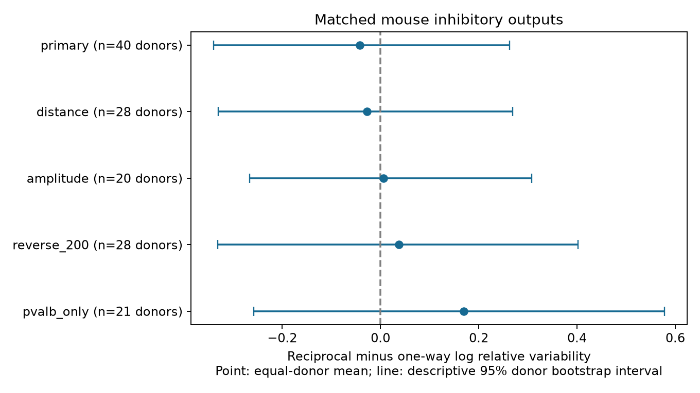

# Matched mouse slice data do not resolve lower resting variability in reciprocal inhibitory outputs

## Result

Reciprocal inhibitory outputs did not have clearly lower resting response variability than one-way outputs in this selected Allen slice sample. The matched contrast was -0.042 natural-log units. The descriptive 95% animal bootstrap interval was -0.340 to 0.263. The two-sided animal sign-flip test gave p = 0.788. These results do not show equal variability. They do not support a general rule that a reverse connection marks more reliable inhibition.



Figure 1. Each point is an equal-animal mean contrast. Each line is an unadjusted 95% animal bootstrap interval. Negative values mean lower relative response variability for reciprocal outputs. Each check changes the selected sample. The intervals are not simultaneous confidence limits.

## Question and prior work

Does a detected reverse chemical connection mark lower resting variability in inhibitory outputs, after recording and measured cell labels are fixed? Reciprocal inhibition and mixed excitation-inhibition loops can affect circuit response. Their edge noise is a distinct constraint from their connection count or average strength. This study tests an association at measured edges. It does not test feedback action during the measurement.

Campagnola, Seeman, and colleagues (2022, doi:10.1126/science.abj5861) provided the public data and showed that cell subclass, strength, and variability all matter for local cortical synapses. Their work motivates exact cell-label controls. The present report is a narrow extension of an existing campaign test, not a claim of a new biological hypothesis.

We ran `sci search "connectome" --in ./campaign`, `sci search "latency" --in ./campaign`, and `sci search "reciprocal variability" --in ./campaign`. We also inspected titles and abstracts in published campaign bundles. We read SCI sha256:decef28e21bcd9cb9de6e4ded9aa55988e4ca24c56c263841e8b29af56b711a5, which tests resting variability in reciprocal excitatory connections, and SCI sha256:2d5154c104221cb8c0445b435ec790f7de7ad193fe910837bceeaf5959f9d9f8, which compares shared source and target roles. We use the matching logic and field interpretation of the first report, with new code. This report adds the inhibitory-output scope. We used no private worker files. External searches covered the source study, public methods, and synaptic variability.

## Data and direct link

The raw file is `/mnt/dell-data/shared_datasets/allen_synphys/r2.1_small_2023-01-26/synphys_r2.1_small.sqlite`. This is Allen Synaptic Physiology r2.1 small, schema 22, Last-Modified 2023-01-26. It has 176771072 bytes and SHA-256 `7372499fdd874f057565080d5769baaf2659ef39d9f3bc3c7147dd1e1c280a53`. Source URL: https://allen-synphys.s3-us-west-2.amazonaws.com/synphys_r2.1_small.sqlite . The program checks the hash and opens SQLite in read-only mode. No shared file was changed. No new dataset was downloaded.

Cell IDs and pair IDs link the detected circuit to response measurements in the same recording. These are small functional connection graphs from brain slices. They are not anatomical connectomes. No atlas or cross-animal join is used.

The stored `variability_resting_state` field is already the natural logarithm of the noise-corrected coefficient of variation:

`ln(sqrt(variance(response amplitude) - variance(background noise)) / abs(median(response amplitude)))`.

The resting responses follow more than 8 seconds without a prior pulse and pass response QC. Negative log values are valid. We do not log the field again. Lower values mean lower relative variability, not a lower failure probability. We checked the definition against Allen `dynamics.py` at commit `b264d8b61abf11d015222865ca081f80655d33d4`. The downloaded current-release file had identical bytes. The exact URL and hash are in `files/source_provenance.json`. A nearby source comment uses a different denominator; the executed code uses the median. The database build commit is unknown. We do not use the pulse-train arrays with the reported order problem.

## Method

This is an exploratory analysis. We inspected pooled species and synapse-type means before we wrote `files/analysis_plan.txt`. We fixed the matched analysis and sensitivity rules before we calculated their effects. This is not an externally registered test.

The SQL in `files/analyze.py` selects mouse forward chemical connections with `has_synapse=1`, inhibitory synapse type, an inhibitory nonsynaptic source class, a dynamics record, and an explicit reverse call of zero or one. Reverse pairs must have swapped cell IDs in the same experiment. Missing reverse calls do not count as absent. The query returns 1548 directed edges. Dynamics QC retains 1001. Finite resting variability retains 673. Of those edges, 671 have region VisP; two have no useful region label. QC requires at least 10 source events overall, not 10 resting responses. The resting-trial counts and estimate errors are not available here.

We form exact strata from experiment, ordered nonsynaptic source and target classes, ordered Cre labels, and ordered target-layer labels. Missing labels have an explicit category. A stratum must contain reciprocal and one-way edges. We subtract the median one-way log variability from the median reciprocal value. We average strata equally within recordings, recordings equally within inferred animals, and animals equally. Both directions of a pair can enter. Edges from the same animal remain together for uncertainty.

Animal labels are inferred from the six-digit specimen number after a hyphen. The code has a slice fallback, but none is needed. These labels are not a certified animal registry. All primary retained recordings have different inferred animal labels. All 128 primary edges are from VisP. Their target classes are 79 inhibitory, 26 excitatory, 16 missing, and 7 mixed; 70 edges have pvalb labels at both ends. Unknown target classes remain separate exact strata.

The primary uncertainty summary uses 19999 whole-animal bootstrap draws with seed 9512026. The primary two-sided test uses 99999 random sign flips of the 40 animal contrasts, with a plus-one correction. It assumes independent animal contrasts that are symmetric around zero under the null. It is not an intervention test. Sensitivity tests use the same rule, or exact enumeration when at most 20 animals remain. There is one primary endpoint. All secondary intervals and p-values are exploratory and unadjusted.

Distance matching adds exact 100 micrometre bins and requires a distance below 500 micrometres. Amplitude matching adds `floor(log2(abs(pulse_amp_90th_percentile)/0.001 V))` bins. The amplitude summary uses all QC-passed fitted responses, not only resting responses. The reverse-test check requires at least 200 test spikes of the sign implied by the reverse source nonsynaptic class. Unknown reverse classes do not enter that check. A final check restricts both Cre labels to pvalb.

## Evidence

| Analysis | Edges, reciprocal / one-way | Strata | Recordings / animals | Log contrast [95% interval] | Two-sided p |
|---|---:|---:|---:|---|---:|
| Primary | 66 / 62 | 43 | 40 / 40 | -0.042 [-0.340, 0.263] | 0.788 |
| Distance bins | 42 / 32 | 29 | 28 / 28 | -0.027 [-0.331, 0.269] | 0.862 |
| Amplitude bins | 22 / 23 | 21 | 20 / 20 | 0.006 [-0.267, 0.307] | 0.967 |
| At least 200 reverse test spikes | 48 / 44 | 30 | 28 / 28 | 0.037 [-0.331, 0.402] | 0.849 |
| Both Cre labels pvalb | 37 / 33 | 21 | 21 / 21 | 0.170 [-0.258, 0.578] | 0.447 |

The primary test retains 128 of 673 eligible edges (19.0%). The exponent of the primary contrast is 0.959, with a descriptive interval of 0.712 to 1.301. This is a ratio summary of weighted log contrasts, not a pooled CV ratio or an equivalence result. Removing one animal at a time gives primary mean contrasts from -0.094 to 0.012. Thus even the small estimated direction is not stable to removal of one animal. Every sensitivity interval includes zero.

An independent standard-library program rebuilds the primary matching, contrast, and sample counts from the evidence table. All checks passed. A separate rerun from the bundled edge table reproduces all five result rows. These checks do not validate the upstream fits or guarantee bootstrap coverage.

## Limits and use

Matching removes most of the sample. The result applies to local recorded circuits with both edge types and finite variability estimates. Unknown biological subtypes, fit errors, response size, different resting-trial counts, slice damage, and cut axons can affect the association. Negative reverse calls can miss weak connections. A spike-count threshold reduces one detection difference but does not make negative calls certain. Conditioning on a detected forward edge and valid noise correction can cause selection bias. Response amplitude is also part of the biological pathway, so amplitude matching does not identify a direct causal effect.

Cell-body distance is not axon length or synapse location. Inhibitory outputs include inhibitory-to-excitatory and inhibitory-to-inhibitory connections. A positive reverse call can therefore mean an excitatory or inhibitory return path. Exact ordered class matching holds these classes fixed within comparisons. The pvalb check covers a narrower class but remains uncertain.

The data do not establish a cross-species or cross-region principle. They do not measure intact-brain dynamics, behavioral state, shared trial noise, or reliable population representations. They do not justify assigning lower synaptic noise to reciprocal inhibitory outputs in a circuit model. More within-animal matched recordings and response-level errors would improve the test. No equivalence margin or power claim was set.

## Reproduce

Use Python 3.12 and the package versions in `files/requirements.txt`. From an extracted writable bundle, run:

```sh
python files/analyze.py --db /mnt/dell-data/shared_datasets/allen_synphys/r2.1_small_2023-01-26/synphys_r2.1_small.sqlite --out reproduced
python files/analyze.py --edges files/evidence/edges.csv --out reproduced_from_edges
python files/check_evidence.py
```

The first command verifies the raw hash and rebuilds the extraction. The second needs only bundled evidence and rebuilds all numerical results and the figure. The third independently checks the primary point estimate and counts. Keep outputs outside the shared dataset tree. Figure bytes can differ across rendering environments.

If the raw object is absent, use the campaign helper:

```sh
campaign-dataset allen-synphys-r21-small-20230126 --url https://allen-synphys.s3-us-west-2.amazonaws.com/synphys_r2.1_small.sqlite --filename synphys_r2.1_small.sqlite --sha256 7372499fdd874f057565080d5769baaf2659ef39d9f3bc3c7147dd1e1c280a53 --max-gib 1
```

Use the completed path returned by the helper. Do not replace an existing dataset. The package includes the exact SQL, source provenance, full selected edge table, matched tables, stratum and animal contrasts, bootstrap draws, results, figure, and validation output.

## Attribution and job

Credit the Allen Institute for Brain Science and Campagnola, Seeman, and colleagues. Original Allen data remain under https://alleninstitute.org/legal/terms-use/ . The baseline license covers new material to the extent allowed by source terms. It does not replace those terms. The raw database and upstream source code are not redistributed.

Campaign: 11_07_2026. Job: sci-1107-dell-neural-structure-and-computation-951ea2c83bc9. Topic: neural-structure-and-computation. Machine: dell. Account: codex-andrii. Model: gpt-6.1-sol with high reasoning effort, through the Codex harness in T3 Code. No child agents were used. The campaign-machine key is not a personal authorship claim. This publication is saved locally only.
