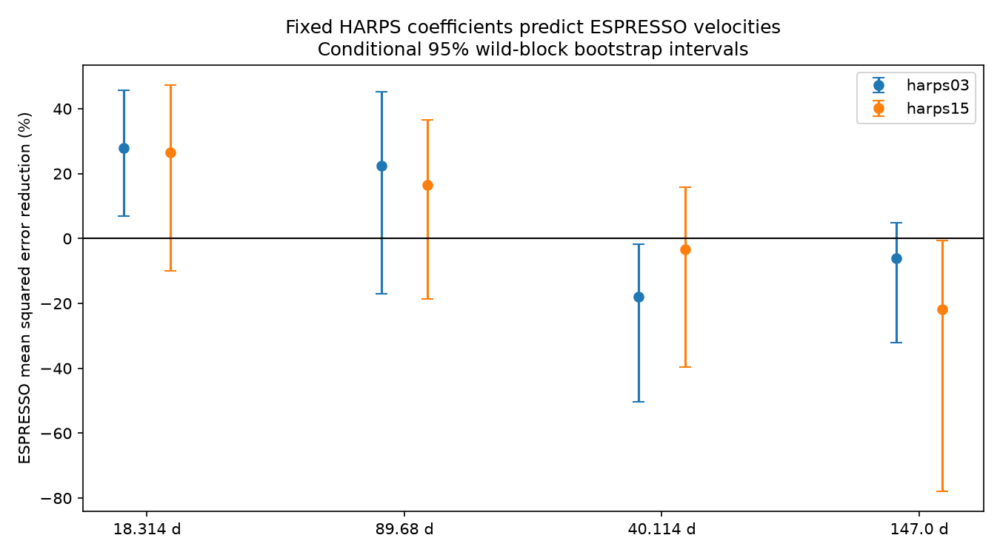

# HARPS templates near 40.114 days increase ESPRESSO prediction error in 36 tests for HD 20794

## Result

A fixed periodic velocity curve fitted to HARPS data does not improve the prediction of ESPRESSO data near 40.114 days. Error increases in all 36 tested settings. The earlier HARPS sample gives an error increase of 17.93 percent in the main test. Its 95 percent conditional interval is 1.85 to 50.23 percent. These results apply to the stated periods and linear models. They do not exclude all planets near 40 days.

The main control at 18.314 days reduces mean squared error by 27.85 percent. The 89.68-day control reduces error by 22.36 percent, but its interval includes zero. No new signal, planet, or physical cause is established.



## Question and prior work

Can a fixed HARPS velocity curve predict an independent instrument at the disputed periods near 40 and 147 days? This test is useful because a large fit amplitude alone does not show that a weak signal repeats.

Nari et al. (2025, DOI 10.1051/0004-6361/202451769) find planets at about 18, 89 and 648 days. They find no support for a 147-day planet. Their ESPRESSO-only data show weak power near 40 days. They favor a stellar rotation cause for that signal, based on activity indicators and its lack of long-term persistence. Earlier work reports a 40-day signal (Pepe et al. 2011) and a 147-day candidate (Feng et al. 2017). We use the period values in these works, as reported by Nari et al. This study adds a fixed-coefficient prediction audit. It is not the first study to question these candidates.

Before selection, SCI searches for `astronomy`, `HD 20794`, and `HD20794` were run in the shared campaign. The two target searches returned no records. No private worker files were read. Search details are in `files/campaign_search.json`.

## Data and selection

We reuse CDS catalog J/A+A/693/A297 from the shared store. The exact input is `./datasets/hd20794-nari2025-cds-a297-tsv-02c8eca1/hd20794.tsv`. Its SHA-256 is `400611a0b6d1b2ee602182a5f50b97aed6e51247fe6564dcdbd84bfede5acac6`. It has 3,077,342 bytes. The VizieR response header records retrieval on 2026-11-09. `files/provenance.json` gives the source URL and resolved shared path. We did not download new raw data or change shared data.

We use the HARPS YARARA v2 sample before the 2015 fiber change (H03), the HARPS YARARA v1 sample after that change (H15), and the ESPRESSO SBART sample after BJD 2458721 (E19). Other tables in the TSV are not used. H03 and H15 already contain nightly data. E19 contains individual exposures. We convert E19 velocities and errors from km/s to m/s and subtract 2400000 from its BJD values. All times then use BJD minus 2400000.

We group each sample by the integer part of the time. Each nightly value is an inverse-variance mean. Its error is the inverse square root of the sum of inverse variances. We make one cut per sample: remove errors above three times the median error and velocities more than three population standard deviations from the median. We then subtract each sample's median velocity. The accepted counts are 512 H03 nights, 231 H15 nights, and 64 E19 nights. E19 starts with 661 exposures on 65 nights. The accepted E19 count differs from the 63 nights in Nari et al.; this is our explicit selection, not an exact reproduction of their private selection. No cut was changed after scoring. `nightly_audit.csv` includes all nightly means and the cut mask.

H03 spans time 52901.87 to 57066.55. E19 spans 58721.83 to 60029.49. Thus H03 precedes the test data. H15 spans 57255.80 to 60397.49 and overlaps E19. H15 is an instrument check, not a second future-time test. HARPS and ESPRESSO have different instruments but observe the same star. Shared stellar noise can affect both.

## Models and score

Each target has two coefficients: cosine and sine of 2 pi times (time minus 55000) divided by period. Both coefficients are fitted to one HARPS sample and held fixed for E19. Periods are fixed at 18.314, 89.68, 40.114 and 147.0 days. There is no period search in E19.

Each model also has an offset, a linear time term, and sine and cosine terms at 647.6 and 323.8 days. The latter two periods give a simple representation of the known eccentric long-period signal. Terms at 18.314 and 89.68 days are included except when they are the target. These additional terms are nuisance terms. We fit all terms together in HARPS. In E19, we refit the nuisance coefficients for each comparison, but never refit the target coefficients.

The null model has only E19 nuisance terms. The transfer model has these terms plus the fixed HARPS target curve. The score is 100 times [1 minus transfer mean squared residual divided by null mean squared residual]. Positive scores show lower error. Scores use an unweighted mean over accepted nights. Fits use weights equal to 1 divided by (nightly error squared plus jitter squared). The main jitter is 0.8 m/s. We do not fit jitter to favor a target.

This is a partial prediction test. E19 nuisance coefficients use E19 measurements. The published periods were also inferred from data that include E19. Thus this is not a blind discovery test or a prediction of the full velocity curve.

## Measurements

| HARPS sample | Period (days) | Fitted amplitude (m/s) | E19 null RMS (m/s) | E19 transfer RMS (m/s) | Error reduction (%) | Conditional 95% interval (%) |
|---|---:|---:|---:|---:|---:|---:|
| H03 | 18.314 | 0.589 | 0.737 | 0.626 | 27.85 | 6.90 to 45.66 |
| H03 | 89.68 | 0.596 | 0.705 | 0.621 | 22.36 | -17.12 to 45.21 |
| H03 | 40.114 | 0.201 | 0.617 | 0.670 | -17.93 | -50.23 to -1.85 |
| H03 | 147.0 | 0.168 | 0.617 | 0.636 | -6.13 | -32.04 to 4.78 |
| H15 | 18.314 | 0.755 | 0.737 | 0.632 | 26.60 | -10.01 to 47.28 |
| H15 | 89.68 | 0.400 | 0.705 | 0.644 | 16.52 | -18.74 to 36.55 |
| H15 | 40.114 | 0.096 | 0.617 | 0.628 | -3.45 | -39.54 to 15.87 |
| H15 | 147.0 | 0.284 | 0.617 | 0.681 | -21.89 | -77.92 to -0.69 |

`files/scores.csv` contains all 144 fits: four targets, two HARPS samples, two nuisance choices, three jitters, and three periods per target. The second nuisance choice adds annual sine and cosine terms to check an instrument or seasonal effect. Jitters are 0.4, 0.8 and 1.2 m/s. Period offsets are 0 and plus or minus 0.0022, 0.10, 0.053 and 1.1 days for the four respective targets.

All 36 near-40-day scores are negative: -27.18 to -0.84 percent. These settings share data and are not 36 independent experiments. The 18-day scores are all positive. The 147-day scores change sign for H03, so the evidence for that target is weaker.

## Error checks and sensitivity

We use a fixed-design wild residual bootstrap. We fit each full model, keep its fitted mean, and multiply its residuals by random signs shared within 30-day calendar blocks. HARPS and E19 signs are independent. We refit both samples and recompute the score for 2000 draws. The intervals account for uncertainty in the fitted HARPS curve and E19 residuals under this model. They assume independent, symmetric residual blocks and fixed periods. They are not detection probabilities and are not corrected for multiple targets.

For H03, 1000-draw checks use 10-, 60- and 120-day blocks. The 40-day score interval remains below zero in each check. The 18-day interval remains above zero. These checks do not establish that longer correlations are absent. `block_sensitivity.csv` gives all intervals.

A noiseless synthetic test recovers each target with residual RMS below 1e-10 m/s. Injection tests add a coherent circular signal to both H03 and E19 at 16 equally spaced phases. At 1 m/s amplitude, all tested phases improve prediction for 40 and 147 days. At 0.5 m/s, some phases do not improve it. These deterministic checks show a limitation of the test at low amplitude; they do not measure survey completeness. `injection.csv` and `validation.json` retain the evidence.

## Physical meaning and limits

A stable circular orbit produces a repeated velocity curve. The failure of this fixed 40-day curve to transfer is consistent with variable stellar activity, an instrument effect, weak-signal fit noise, or an incorrect period. It does not distinguish those causes. The annual terms test one simple instrument explanation. The published activity evidence supports rotation as a possible cause, but we do not make a new activity measurement here.

Only 64 E19 nights are used. A period error can cause a phase error across the gap from H03. Our narrow period checks do not cover every possible orbit. We do not model a Gaussian process, perform a full Keplerian evidence comparison, test selection alternatives, or prove that the stated extra noise is white. The long-period nuisance curve has only two harmonics. All quoted intervals are conditional on these choices. The data are public observations already used in prior papers; no new independent observations were obtained. The contribution is a reproducible score audit and its sensitivity limits, not a newly confirmed or rejected physical object.

## Reproduction and provenance

Job: `sci-1107-dell-astronomy-a6c4a0b1829f`. Campaign: `11_07_2026`. Topic: astronomy. Machine: dell. Account: codex-andrii. Model: gpt-6.1-sol, high reasoning effort, through T3 Code and the Codex harness. The campaign-machine signing key is not a personal authorship claim. No agents were launched.

To reproduce the numerical analysis offline, copy or extract the verified publication and run:

```sh
python files/analyze.py
```

This uses the included nightly means and regenerates scores, checks and static PNGs. It takes about a minute in the prepared Python environment. Exact package versions are in `files/validation.json`; requirements are in `files/requirements.txt`. Results from other linear algebra libraries can differ at floating-point precision.

To rebuild the nightly data from the shared raw file, first run:

```sh
python files/prepare.py /path/to/datasets/hd20794-nari2025-cds-a297-tsv-02c8eca1/hd20794.tsv
python files/analyze.py
```

Outside this campaign, retrieve the TSV from the URL in `files/provenance.json` and compare its SHA-256 before use. The live service can change. The included nightly tables preserve the exact analyzed values if that hash is no longer available. Raw data are credited to Nari et al. and CDS/VizieR (dataset DOI 10.26093/cds/vizier.36930297). The shared raw file is not duplicated. `files/input_hashes.json` records hashes of the source and analyzed input tables. The baseline license covers our text, code, figures, and derived tables; original source rights remain with their holders.
