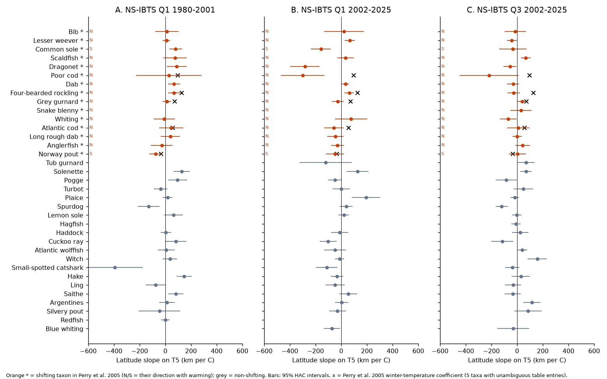
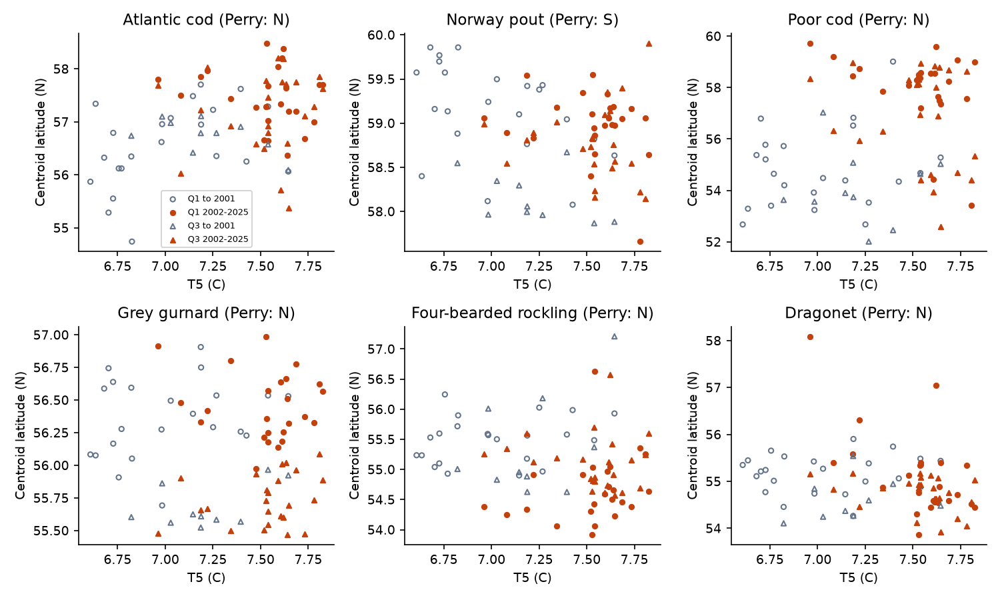
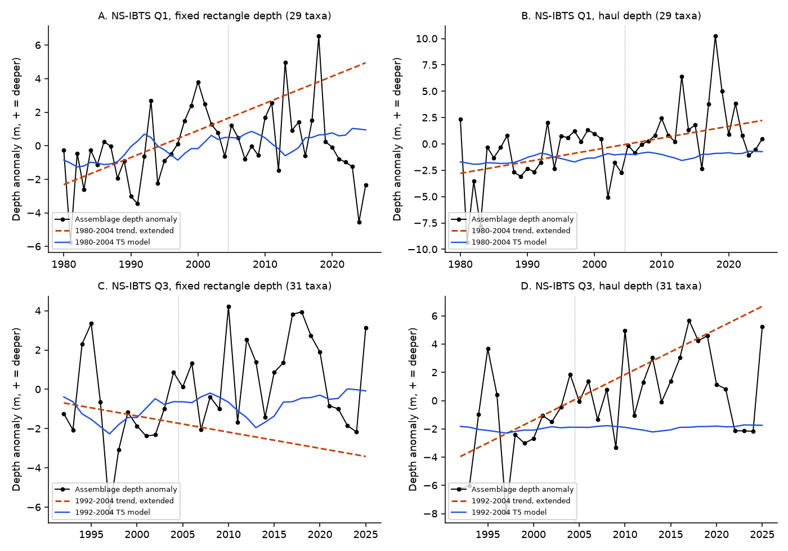

# North Sea fish latitude did not follow winter temperature in 2002-2025 as Perry et al. (2005) found for 1977-2001, in two IBTS survey seasons

Job `sci-1107-dell-climate-pollution-biodiversity-3953d613f346`, campaign 11_07_2026, topic climate-pollution-biodiversity, machine dell, model Claude Opus 5.5 (`claude-opus-5-5`). The signing key is a campaign-machine key. It does not make a personal authorship claim.

## Summary

Perry et al. (2005, *Science* 308:1912) found that the mean latitude of 15 of 36 North Sea demersal fish taxa moved with warming in 1977-2001. Thirteen taxa moved north and two moved south. Winter (December-March) bottom temperature was the main predictor. This result is one of the most cited examples of climate-driven fish range shifts. We tested it out of sample. We used the ICES DATRAS North Sea International Bottom Trawl Survey (NS-IBTS) for 2002-2025 in two seasons: quarter 3 (July-September, the season of the English survey that Perry et al. used) and quarter 1 (January-February). The temperature index was the HadISST December-March North Sea sea surface temperature, as a 5-year trailing mean (T5).

Main results:

1. **The pattern was present before 2002 in our data.** In NS-IBTS quarter 1 for 1980-2001, 11 of 14 Perry shifting taxa had a latitude slope on T5 in the Perry direction (one-sided sign test p = 0.029). The mean direction-signed slope was +29 km per °C (95% taxon-bootstrap interval +4 to +52).
2. **The pattern did not continue in 2002-2025.** In quarter 3, 7 of 15 shifting taxa had a slope in the Perry direction (p = 0.70). The mean direction-signed slope was -15 km per °C (interval -51 to +14). In quarter 1, 8 of 14 had the Perry direction (p = 0.40). The mean was -17 km per °C (interval -87 to +42). Shifting taxa did not have larger slopes than non-shifting taxa (one-sided Mann-Whitney p = 0.77 and 0.18). The intervals exclude the Perry coefficients of 59 to 128 km per °C for the four northward taxa with clear table entries.
3. **Temperature models did not forecast 2002-2025 latitudes.** We trained a per-taxon model of latitude on T5 and abundance with quarter-1 data for 1980-2001. It had a larger 2002-2025 error than the 1997-2001 mean for 19 of 30 taxa (median skill -0.22). The training and test slopes had no rank correlation (Spearman rho = -0.01). The quarter-1 and quarter-3 test slopes of the same taxa also did not agree (rho = 0.16, p = 0.40).
4. **Era-level shifts were weak and fragile (exploratory).** Between the 1980-2001 and 2002-2025 means, 11 of 14 shifting taxa moved in the Perry direction (p = 0.029). The median movement was only 10 km. The result changed to 7 of 14 when we removed Norwegian hauls and to 9 of 13 when we removed French hauls. Large movements came from a few taxa: poor cod (+355 km), Atlantic cod (+101 km), whiting (-111 km) and four-bearded rockling (-92 km).
5. **The assemblage deepening of Dulvy et al. (2008) did not continue.** In quarter 1, the mean depth anomaly of 29 taxa (fixed rectangle depths) deepened by 1.6 ± 0.5 m per decade in 1980-2004. In 2005-2025 it changed by -1.2 ± 0.9 m per decade. Its slope on T5 changed from +1.9 m per °C to -4.9 m per °C. With haul depths, a part of the deepening continued (+0.7 ± 1.1 m per decade; the 2005-2025 mean was 3.2 m deeper than the 2000-2004 mean). Thus the depth result depends on the depth measure.

Conclusion: the year-to-year link between winter temperature and the latitude of the Perry shifting taxa was not repeatable after 2001 in either survey season. A small long-term northward displacement of some taxa may continue, but it is not robust to the removal of one national survey. Temperature in 2002-2025 changed by a similar amount as before (T5 range 6.96-7.82 °C, standard deviation 0.22 °C; 1980-2001: 6.61-7.65 °C, 0.31 °C). Thus the test period had enough temperature contrast to show slopes of the Perry size.

## Claims under test

- **P05.** Perry, Low, Ellis and Reynolds (2005), *Science* 308:1912-1915, doi:10.1126/science.1111322. English Groundfish Survey (August-September), 1977-2001. Table 1 lists 36 taxa. Fifteen "shifting" taxa had mean latitudes related to warming (PC1, winter T5 or summer T5). Thirteen moved north. Norway pout and common sole moved south. We encoded Table 1 in `files/data/perry2005_table1.csv`. Five rows (Atlantic cod, grey gurnard, four-bearded rockling, Norway pout, poor cod) have all three coefficients, so the winter coefficient is clear. For the other shifting taxa, the column of the single coefficient is not clear in the text layout. We use only the direction for these taxa.
- **D08.** Dulvy, Rogers, Jennings, Stelzenmüller, Dye and Skjoldal (2008), *J. Appl. Ecol.* 45:1029-1039, doi:10.1111/j.1365-2664.2008.01488.x. NS-IBTS quarter 1, 1980-2004. The demersal assemblage deepened by about 3.6 m per decade and followed winter temperature.

We wrote the analysis plan (`files/analysis_plan.md`) before we computed any 2002-2025 centroid. The era-shift test (result 4) and the time-trend slopes were added after we saw the primary results. They are exploratory.

## Data

| Source | Use | Version / retrieval | Hash |
| --- | --- | --- | --- |
| ICES DATRAS NS-IBTS HH and HL exchange records, quarter 1 1977-2025, quarter 3 1991-2025 | Hauls and catches | Web service `getHHdata` / `getHLdata`, downloaded 2026-11-09 | SHA-256 of each served XML file in `files/data/provenance/datras_downloads.csv` (168 files) |
| HadISST 1.1 monthly SST | Temperature index | Shared dataset `datasets/hadisst1-sst-nc-20261108-olen/HadISST_sst.nc.gz` (source https://www.metoffice.gov.uk/hadobs/hadisst/data/HadISST_sst.nc.gz) | `eb0a402520ec4a9f0089a0c5471d7a04e4fc83dbdcb5e2d624de9fcd60670d45` |
| Natural Earth 10 m land v5 | Map background only | Shared dataset `datasets/naturalearth-10m-land-v5/ne_10m_land.zip` | `e547d749445eaa0964aba76738090ec88f5e63c4585122170f98c67a7ea922dc` |
| WoRMS REST API | AphiaID of each Perry taxon | https://www.marinespecies.org/rest/AphiaRecordsByName/, 2026-11-09 | IDs listed in `03_build_centroids.py` |

DATRAS data can be recalculated by ICES (field `DateofCalculation`). A later download can differ a little. The raw XML (55 MB compressed) is not in this package. The package contains the derived haul table, the haul-by-taxon catch-rate table, the rectangle frames and all centroids. These files are sufficient to repeat every step after step 03.

## Methods

**Hauls.** We used only GOV-trawl hauls with valid status (`HaulVal` V), all species recorded (`StdSpecRecCode` 1 and `BySpecRecCode` 1) and a duration of 13-66 minutes. The area was 51-62° N and 4° W-9° E without the Skagerrak and Kattegat. This gave 14,807 quarter-1 hauls (1980-2025) and 9,083 quarter-3 hauls (1992-2025). Before 1980 (quarter 1) and before 1992 (quarter 3), other gears were common. Thus our quarter-3 series starts in 1992 and does not overlap the Perry period enough for a separate fit.

**Catch rates.** For each haul, taxon, sex and catch category, we used `TotalNo`. If `TotalNo` was missing, we used the sum of `HLNoAtLngt` × `SubFactor`. Records of data type C are already per hour. We converted other records with 60 / haul duration. Synonyms were joined with the WoRMS valid AphiaID. *Argentina*, *Sebastes* and *Gadiculus* were joined at genus level (as in P05 for the first two). Fourspot megrim (*Lepidorhombus boscii*) had no NS-IBTS records in the area, so we could not test it.

**Fixed frame (observation-bias control).** The number and position of hauls changed between years and between countries. Thus we used a fixed frame of ICES rectangles that had a valid haul in at least 90% of years: 143 rectangles in quarter 1 and 112 in quarter 3 (Fig. 1A). The rectangle density was the mean catch per hour of its hauls in that year. A missing rectangle-year was filled with a multiplicative rectangle × year model. The centroid latitude was the density-weighted mean of the fixed rectangle latitudes. The centroid depth used the median haul depth of each rectangle. Thus a change of haul positions inside the frame cannot move a centroid. As in P05, we used a taxon-year only if the taxon was caught in at least 5 hauls, and a taxon only if it had at least 15 usable years in the period.

**Temperature.** T5 is the trailing 5-year mean of the HadISST December-March SST in the box 51-62° N, 4° W-9° E. The North Sea is mixed in winter, so winter SST is a proxy of winter bottom temperature. In quarter 1 of 2003-2025, the yearly mean of the haul bottom temperatures (equal rectangle weights) had r = 0.80 with the HadISST winter SST (23 years, p = 5 × 10⁻⁶).

**Tests.** For each taxon and period, we fitted latitude (km) = a + b·T5 + c·log₁₀(1 + abundance index). We used Newey-West standard errors with 3 lags. We multiplied b by the P05 direction (+1 north, -1 south) to get a direction-signed slope. For non-shifting taxa we used +1. The tests were: (1) a one-sided sign test of the number of shifting taxa with a positive signed slope, and a taxon bootstrap of the mean signed slope; (2) a one-sided Mann-Whitney test of shifting against non-shifting signed slopes; (3) a quarter-1 forecast test: train on 1980-2001, predict 2002-2025, compare the mean squared error with the 1980-2001 mean, the 1997-2001 mean and the 1980-2001 linear trend; (4) the D08 assemblage index (the mean over taxa of the depth anomaly of each taxon). For D08 we fitted a time trend and a T5 model on 1980-2004 (quarter 3: 1992-2004) and predicted 2005-2025. Single-taxon q values use the Benjamini-Hochberg method within each set of slopes.

**Sensitivity checks.** Haul-weighted centroids (the P05 method without a frame), detrended latitude and T5, annual winter SST in place of T5, no abundance covariate, and frames without the hauls of one country (leave-one-country-out; DE, FR, NL, DK, GB-SCT and NO in quarter 1; GB, GB-SCT, DK, DE and NO in quarter 3).

## Results

### P05 direction test

| Survey, period | Shifting taxa in P05 direction | Sign test p (one-sided) | Mean signed slope, km per °C (95% interval) | Shifting minus non-shifting, km per °C (95% interval) | Mann-Whitney p |
| --- | --- | --- | --- | --- | --- |
| Q1 1980-2001 (in-sample period) | 11 / 14 | 0.029 | +29 (+4, +52) | +29 (-28, +94) | 0.31 |
| Q3 2002-2025 (primary) | 7 / 15 | 0.70 | -15 (-51, +14) | -24 (-72, +20) | 0.77 |
| Q1 2002-2025 (primary) | 8 / 14 | 0.40 | -17 (-87, +42) | -6 (-85, +63) | 0.18 |
| Q3 2002-2025, haul-weighted | 6 / 15 | 0.85 | -24 (-59, +4) | -33 (-78, +10) | 0.86 |
| Q1 2002-2025, haul-weighted | 8 / 14 | 0.40 | -8 (-66, +41) | -12 (-76, +48) | 0.36 |
| Q3 2002-2025, detrended | 5 / 15 | 0.94 | -23 (-69, +13) | -32 (-91, +23) | 0.73 |
| Q1 2002-2025, detrended | 8 / 14 | 0.40 | -25 (-104, +37) | -13 (-98, +60) | 0.32 |
| Q3 2002-2025, annual winter SST | 6 / 15 | 0.85 | -16 (-43, +2) | -8 (-38, +14) | 0.57 |
| Q1 2002-2025, annual winter SST | 5 / 14 | 0.91 | -16 (-39, +4) | -4 (-31, +23) | 0.55 |

Leave-one-country-out: in 2002-2025, the count in the P05 direction was 6-8 of 13-14 in quarter 1 and 5-7 of 13-14 in quarter 3. No variant gave a sign-test p below 0.39. All values are in `files/results/summary.json`; all single-taxon slopes are in `files/results/taxon_slopes.csv`.

Single shifting taxa (latitude slope on T5, km per °C; q < 0.1 in bold):

| Taxon | P05 direction | Q1 1980-2001 | Q1 2002-2025 | Q3 2002-2025 |
| --- | --- | --- | --- | --- |
| Scaldfish | N | +75 | +34 | **+69** |
| Dragonet | N | **+89** | **-282** | -55 |
| Lesser weever | N | +9 | **+67** | -41 |
| Grey gurnard | N | +12 | -26 | +39 |
| Atlantic cod | N | +45 | -56 | +10 |
| Long rough dab | N | +38 | -45 | +1 |
| Dab | N | **+68** | **+33** | -31 |
| Anglerfish | N | -27 | -29 | +43 |
| Snake blenny | N | (too few years) | (too few years) | +32 |
| Whiting | N | -8 | +77 | -70 |
| Four-bearded rockling | N | **+69** | **+63** | -27 |
| Common sole | S | **+81** | **-157** | -32 |
| Norway pout | S | **-74** | -48 | +4 |
| Bib | N | +13 | +22 | -14 |
| Poor cod | N | +28 | **-299** | -217 |



Figure 2. Latitude slope on T5 for each taxon. A: quarter 1, 1980-2001. B: quarter 1, 2002-2025. C: quarter 3, 2002-2025. Orange: P05 shifting taxa. Black crosses: P05 winter coefficients (five taxa).

### Forecast test (quarter 1, train 1980-2001, test 2002-2025)

| Measure | Value |
| --- | --- |
| Taxa tested | 30 (14 shifting) |
| T5 model better than the 1997-2001 mean | 11 of 30 (shifting: 6 of 14) |
| T5 model better than the 1980-2001 mean | 11 of 30 |
| Median skill against the 1997-2001 mean | -0.22 |
| Median skill against the 1980-2001 linear trend | +0.07 |
| Spearman rho, training slope against test slope | -0.01 (p = 0.97) |
| Spearman rho, quarter-1 against quarter-3 test slopes (32 taxa) | 0.16 (p = 0.40) |
| Mean absolute error of era shift: T5 model / no change | 65 km / 59 km |

Per-taxon values are in `files/results/q1_forecast_test.csv`.



Figure 4. Centroid latitude against T5 for six P05 shifting taxa. Open grey symbols: years up to 2001. Orange: 2002-2025. Circles: quarter 1. Triangles: quarter 3. Poor cod and Atlantic cod were further north after 2001, but inside 2002-2025 their latitude did not increase with T5.

### D08 assemblage depth

| Index | Training trend, m per decade | Training slope on T5, m per °C | 2005-2025 trend, m per decade | 2005-2025 slope on T5, m per °C | MSE: T5 model / trend / 2000-2004 mean |
| --- | --- | --- | --- | --- | --- |
| Q1, fixed rectangle depth (29 taxa), train 1980-2004 | +1.6 ± 0.5 | +1.9 ± 1.1 (p = 0.07) | -1.2 ± 0.9 | -4.9 ± 1.6 (p = 0.002) | 6.6 / 16.5 / 6.7 |
| Q1, haul depth (29 taxa) | +1.1 ± 0.9 | +1.0 ± 1.9 | +0.7 ± 1.1 | -2.8 ± 1.6 | 15.1 / 8.1 / 18.5 |
| Q3, fixed rectangle depth (31 taxa), train 1992-2004 | -0.8 ± 1.3 | +2.3 ± 2.5 | +0.2 ± 0.8 | -0.8 ± 1.5 | 6.7 / 15.6 / 8.5 |
| Q3, haul depth (31 taxa) | +3.2 ± 1.6 | +0.6 ± 4.5 | +0.5 ± 1.0 | -1.4 ± 1.6 | 16.7 / 14.6 / 10.9 |

(± values are Newey-West standard errors.) Our 1980-2004 deepening rate (1.1-1.6 m per decade) is smaller than the D08 value of 3.6 m per decade. Our taxon set and depth measure are different from D08. The fixed-frame index stopped deepening after 2004 and became shallower after 2018. The haul-depth index stayed deeper in 2005-2025 than in 2000-2004.



Figure 3. Assemblage depth anomaly (positive = deeper) with the training-period trend (dashed) and T5 model (blue) extended past 2004.


Figure 1. A: fixed ICES rectangle frames. B: HadISST North Sea winter SST and T5. T5 had a cool period in 2010-2014 and a warm period after 2016. This variation lets the test period separate temperature tracking from a simple time trend.

## Interpretation

The P05 latitude-temperature relation was a correct description of 1977-2001: we found a similar pattern in an independent survey season (quarter 1) of the same years. After 2001 the relation was not repeatable. The 2010-2014 cool period and the warm years after 2016 did not move the shifting taxa south and then north. Some taxa (Atlantic cod, poor cod, bib, dab) had northern means after 2001 that agree with a long-term shift. Common sole and Norway pout moved south, as in P05. Whiting and four-bearded rockling moved south, against the P05 direction. Possible causes include changes in fishing pressure and stock size (for example the North Sea cod recovery plan), recruitment events, food-web changes and lagged responses that a 5-year mean does not show. Our data cannot separate these causes. The main practical point: a latitude-on-temperature slope fitted to one warming period did not forecast the next 24 years better than a recent mean.

## Limitations

- P05 used the English Groundfish Survey with a Granton trawl before 1992. DATRAS NS-IBTS quarter 3 with the GOV trawl starts in 1992. Thus our quarter-3 test uses a related, larger survey, not the same series. Quarter 1 is a different season.
- We used HadISST winter SST, not the ICES bottom-temperature product of P05. The check against haul bottom temperatures gave r = 0.80 for quarter 1; the summer SST check for quarter 3 gave r = 0.53.
- For 10 of 15 shifting taxa, we used only the P05 direction, not a coefficient.
- Species identification of small non-commercial taxa (for example dragonet, poor cod, snake blenny) can change between countries and years. Poor cod and dragonet had the largest negative 2002-2025 slopes in quarter 1. These values can include identification or recording effects. The fixed frame and leave-one-country-out checks control the allocation of hauls, but not a change of catchability inside one country's hauls.
- The series are short (24 years) and autocorrelated. Single-taxon intervals are wide. The cross-taxon tests have only 14-15 shifting taxa.
- The era-shift test (result 4) and the time-trend slopes were not in the written plan.
- Fishing pressure is not in the model.

## Reproduction

Python 3.12 with numpy, pandas, lxml, statsmodels, scipy, xarray, matplotlib and geopandas.

```bash
# 1. download DATRAS (about 1 hour, 55 MB compressed XML)
python files/code/01_download_datras.py NS-IBTS 1 1977 2025 raw/datras 4
python files/code/01_download_datras.py NS-IBTS 3 1991 2025 raw/datras 3
# 2. temperature index from the shared HadISST file
gunzip -c datasets/hadisst1-sst-nc-20261108-olen/HadISST_sst.nc.gz > raw/HadISST_sst.nc
python files/code/02_temperature_index.py raw/HadISST_sst.nc files/data/northsea_temperature_hadisst.csv
# 3. fixed-frame centroids (optional sixth argument: country to remove)
python files/code/03_build_centroids.py raw/datras 1 1980 2025 derived
python files/code/03_build_centroids.py raw/datras 3 1992 2025 derived
for c in DE FR NL DK GB-SCT NO; do python files/code/03_build_centroids.py raw/datras 1 1980 2025 derived $c; done
for c in GB GB-SCT DK DE NO; do python files/code/03_build_centroids.py raw/datras 3 1992 2025 derived $c; done
# 4. tests and figures (the package copy of step-3 outputs is in files/data/derived)
python files/code/04_analysis.py files/data/derived files/data files/results
python files/code/05_figures_checks.py files/data/derived files/data files/results files/figures
```

Bootstrap intervals use a fixed seed (20261109). Step 05 reads a Natural Earth file at the campaign shared-dataset path; the map background is optional.

## Files

- `files/code/` - scripts 01-05.
- `files/analysis_plan.md` - the plan written before the 2002-2025 results.
- `files/data/perry2005_table1.csv` - P05 Table 1 as used here.
- `files/data/northsea_temperature_hadisst.csv` - winter and summer SST and 5-year means, 1950-2026.
- `files/data/derived/` - valid hauls, haul × taxon catch per hour, rectangle frames, species-year centroids (all and leave-one-country-out).
- `files/data/provenance/datras_downloads.csv` - URL and SHA-256 of each DATRAS file.
- `files/results/` - `summary.json`, `taxon_slopes.csv`, `q1_forecast_test.csv`, assemblage indices, bottom-temperature check.
- `files/figures/` - Figures 1-4.

## Related campaign work

Earlier campaign studies examined North American trawl surveys: community temperature indices (sci:sha256:edec25d0faea54bfa8e98e8d103351c0014eb2f4703edf9966b42f9cbc7833da, sci:sha256:566c05207cc6c7b1802d659122fab3152e1fcd1a7c488a5d1a08362a17f030ba) and redistribution offset of bottom-temperature change (sci:sha256:58093808ecb2a86ee2ee789bec9ac0ee81c53408d54e43471041d519715ee6f4). This study adds a European survey and an out-of-sample test of a published species-level claim.
