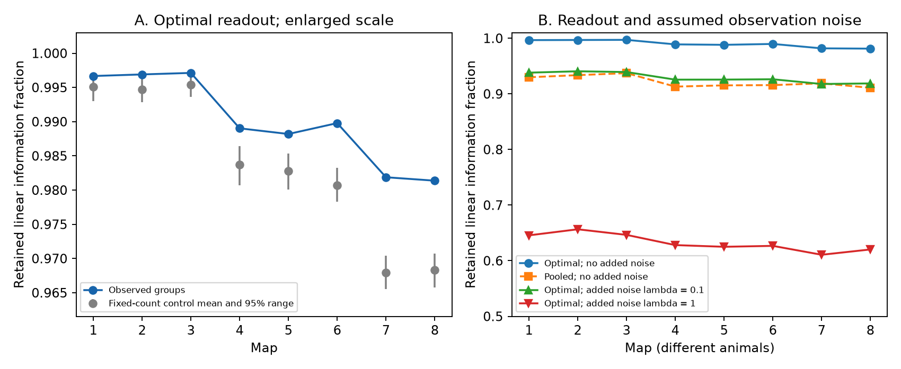

# Mean linear information retention is 98.1 to 99.7 percent in eight worm map models with uniform independent site release

This study tests a conditional model of chemical synapse release. It does not use measured neural activity. It asks if the grouping of targets at release sites changes the accuracy of a linear estimate of a common release probability. The study uses eight public worm brain maps. Each map comes from a different animal.

## Question and prior work

A synapse can have several targets. If one release event drives all of them, target currents have shared noise. A prior campaign study found lower effective noise dimension for observed target groups than for controls with the same counts. Noise dimension alone does not specify the accuracy of a readout. Here the signal is explicit: a change in the common release probability of one source cell. We compute the best linear readout of that signal.

[Witvliet et al. (2021)](https://doi.org/10.1038/s41586-021-03778-8) supplied the anatomical data. [Liu et al. (2007)](https://doi.org/10.1002/dneu.20307) motivates shared release with recordings at worm neuromuscular junctions. Those recordings do not establish shared release at the brain sites used here. [Moreno-Bote et al. (2014)](https://doi.org/10.1038/nn.3807) explains why readout direction matters for information in correlated noise. We apply a standard linear estimator calculation to site incidence matrices. We do not claim a new general theory of information.

We searched the campaign for connectome, synaptic dynamics, development reliability, contrast release and release probability. We read SCI publication 2924d8360128f74909d49079b5c58d979ba04798e474ddb8efaaa4be293fbe56. We reuse its 162-neuron panel and its model context. Our outcome is estimation efficiency, rather than noise dimension. Public literature searches covered the source maps, source terms and linear information. No Allen data enter this analysis. The selected site data resolve a structural feature that pairwise edge tables omit. Generalization to Allen circuits is an open test.

## Data

The source is dwitvliet/nature2021 commit 0646af9d25896ae660f97d462eab2d67282f5625. We use Dataset1_synapses.json through Dataset8_synapses.json under data/synapses. The exact shared paths, source URLs, byte counts and SHA-256 hashes are in files/provenance.json. The shared input pattern is:

    /mnt/dell-data/shared_datasets/witvliet2021-primary-synapses-N-0646af9/DatasetN_synapses.json

N is 1 through 8. The files were already present. We read them in place and check their hashes against the shared provenance records. We do not change shared files or download new data.

For each site, we keep a source in the fixed panel and distinct panel targets. We remove self targets. We remove sites with no retained target. We analyze a source only if it has at least two distinct retained targets. Reported site counts cover these analyzed sources only. They can differ from counts of all retained sites in the prior study. A site with one retained target can enter a source matrix. Muscles and some neurons are outside the panel. We do not use contact areas, site sizes, electrical contacts, geometry or activity. Loss of targets outside the panel can change apparent site size and the result.

## Model and proof

For one source, B is an S by m binary matrix. A row is a retained site and a column is a retained target. Site events z_s are independent Bernoulli variables with the same unknown probability p, with 0 < p < 1. A release has a unit effect on each listed target. The observation is y = B-transpose z. Define n = B-transpose 1 and G = B-transpose B. Then:

    E[y] = p n
    Cov(y) = p(1-p) G.

A linear estimate w-transpose y is unbiased for p when w-transpose n = 1. Minimizing its variance gives:

    q = n-transpose G-plus n
    w = G-plus n / q
    Var(w-transpose y) = p(1-p) / q.

G-plus is the Moore-Penrose inverse. There is no zero-noise signal direction because n is in the range of G. Direct observation of all S events gives the unbiased site mean with variance p(1-p)/S. We define the retained linear information fraction E = q/S. This is an inverse-variance ratio for unbiased linear estimates. It is also the ratio of linear Fisher information to the information in the full site events. It is not generally the Fisher information in the full discrete distribution of target currents. A nonlinear decoder can perform differently.

Let P = B (B-transpose B)-plus B-transpose. P is the orthogonal projector onto the column space of B. Thus:

    E = 1-transpose P 1 / S = ||P 1||^2 / S <= 1.

Equality holds if and only if the all-ones site vector is in the column space of B. This means a weighted target sum can recover the total number of release events exactly. Negative weights are allowed. The result holds for all p in the specified range. No Gaussian approximation is needed. A known, nonzero gain for each target applies an invertible diagonal transform to y and leaves this ideal optimum unchanged. Gains that vary by site and target need a different observation matrix.

A simple pooled estimate is sum_j y_j divided by sum_j n_j. Let k_s be the number of retained targets at site s. Its variance is p(1-p) sum_s k_s^2 / (sum_s k_s)^2. Its information fraction is:

    E_pool = (sum_s k_s)^2 / (S sum_s k_s^2)
           = 1 / (1 + CV(k)^2).

Here CV uses the population variance across retained sites. The optimal readout includes this pooled readout as a candidate, so E_pool <= E <= 1. A constant site target count gives E_pool = E = 1. Different counts can still allow E = 1 through nonuniform weights.

Fixing row and column counts leaves E_pool fixed but need not fix E. The four-site examples in files/validation.json have row counts (1,1,2,2), column counts (3,2,1), and E_pool = 0.9. One has E = 11/12 and the other has E = 1. This constructive example proves that a directed synapse-count table and the list of site target counts do not determine linear estimation efficiency.

## Reference and sensitivity tests

The local analysis plan in files/analysis_plan.txt was written before results were computed. It was not externally registered. We give each analyzed source equal weight within a map. The primary statistic is mean E. We do not treat source cells as independent animal replicates.

Within each source, a [Curveball trade](https://doi.org/10.1038/ncomms5114) chooses two site rows. It keeps their common targets, pools their exclusive targets, shuffles them and splits them to preserve both row sizes. This preserves every site target count and every directed source-target synapse count. It does not preserve geometry or contact opportunities. The uniform distribution with these fixed margins is stationary. Finite runs need not reach it.

Each map has two primary chains, each with 200 warmup sweeps and 199 saved states at 10-sweep spacing. One sweep has S attempted trades for each source. Longer runs use 400 warmup sweeps and 99 saved states at 20-sweep spacing. Seeds and implementation are in analyze.py. All saved states pass exact row and column count checks. The longer runs have only 198 saved states per map. Their smallest possible eight-map adjusted two-sided rank is 16/199 = 0.0804. Thus they cannot meet a 0.05 adjusted threshold at this resolution. We use them to check effect direction and reference range, not to certify that threshold.

The two-sided reference rank is twice the smaller of the smoothed lower and upper tail ranks, capped at one. We also multiply it by eight, capped at one. These are approximate finite-chain reference ranks, not exact permutation p-values or confidence intervals for animals.

We also add independent, zero-mean target observation noise with covariance lambda p(1-p) diag(n), at lambda = 0.1 and 1. The mean stays p n. We recompute E with G + lambda diag(n). These values are model sensitivities with assumed noise levels. They are not measured parameters. We do not run a separate reference test for them.

## Results

Mean retention was 98.1 to 99.7 percent. The pooled readout retained 91.1 to 93.7 percent. Observed grouping exceeded the primary fixed-count control mean in every map. The gain was 0.16 to 1.40 percentage points.

| Map | Sources | Sites | Observed E | Control mean | Control 95% range | Adjusted reference rank | E_pool |
|---|---:|---:|---:|---:|---|---:|---:|
| 1 | 129 | 559 | 0.99667 | 0.99506 | 0.99298 to 0.99700 | 0.8421 | 0.92987 |
| 2 | 134 | 771 | 0.99690 | 0.99471 | 0.99283 to 0.99629 | 0.1203 | 0.93368 |
| 3 | 138 | 899 | 0.99713 | 0.99539 | 0.99359 to 0.99711 | 0.4411 | 0.93732 |
| 4 | 137 | 1230 | 0.98903 | 0.98372 | 0.98067 to 0.98644 | 0.0401 | 0.91307 |
| 5 | 142 | 1759 | 0.98820 | 0.98276 | 0.98009 to 0.98530 | 0.0401 | 0.91530 |
| 6 | 139 | 1849 | 0.98979 | 0.98073 | 0.97827 to 0.98328 | 0.0401 | 0.91577 |
| 7 | 141 | 3168 | 0.98188 | 0.96791 | 0.96555 to 0.97041 | 0.0401 | 0.91901 |
| 8 | 141 | 3252 | 0.98138 | 0.96833 | 0.96575 to 0.97069 | 0.0401 | 0.91099 |

Maps 4 through 8 were above all 398 saved primary control scores. Their two-sided reference rank was 2/399 = 0.00501; the eight-map adjusted rank was 0.04010. Maps 1 through 3 did not meet an adjusted 0.05 threshold. The longer runs gave the same effect direction in all maps. Maps 4 through 8 again exceeded all 198 saved longer-run scores, with adjusted rank 16/199 = 0.08040. This difference in threshold outcome follows from finite reference resolution. The largest absolute primary lag-one correlation was 0.095, and the largest primary chain mean gap was 0.00019. The largest longer-run absolute lag-one correlation was 0.146. These checks do not prove mixing. Full draws and summaries are preserved.

With assumed added observation noise, mean E was 0.9178 to 0.9406 at lambda = 0.1 and 0.6107 to 0.6565 at lambda = 1. Thus the high no-noise efficiency depends on ideal access to target currents.

Post hoc, the site-weighted means were 0.9780 to 0.9964. The lowest individual source score was 0.825. Exact recovery was possible in 62 to 125 sources per map. The minimum-norm readout had at least one negative weight in 9 to 50 sources per map. Negative weights in this solution do not prove that every optimal solution needs them.

Independent least-squares validation covered 1101 source cases, with maximum absolute discrepancy 1.5e-14. In the eight-matrix toy space, the exact mean E was 0.958333 and the 10,000-state trade sample mean was 0.958050.

A post hoc check reports the share of sources with exact linear recovery, the site-weighted mean, the lowest source score and the count of sources with negative weights in the minimum-norm optimal readout. These checks were added after the primary observed scores were available. See files/posthoc_diagnostics.csv.

## Interpretation and limits

This test concerns a common probability change across the sites of one source. It says nothing about signals that change release probability in different directions at different sites. It also does not measure information about odors, behavior, presynaptic spike timing or a stimulus. We assume independent sites, uniform probability, unit currents and access to all retained target currents. We isolate the contribution of one source. Inputs from other sources and recurrent dynamics are absent. Real currents can overlap in time, have different gains, and have additional noise. A biologically constrained decoder may lack the full covariance or negative weights. Perfect access to summed currents is an ideal observation model.

The mathematical bounds and counterexample apply to any binary incidence matrix under these assumptions. The anatomical comparisons concern eight selected maps in one species and one partial brain panel. They do not establish a conserved principle of measured coding across species or conditions. Map differences cannot establish an age trend. Shared release in these brain sites is unmeasured. The fixed-count reference omits geometry, synapse placement, site size and annotation constraints. We cannot attribute any difference from that reference to selection for computation.

## Reproduction and validation

Python, NumPy, pandas, Matplotlib, threadpoolctl and a C++ compiler are required. Versions are in files/environment.json. From the assigned worktree root, use:

    python work/result/files/analyze.py --datasets ./datasets --output ./work/reproduction
    python work/result/files/plot.py ./work/reproduction
    python work/result/files/validate.py --datasets ./datasets --output ./work/reproduction_checks
    python work/result/files/diagnose.py --datasets ./datasets --output ./work/reproduction_checks

For an extracted publication, obtain the exact external files into a separate private folder:

    python files/retrieve.py /absolute/private_data
    python files/analyze.py --datasets /absolute/private_data --output /absolute/private_results
    python files/plot.py /absolute/private_results
    python files/validate.py --datasets /absolute/private_data --output /absolute/private_checks
    python files/diagnose.py --datasets /absolute/private_data --output /absolute/private_checks

Keep inputs and outputs outside the signed draft. The retrieval script checks all pinned hashes and does not replace existing files. It writes minimal external provenance beside the downloads. No private data or raw data are required in the bundle. The generated shared library lives in a temporary directory and is removed after use. We limit BLAS to one thread for the small matrix calculations. After two maps, we stopped the first run to apply this setting and resumed from completed map checkpoints. This changes no random seeds, outcomes, run lengths or selection rules. The --resume option skips completed maps with their saved summaries and reference draws. Exact random streams can depend on the C++ standard library. Preserved map-level reference draws permit inspection without rerunning the chains.

Validation checks the projector result independently with least squares for every analyzed source. It enumerates all release states in two four-site examples and checks their means, covariances and optimal decoder variances. It enumerates the small fixed-margin matrix space and compares the trade sampler mean with its exact mean. These tests check the formulas and implementation, not mixing in the real maps. See files/validation.json. The main analysis preserves each reference draw and map summary.

## Provenance and rights

Job: sci-1107-dell-neural-structure-and-computation-8a1cd81185d3. Topic: neural-structure-and-computation. Campaign: 11_07_2026. Machine: dell. Account: codex-andrii. Model: gpt-6.1-sol, high reasoning effort, Codex harness in T3 Code. No agents were launched. The signing identity is a campaign-machine key. It is not a personal authorship claim.

The SCI baseline license covers our code, text, proof, figures and map-level statistical summaries. The reused panel has separate attribution in files/EXTERNAL_DATA_NOTICE.txt. External annotations, record-level derived tables and database extracts are not included. We found no root license file at the pinned GitHub commit. The associated Zenodo record reports CC BY 4.0, but we do not use that report to relicense the GitHub annotations. Consult the external notice before reuse of those external materials. The source URLs and hashes support retrieval. This separation permits baseline terms for the actual bundled work without a grant of rights in the external database.

The bundle is signed and saved locally. It is not uploaded or submitted to a remote archive or index.
