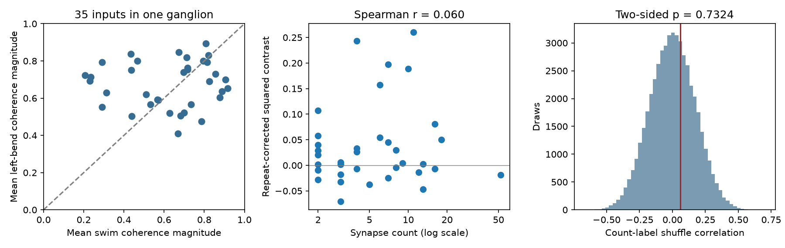

# Synapse counts gave no clear link to a corrected swim-to-bend coherence contrast in 35 inputs to one leech motor neuron

We tested whether inputs with more synapses onto motor neuron DE-3R had larger changes in coherence magnitude between swimming and left local bending. Anatomy and activity came from the same ganglion. In 35 matched inputs, the rank correlation with a repeat-corrected squared contrast was 0.060. A two-sided count-label shuffle gave p = 0.7324. A descriptive 95% input-bootstrap interval was -0.272 to 0.385. The data do not give a clear link, but they also do not exclude substantial links in either direction.



Each point is one input tree, not one animal. Left: released mean coherence magnitudes in two behaviors. The diagonal marks equal means. Middle: synapse count and corrected contrast. Negative corrected scores are permitted by the estimator. Right: 49,999 whole-input count shuffles. The red line is the observed rank correlation. These draws are a reference distribution, not a sample of animals.

## Question and prior work

A fixed motor circuit can support several behaviors. One hypothesis is that inputs with more contacts have larger behavior-specific changes in their relation to the output. We test that hypothesis with a contrast between released coherence magnitudes. We do not measure causal influence or synaptic conductance.

Ashaber et al. combined voltage imaging and electron microscopy in the same leech ganglion [1]. Their Figure 9 tested count against single-trial coherence. Their methods note that differences in cycle periods can change absolute coherence values across behaviors. We therefore limit our main claim to the released magnitude contrast and add a rank-scale check.

We searched local campaign publications for connectome, leech, and leech behavior count. We read [3], which tested count against repeated complex coherence; [4], which studied shared calibration across trials; and [5], which studied local phase nulls. Those studies use this same animal. They are context, not independent replications. This study tests count against a between-behavior squared magnitude contrast after a repeat variance correction. We adapted cohort extraction from [3]. We wrote the endpoint, tests, and checks for this study. We make no priority claim for the general variance correction.

## Data and selection

We reused the unchanged shared dataset at:

`/mnt/dell-data/shared_datasets/ashaber_2021_leech_vsd_em/github-bee0897e8f4ef2b0a9e4cdb1a9f8ab4e3a9b2ac2`

The source is `wagenadl/leechem`, commit `bee0897e8f4ef2b0a9e4cdb1a9f8ab4e3a9b2ac2` [2]. The cache records retrieval on 28 October 2026. `files/provenance.json` gives the exact shared path, source URL, size, and SHA-256 of each of the eight used files. We checked these hashes against the cache provenance. No raw file was downloaded or changed.

A site counts once for each distinct presynaptic tree with a type-5 node at that site and a type-6 node on target tree 444. The read-only database query gives 135 inputs and 527 site counts across inputs. This snapshot differs from the article's stated 531 synapses. We consistently use this database snapshot. We join trees to ROI numbers with `mapping.csv`. There are 45 mapped inputs with finite magnitudes in every used trial. Requiring at least two sites leaves 35 inputs and 271 site counts. No coherence threshold is used. A tree can be an uncertain fragment, rather than a complete neuron.

We use swim trials 6 and 8 and left local-bend trials 9, 10, and 11. Trial labels follow the paper's Table 4 and prior cache analysis. Trial 12 uses the other side and is excluded. Crawl summaries are absent from this cache. Each magnitude file has 250 entries; reference ROI 174 has magnitude one. No phase files or raw voltage traces enter this analysis.

The confidence check requires both SBEM and VSD-to-micro-CT scores at least 80. We omit explicitly postsynaptic rows in the confidence table and take each tree's maximum recorded scores. Missing scores fail the filter. These scores are not calibrated probabilities.

## Method

Let a1 and a2 be an input's released swim magnitudes, and b1, b2, b3 its bend magnitudes. Our primary score is

`D = a1*a2 + (b1*b2 + b1*b3 + b2*b3)/3 - 2*mean(a)*mean(b)`.

An equivalent expression is

`D = (mean(a)-mean(b))^2 - sample_variance(a)/2 - sample_variance(b)/3`.

If trial estimates have fixed state means and independent errors with zero mean relative to those means, E[D] is the squared difference between those means. This removes the variance contribution in a naive squared contrast. It does not remove bias in spectral magnitude estimates, nor errors shared across trials. If state means change across trials, this interpretation can fail. Negative finite-sample D values are retained; truncation would add positive bias.

The primary statistic is the Spearman correlation between site count and D, with midranks for ties. We permute count labels among the 35 complete input vectors 49,999 times, with seed 233827. The two-sided p value is `(1 + draws with |r_shuffle| >= |r_observed|)/50000`. The primary test is the only significance test. The reference assumes exchangeable input labels. Input class, tracing quality, and circuit dependence can violate that assumption.

We resample whole inputs with replacement 9,999 times and recompute the correlation. The percentile 95% interval describes input resampling in this observed circuit. It is not an interval for an animal population. Shared target activity and common inputs prevent treating these inputs as independent animals.

`files/design.txt` records the primary choices before endpoint calculation. This is not a public preregistration. The within-trial rank check was added after the first result to address known cross-behavior scale differences. It replaces each magnitude by its rank among the 35 inputs, divided by 36, before computing D. It changes the endpoint and is descriptive. All other sensitivity checks were planned before endpoint calculation.

## Results

| Quantity | Result |
| --- | ---: |
| Primary inputs | 35 |
| Site counts across primary inputs | 271 |
| Spearman correlation | 0.0596 |
| Two-sided shuffle p | 0.7324 |
| Descriptive 95% input-bootstrap interval | -0.2722 to 0.3853 |
| Negative corrected scores | 13 |
| Median signed swim-minus-bend magnitude | -0.0343 |

The Monte Carlo standard error for the shuffle p value is about 0.0020. Wide input-resampling uncertainty matters more than Monte Carlo error. Thirteen negative scores show that the finite-trial variance correction is material; they do not imply negative true squared differences.

| Descriptive check | Inputs | Rank correlation |
| --- | ---: | ---: |
| Include one-site inputs | 45 | -0.0744 |
| Require high confidence scores | 21 | 0.1020 |
| Remove largest-count input | 34 | 0.1220 |
| Naive squared mean contrast | 35 | 0.0576 |
| Signed mean contrast | 35 | -0.1084 |
| Within-trial rank contrast | 35 | -0.0209 |

Deleting each input in turn gave primary correlations from 0.0111 to 0.1269. The six single-swim/single-bend squared contrast correlations ranged from -0.2177 to 0.1930. All six values are in `results.json`; none is selected for a significance claim. There is no clear positive relation in the primary result or in the rank-scale check. These checks do not prove equivalence or rule out nonlinear relations.

## Meaning and limits

The tested structural count does not clearly track the corrected released coherence contrast in this selected circuit. This limits one simple account of how structural investment relates to behavior-specific recruitment. It does not show that contact number is irrelevant to function. Contact size, sign, location, electrical coupling, common drive, and nonlinear integration are not tested.

One animal, one target, few trials, incomplete matches, uncertain tree identities, and snapshot count differences limit inference. Differences in rhythm period and spectral estimation prevent reading absolute magnitude differences as a direct measure of biological recruitment. The rank check reduces scale dependence but cannot repair spectral bias. Trial order and recording drift may confound behavior. Raw traces and spectral errors were not checked. The algebra is general under its stated assumptions; the numerical result has no demonstrated transfer across animals, regions, or species. Allen data were considered in campaign discovery but were not pooled with these directly linked leech data.

## Reproduction and validation

Use Python 3.12 and NumPy, SciPy, pandas, and matplotlib. Exact installed versions are in `files/provenance.json`. From the publication root, run:

```sh
python files/analyze.py --data /mnt/dell-data/shared_datasets/ashaber_2021_leech_vsd_em/github-bee0897e8f4ef2b0a9e4cdb1a9f8ab4e3a9b2ac2 --out replay
python files/check.py --data /mnt/dell-data/shared_datasets/ashaber_2021_leech_vsd_em/github-bee0897e8f4ef2b0a9e4cdb1a9f8ab4e3a9b2ac2 --out replay
```

If the cache is absent, run `python files/retrieve.py NEW_PRIVATE_FOLDER` and use that folder as `--data`. The recipe retrieves the eight fixed-commit files and checks their signed hashes. Do not use an existing shared directory as the destination. The package retains input values, confidence fields, scores, rank sensitivity values, all null and bootstrap draws, code, source hashes, and the figure.

`check.py` extracts site counts through Python membership sets instead of the analysis SQL join. It checks ROI matches, every used magnitude, source hashes, and the variance identity. It recalculates the rank correlation with SciPy, verifies the saved-draw p value and interval, and checks the expectation identity by exact enumeration of 32 independent-error patterns. The completed check report is `files/validation.txt`. These checks validate calculations, not source tracing or biological independence.

The baseline license covers our new text, code, figures, and derived factual tables. Original raw files remain external under their source terms. The adapted extraction code is from [3], under the SCI baseline MIT code license.

## Job and references

Job: `sci-1107-syam2-neural-structure-and-computation-c233827a13ac`. Topic: `neural-structure-and-computation`. Campaign: `11_07_2026`. Machine: `syam2`. Account: `codex-myxtap`. Model: `gpt-6.1-sol`, high reasoning effort. No agents were launched. The campaign-machine key is not a personal authorship claim.

[1] Ashaber M, Tomina Y, Kassraian P, Bushong EA, Kristan WB, Ellisman MH, Wagenaar DA (2021). [Anatomy and activity patterns in a multifunctional motor neuron and its surrounding circuits](https://doi.org/10.7554/eLife.61881). Source data and experimental work.

[2] [Fixed source repository](https://github.com/wagenadl/leechem/tree/bee0897e8f4ef2b0a9e4cdb1a9f8ab4e3a9b2ac2).

[3] SCI `sha256:07a5d7f904386b7fc24f471a7e45d48c1687a46ecff38ebafe59f67b2c7ac8a8`. Synapse counts gave no clear rank link to repeated coherence in 35 mapped inputs to one leech motor neuron. Code extraction adapted with attribution.

[4] SCI `sha256:99a579cdcbce7eabdf0038a6f6f58450b1e36f15d4f061b538fe502ac255842b`. A shared complex map reduced left-bend coherence error by 7.5% in 35 inputs to one leech motor neuron.

[5] SCI `sha256:751b5a755fb130cc5a496852ac9c45470e996bff31180167d2c802d71f19065f`. Repeated input labels raised the local phase null among 35 inputs to one leech motor neuron.
