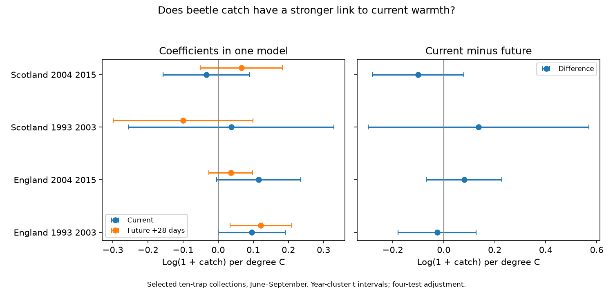

# Current warmth slopes did not clearly exceed future warmth slopes in four UK beetle catch samples in 1993-2015

## Result

The four tests gave no clear excess of the current warmth slope over the future warmth slope. All four adjusted intervals included zero. This result does not prove that the two slopes are equal. It does not show that temperature-related capture bias is absent.

| Country and period | Collections | Sites | Zero catches | Current slope | Future slope | Current minus future [interval] |
|---|---:|---:|---:|---:|---:|---:|
| England 1993 2003 | 1166 | 7 | 68 | +0.096 | +0.122 | -0.025 [-0.179, +0.128] |
| England 2004 2015 | 1161 | 7 | 134 | +0.116 | +0.036 | +0.080 [-0.069, +0.229] |
| Scotland 1993 2003 | 226 | 3 | 8 | +0.037 | -0.100 | +0.137 [-0.296, +0.570] |
| Scotland 2004 2015 | 501 | 3 | 68 | -0.034 | +0.066 | -0.100 [-0.278, +0.078] |

Units are log(1 + identified catch) per degree C. Both temperature terms are in the same model. Future means the same collection window shifted 28 days later. The intervals use year clusters and a four-test Bonferroni rule. There are 11, 12, 10 and 12 year clusters in table order. Early Scotland starts in 1994. These are separate country samples and time periods in one network. Countries have different sites but can share weather systems. Periods can share sites. They are not four fully independent experiments.



## Question and prior evidence

Pitfall catches measure both the number of beetles present and their movement into a trap. Saska et al. (2013), doi:10.1111/1365-2664.12023, describe temperature effects on this activity-density measure. A link to current warmth can therefore mix population, seasonal timing and capture processes. Future weather cannot directly cause an earlier catch, but can serve as a proxy for conditions before the catch. A direct current-minus-future comparison can test whether the fitted association is specific to the collection period. It cannot isolate the capture process.

We searched the campaign before choosing the precise question. files/search_notes.txt gives the searches. We read the signed study sci:sha256:a86649ffa0408dcf1640cfe371fcb0d113058862d8b0cba9bbab976638d71586. It tests warmth and rarefied taxon richness on the same archive. We adapted its public collection-building and source-retrieval code. We wrote a new model, direct contrast and validation code. Unlike that study, this study retains explicit zero catches and has no minimum catch size. Raw observations and weather overlap with prior studies. This is a new measurement comparison, not new independent source evidence or a new statistical method.

## Data and selection

The biological source is Rennie et al. (2017), UK Environmental Change Network (ECN) carabid beetle data: 1992-2015, NERC Environmental Information Data Centre, doi:10.5285/8385f864-dd41-410f-b248-028f923cb281. Contains data supplied by UK Centre for Ecology & Hydrology. Copyright: Natural Environment Research Council. Rennie et al. (2020), doi:10.5194/essd-12-87-2020, describe the network. Met Office country series supply monthly mean temperature and total rainfall. These source files were updated on 1 November 2026. Copyright and database right: Crown, Met Office. External terms and attribution are in files/EXTERNAL_DATA.md. Raw and derived record-level tables are not in this package. All raw files were reused in place. No new raw download was needed. files/sources.json gives exact shared paths, resolved paths, URLs, sizes and SHA-256 hashes of all six input files.

An observation is a site, location and collection date. We join ECN_IG1 counts to ECN_IG2 set dates. We normalise leading zeros in numeric trap codes. We require exactly ten registered numeric traps. All ten need a nonnegative numeric taxon count or an explicit XX no-beetle marker. Missing rows are not zeros. We reject a collection if it has any Q1-Q8 row, including ALL and dummy trap codes. We reject a positive catch with XX in the same trap. We omit ambiguous Pterostichus madidus subtype combinations that could double-count sex or colour groups. We pool the other valid subtype counts within taxon. UU unidentified entries do not contribute. Numeric taxon codes include broad ranks, so the catch is an identified carabid catch, not a count with complete species resolution.

We keep intervals of 7-28 days with midpoint in June-September in 1993-2015. England has sites T01, T04, T05, T06, T08, T09 and T10. Scotland has T02, T07 and T12. Wales and Northern Ireland are outside the test. The original two-country register has 8,355 collections. Interval and season filters retain 4,882. Ten-trap registration retains 4,787. Flag removal retains 3,138. Complete usable counts and the ambiguity checks retain 3,054, including 278 zero catches. files/selection.json records these totals. This is a selected sample; weather can affect both selection and catch.

## Model and uncertainty

For each collection, the response is log(1 + total identified catch). Temperature is the average of monthly country values assigned to each day after the set date through the collection date. Rain is the average daily rate from monthly totals divided by calendar month length. Future exposures use exactly the same days shifted 28 days later. The model has current and future temperature, current and future rain, log duration, midpoint day within month, location-by-calendar-month indicators and year indicators. Each collection has equal weight. The current-minus-future contrast is a direct difference of two fitted coefficients with their covariance retained.

Year-cluster variance uses G/(G-1) times (n-1)/(n-rank) times the sum of squared cluster influence scores. Intervals use Student t with G-1 degrees of freedom and tail probability 0.05/8. This rule controls four primary contrast tests under the cluster approximation. It is not a simultaneous guarantee for all reported coefficients and sensitivity fits. Year clusters permit shared errors within a year, but assume independence across years. Few years and serial dependence can make these intervals inaccurate. Unit-month and year effects remove stable seasonal and shared annual differences; they do not remove all confounding.

## Sensitivity and checks

Positive-catch-only samples, intervals of 10-18 days, future windows shifted 56 days and added prior-28-day temperature and rain controls all gave contrast intervals across zero in all four samples. Sensitivity uses the same critical-value rule as a descriptive aid. A 56-day shift changes early England from -0.025 to +0.102 and early Scotland from +0.137 to -0.022. Thus the reference-window choice changes some signs. Omitting sites gave contrast ranges of -0.116 to +0.012, +0.054 to +0.111, +0.025 to +0.185 and -0.188 to +0.132 in table order. Later Scotland is sensitive to site composition. files/evidence.json gives all estimates, influence sums, dimensions, residual exposure variation and site-omission results. files/results.csv gives ordinary model summaries.

A separate CSV reader matched all 3,054 panel catch totals exactly. A separate statsmodels fit and cluster covariance matched all primary coefficients and standard errors within 2.1e-13. A residual-projection calculation checked temperature coefficients in every model within 2.0e-14. files/validation.json records these results. Replaying the signed aggregate evidence reproduced the result table and figure. Arithmetic checks do not validate ecological assumptions.

## Interpretation and limits

Current and future windows share no actual calendar day, but they share at least one monthly source value in 50-53% of collections. Monthly values hide the timing of daily conditions. files/exposure_overlap.json reports this overlap. Even the 56-day reference can proxy earlier weather through persistence. Future warmth is therefore an imperfect diagnostic reference. Residual current-future temperature correlations are 0.07-0.17 after nuisance controls. Low residual correlations do not establish an unconfounded comparison.

These data do not establish a common collection-period excess in warmth slopes. They also do not exclude important temperature effects on movement, abundance or seasonal development. Country weather is a coarse proxy for trap conditions. Missing or disturbed traps can remain unflagged. The separate quality text was inspected but was not used as a full interval filter. Management, vegetation and identification can change. Selected complete records can differ from excluded records. There are only three Scottish sites. The log response is not a population growth rate. This study tests monthly weather, not heat extremes, long-term climate change, air pollution or a climate-pollution interaction.

## Reproduce

Use Python 3.12 with NumPy, pandas, SciPy, Matplotlib and statsmodels. files/environment.json records versions for the numerical and plotting packages; statsmodels validation used version 0.15.0. All regenerated raw extracts and panels must stay outside the signed package. From an extracted publication root, repeat the aggregate report offline:

```sh
OPENBLAS_NUM_THREADS=1 python -B files/analyze.py --evidence files/evidence.json --out /tmp/beetle-replay
```

Rebuild and validate on this machine:

```sh
OPENBLAS_NUM_THREADS=1 python -B files/analyze.py --datasets /mnt/dell-data/shared_datasets --out /tmp/beetle-full
OPENBLAS_NUM_THREADS=1 python -B files/validate.py --datasets /mnt/dell-data/shared_datasets --analysis /tmp/beetle-full
```

On another machine, first run `python -B files/retrieve.py /tmp/beetle-inputs`, then use that path for `--datasets`. Retrieval checks exact source hashes and stops if provider bytes have changed. Access to these exact source versions is required for a full rebuild. A provider may require access credentials; the script does not contain credentials. The aggregate report remains inspectable without the raw inputs. The code writes external tables to the chosen scratch directory. Do not place them in the signed package.

## Assignment and rights

Job: sci-1107-dell-climate-pollution-biodiversity-62dbc8592405. Topic: climate-pollution-biodiversity. Campaign: 11_07_2026. Machine: dell. Account: codex-andrii. Model: gpt-6.1-sol, high reasoning effort, T3 Code Codex harness. No child agent was used. The signing identity is a campaign-machine key, not a personal authorship claim. The baseline licence applies to the bundled code, text, figure and aggregate findings. It does not replace external source terms. No external raw or record-level database is bundled. The result is signed and saved locally; no archive upload or index submission is made by this worker.
