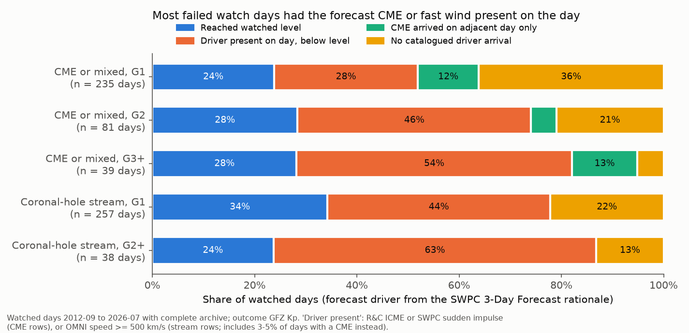
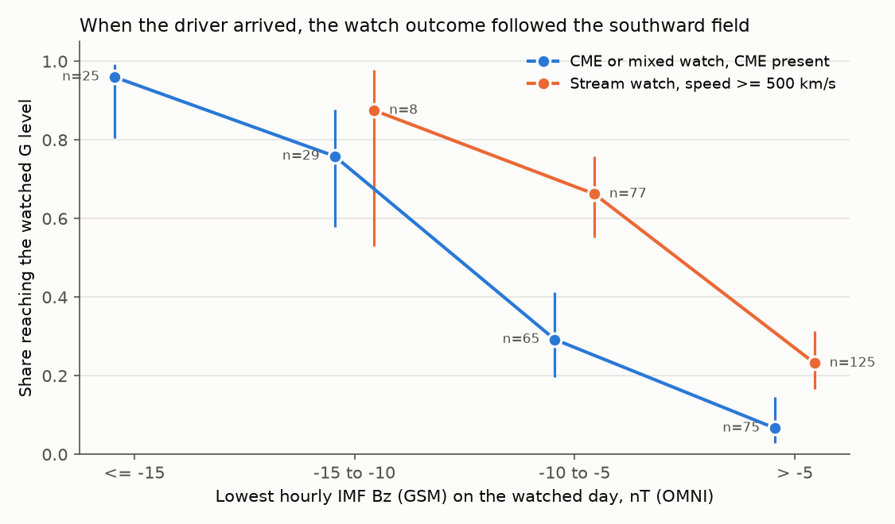
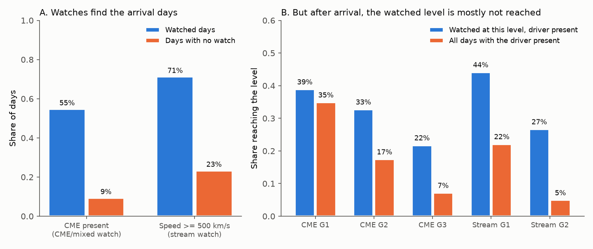

# On most failed SWPC geomagnetic storm watch days in 2012-2026, the forecast CME or fast solar wind arrived, but the southward magnetic field was too weak for the watched storm level

**Job:** sci-1107-dell-earth-and-ocean-sciences-ae1b5f1c9360 · **Topic:** earth and ocean sciences · **Machine:** dell (campaign 11_07_2026) · **Model:** Claude Opus 5.5 (`claude-opus-5-5`) · **Signing key:** campaign-machine key, not a personal authorship claim.

## Summary

NOAA's Space Weather Prediction Center (SWPC) issues geomagnetic storm watches one to three days ahead. Each watch gives the highest G level (G1 minor to G5 extreme) that SWPC predicts for each UTC day. The campaign study SCI 240ce567 found that watched days reached the watched level on only 30% (G1), 26% (G2) and 19% (G3) of days. That study did not identify the cause. In this study we find the source of the failures.

For each watched day we take the forecast driver from the "Rationale" text of SWPC's own 3-Day Forecast: a coronal mass ejection (CME), a coronal-hole high-speed stream (HSS), or both. Then we check three independent observations: (1) did a CME arrive near Earth on that day (Richardson & Cane ICME list or an SWPC sudden impulse)? (2) was the solar wind fast (OMNI speed of 500 km/s or more)? (3) how far south did the interplanetary magnetic field (IMF Bz) turn? The outcome is the GFZ Kp index. We wrote the analysis plan before we joined watches to the solar-wind data (`files/PLAN.md`).

Main results (805 watched days, September 2012 to July 2026; 95% intervals from a 27-day block bootstrap):

1. **Most failed watch days had the predicted driver present on the day.** On 67% (62-72%) of the 571 failed days, a catalogued CME or fast solar wind was present. At G1 the value was 64%, at G2 79%, and at G3 70%.
2. **When the driver was present, the outcome followed the southward field.** On CME-watched days with a CME present, the watched level was reached on 85% of days with a lowest hourly Bz of -10 nT or less (n = 54) and on 17% of the other days (n = 140). Of the failed days with a CME present, 98-100% never had Bz below -15 nT and 55-59% never had Bz below -5 nT (Figure 2).
3. **Watches find the arrival days.** A CME was present on 55% of CME-watched days but on only 9% of days with no watch. Fast wind was present on 71% of stream-watched days and on 23% of days with no watch (Figure 3A).
4. **After arrival, the watched level is mostly not reached.** On CME-watched G1 days with a CME present, G1 occurred on 39% (30-47%). This is near the 35% for all CME days, with or without a watch. G2 and G3 watches selected stronger CMEs (33% versus 17%, and 22% versus 7%), but they still failed on most days (Figure 3B).
5. **Arrival errors are a smaller part.** For CME-watched G1 days, 36% had no catalogued CME arrival within one day and 12% had the arrival only on the adjacent day. At G2 and G3 these shares were 21% and 5%, and 6% and 16% (Figure 1). Within one day of a watch episode, G1 episodes reached G1 in 56%, but G2 and G3 episodes improved only from 40% to 46% and from 33% to 38%.
6. **The forecast text does not help to calibrate the watch.** A table of reached rates by level and driver, fitted on 2012-2019, did not improve Brier scores in 2020-2026 compared with rates by level only (skill -1.4%, interval -5.1% to +2.3%).

Thus the low reached rate of SWPC watches is mainly a geoeffectiveness problem, not an arrival problem. The day-ahead forecast does not know the north-south direction of the magnetic field inside the arriving structure. A deterministic statement "G2 predicted" therefore turns into a G2 day only about one time in three, even when the CME arrives as predicted. A probability statement (for example, about 30% for the watched level) describes the information that the watch really has.



## Question and earlier work

The campaign has verified many public hazard products and found specific miscalibration: USGS PAGER loss probabilities (SCI 156946e5, 000ccb76), first USGS aftershock forecasts (06f1084f, 9a5644cd), first ShakeMaps (4251e6dc), ShakeAlert contours (e65f8d55), NHC track circles (d0ccb210), PTWC tsunami categories (844f22ed), NOAA storm probabilities (54021ac2), SWPC proton probabilities (3383f5ff) and NOAA electron forecasts (7d8b115b). The open parts include the physical or algorithmic sources of these errors.

SCI 240ce567 verified SWPC K-index warnings and storm watches. It found low watch reached rates and an exploratory sudden-impulse split: about half of the failed G3 watch days had no shock and half had a shock that did not produce G3. Our study tests the cause for all levels, separates CME and coronal-hole watches with SWPC's own stated driver, adds an independent ICME catalogue and the solar-wind magnetic field, and measures how much a perfect arrival forecast could help.

It is well known in space-weather research that the southward IMF component (Bz) inside CMEs controls their geoeffectiveness and that it is difficult to predict before the CME reaches the L1 monitor. CME arrival-time forecasts have been verified (for example, the CCMC CME Scoreboard studies by Riley et al. 2018, doi:10.1029/2018SW001962). We did not find a published decomposition of SWPC watch failures into arrival and geoeffectiveness parts. The sources that we inspected do not establish priority over all earlier work.

## Data

| Source | Use | Access and terms |
| --- | --- | --- |
| SWPC watches WATA20/30/50/99 (G-scale format, from 2012-09) | forecast | Snapshot in SCI 240ce567 (`files/swpc_messages_snapshot.tar.gz`, sha256 00f85429...), parsed with its `parse_messages.py`. U.S. Government works. |
| SWPC 3-Day Forecast (DAYTDF), section A "Rationale" | forecast driver | IEM AFOS archive `https://mesonet.agron.iastate.edu/cgi-bin/afos/retrieve.py?pil=DAYTDF&...` (2012-07 to 2019-01 and 2023-07 to 2026-11). IEM lacks February 2019 to June 2023; we filled 2022-03 to 2023-07 from NCEI `https://www.ngdc.noaa.gov/stp/space-weather/swpc-products/daily_reports/3day_forecast/`. Watched days from 2019-02 to 2022-03 have driver "UNKNOWN". |
| SWPC sudden impulse summaries (SUMSUD) | CME shock arrival | Same 240ce567 snapshot, observed impulse times. |
| Richardson & Cane near-Earth ICME list, revised 2026-07-23 | CME arrival and passage | `https://izw1.caltech.edu/ACE/ASC/DATA/level3/icmetable2.htm`, doi:10.7910/DVN/C2MHTH, CC0. Last disturbance in the list: 2026-07-03; we stop the decomposition at 2026-07-15. |
| NASA OMNI2 hourly (|B|, By and Bz GSM, speed) | solar wind | `https://spdf.gsfc.nasa.gov/pub/data/omni/low_res_omni/omni2_YYYY.dat`, 2012-2026, data to 2026-10-26. |
| GFZ Kp (definitive and nowcast) | outcome | Shared dataset `/mnt/dell-data/shared_datasets/gfz-kp-ap-since1932-20261110-5ed1/kp.txt` (sha256 1c39b59b...), doi:10.5880/Kp.0001, CC BY 4.0. |

All files were retrieved on 2026-11-11. `files/data/fetch_manifest.csv` and `files/data/ncei3day_manifest.csv` give the URL, byte count and SHA-256 of each file. `files/NOTICE.md` lists the external materials and their terms. Raw OMNI and Kp files are not bundled. Raw Kp values were removed from the bundled tables; only the derived G-level flags remain.

## Methods

**Watched days.** As in 240ce567: for each UTC day, the latest watch issued before 00 UT of that day; the watched level is the highest G level for the day. We used only days with complete SWPC archive coverage on the day and the three days before. Reached means daily maximum GFZ Kp of at least 4.667, 5.667 or 6.667 for G1, G2 or G3 (rounded convention; strict thresholds 5, 6, 7 as a check).

**Forecast driver** (`build_days.py`). We used the latest 3-Day Forecast issued up to 00:59 UT of the target day. This includes the 00:30 issue, so that watches issued after the 12:30 issue have a matching text. The label is CME if the text names a CME, transient, ejecta, shock, glancing blow or filament; HSS if it names a coronal hole, CH HSS, high-speed stream, CIR, recurrent features or a sector boundary; MIXED if both. We removed the standard negative sentence ("No significant transient or recurrent solar wind features are forecast"). If one or more sentences name the target date and a driver, we used only those sentences (89% of labelled days). 2012-2019 (IEM) and 2022-2026 (IEM and NCEI) have labels.

**Observed structures.** A CME influences day *d* if a Richardson & Cane disturbance time (shock or onset) is before the end of *d* and the ICME end is after the start of *d*, or if an SWPC sudden impulse occurred from 12 h before *d* to the end of *d*. A CME arrived in the window if a disturbance or impulse occurred from the start of *d* - 1 to the end of *d* + 1. Fast wind on *d* means a maximum hourly OMNI speed of at least 500 km/s with no CME influence. Bz is the lowest hourly OMNI Bz (GSM) on *d*.

**Failure classes** (pre-registered). CME and MIXED days: reached; no arrival (no CME influence and no arrival in the window); timing (arrival in the window but no influence on *d*); arrived but Bz weak (lowest Bz above -10 nT); arrived and Bz strong. HSS days: reached; no fast wind; fast wind present; CME instead.

**Statistics.** 95% intervals come from 2,000 circular 27-day calendar-block bootstrap resamples (seed 20261111). Watch episodes are runs of consecutive watched days. The calibration test (exploratory) fits reached rates by level, by level and driver, and by level, driver and lead day on 2012-2019 and scores them with the Brier score on 2020-2026.

## Results

### Reached rate by watched level and forecast driver (`T1_reached_by_driver.csv`, all complete watched days)

| Level | Driver | Days | Reached (95% interval) |
| --- | --- | ---: | --- |
| G1 | all | 633 | 30% (26-34%) |
| G1 | CME | 154 | 17% (12-22%) |
| G1 | MIXED | 89 | 37% (28-46%) |
| G1 | HSS | 270 | 35% (28-42%) |
| G2 | all | 156 | 26% (19-32%) |
| G2 | CME | 65 | 28% (18-40%) |
| G2 | HSS | 36 | 25% (11-42%) |
| G3 | all | 37 | 19% (6-34%) |
| G3 | CME | 24 | 13% (0-33%) |

The "all" rows reproduce 240ce567 exactly (30.2%, 25.6%, 18.9%).

### Failure decomposition (`T2_failure_decomposition.csv`, days to 2026-07-15)

| Watch | Days | Reached | No CME arrival | Arrival on adjacent day only | CME present, Bz > -10 nT | CME present, Bz <= -10 nT |
| --- | ---: | --- | --- | --- | --- | --- |
| CME/MIXED G1 | 235 | 24% (19-29%) | 36% (29-43%) | 12% (8-16%) | 27% (21-34%) | 1% |
| CME/MIXED G2 | 81 | 28% (19-38%) | 21% (13-31%) | 5% (0-10%) | 43% (33-54%) | 2% |
| CME/MIXED G3 | 31 | 19% (4-36%) | 6% (0-14%) | 16% (5-29%) | 52% (34-72%) | 6% |

| Watch | Days | Reached | No fast wind | Fast wind present | CME instead |
| --- | ---: | --- | --- | --- | --- |
| HSS G1 | 257 | 34% (27-42%) | 22% (15-29%) | 39% (32-46%) | 5% |
| HSS G2 | 36 | 25% (10-41%) | 11% (3-20%) | 61% (45-78%) | 3% |

Our pre-stated expectation for CME watches at G2-G3 was an equal split between arrival errors and weak arrivals. The data do not support it: weak arrivals were 64% (G2) and 72% (G3) of the failures. The expectation for stream watches (failures mostly from a stream that is present but not geoeffective enough) was supported: 59% of G1 and 81% of G2 failures had fast wind.

### Southward field controls the outcome (`S2_reach_by_bz.csv`)



| Watched days with the driver present | Lowest Bz <= -15 | -15 to -10 | -10 to -5 | > -5 nT |
| --- | --- | --- | --- | --- |
| CME/MIXED watch, CME present | 96% (n = 25) | 76% (29) | 29% (65) | 7% (75) |
| HSS watch, fast wind, no CME | none | 88% (8) | 66% (77) | 23% (125) |

Bz is measured at L1 after the forecast. It is the outcome-side cause, not a forecast input. This table shows that, given the arrival, the watched level depends almost fully on a quantity that the day-ahead forecast does not know.

### Arrival skill and level skill (`S5_base_rates.csv`, `T3_multiplicative.csv`)



For CME/MIXED watches the reached rate is the product of two parts: P(reached) = P(CME present) x P(reached | CME present) + small rest.

| Level | P(CME present on day) | P(reached given CME present) | All CME days, P(level) |
| --- | --- | --- | --- |
| G1 | 0.46 (0.38-0.53) | 0.39 (0.30-0.47) | 0.35 |
| G2 | 0.68 (0.58-0.77) | 0.33 (0.21-0.47) | 0.17 |
| G3 | 0.74 (0.59-0.90) | 0.22 (0.04-0.42) | 0.08 |

A perfect arrival forecast with the same level choice would therefore raise the reached rate only to about the second column: 0.39 at G1, 0.33 at G2 and 0.22 at G3, compared with 0.24, 0.28 and 0.19 now.

**Per CME** (`S6_icme_watch_on_arrival_day.csv`, 244 ICMEs). When a watch of G3 or more was in effect on the ICME arrival day (watch issued before that day), G3 occurred on the arrival day for 9 of 17 ICMEs (53%) and by the next day for 11 of 17 (65%). With a G2+ watch: G2 on the arrival day 41% and by the next day 59% (n = 51). Without a watch: G1 by the next day 50%, G3 5% (n = 144). Thus watches select the stronger ICMEs well. The low day-level rates come from watched days on which the storm did not develop, often next to a day on which it did (G2-G3 episodes) or with a weak field.

### Watch episodes (`T5_episodes.csv`)

| Episode level | Episodes | Reached on a watched day | Reached within 1 day of the episode |
| --- | ---: | --- | --- |
| G1 | 292 | 36% | 56% |
| G2 | 85 | 40% | 46% |
| G3 | 24 | 33% | 38% |

### Storm days without a watch (`T6_storm_days_by_watch.csv`)

298 of 597 G1+ days (50%) had no watch. On these days a CME was present on 32%, fast wind only on 45%, and neither on 23%. The 3-Day Forecast named a CME for 15% and a stream for 32% of these days. For G3 days, 9 of 58 had no watch and 33 had a lower-level watch.

### Robustness (`S1`, `S3`, `S4`, `sensitivity.json`)

* **Arrival definition.** Share of CME/MIXED G1 failures with the CME present: 37% (primary), 28% (ICME list only), 12% (sudden impulses only). For G2+: 67%, 53%, 37%. A wider window (2 days) moves 7-8 points from "no arrival" to "timing". With every definition, CME-present failures are the largest class at G2+.
* **"No arrival" days may hold uncatalogued structures.** Of 104 CME-watched failed days with no catalogued arrival, 37% had wind of 500 km/s or more and 31% had |B| of 10 nT or more. Only 2% had Bz of -10 nT or less.
* **Era.** The share of failures with the driver present was 65% (G1) and 84% (G2+) in 2012-2019, and 63% and 74% in 2020-2026.
* **Strict Kp thresholds** lower all reached rates (CME/MIXED G1 18%, G2 25%, G3 10%; HSS G1 23%) and do not change the pattern.
* **Calibration test.** Brier score on 2020-2026 (412 days, reached rate 29%): literal watch (probability 1) 0.709; rates by level 0.210; rates by level and driver 0.213; with lead day 0.215.

## Interpretation

SWPC watches contain real day-ahead information: they pick the days on which CMEs and high-speed streams arrive (4-6 times the base rate for CMEs), and at G2-G3 they pick the stronger CMEs. But the watch states a single storm level. That level depends mainly on the north-south magnetic field inside the arriving structure, which coronagraph-based forecasts do not give. On most failed days, the forecast structure was there and the field stayed north or only weakly south. Arrival-time errors and CMEs that missed Earth (or were not catalogued) explain the rest. For CME watches this was 63% of the failures at G1, but only 36% at G2 and 28% at G3.

This result explains why the earlier campaign result (54021ac2) found NOAA's G1-G2 probabilities too high and why watches are reached on only 19-30% of days. Better CME arrival times (for example from improved WSA-Enlil runs) can at most raise watch reached rates to about 0.4 at G1 and 0.3 at G2. Larger gains need information on the magnetic field before L1 (for example, flux-rope orientation models or sub-L1 monitors). Until then, a watch that states the probability of the level, near 0.3, would be calibrated, while the literal deterministic watch is not.

## Limitations

* **Catalogue completeness.** The ICME list and sudden impulses can miss weak or glancing CMEs. The "no arrival" class is therefore an upper bound; the robustness checks show how the split moves with the definition.
* **Driver labels from text.** The labels come from keyword rules on SWPC prose. Some days mention both drivers or old CMEs. Labels are missing for 133 watched days (2019-02 to 2022-03, IEM and NCEI gap).
* **Day resolution.** UTC days split storms that start late in a day. Episode results show this effect.
* **Bz is daily minimum hourly OMNI Bz.** Short southward intervals and storm duration are not modelled. OMNI has data gaps (time-shifted to the bow shock).
* **Outcome index.** GFZ Kp (rounded thresholds) differs from SWPC's real-time estimated Kp; 240ce567 found agreement within 3 points for watch outcomes. The last weeks use nowcast Kp.
* **Few severe cases.** G3 has 31 decomposed days and G4-G5 only 9; their intervals are wide.
* **Post hoc parts.** The base-rate comparison, per-ICME analysis, episode window, robustness checks and the calibration test were added after the plan and are exploratory.

## Reproduce

Python 3.12.16, numpy 2.5.4, pandas 3.1.1, matplotlib 3.11.2. From the package root:

```
bash files/code/run_all.sh /tmp/watch_scratch KP_FILE campaign/240ce56739fccc85f7bfe5bb51acbcc217a8406b820df771df35addc41887637.zip
```

`KP_FILE` is the GFZ file `https://kp.gfz.de/app/files/Kp_ap_since_1932.txt` (we used the shared copy with sha256 1c39b59b...). The script unpacks the SWPC snapshot from SCI 240ce567, downloads the 3-Day Forecasts, OMNI2 and the ICME list into the scratch folder, builds the per-day table, runs all analyses (about 1 min after the download) and draws the figures. Live archives can change after 2026-11-11; compare hashes with `files/data/*manifest.csv`.

## Files

* `files/PLAN.md`: analysis plan (worktree commit 2ede34f, 2026-11-11 05:44 UTC, before the join).
* `files/code/`: `fetch_data.py`, `fetch_ncei_3day.py`, `build_days.py`, `analyze.py`, `sensitivity.py`, `figures.py`, `run_all.sh`.
* `files/data/`: retrieval manifests; `swpc_3day_forecast_rationale.csv.gz` (parsed rationale texts); `icme_rc_parsed.csv`; `swpc_sudden_impulses.csv`.
* `files/results/`: `days.csv.gz` (one row per day, with watch, driver label, arrival flags, OMNI daily values and G flags), `watch_days_classified.csv`, `episodes.csv`, `icme_outcomes.csv`, tables `T1`-`T6` and `S1`-`S6`, `summary.json`, `sensitivity.json`.
* `files/figures/`: three PNG figures.
* `files/provenance.json`, `files/NOTICE.md`.
