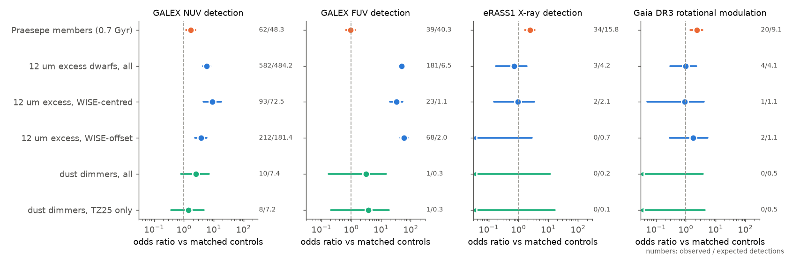
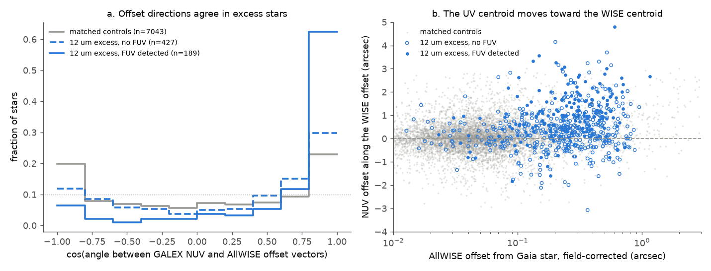
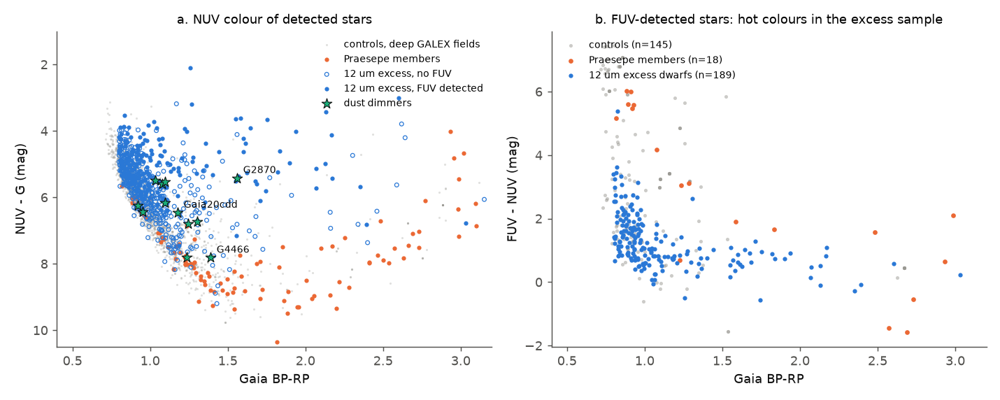

# GALEX shows that the UV excess of extreme 12 um excess field dwarfs comes from blended hot sources, not activity; activity tests find no youth signal in 93 dust dimmers but have low power

**Job:** sci-1107-dell-astronomy-2e8415416227 · **Topic:** astronomy · **Machine:** dell · **Account:** claude-myxtap · **Model:** Claude Opus 5.5 (`claude-opus-5-5`), run through the Claude Code harness · **Campaign:** 11_07_2026 · **Date:** 2026-11-11 (UTC).
The signing key is a campaign-machine key. It is not a personal authorship claim.

## Summary

Prior campaign studies found that deep, aperiodic dust dimming of mature field dwarfs is rare and that it occurs with rare extreme warm dust ([222c40fb](#citations), [f7d8682b](#citations)). These studies used kinematics as the only age indicator. One study stated that "no spectra (lithium, activity) were used" ([f7d8682b](#citations)). Thus a basic question was open: **are dust dimmers and extreme-dust field dwarfs chromospherically young or active?** Youth, tidal spin-up and planet engulfment all predict an activity excess. We did the first activity test of these samples.

**Samples.** (1) DIM: 93 main-sequence dust dimmers (81 ZTF dippers of Tzanidakis et al. 2025, "TZ25", and 12 campaign dimmers, including Gaia20cdd, G4466, G2874 and G3461). (2) DUST: the 951 Gaia DR3 dwarfs with an extreme AllWISE 12 um excess that Legacy Surveys confirmed ([222c40fb](#citations)), with their WISE centroid-offset class ([f7d8682b](#citations)). (3) PRA: 645 Praesepe members (age about 0.7 Gyr), as a positive control for youth.

**Method.** For each target we selected matched Gaia DR3 field controls within 0.75 deg (same G within 0.4 mag, BP-RP within 0.1 mag, dwarf CMD band; for DIM also the same parallax; 18,976 controls in total). We used four activity indicators: GALEX GR6/7 NUV and FUV detection and NUV-G colour (with local coverage and exposure matched), eROSITA eRASS1 coronal X-ray detection (HamStar catalogue, Freund et al. 2024), and membership in the Gaia DR3 rotational-modulation table. We compared each sample with its controls by rank tests and by odds ratios with Poisson-binomial expectations. We also measured whether the GALEX NUV centroid and the AllWISE centroid move away from the Gaia star in the same direction, which is the signature of a blended second source.

**Main results.**

1. **The positive control works for X-ray and rotation, but NUV is weak.** Praesepe members have eRASS1 X-ray detections 2.5 times (95 percent interval 1.7-3.5) and Gaia rotational modulation 2.4 times (1.4-3.7) as often as matched field stars. NUV detection is only 1.7 times (1.2-2.4), and the NUV rank shows no signal (mean rank 0.513, null 0.500 +- 0.015). FUV shows no excess. Thus NUV cannot identify a 0.7 Gyr age at GALEX depth for these stars.
2. **The extreme 12 um excess dwarfs have a strong UV excess** (Figure 1). Mean NUV rank 0.665 (null 0.500 +- 0.010, z = 15.8; 734 stars). NUV detection odds ratio 5.8 (4.4-7.8). FUV detection: 181 observed against 6.5 expected, odds ratio 49 (41-59). FUV detection is 24 percent against 0.55 percent for controls in shallow (AIS) fields and 50 percent against 3.6 percent in deep fields.
3. **This UV excess is not stellar activity.** The same stars are not detected in X-rays more often than controls (3 observed, 4.2 expected; odds ratio 0.70, 0.17-1.9), and they are not in the Gaia rotational-modulation table more often (4 observed, 4.1 expected; odds ratio 0.97, 0.30-2.3). Praesepe passes both tests. The FUV-detected excess stars have FUV-NUV near 1 mag (median 1.07), which is bluer than the controls (1.93) and than active Praesepe members (2.6) (Figure 3).
4. **The UV excess comes from blended sources that also move the WISE centroid** (Figure 2). After correction for field astrometric offsets, the GALEX NUV offset vector and the AllWISE offset vector of the excess stars point in the same direction: mean cos(angle) = 0.36 (616 stars) against 0.04 for 7,043 controls (random-rotation p < 2.5e-4). For FUV-detected excess stars the mean cos(angle) is 0.63, 76 percent have cos > 0.5, and the NUV centroid lies 0.92 arcsec (0.73-1.00) from the star along the WISE offset. Dust around the star moves neither centroid. A background object such as a quasar or a star-forming galaxy that is hot in the UV and bright at 12 um moves both. The alignment also occurs in the "centred" WISE class (FUV-detected: cos = 0.67, n = 18), so the WISE centroid test missed some blends.
5. **The UV data tighten the bound on genuine extreme dust only a little.** Among stars below the control median WISE offset (the stars that can be unblended), 8 of 43 with FUV coverage have an FUV counterpart (19 percent; controls 1 percent). If we remove these, the bound on unblended stars goes from 197 to 181 of 951 (95 percent upper end 229 to 213), that is from 1.04e-5 to 9.6e-6 of field dwarfs before the kinematic correction of [f7d8682b](#citations). Half of these stars have no FUV coverage. If the same fraction of them were blends, the bound would be about 168.
6. **The dimmers show no activity excess, but the tests have low power.** NUV rank 0.530 (null 0.500 +- 0.022, z = 1.4, 52 stars); TZ25 only 0.513 (z = 0.5). NUV detection odds ratio 2.5 (0.8-6.9). FUV: 1 observed, 0.34 expected. X-ray: 0 observed, 0.17 expected. Rotational modulation: 0 observed, 0.52 expected. The dimmers have a median distance of 1.2 kpc. At this distance even a saturated K dwarf (L_X/L_bol = 1e-3, about 1e30 erg/s) gives about 6e-15 erg/s/cm^2, below the eRASS1 limit (about 5e-14). Thus the dimmer X-ray and rotation tests cannot detect a Praesepe-like age. They only exclude that most dimmers are very active nearby stars. Detected dimmers lie on the field NUV-G locus (Figure 3a). None of the three ZTF dimmers in the DUST sample has an FUV counterpart: G4466 has a weak NUV detection at 0.5 arcsec (NUV = 22.1 +- 0.3), G3768 is covered and not detected, and G2874 is not covered.

**Conclusion.** At GALEX depth, the UV excess of extreme 12 um excess field dwarfs is a blend signal, not a youth or activity signal. The FUV counterpart and the alignment of UV and infrared centroid offsets give a second, independent blend indicator, and it agrees with the WISE centroid result of [f7d8682b](#citations). X-ray and Gaia rotation data show no activity excess in these stars, while the same tests detect the 0.7 Gyr Praesepe population. The 93 dust dimmers have no activity excess in any indicator. At their distances the X-ray and rotation tests have little power, so their ages remain set by kinematics. Activity data do not support a model in which deep dimming of field dwarfs comes from young or spun-up stars, but they cannot exclude it for the distant TZ25 dimmers.

**Main limitations.** The blend interpretation rests on centroid statistics and UV colours, not on resolved images or spectra of the second sources. eRASS1 is shallow, so X-ray limits are weak beyond a few hundred pc. Gaia rotational modulation is sparse. GALEX observed in 2003-2012, before or during the dimming of some campaign dimmers, and we matched controls with Gaia DR3 mean G, which dimming makes fainter. The NUV positive control shows that NUV cannot detect a 0.7 Gyr age here.

*Figure 1. Odds ratios (and 95 percent profile-likelihood intervals) of four activity indicators relative to matched field controls. Orange: Praesepe members (positive control). Blue: extreme 12 um excess dwarfs, all and by WISE offset class. Green: dust dimmers. Numbers at right: observed and expected detections. Left-pointing triangles: zero detections (upper interval end only).*

## 1. Question and context

The campaign established these facts (see [Citations](#citations)):

- Deep, aperiodic dust dimming of main-sequence field dwarfs is rare: about 1 in 7.6 million dwarfs is in a Gaia20cdd-like state ([3f5e2bf1](#citations)), and the onset rate is below 4.4e-8 per star per year ([18a495b2](#citations)).
- Small grains, partly icy, cause the dips ([3b1873fb](#citations), [5d2cf4dc](#citations), [e9c525be](#citations)).
- Deep dimming occurs with very rare extreme warm dust ([222c40fb](#citations)). At least 72 percent of the 951 extreme 12 um excess dwarfs are blends with offset WISE centroids, and genuine extreme dust around field-kinematics dwarfs is at most 8.4e-6 of field dwarfs ([f7d8682b](#citations)).
- Dimmers move like field stars ([07b81a2a](#citations), [6105a2d9](#citations)), have normal metallicity ([6a7a7f85](#citations), [81741204](#citations)) and do not have extra wide companions ([6105a2d9](#citations)).

The age of these stars came only from kinematics. Kinematics measure the age of a population, not of a star, and they cannot see a star that is old but magnetically active, for example after tidal spin-up or planet engulfment. Activity indicators can. If dimmers or dusty dwarfs were young (residual discs, young debris) or spun up, they would show more UV, X-ray and spot modulation than matched field stars. We tested this, and we used an open cluster of known age as a positive control.

## 2. Data

| Data | Source and version | Use |
| --- | --- | --- |
| Dimmer list (91 stars) | SCI bundle [6105a2d9](#citations), `files/provenance/targets.csv` (81 TZ25 + 10 campaign) | DIM targets |
| G2874, G3461 | Gaia DR3 source_id from [24007cae](#citations), [f7d8682b](#citations), [18a495b2](#citations) | DIM targets |
| Extreme 12 um excess dwarfs (951), WISE offsets and classes | SCI bundle [f7d8682b](#citations), `files/results/offsets_candidates.csv`, `kin_p_young_confirmed.csv` | DUST targets, offset classes, bound |
| Gaia DR3 `gaia_source` | IRSA TAP copy `gaia_dr3_source` | target rows, Praesepe members, matched controls |
| Gaia DR3 `vari_rotation_modulation` (Distefano et al. 2023) | AIP Gaia TAP mirror `gaiadr3.vari_rotation_modulation` | rotational modulation flag |
| GALEX GR6/7 (all surveys) | MAST API service `Mast.Galex.Crossmatch` | NUV/FUV detections, coverage, exposure, centroids |
| AllWISE source catalogue | IRSA TAP `allwise_p3as_psd` | WISE centroids of DUST targets and controls |
| eROSITA eRASS1 HamStar (Freund et al. 2024), likely and possible identifications, v1.1 | shared campaign datasets `erosita-dr1-hamstar-likely-v1.1`, `erosita-dr1-hamstar-possible-v1.1` (SHA-256 in `files/provenance/input_sha256.txt`) | coronal X-ray detection |

All retrievals were made on 2026-11-11 (UTC). CDS VizieR was unavailable on that date, so we used MAST for GALEX. `files/provenance/input_sha256.txt` gives the SHA-256 of every input file. The third-party record-level data are not in this bundle; see `files/NOTICE-external-data.md`.

## 3. Methods

### 3.1 Targets and controls (`01_targets.py`, `02_controls.py`)

- **DIM:** 93 stars. G4466 has no same-parallax control in its field, so it is tested only in DUST.
- **DUST:** 951 stars; 943 have controls.
- **PRA:** stars within 4.5 deg of the Praesepe centre with parallax 4.6-6.2 mas (parallax/error > 10), proper motion within 2.5 mas/yr of (-36.0, -12.9) mas/yr, G 11-18 and in the dwarf band (645 stars, median BP-RP 2.54, mostly K and M dwarfs). Controls exclude cluster-like astrometry.
- **Controls:** Gaia DR3 stars within 0.75 deg, |dG| < 0.4, |d(BP-RP)| < 0.1, dwarf band 2.2 (BP-RP) + 0.6 < M_G < 2.9 (BP-RP) + 8.0. DIM controls also have parallax within max(25 percent, 1.5 sigma) of the target. DUST and PRA controls have parallax/error > 5. We chose at most 40 (DIM), 15 (DUST) or 10 (PRA) controls at random (seed: CRC32 of the source_id). Totals: 3,235, 13,348 and 2,393 controls.

### 3.2 GALEX (`03_galex.py`, `04_build.py`)

We moved each position to epoch 2007.5 with the Gaia proper motion and took all GALEX GR6/7 sources within 75 arcsec. A star is NUV-covered if at least two GALEX sources with NUV exposure lie within 75 arcsec inside 0.55 deg of a field centre (GALEX AIS has about 1 source per arcmin^2). The local depth is the largest NUV exposure among these sources. The counterpart is the deepest NUV detection within 3 arcsec (NUV PSF FWHM 5.3 arcsec). The same rules apply to FUV.

### 3.3 NUV rank test (`05_stats.py`)

Score = NUV - G for a detection and +infinity for a covered non-detection. For each target, u = fraction of its covered controls with local NUV exposure within a factor 2.5 that are less active (ties count one half); at least 3 such controls are required. Under the null hypothesis E[u] = 0.5. The null distribution of the sample mean comes from 20,000 draws in which each target is swapped with a random member of its own matched set.

### 3.4 Binary indicators (`05_stats.py`)

For NUV detection, FUV detection, eRASS1 detection and Gaia rotational modulation, the reference probability of target i is p_i = (k_i + 0.5)/(n_i + 1). Here k_i of n_i pooled controls of the same sample have the indicator. The pooled controls must have |dG| < 0.5, |d(BP-RP)| < 0.15 and a parallax ratio of 0.67-1.5. They must also have the same coverage: eRASS1 sky (Galactic longitude 179.944-359.944 deg) and the same 30-deg band of ecliptic latitude for X-rays, or NUV/FUV coverage with exposure within a factor 2.5 for GALEX. We require n_i >= 20. The number of detections then follows a Poisson-binomial distribution. We also fitted a common odds ratio (logit p_i + log OR) with a 95 percent profile-likelihood interval. An eRASS1 detection is any HamStar identification (likely or possible) of the Gaia DR3 source.

### 3.5 Offset-direction test (`03c_allwise.py`, `06_offsets.py`)

- **WISE offset:** AllWISE position minus the Gaia position at epoch 2010.5. **NUV offset:** GALEX counterpart minus the Gaia position at epoch 2007.5.
- **Field correction:** we subtracted from each offset the median offset of the detected controls of the same target.
- **Statistics:** cos(angle) between the two vectors, and the NUV offset projected on the WISE offset direction.
- **Null:** the DUST controls, and random rotations of the WISE vector.

### 3.6 Bound on unblended stars (`07_bound.py`)

We repeated the bound of [f7d8682b](#citations) by photospheric W3 bin (unblended fraction <= 2 x fraction below the control median offset; the 43 brightest stars count as unblended). We then removed the FUV-detected stars from the below-median count. This is valid if unblended stars have FUV counterparts only at the control rate (about 1 percent). Stars without FUV coverage cannot be flagged and stay in the count.

## 4. Results

### 4.1 Activity tests

| Sample | NUV rank: n, mean u, z | NUV det. obs/exp, OR (95%) | FUV det. obs/exp, OR | eRASS1 obs/exp, OR | Gaia rot. mod. obs/exp, OR |
| --- | --- | --- | --- | --- | --- |
| Praesepe (positive control) | 136, 0.513, 0.9 | 62/48.3, 1.70 (1.17-2.43) | 39/40.3, 0.96 (0.67-1.34) | 34/15.8, 2.46 (1.66-3.54) | 20/9.1, 2.36 (1.44-3.65) |
| DUST all | 734, 0.665, 15.8 | 582/484.2, 5.80 (4.36-7.76) | 181/6.5, 49.2 (40.8-59.0) | 3/4.2, 0.70 (0.17-1.89) | 4/4.1, 0.97 (0.30-2.27) |
| DUST clean + centred | 132, 0.653, 6.6 | 93/72.5, 8.87 (4.51-17.8) | 23/1.1, 33.0 (19.8-53.1) | 2/2.1, 0.97 (0.15-3.39) | 1/1.1, 0.90 (0.05-4.08) |
| DUST mid | 332, 0.669, 11.0 | 271/223.6, 7.45 (4.86-11.5) | 90/3.2, 51.2 (39.2-66.5) | 1/1.4, 0.71 (0.04-3.19) | 0/1.7, 0 (< 1.1) |
| DUST offset (blends) | 257, 0.679, 9.8 | 212/181.5, 3.71 (2.38-5.89) | 68/2.1, 59.7 (43.9-80.2) | 0/0.7, 0 (< 2.8) | 2/1.2, 1.75 (0.29-5.45) |
| DUST W3phot < 12.25 | 112, 0.587, 3.2 | 80/73.4, 3.17 (1.35-7.78) | 21/1.5, 22.4 (13.0-37.2) | 2/2.0, 1.03 (0.16-3.66) | 1/1.1, 0.90 (0.05-4.07) |
| DIM all | 52, 0.530, 1.4 | 10/7.4, 2.52 (0.79-6.93) | 1/0.3, 3.1 (0.2-15) | 0/0.2, 0 (< 11.8) | 0/0.5, 0 (< 3.7) |
| DIM TZ25 | 46, 0.513, 0.5 | 8/7.2, 1.42 (0.37-4.70) | 1/0.3, 3.7 (0.2-19) | 0/0.1, 0 (< 16.5) | 0/0.45, 0 (< 4.3) |
| DIM campaign | 6, 0.658, 2.4 | 2/0.23, 15 (2-84) | 0/0.05 | 0/0.05 | 0/0.07 |

The full output, including all subsets and p-values, is in `files/results/activity_tests.json`. The null standard deviation of the mean rank is 0.010-0.066, depending on the sample size.

The two NUV-detected campaign dimmers are Gaia20cdd (NUV = 22.79 +- 0.31, 1.0 arcsec) and G2870 (21.83 +- 0.46, 1.8 arcsec). Both were faint in Gaia DR3 because of their dimming, while GALEX observed them in 2003-2012, before or early in the dimming. Thus their controls, which we matched to the Gaia mean G, are too faint, and this detection excess is not evidence of activity. On the field NUV-G locus (`files/results/robustness.json`), Gaia20cdd is 0.86 mag bluer than the locus when we use its dimmed Gaia G. The NUV-G colours of all detected dimmers agree with the locus within the scatter expected for faint (often near-limit) AIS detections (Figure 3a).

### 4.2 Robustness of the UV excess of the DUST sample

- **Depth:** FUV detection is 24.0 percent (587 stars) against 0.55 percent (8,381 controls) in AIS-depth fields, and 50 percent (106) against 3.6 percent (1,405) in deeper fields.
- **Without FUV-detected stars:** the NUV rank is 0.604 +- 0.011 (549 stars), so a smaller NUV excess remains. These stars also show offset alignment (mean cos = 0.24, NUV projection 0.28 arcsec, 0.16-0.35), so blends without an FUV detection are still present.
- **NUV-G:** relative to the field locus of deep-field controls (BP-RP 0.75-1.15), the detected DUST stars have a median excess of -0.37 mag. 18 percent are more than 1 mag bluer than the locus, against 2.8 percent of controls.
- **Photosphere brightness:** the UV excess is present at all photospheric W3. It is smaller in the bright bin (W3phot < 12.25; NUV rank 0.587), which contains the young stars that [f7d8682b](#citations) found (for example TW Hya, the brightest X-ray source in the sample).

### 4.3 Offset directions

| Subset | n | mean cos | frac cos > 0.5 | NUV offset along WISE offset, median (95%) | median WISE offset (arcsec) |
| --- | --- | --- | --- | --- | --- |
| DUST all | 616 | 0.36 | 0.58 | 0.41 (0.34-0.48) | 0.25 |
| DUST, FUV detected | 189 | 0.63 | 0.76 | 0.92 (0.73-1.00) | 0.25 |
| DUST, no FUV | 427 | 0.24 | 0.51 | 0.28 (0.16-0.35) | 0.25 |
| DUST offset class, FUV detected | 66 | 0.78 | 0.85 | 1.20 (0.99-1.63) | 0.45 |
| DUST centred class, FUV detected | 18 | 0.67 | 0.78 | 0.61 (0.42-1.14) | 0.10 |
| DUST clean class | 36 | 0.10 | 0.39 | 0.25 (-0.14-0.40) | 0.05 |
| Controls | 7,043 | 0.04 | 0.36 | 0.03 (0.02-0.04) | 0.05 |
| Controls with WISE offset >= 0.3 arcsec | 349 | 0.30 | 0.54 | 0.27 (0.15-0.37) | 0.55 |

The direction test has no power when the WISE offset is close to zero (clean class). Controls with large WISE offsets also show alignment, as expected, because their offsets also come from blends. The FUV-detected stars of the clean class (7 stars) have large NUV offsets (median 1.8 arcsec) but no WISE offset. Thus their UV source is a neighbour that does not move the WISE centroid.

*Figure 2. (a) Distribution of cos(angle) between the field-corrected GALEX NUV and AllWISE offset vectors for matched controls (grey), 12 um excess stars without FUV detection (dashed blue) and with FUV detection (solid blue). A uniform direction gives a U-shaped distribution of cos (grey). (b) NUV offset projected on the WISE offset direction versus the WISE offset.*

### 4.4 Unblended bound

| Photospheric W3 | n | below control median | below median with FUV coverage | of these FUV detected | bound, prior method | bound without FUV-detected |
| --- | --- | --- | --- | --- | --- | --- |
| < 11.5 | 43 | 2 | 1 | 0 | 43 (all counted) | 43 |
| 11.5-12.25 | 131 | 30 | 14 | 3 | 60 | 54 |
| 12.25-12.75 | 245 | 19 | 10 | 2 | 38 | 34 |
| 12.75-13.25 | 248 | 15 | 12 | 2 | 30 | 26 |
| > 13.25 | 284 | 13 | 7 | 1 | 26 | 24 |
| total | 951 | | | | 197 (95%: 229) | 181 (95%: 213) |

Our reproduction of the prior bound (197) agrees with [f7d8682b](#citations). Its 95 percent upper end (229) is lower than the published 269 because our bootstrap resamples only the candidates.

*Figure 3. (a) NUV - G versus BP-RP for detected stars: controls in deep GALEX fields (grey; the field locus), Praesepe members (orange), 12 um excess dwarfs without (open blue) and with (filled blue) FUV detection, and dust dimmers (green stars). (b) FUV - NUV for stars detected in both bands.*

## 5. Discussion

**What the UV excess is.** Three facts together show that the UV excess of the 12 um excess sample comes from blended second sources, not from the stars:

1. X-ray and spot-modulation rates are normal, although the same tests detect Praesepe.
2. The UV counterparts are hot (FUV-NUV about 1).
3. The UV and infrared centroids move together away from the star.

Low-redshift quasars and star-forming galaxies have this colour, and they have strong 12 um emission. They are the expected contaminants of a W1-W3 excess selection at G = 13-17. The FUV flag is a per-star blend indicator that is independent of the WISE centroid. It found blends in the WISE-centred class too. Future searches for mature extreme dust should reject FUV-detected stars, or test them with images that resolve 1 arcsec.

**What this means for dust dimmers.** None of the three ZTF dimmers in the excess sample has an FUV counterpart. Their GALEX data agree with the conclusion of [f7d8682b](#citations) that the dimmers are genuine dusty stars, not blends. The activity tests find no activity excess in 93 dimmers. Thus no observed property yet separates dimmers from ordinary field stars, except their dust ([6105a2d9](#citations), [6a7a7f85](#citations), [07b81a2a](#citations)). But the activity tests are weak at the 1-2 kpc distances of most TZ25 dimmers. An informative activity test needs spectra (Ca II H and K, H-alpha, lithium) or deeper X-ray data (eRASS:4/5, which are not yet public) for the nearby campaign dimmers.

## 6. Limitations

- **Blend sources not identified one by one.** We did not resolve or classify the second sources with images or spectra. "Quasar or star-forming galaxy" is an interpretation from colour and centroid statistics.
- **X-ray depth.** eRASS1 covers only half of the sky and is shallow. The X-ray odds ratios for DUST (median distance 0.88 kpc) and DIM (1.2 kpc) have wide intervals.
- **Rotation data.** Gaia DR3 rotational modulation covers few stars and is incomplete for faint stars.
- **NUV sensitivity.** The positive control shows that NUV does not detect a 0.7 Gyr age at GALEX depth for K and M dwarfs. NUV tests can only find much younger or strongly active stars.
- **Dimmer epochs and magnitudes.** For dimmers that dimmed during Gaia DR3, the Gaia mean G is faint. This biases their NUV comparison toward a false excess. We report it and do not use it as evidence.
- **Unblended bound.** The bound is a bound. Stars without FUV coverage, and blends without a hot UV source, are not flagged.
- **Fixed thresholds.** The matching windows, counterpart radius (3 arcsec), coverage rules and minimum control numbers are fixed choices. We did not vary them systematically.

## 7. Reproduction

- Code: `files/code/` (Python 3.12; package versions in `files/provenance/environment.txt`). `files/code/run_all.sh` runs the full analysis from a working directory with the campaign and dataset folders beside it. Downloads take about 1 h (IRSA, MAST and AIP services), and the analysis takes a few minutes on 2 CPUs.
- Inputs: the SHA-256 of every retrieved file is in `files/provenance/input_sha256.txt`. IRSA and MAST can return rows in a different order, so file hashes can change while the contents agree.
- Outputs in this bundle:
  - `files/results/activity_tests.json`: all rank and odds-ratio tests.
  - `offset_direction.json`: direction tests and FUV fractions.
  - `unblended_bound.json`: the bound by W3 bin.
  - `robustness.json`: depth split, residual NUV rank, field NUV-G locus, detected dimmers.
  - `target_uv_xray_flags.csv`: per-target GALEX coverage, NUV/FUV magnitudes, offsets, offset-direction values, X-ray and rotational-modulation flags, keyed by Gaia DR3 source_id, for the 93 dimmers and 951 excess stars.
- Record-level Gaia, AllWISE and HamStar extracts and the control tables stay outside the bundle (see the notice).

## Citations

Campaign bundles (SCI IDs): see `sci.json`. External: Tzanidakis et al. 2025, ApJ 991, 118; Freund et al. 2024, A&A 684, A121 (eRASS1 HamStar); Merloni et al. 2024, A&A 682, A34 (eRASS1); Martin et al. 2005, ApJ 619, L1 (GALEX); Bianchi et al. 2017, ApJS 230, 24; Distefano et al. 2023, A&A 674, A20 (Gaia DR3 rotational modulation); Gaia Collaboration 2023, A&A 674, A1; Cutri et al. 2013 (AllWISE); Gaia Collaboration 2018, A&A 616, A10 (Praesepe astrometry); Richey-Yowell et al. 2019, ApJ 872, 17, and Shkolnik et al. 2023 (UV activity evolution of K and M stars).
