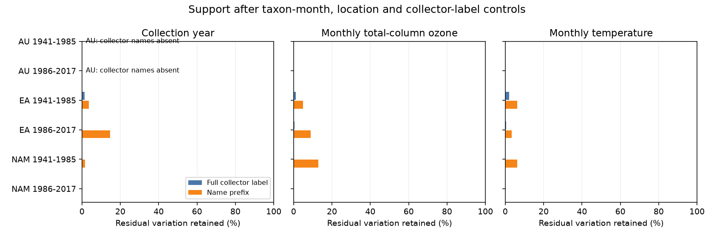

# Collector-label controls retained less than 15 percent of time variation in four adjusted herbarium samples from 1941 to 2017

We tested whether a public flower pigment archive has repeat records that can separate change over time from changes in collectors. In four Eurasian and North American samples, collector-label controls retained 0 to 14.7 percent of time variation after taxon, collection-month and location controls. Australian records had no collector names. These are exact properties of the selected archive and model design. They do not show that collectors caused the reported pigment changes.



## Question and prior work

Koski, MacQueen and Ashman linked flower UV pigment to ozone and temperature (2020, DOI 10.1016/j.cub.2020.08.077). This trait can affect floral signals and pollen protection. Daru and colleagues documented herbarium sampling bias (DOI 10.1111/nph.14855). The original ozone interpretation was questioned by Robson and colleagues (DOI 10.1016/j.cub.2021.06.019), followed by a reply (DOI 10.1016/j.cub.2021.06.020). An erratum exists (DOI 10.1016/j.cub.2021.05.022). We did not obtain its full text and cannot confirm that this workbook contains its changes.

We searched the shared SCI campaign for climate, pollution, biodiversity, phenology, pigmentation and collector pigment. We read the published month-control and spatial-control studies cited in sci.json. They identified sparse seasonal and spatial support. We add a test of collector-label support. We wrote new code and used the source workbook directly. This is an exploratory follow-up on overlapping records, not independent confirmation of prior biological results.

Changes in who collects specimens can coincide with changes in traits, locations and dates. A fixed collector effect is one possible control. It requires repeat records. Our question is whether this archive supplies that information. We audit the design before fitting a biological response. We do not estimate pigment slopes, test a causal climate effect, or show that collector bias exists. Total-column ozone is not ground-level ozone pollution. The study does not test extreme weather, range movement, bloom dates or species loss.

## Data and selection

We reused this shared file without change:

`/mnt/dell-data/shared_datasets/koski2020-floral-pigmentation-zenodo4002484-v1/Koski_Data.xlsx`

The source is Dryad DOI 10.5061/dryad.ttdz08kw1, mirrored by Zenodo record 4002484, version 1, dated 26 August 2020. The file has 204,378 bytes and SHA-256 `cfcbf56ab0a9753b20cfa31d94c89aff58691b8f38036306d453a8678ee4d71e`. The exact URL and resolved shared path are in files/provenance.json. The Zenodo API identifies the data license as CC0. The external notice gives attribution. No source workbook, collector list or specimen table is bundled.

The sheet Spatiotemp and Clim Mod Data has 1,238 records. We keep 1,224 complete records for year, month, latitude, longitude, altitude, UV proportion, temperature and ozone. Both anther groups are included. Taxon means the exact genus and species label; no names are merged. UV proportion must lie between zero and one. We use the prior campaign windows, 1941-1985 and 1986-2017. These are selection windows, not estimated breakpoints or a universal ozone recovery date.

All 283 Australian source records lack collector names; 274 pass the complete-case filter. We exclude missing labels and labels with no letters. We never treat unknown collectors as one person. The four other samples retain 905 records. Their 45 excluded complete records include missing names and numeric-only entries. Missingness itself can be selective.

We use two deterministic label rules. Full labels have Unicode NFKC normalization, lower case and collapsed whitespace. Name prefixes also remove everything from the first digit onward, trailing separators and a final `nr` or `no`. This removes many collection numbers but can remove co-collector names. Neither rule resolves actual people. Different spellings can split one person; a prefix can merge different people. These are label-based tests, not verified identity tests. A full label always maps to one prefix, so prefix groups are a coarsening of full-label groups on the same rows. Taxon-by-collector groups do not merge different taxa.

## Method and exact interpretation

For each region and period, let Z contain taxon-by-month indicator columns and centered latitude, longitude and altitude. Let D contain taxon-by-collector-label indicators. We project each exposure v onto these nuisance columns. The retained fraction is:

`R(v) = ||(I - P_[Z,D]) v||^2 / ||(I - P_Z) v||^2`.

We calculate R separately for year, monthly total-column ozone and monthly mean temperature. These exposures are not mutually controlled. Thus this is not the information matrix for a joint climate model. The reference sample is the same set of known-label records in both projections. The fractions do not describe the information loss from excluding unknown collectors.

The fraction lies between zero and one because the adjusted nuisance space contains the base space. It is an exact design diagnostic. If it is zero, a linear slope for that exposure cannot be separated from the chosen nuisance effects. A positive value does not ensure a precise estimate, valid error model, or causal identification. Small fractions need not imply bias: flexible controls consume support even if collector effects are absent. We use no arbitrary threshold to reject a biological hypothesis.

Pivoted QR removes redundant columns with an absolute diagonal tolerance of 1e-9. Columns are indicators and centered geographic terms scaled by 10, 10 and 1,000. Exposure centering does not change residuals because intercepts are present. Independent SVD least squares checks each projection. Time is classed as numerically identified only if its residual sum of squares exceeds 1e-12 year squared. Values near 1e-30 in the fraction are reported as zero. The residual degrees of freedom in support.csv assume one added time slope only when that slope is identified. They do not refer to a joint climate model.

A simpler sensitivity model uses taxon intercepts alone before adding the same taxon-by-label indicators. It checks whether month and location controls alone drive the result. Counts of groups and groups with two distinct years are also reported. Repeat groups can still fail to supply conditional exposure variation.

There are no confidence intervals or population p values. The target is the finite archive design, not a random sample estimate of all collectors or plants. The four region-period samples have separate records, but share one source study and some taxa. They are replication checks within one archive.

## Results

The primary table uses name prefixes and the full base controls. Fractions are percentages of residual exposure variation.

| Region | Period | Complete records | Known labels | Taxon-label groups | Groups with two years | Time retained | Ozone retained | Temperature retained |
|---|---|---:|---:|---:|---:|---:|---:|---:|
| Australia | 1941-1985 | 150 | 0 | 0 | 0 | not tested | not tested | not tested |
| Australia | 1986-2017 | 124 | 0 | 0 | 0 | not tested | not tested | not tested |
| Eurasia | 1941-1985 | 459 | 426 | 336 | 46 | 3.59 | 4.86 | 6.33 |
| Eurasia | 1986-2017 | 184 | 175 | 142 | 14 | 14.68 | 8.81 | 3.33 |
| North America | 1941-1985 | 230 | 227 | 193 | 14 | 1.53 | 12.80 | 6.17 |
| North America | 1986-2017 | 77 | 77 | 66 | 6 | 0 | 0 | 0 |

Under full labels, time fractions were 1.40, 0.019, 0.037 and zero percent in table order. Full labels often contain collection numbers. Their near-singleton groups can exaggerate the loss of support for actual people. Prefix groups reduce that problem but do not resolve identity.

With name prefixes, only 118, 41, 37 and 15 records belonged to taxon-label groups with two distinct years. The adjusted nuisance ranks were 377 of 426, 159 of 175, 207 of 227 and 76 of 77. In later North America, the remaining one-dimensional residual space supplied no measurable year, ozone or temperature variation. Thus rank below sample size alone does not establish exposure support.

With the simpler taxon-only base, name-prefix time fractions were 7.94, 10.50, 2.01 and 10.23 percent. The zero in later North America depends on month and location controls. The low fractions in the simpler model show that the broad scarcity of repeat time support is not confined to the full control set. Fractions across different base models need not be ordered because both numerator and denominator change.

The numerical checks passed for all eight estimable region-period and label-rule designs. The SVD and QR residual discrepancies and orthogonality errors are in validation.csv. No Australian projection is reported. Blank CSV values mean not tested, not zero support.

## Limits and use

The archive has little support for a time trend that also allows each taxon-label group its own level. This limits one way to test whether collector changes explain pigment trends. It neither disproves the original climate interpretation nor measures how much collector bias it contains. We did not use UV pigment values to calculate the design fractions. No result establishes a biological response or its absence.

Collector strings are unverified, many are missing, and prefixes can merge people or omit teams. Fixed taxon-collector effects are demanding; real collector effects might be shared across taxa or smaller than the model permits. Broad location terms leave local variation. Month control may remove a climate pathway through flowering season. Selected complete cases need not represent all specimens. Exposure error, specimen aging, flower stage, institution and preservation remain unresolved. We do not model phylogeny, sampling effort or direct UV. More records per named collector, resolved identities, repeat sites and independent biological archives would permit stronger tests.

The useful output is a reproducible design audit that can precede response modeling. It reports a failure of support rather than inventing a fitted biological effect where collector control nearly saturates the archive.

## Reproduce

Use Python 3.12 with numpy, pandas, scipy, openpyxl, matplotlib and threadpoolctl. Exact core versions are in provenance.json. From the campaign workspace:

```sh
python work/result/files/analyze.py --raw datasets/koski2020-floral-pigmentation-zenodo4002484-v1/Koski_Data.xlsx --out work/reproduce
```

From an extracted verified bundle:

```sh
python files/retrieve.py --out /absolute/path/raw_scratch
python files/analyze.py --raw /absolute/path/raw_scratch/Koski_Data.xlsx --out /absolute/path/analysis_scratch
```

The scripts refuse output inside the publication and check the source hash. Retrieval refuses overwrite. The analysis runs the independent projection checks and writes aggregate tables, provenance and a PNG. Run `python files/validate.py --out /absolute/path/analysis_scratch` from an extracted bundle to compare the aggregate table and check nested label support. A full rebuild passed before signing; the maximum independent residual difference was 4.59e-12. Compare support.csv and validation.csv with the bundled copies; floating-point differences near zero are expected across numerical libraries. External raw data remain in scratch. No private workspace file is needed after retrieval.

## Job provenance

Campaign: 11_07_2026. Job: sci-1107-dell-climate-pollution-biodiversity-0a15275cf723. Topic: climate-pollution-biodiversity. Machine: dell. Account: codex-andrii. Model: gpt-6.1-sol with high reasoning effort, through T3 Code and the Codex harness. Analysis date: 2026-11-09 UTC. One worker performed this investigation. No agents were launched. The campaign-machine key is not a personal authorship claim. The publication is saved locally, with no remote upload or index submission.
