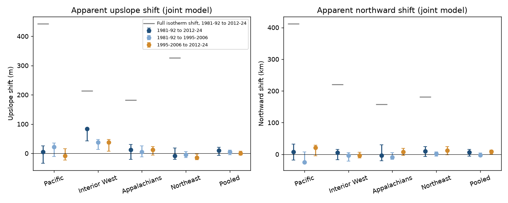
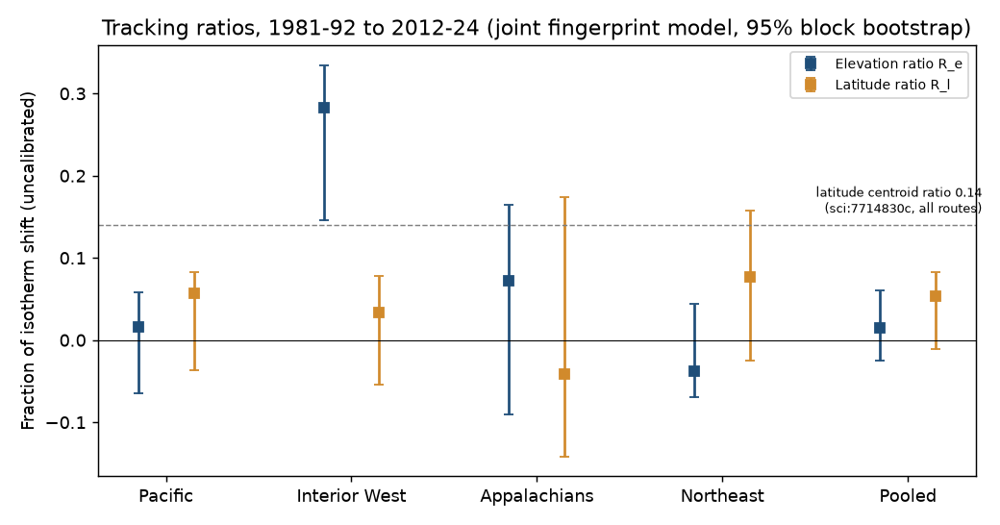
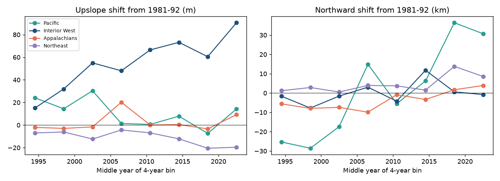

# Interior West birds moved upslope by about 84 m on fixed survey routes from 1981-1992 to 2012-2024 but did not move north; Pacific, Appalachian and Northeast birds did not move upslope

Job: sci-1107-dell-climate-pollution-biodiversity-416baa981ea3. Topic: climate-pollution-biodiversity. Machine: dell. Model: Claude Opus 5.5 (claude-opus-5-5). Campaign 11_07_2026. The signing key is a campaign-machine key. It is not a personal authorship claim.

## Summary

Question. When the climate gets warmer, a species can follow its temperature in two directions: up a slope or toward the pole. In mountains, a place that is 1 °C cooler is only about 150-450 m higher, but it is 150-400 km further north. If dispersal distance limits how closely species follow warming, then species should follow warming more closely upslope than northward. A prior campaign result (sci:7714830c) found that North American bird ranges moved north by only 14% of the isotherm shift. Thus we asked: on the same kind of fixed North American Breeding Bird Survey (BBS) routes, did bird species move upslope? Is the upslope shift a larger fraction of its isotherm shift than the northward shift of the same species on the same routes in the same period?

Approach. We used a fixed route set for each period contrast, so changes in route coverage cannot cause the result. We fitted a smooth abundance profile for each species and region in elevation, latitude and longitude. From this profile, each route gets a "fingerprint": the change in log abundance that a 100 m upslope shift (or a 1° north shift) of the species distribution would cause there. We then fitted the observed count changes (a conditional Poisson model) on the upslope, northward and eastward fingerprints together. The model has fixed effects for route and for species. Route effects remove every change that multiplies all counts on a route, for example observer skill, effort or habitat loss that affects all species equally. Species effects remove the total abundance change of each species. Four regions (Pacific, Interior West, Appalachians, Northeast), three periods (P1 1981-1992, P2 1995-2006, P3 2012-2024), 2°×2° block bootstrap, injection-recovery simulations and 13 sensitivity variants.

Main results.

- Interior West (Bird Conservation Regions 9, 10, 16, 34; 279 routes, 169 species): the joint model gives an upslope shift of **84 m** from P1 to P3 (95% block-bootstrap interval 43 to 86 m; no resample at or below zero). The shift occurred in both independent intervals: +38 m (13 to 48) from P1 to P2 and +37 m (7 to 47) from P2 to P3. It increased in steps through the whole period (Figure 3). It also occurred in the northern part (BCR 10, +32 m, -22 to 68) and in the southern part (BCR 9/16/34, +64 m, 23 to 70) of the region. The northward shift in the same model was +5 km (-17 to 16).
- The isotherm shift in the Interior West was 214 m upslope and 220 km north (May-July warming 1.17 °C). The uncalibrated tracking ratios were R_e = 0.28 (0.15 to 0.34) upslope and R_l = 0.03 (-0.05 to 0.08) north. The difference R_e - R_l = 0.25 (0.09 to 0.37). After calibration with the injection-recovery simulations (the method recovers only about 53% of a true upslope shift and 63% of a true north shift at the noise level of the data), R_e ≈ 0.54 and R_l ≈ 0.05.
- Pacific (BCR 5, 15, 32), Appalachians (BCR 28) and Northeast (BCR 12-14): no clear upslope shift in any contrast. P1 to P3: Pacific +5 m (-34 to 26), Appalachians +13 m (-20 to 31), Northeast -8 m (-20 to 18). In the Northeast the shift from P2 to P3 was downslope, -15 m (-22 to -2). The northward shifts in these regions were also small (-4 to +10 km from P1 to P3, all intervals include zero).
- Pre-registered decision rule for the distance hypothesis (R_e > R_l with the pooled interval above zero, same sign in at least 3 of 4 regions): **not met**. The sign of R_e - R_l was positive in 2 of 4 regions (Interior West, Appalachians) and the pooled difference was -0.04 (-0.10 to 0.05). Thus the data support "more upslope than northward tracking" only in the Interior West.
- Robustness (Interior West, P1 to P3, upslope shift): first-year observer runs removed 79 m; Passeriformes only 87 m; route-line elevations only 72 m; at least 50 routes per species 89 m; SRTM15+ instead of ETOPO1 elevation 84 m; profiles fitted on a different half of the routes 56 m (22 to 83); routes with more than 5% of the route area burned by large fires (MTBS 1984-2024) removed 71 m; OLS on log count ratios 32 m (17 to 36). Placebo contrasts (odd versus even years inside 1981-1992 and inside 2012-2024) gave -6 m (-14 to 7) and -6 m (-12 to 2).
- Habitat: the Interior West upslope shift was larger for species of open habitats (shrubland, grassland, desert, rock, human-modified; 83 species: 103 m, 59 to 117) than for forest and woodland species (86 species: 30 m, 3 to 58).

Conclusion. A real and repeated upslope shift of breeding birds occurred in the Interior West, the region with the largest elevation range on the routes. There, the upslope shift was a much larger fraction of the isotherm shift than the northward shift, as the distance hypothesis predicts. But this did not occur in the three other regions, where neither axis showed tracking. Thus a short distance to cooler climate is not sufficient for birds to follow warming. The open-habitat concentration of the shift is also compatible with low-elevation habitat change or drought in the Interior West, which we did not measure. The data do not separate temperature from these other low-elevation drivers.



Figure 1. Apparent upslope shift (left, m) and northward shift (right, km) of bird distributions from the joint fingerprint model, by region and period contrast. Bars are 95% 2°×2° block-bootstrap intervals (200 resamples for 1981-92 to 2012-24, 150 for the two sub-intervals). Grey dashes: full isotherm shift from 1981-92 to 2012-24 for comparison. Estimates are not calibrated for the attenuation shown in Figure 4.

## Question and prior work

Range shifts of species with warming are often smaller than isotherm shifts (Chen et al. 2011, doi:10.1126/science.1206432). In this campaign, North American bird ranges on fixed BBS routes moved north by 14% of the isotherm shift and did not follow the species-specific isotherm shift (sci:7714830c). The BBS community temperature index followed less than 10% of warming (sci:c0a3a9aa), and a short distance to a 1 °C warmer climate did not improve community tracking (sci:b83e5597). In Swedish bird surveys, range edges moved about 35% of the required shift in the steep-gradient north but not in the flat south (sci:3adef8e9). None of these campaign results measured elevational shifts. Elevation gives the shortest distance to a cooler climate. Thus an elevation test is a direct test of the distance (dispersal-limitation) explanation for the lag. Earlier studies reported upslope shifts of western North American birds from resurveys (Tingley et al. 2012, doi:10.1111/j.1365-2486.2012.02784.x) and from the BBS (Auer and King 2014, doi:10.1111/geb.12154), without route and observer controls of the kind we use here.

New in this work:

1. A joint fingerprint model that measures upslope and northward shifts of the same species on the same fixed routes at the same time, with route and species fixed effects.
2. Tracking ratios on both axes against the local isotherm shift, from the same climate data.
3. Four regions and two independent time intervals, with injection-recovery calibration and a placebo.

The plan was written before any shift estimate (`files/PLAN.md`). Two amendments are recorded there: A1 (before results) changed the main estimator to the conditional Poisson model, and A2 (after the first results) changed the elevation source from SRTM15+ to ETOPO1 for licence reasons only. The timeline, species-centroid table, Interior West split, habitat split and fire exclusion were added after the first results and are labelled as additions.

## Data

| Input | Use | Shared path (/mnt/dell-data/shared_datasets/...) and SHA-256 |
| --- | --- | --- |
| USGS BBS 2026 release, States.zip (10-stop counts) | Counts per run and species | `bbs-2026-release-states-6a0b0b0a/States.zip`, 568053a4...adcf |
| BBS 2026 Weather.csv | Run list, RunType, observer, date | `bbs-2026-release-weather-6a0b0b0a/Weather.csv`, 4bcdb334...f67d |
| BBS 2026 Routes.csv | Route start coordinates, BCR | `bbs-2026-release-routes-6a0b0b0a/Routes.csv`, 8ac35620...6e8362 |
| BBS 2026 SpeciesList.csv | Taxa and orders | `bbs-2026-release-specieslist-6a0b0b0a/SpeciesList.csv`, e54e4b5b...5274 |
| National Atlas BBS route lines 1966-1998 (Stanford Digital Repository vy474dv5024) | Route paths for mean route elevation | `bbs-routes-natatlas-1966-1998-stanford-vy474dv5024/bbsrtsl020.fgb`, eab38352...0faa |
| CRU TS 4.09 tmp, 1981-2024, five decadal files | May-July temperature, warming, lapse rate | `cru-ts-4.09-tmp-*`, hashes in `files/input_sha256.txt` |
| NOAA ETOPO1 (ERDDAP `etopo180`, 1 arc-minute) | Route and 0.5° cell elevation | Downloaded to scratch, 63 tiles, hashes in `files/etopo1_tiles_sha256.txt` |
| SRTM15+ (ERDDAP `srtm15plus`, sampled at 30") | Elevation sensitivity only | Scratch only, not redistributed (non-commercial licence) |
| AVONET Supplementary dataset 1 (Tobias et al. 2022) | Habitat class (habitat split only) | `avonet-tobias2022-supplementary-dataset1-v7/AVONET_Supplementary_dataset_1.xlsx`, eb645e83...8d3e |
| MTBS burned area perimeters | Route burned fraction (fire exclusion only) | `mtbs-perimeter-data-20261109-olen/mtbs_perimeter_data.zip`, 7b9b1de6...e078 |

Full hashes and source URLs: `files/input_sha256.txt`, `files/provenance.json`. Licences and attribution: `files/NOTICE_external_data.md`. All CRU decadal files passed `gzip -t` (the shared 1901-2024 file and some 1951-1980 copies are truncated and were not used).

## Method

Surveys. RunType 1, RPID 101, May-July, United States and Canada, one run per route and year. Counts are SpeciesTotal of the 10-stop States data.

Taxa. Landbird orders only (Passeriformes, Piciformes, Columbiformes, Cuculiformes, Apodiformes, Caprimulgiformes, Galliformes, Accipitriformes, Falconiformes, Cathartiformes, Coraciiformes, Strigiformes, Trogoniformes, Psittaciformes). Forms merged to species (genus and first epithet). Unidentified, hybrid and slash taxa removed. A species is used in a region if it was recorded on at least 25 of the fixed routes of the region.

Fixed routes. For each contrast, a route is used only if it has at least 3 accepted runs in each of the two periods (at least 2 in each 4-year bin for the timeline).

Route elevation. Mean of ETOPO1 sampled every 250 m along the 1:2,000,000 National Atlas route line (2,674 US routes with a line whose centroid is less than 40 km from the route start and whose length is 20-70 km). Otherwise the elevation at the route start (Canada and routes added after 1998). SRTM15+ and ETOPO1 route elevations agree (r = 0.999 over 4,671 routes; median difference 0.7 m, mean +7 m).

Profiles and fingerprints. For each species and region, a ridge-penalised Poisson regression (penalty 1 on standardised terms) of the mean count per run (both periods pooled) on elevation, latitude, longitude, their squares and their pairwise products. For each route, the fingerprint of a displacement d is X_d = log μ(x - d) - log μ(x). We used d = 100 m up, 1° north, 1° east (physical units), and d = the route's own isotherm shift up (ΔT_r / Γ) and north (ΔT_r / g) (tracking-ratio units). Fingerprints are clipped to ±3. For a log-linear profile a shift is the same as a uniform abundance change; thus identification comes from the curvature and the interaction terms (where a species gains in one part of the gradient and loses in another).

Model. S2 | S1 + S2 ~ Binomial, logit p = log(n2/n1) + route effect + species effect + Σ b_k X_k, where S are summed counts and n the number of runs. Rows are route × species pairs with at least one record. Fitted by iteratively reweighted least squares with two-way fixed effects removed by alternating projections. b for X_100m × 100 is the upslope shift in metres; b for X_1° × 111.2 is the northward shift in km; b for the isotherm-unit fingerprints is the tracking ratio. "Pooled" fits all regions together with species × region effects.

Climate benchmarks. CRU TS 4.09 May-July mean temperature at the nearest valid 0.5° cell of each route. ΔT_r = later-period mean minus earlier-period mean. Lapse rate Γ and latitudinal gradient g: least-squares regression of the 1981-2010 May-July climatology on cell mean ETOPO1 elevation, latitude and longitude over the cells that hold the region's routes (cells with more than 50% land). Γ was -5.5 °C/km (Interior West), -5.1 (Appalachians), -3.1 (Northeast) and -2.6 (Pacific, where cool coastal lowlands reduce the slope); g was -0.59, -0.66, -0.63 and -0.31 °C per degree. A fixed lapse rate of 6.5 °C/km was a sensitivity test.

Inference. 2°×2° spatial blocks of routes resampled with replacement within each region; profiles and fingerprints refitted in every resample; percentile 95% intervals. Resampling duplicates routes and so makes the profiles noisier, which attenuates the estimates more than in the full data. Thus the bootstrap distribution lies mostly below the point estimate (Interior West median 64 m against 84 m), and the percentile intervals are conservative on the lower side.

Injection-recovery (`files/code/sim.py`). The fitted profiles were the truth. We simulated counts with persistent route × species heterogeneity (lognormal SD 0.6, 1.0 or 1.4), period noise (SD 0.3), route change (SD 0.2), species change (SD 0.3) and known shifts (half of the isotherm shift upslope, half northward, a quarter on each axis, or none), 6 replicates each, and ran the full pipeline. We matched the noise level to the data by the variance of the log ratio of observed to fitted counts (Table below).

## Results

### Main estimates (joint model, uncalibrated)

| Contrast | Region | Routes | Species | ΔT °C | Isotherm up m / north km | Upslope m (95% CI) | North km (95% CI) | R_e | R_l | R_e - R_l (95% CI) |
| --- | --- | --- | --- | --- | --- | --- | --- | --- | --- | --- |
| P1→P3 | Pacific | 115 | 132 | 1.16 | 443 / 412 | 5 (-34, 26) | 8 (-18, 32) | 0.02 | 0.06 | -0.04 (-0.14, 0.08) |
| P1→P3 | Interior West | 279 | 169 | 1.17 | 214 / 220 | **84 (43, 86)** | 5 (-17, 16) | **0.28** | 0.03 | **0.25 (0.09, 0.37)** |
| P1→P3 | Appalachians | 190 | 133 | 0.93 | 183 / 157 | 13 (-20, 31) | -4 (-20, 31) | 0.07 | -0.04 | 0.11 (-0.22, 0.28) |
| P1→P3 | Northeast | 291 | 150 | 1.02 | 326 / 181 | -8 (-20, 18) | 9 (-7, 25) | -0.04 | 0.08 | -0.12 (-0.22, 0.04) |
| P1→P3 | Pooled | 875 | - | - | - | 10 (-7, 20) | 6 (-6, 16) | 0.02 | 0.05 | -0.04 (-0.10, 0.05) |
| P1→P2 | Interior West | 307 | 168 | 0.35 | 64 / 66 | 38 (13, 48) | -4 (-21, 5) | 0.26 | -0.04 | 0.31 (0.10, 0.49) |
| P2→P3 | Interior West | 518 | 196 | 0.81 | 139 / 155 | 37 (7, 47) | -4 (-12, 7) | 0.24 | -0.02 | 0.26 (0.00, 0.35) |
| P1→P2 | Pacific | 141 | 137 | 0.32 | 120 / 129 | 23 (-11, 35) | -25 (-28, 7) | 0.05 | -0.02 | 0.07 (-0.16, 0.22) |
| P2→P3 | Pacific | 176 | 144 | 0.83 | 305 / 296 | -9 (-22, 16) | 21 (-4, 29) | 0.00 | 0.07 | -0.07 (-0.13, 0.07) |
| P1→P2 | Appalachians | 200 | 135 | -0.11 | - | 5 (-12, 26) | -9 (-16, 6) | n/a | n/a | n/a |
| P2→P3 | Appalachians | 253 | 139 | 1.03 | 201 / 176 | 13 (-6, 23) | 7 (-3, 18) | 0.07 | 0.04 | 0.03 (-0.06, 0.11) |
| P1→P2 | Northeast | 328 | 151 | 0.12 | 40 / 22 | -4 (-14, 6) | 2 (-6, 8) | n/a | n/a | n/a |
| P2→P3 | Northeast | 418 | 152 | 0.89 | 281 / 159 | **-15 (-22, -2)** | 12 (-1, 24) | -0.03 | 0.07 | -0.11 (-0.20, 0.00) |

The Appalachians did not warm from P1 to P2 (-0.11 °C), and the Northeast warmed only 0.12 °C; ratios for these contrasts are not meaningful (n/a). All values are in `files/results/estimates_all.csv`.



Figure 2. Uncalibrated tracking ratios (fraction of the isotherm shift) upslope (R_e) and northward (R_l), 1981-92 to 2012-24, joint model, 95% block-bootstrap intervals. The dashed line is the latitudinal centroid ratio of sci:7714830c for comparison (different metric, all routes).

### Calibration

| Region | Noise statistic (data) | Recovery of a true upslope shift | Recovery of a true north shift | Null bias R_e / R_l | Upslope leak from a pure north shift |
| --- | --- | --- | --- | --- | --- |
| Pacific | 2.21 | 0.59 | 0.69 | 0.000 / 0.001 | -0.03 |
| Interior West | 2.25 | 0.53 | 0.63 | -0.003 / 0.003 | -0.10 |
| Appalachians | 0.90 | 0.55 | 0.74 | 0.004 / 0.007 | 0.03 |
| Northeast | 1.26 | 0.49 | 0.71 | 0.002 / -0.003 | -0.01 |

The method has no bias under the null and separates the two axes well. But it recovers only about half of a true upslope shift and about two thirds of a true north shift, because the fitted profiles are noisy (errors in the fingerprint variable). The calibrated Interior West shift from P1 to P3 is about 160 m upslope (R_e ≈ 0.54, interval scaled 0.28 to 0.64) and 8 km north (R_l ≈ 0.05, -0.09 to 0.12). The calibration depends on the simulated noise structure; thus calibrated values are approximate (`files/results/calibrated_ratios.csv`). Because the attenuation is similar on the two axes (0.53 against 0.63), the comparison R_e > R_l in the Interior West does not depend on the calibration.


Figure 4. Injection-recovery results at the simulated noise level nearest to the data (mean ± SD of 6 replicates). Filled circles: estimated upslope ratio; open triangles: estimated north ratio. Dotted lines: true values 0.25 and 0.5.

### Timeline



Figure 3. Upslope (left) and northward (right) shift from 1981-1992 to each 4-year bin (joint model, point estimates; fixed routes with at least 3 runs in 1981-1992 and 2 runs in the bin). The Interior West shift increased from +15 m (1993-1996) to +91 m (2021-2024). The other regions stayed within about ±30 m.

### Sensitivity (P1→P3, upslope m (95% CI), 50 resamples unless stated)

| Variant | Pacific | Interior West | Appalachians | Northeast | Pooled |
| --- | --- | --- | --- | --- | --- |
| Main (200 resamples) | 5 (-34, 26) | 84 (43, 86) | 13 (-20, 31) | -8 (-20, 18) | 10 (-7, 20) |
| First-year observer runs removed | 2 (-34, 25) | 79 (30, 87) | 9 (-13, 37) | -5 (-19, 19) | 8 (-4, 23) |
| Passeriformes only | 8 (-35, 27) | 87 (44, 92) | 10 (-14, 26) | -10 (-22, 16) | 10 (-8, 20) |
| Route-line elevation only | 4 (-36, 16) | 72 (35, 78) | 13 (-20, 35) | -4 (-15, 10) | 10 (-2, 15) |
| Lapse rate fixed 6.5 °C/km (ratios only change) | 5 | 84 (R_e 0.34) | 13 (R_e 0.10) | -8 (R_e -0.09) | 10 |
| At least 50 routes per species | -10 (-39, 18) | 89 (47, 91) | 12 (-13, 31) | -8 (-22, 19) | 9 (-9, 22) |
| Profiles from other half of routes | -17 (-50, 24) | 56 (22, 83) | 1 (-29, 33) | -1 (-18, 10) | 1 (-7, 16) |
| OLS on log((N2+0.5)/(N1+0.5)) | 12 (-7, 20) | 32 (17, 36) | 7 (-6, 16) | -4 (-11, 5) | 3 (-3, 9) |
| Burned routes (>5%, MTBS 1984-2024) removed (60 resamples) | -28 (-37, 5) | 71 (32, 84) | 13 (-20, 30) | -8 (-18, 18) | 5 (-9, 16) |
| SRTM15+ elevation (point) | 8 | 84 | 13 | -9 | 10 |
| Forest and woodland species | 32 (-5, 42) | 30 (3, 58) | 10 (-23, 41) | -20 (-33, 4) | -1 (-18, 17) |
| Open-habitat species | -8 (-75, 29) | 103 (59, 117) | 24 (-20, 48) | 19 (-6, 35) | 29 (4, 30) |
| Placebo: odd vs even years, 1981-1992 | -1 (-19, 20) | -6 (-14, 7) | -6 (-7, 2) | -1 (-4, 2) | -3 (-5, 0) |
| Placebo: odd vs even years, 2012-2024 | 0 (-13, 4) | -6 (-12, 2) | 0 (-6, 3) | 0 (-3, 2) | -1 (-3, 1) |

The OLS variant gives smaller values because the +0.5 offset shrinks the log changes of rare species toward zero (the reason for amendment A1); its sign and interval agree with the main model. Both placebos gave upslope values near zero (Interior West -6 m in each) and north values within ±3 km. The Interior West north/south split is in the same file (variant `iwsplit`).

### Species centroids (descriptive)

Abundance-weighted centroid elevation is a weak measure here. A shift of a log-linear profile does not move the centroid, and the expected full-tracking centroid shift was only 7 m (Interior West), 11 m (Appalachians) and 1 m (Northeast) on average. The observed route-normalized centroid shifts were +1.5, -7.9 and -1.6 m. Thus the centroid data cannot confirm or refute the fingerprint result (`files/results/species_centroids_P1P3.csv`).

## Discussion

The Interior West result is a repeated upslope shift on fixed routes. Route effects remove observer and route-wide changes, and the placebo and the injection tests show no bias of the method. The shift occurred in both time intervals and in both parts of the region, and it did not depend on the elevation source, observer first years, taxon set or large fires. There, the upslope shift was about half of the isotherm shift after calibration, while the north shift was near zero. This agrees with the distance explanation of tracking lags and with the Swedish edge result (sci:3adef8e9), where only the steep-gradient north tracked.

But three regions showed no upslope tracking, although the isotherm shift was 180-440 m. Possible reasons: (1) the elevation range of the routes is narrow in the Appalachians (10th-90th percentile 225-725 m) and the Northeast (70-465 m), so the fingerprints are weak and the profiles barely bracket the isotherm shift; (2) in the Pacific region, coastal lowlands are cool in summer (lapse rate only 2.6 °C/km), so elevation is a poor proxy for temperature; (3) Interior West routes have the largest elevation range (700-2,300 m) and the driest climate. The larger shift of open-habitat species suggests that low-elevation drivers other than temperature contribute: drought since 2000, fire-driven loss of shrub-steppe (the fire exclusion test removed only large mapped fires), and valley land-use change. These causes also produce an upslope fingerprint and we did not separate them. Thus we do not claim that temperature alone caused the Interior West shift.

## Limitations

- No detection model; route effects remove only route-wide multiplicative changes. A species-specific detection change that is correlated with the elevation profile (for example observer hearing loss for high-pitched montane species, sci:b9959b67) can remain.
- Route elevation is the mean along 1966-1998 route lines or the start point. Routes changed after 1998 and Canadian routes use start-point elevation only.
- CRU TS 0.5° temperature is coarse for elevation; the lapse rates from it are low in the Pacific and the Northeast. The ratios depend on these benchmarks (see the 6.5 °C/km variant).
- The calibration rests on a simulation with assumed lognormal noise; calibrated ratios are approximate.
- For a purely thermal niche, the two fingerprints are equal; the axis split comes from the non-thermal part of the profiles. The single-axis fits are in the results file (Interior West P1→P3: 0.30 elevation-only, 0.09 latitude-only).
- Land-cover change, drought and fire severity were not modelled beyond the MTBS exclusion.
- Bootstraps refit profiles on resampled routes and are biased low; intervals are percentile intervals with 50-200 resamples.

## What remains open

- Test whether the Interior West shift follows local warming or local drought, with route-level climate (PRISM or Daymet) and land-cover change (NLCD/LCMAP).
- Use 50-stop data (1997 onward) with stop-level elevations to measure within-route shifts.
- Repeat with species groups by thermal niche (warm vs cold species) and by low vs high elevation edges.
- Apply the same fingerprint model to other fixed-route surveys with large elevation ranges (for example Swiss or Spanish breeding bird surveys).

## Reproduction

Requirements: Python 3.12 with numpy, pandas, geopandas, netCDF4, openpyxl and matplotlib; network access to NOAA CoastWatch ERDDAP. All scripts write into a scratch directory, never into this package.

```bash
export BBS_DATASETS=/mnt/dell-data/shared_datasets/  # or your own copies, see files/NOTICE_external_data.md
bash files/code/run_all.sh /path/to/scratch           # full pipeline, about 3 hours on 2 CPUs
```

`run_all.sh` collects the commands that we ran step by step for this publication; we did not rerun it as one script. It downloads 63 ETOPO1 tiles (about 12 MB), builds the BBS tables and CRU May-July fields, computes route elevations and burned fractions, runs the main model with bootstraps, the variants, the timeline, the simulations and the summaries. Seeds: 20261112 (P1→P3 and variants), 777 (sub-intervals), 7 (simulation).

Files: `files/code/` (all code), `files/PLAN.md` (plan and amendments), `files/results/` (all estimates with bootstrap draws in `estimates_json/`, calibration, simulation results, species centroids, route elevations from ETOPO1 and route burned fractions), `files/figures/`.
