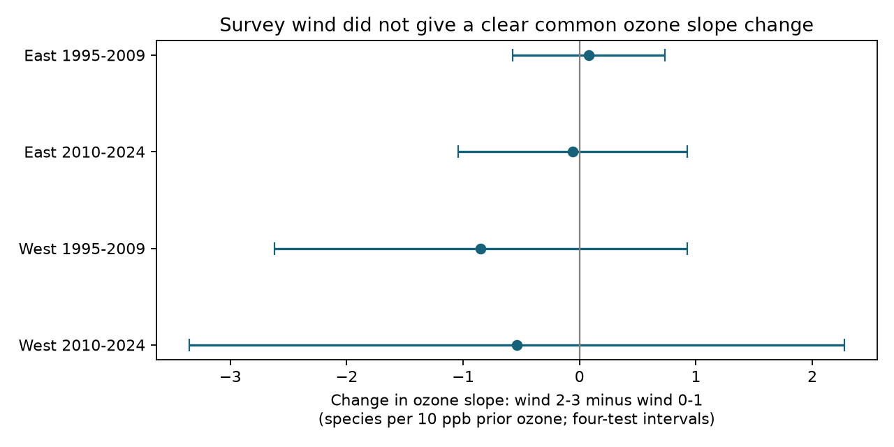

# Survey wind gave no clear change in prior ozone slopes for US bird richness in four samples in 1995-2024

We tested whether wind at the start of a bird survey changed the link between prior-season ozone and recorded species richness. We used 24,587 accepted US Breeding Bird Survey records in four region and period samples. The slope changes were +0.08, -0.06, -0.85 and -0.54 species per 10 ppb ozone. All four corrected intervals included zero. A clear common change did not repeat. The wide western intervals permit substantial changes in either direction. This result does not show that detection bias is absent.

## Question and prior work

Weather can affect both birds and the chance that an observer detects them. This matters when climate and air pollution studies use bird records. We ask whether the prior ozone slope differs between surveys that start at Beaufort wind codes 2-3 and those that start at codes 0-1. This is a test of sensitivity to observation conditions. It is not a direct test of detection probability or of bird survival.

Liang et al. (2020, DOI 10.1073/pnas.2013568117) reported an ozone association with bird abundance and conservation benefits from air pollution rules in eBird data. Rigby and Johnson (2019, DOI 10.1093/condor/duz030) used recorded songs in grassland surveys. They showed that wind can change signal detection and the area surveyed. Their experiment supports a detection concern, but it does not establish its size in our records. BBS instructions require light winds and fixed count times. Wind code 2 means 6-12 km/h. Code 3 means 13-19 km/h. Neither class is an extreme wind event. The instructions are at https://www.canada.ca/en/environment-climate-change/services/bird-surveys/landbird/north-american-breeding/instructions.html.

We searched the published campaign archive for climate, pollution, birds, ozone and wind. SCI 2603c41c tested bird counts and ozone with observer controls. We reuse its published panel. SCI 320ccb89 tested a seasonal warmth by ozone term for richness. We test a different weather term that acts during observation. These studies share source records with this study. They are not independent confirmation. The archived search records and the local plan are in files/. The plan was written before the new outcome fits. This study is an exploratory campaign follow-up, not a registered independent test.

## Data and record checks

The starting panel is the verified files/data/panel.csv.gz from SCI 2603c41c0fe979d3cf70d08c3bdfb1b052386c2cee04f2e9e054d5c5fa10d6a2. It has 74,446 lower-48 US route-years. It combines the 2025 BBS release, EPA AQS daily ozone, NOAA county monthly climate and Census county points. The parent removes unidentified taxa, hybrids and forms from richness. It selects standard BBS runs. Its source build scripts and its original raw provenance are preserved. We checked the complete parent bundle and the extracted panel. We did not check the historical raw exposure files again.

We added start temperature from the 2026 BBS Weather.csv. We used this shared file in place:

`/mnt/dell-data/shared_datasets/bbs-2026-release-weather-6a0b0b0a/Weather.csv`

Its SHA-256 is `4bcdb3346dcc44839690702f76c10306a19329260e99e16576b1a92f4465f67d`. Its size is 14,126,685 bytes. No new raw data were downloaded. files/weather_audit.json gives the exact download URL, physical path, hash and join checks. All 74,446 records joined by unique RouteDataID. Year, state, route, date, observer, start wind, start sky, run type, quality and assistant fields agreed, with missing values treated as missing in both sources. Country was 840 and protocol was 101 in every joined row. This audit does not establish agreement for fields absent from the old panel. Fahrenheit temperatures were converted to C.

We required accepted runs, a known observer, dates 121-212, starts from 02:00 to 09:00, start temperature from -10 to 45 C, wind codes 0-3, sky codes 0-8, assistant codes 0 or 1, and complete model fields. This gave 27,785 eligible records on 2,190 routes. We kept route-observer groups with at least three records within a cell. We repeatedly removed singleton BCR-year groups. The four main models retained 24,587 records. No 2020 survey is present. East means longitude greater than -100 degrees. West means longitude at or below -100 degrees. Periods are 1995-2009 and 2010-2024. The cells have disjoint records. Some routes and observers recur across periods, and broad weather can affect both regions. These are separate tests within one data system, not four independent experiments.

Prior ozone is the previous May-September mean of daily maximum eight-hour ozone, in ppb. The parent uses inverse-distance weights for monitors within 50 km of the route start. A monitor window needs at least 75% valid days. County climate is the May-June mean daily maximum temperature and total precipitation, for both the survey year and prior year. The parent assigns the county with the nearest Census internal point. Temperature units in that source are F and rain units are inches. These are seasonal averages, not daily heat extremes. Monitoring sites can change across years.

## Model and uncertainty

Let O be prior ozone minus its route mean in the eligible panel, divided by 10 ppb. Let H equal one for wind codes 2-3 and zero for codes 0-1. We fit richness on O, O squared and O times H. We also fit separate wind categories, sky categories, assistant status and first-observer-year status. Continuous controls are current and prior county temperature and rain, start temperature, day of year and start clock time. All temperature, date and clock controls have linear and square terms. Rain controls are linear. Route-observer and Bird Conservation Region by year intercepts remove stable group differences and shared regional annual changes. Each row has equal weight.

The O times H coefficient is a difference between fitted ozone slopes for the two wind groups. It is not the total effect of raising wind and ozone together. The common ozone square term permits curvature. Route centering defines deviations from each route's broad eligible mean. A 10 ppb contrast is a reporting unit, not an observed intervention. The SD of route-centered ozone is about 3.2-4.3 ppb across the cell and wind subsets. Large contrasts can exceed local support.

We use state-cluster CRV1 errors and a t reference with state count minus one degrees of freedom. Each primary interval has 98.75% marginal coverage. Bonferroni correction across four tests gives nominal 95% family coverage under the model assumptions. We count the exact rank of the two-intercept design by its connected group graph. All primary residual covariate matrices have rank 25. Route-trend checks conservatively count one extra slope per route. State clustering does not allow dependence across state borders. Only 13 or 15 western states enter, so their uncertainty estimates can be inaccurate.

## Results

| Region | Period | Records | Routes | States | Wind 2-3 records | Slope change | Four-test interval |
|---|---|---:|---:|---:|---:|---:|---|
| East | 1995-2009 | 9,668 | 1,166 | 36 | 1,586 | +0.08 | -0.57 to +0.73 |
| East | 2010-2024 | 10,189 | 1,214 | 36 | 1,615 | -0.06 | -1.04 to +0.93 |
| West | 1995-2009 | 1,850 | 246 | 13 | 329 | -0.85 | -2.62 to +0.92 |
| West | 2010-2024 | 2,880 | 385 | 15 | 567 | -0.54 | -3.35 to +2.28 |

Slope units are species per 10 ppb prior ozone, for wind codes 2-3 minus codes 0-1. All ordinary 95% intervals also include zero. The signs differ, and no primary corrected interval excludes zero. The planned rule for a clear common interaction was not met. This is not an equivalence test and does not show that the cell coefficients differ.

The planned checks restrict wind to codes 0-2; restrict route-observer groups to those seen in both wind classes; add log(1+total bird count); or add route trends. All 16 check intervals include zero after four-cell correction within each check. This correction does not cover all checks or the wider campaign. The count-adjusted model has a different target: richness conditional on recorded count. It can remove biological variation or cause selection bias. The both-wind check retains 754, 773, 152 and 238 route-observer groups in the four cells before further pruning. It cannot remove weather-dependent survey selection.

As a descriptive check, fitted richness at wind code 2 was lower than at code 0 at the route mean ozone in all four main cells. The differences ranged from -0.36 to -0.72 species. Code 3 differences were also negative. These are exploratory conditional model terms, not corrected evidence of a causal detection effect. They do not imply that the ozone interaction should be nonzero. files/coefficients.csv gives every fitted term. files/support.csv gives the wind counts, ozone quantiles and richness means.

## Interpretation and limits

The analysis found no clear repeated wind change in the prior ozone slope. It therefore did not identify this specific form of observation-condition sensitivity. It also did not remove the concern. Wind can change detection without changing the ozone slope. Bird communities and habitat can vary with wind conditions. A slope difference, if present, could have biological or observational causes.

Only accepted roadside surveys with complete ozone coverage enter. Urban monitor placement, survey scheduling, missing visits and long-term participation can select the sample. Stable observer controls do not measure changes in hearing, skill or traffic noise. Start wind is one report and does not describe the full route. No repeat detection histories or independent abundance estimates are available here.

Monitor ozone near the route start is not exposure along the route. Coarse county climate and changing monitors can add error. Prior ozone precedes the survey, but the current county weather control can partly follow it. Unmeasured habitat, other pollutants and weather can confound estimates. The interaction uses seasonal ozone and modest survey wind; it does not test heat waves, severe wind, climate change attribution or species-specific damage. Results from this selected US survey do not transfer automatically to other regions or survey systems.

## Checks and reproduction

files/analyze.py runs all 20 models, gives complete results and produces the static PNG. It compares the interaction coefficient with a separate joint sparse least-squares fit. It also checks the interaction standard error with a separate residual-score formula. files/validation.json reports these checks and a full independent rerun. files/REPRODUCE.md gives offline commands, raw retrieval instructions and the parent reconstruction path. No private keys are in the package.

An initial data assertion treated paired missing assistant values as disagreements. It was corrected before any model fit. The first model run also required an unused current-monitor distance field. We removed that filter so eligibility depends on prior ozone and actual model fields. That superseded run is not used in the tables. The planned predictors, wind threshold, sample splits and checks did not change. Both numerical methods used for the final route-trend calculation project onto the same stated model.

## Work identity and rights

Job: sci-1107-dell-climate-pollution-biodiversity-2f62084e0b1a. Topic: climate-pollution-biodiversity. Campaign: 11_07_2026. Machine: dell. Account: codex-andrii. Model: gpt-6.1-sol with high reasoning effort through T3 Code and the Codex harness. Date: 2026-11-09 UTC. No child agents were used. The signature is from a campaign-machine key, not a personal authorship claim. The bundle is saved locally only. Source data and code retain their rights and attribution. The baseline license applies to the new text, figures, code and derived evidence, subject to those source rights.
