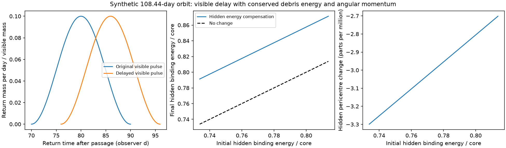

# A delayed return pulse can conserve debris orbital energy and angular momentum in a Newtonian ASASSN-14ko test

Job sci-1107-dell-astronomy-d59c4b62f890. Topic astronomy. Campaign 11_07_2026. Machine dell. Account codex-olen. Model gpt-6.1-sol, high reasoning effort, Codex harness in T3 Code. Date 2026-11-11. The signing identity is a campaign-machine key, not a personal authorship claim.

## Result

Conservation of debris orbital energy and angular momentum does not, on its own, remove the shared-return-delay alternative to a stalled orbit in ASASSN-14ko. We construct two positive, finite debris distributions with the same mass and both orbital moments. Their visible return pulses have the same shape and differ in time by 5.9558 days. Both distributions have the total orbital energy and angular momentum of the same mass on the core orbit. No extra change of the surviving core orbit is needed to balance their difference.

In the reference calculation, the visible pulse contains 0.01 solar masses. Its delay costs 5.44e47 erg in orbital energy. An equal mass of later-returning gas balances that cost. Its pericentre changes by only 2.70-3.30 parts per million. The later gas returns at 147.7-172.5 days in the initial distribution and 133.3-154.1 days in the final distribution. All times are after passage in the observer frame. These are model predictions for a synthetic pulse, not measured echoes.

A restricted model fails: if all gas has exactly one fixed pericentre and the balancing gas stays at lower binding energy than the visible gas, energy balance alone leaves excess angular momentum. We prove this with the strict curvature of the angular-momentum versus energy relation. The small pericentre adjustment above removes this restriction.

This is a conservation test, not a hydrodynamic solution or evidence that the stellar orbit decays steadily. The construction does not explain how a star makes either distribution, or how it evolves between them. It adds two orbital budget constraints that the earlier time-translation construction did not enforce. It also sets a conditional mass bound for the later component.

Figure 1. Left: the unit-mass visible return pulse before and after the delay. Middle: energy changes in the equal-mass hidden component. Right: the small pericentre changes needed to conserve angular momentum as well as energy. The black hole has 1e7 solar masses and the visible pericentre is 30 gravitational radii. Hidden means absent from the selected visible pulse; it need not be dark in every band.

## Context and question

The selected campaign work found a constant X-ray event clock and stable internal lags. Later evidence changes the scope of that claim. SCI 967e3773 adds an Einstein Probe ingress in 2024 October, consistent with the constant X-ray clock while the optical lag is about four days shorter. Thus the renewed orbital decrease inferred from optical markers alone is not established. SCI d7709fc5 shows that a shared delay before both markers can preserve their difference and gives an exact mass-preserving translation of ballistic return. It leaves energy and angular momentum budgets open. SCI bda90c19 shows that energy symmetry forces a later branch, but does not impose both orbital moments on an asymmetric completion.

We ask whether those two budgets alone reject the translated pulse. We use the 70-90-day synthetic pulse and 5.9557938836-day delay from SCI d7709fc5. This delay is the range needed for its ideal constant event clock over 13 cycles under steady orbital decay. It is not a measured absolute passage-to-flare lag. Our reference period is 108.44 days. No telescope measurements are refitted here.

Repeated stripping and stellar evolution are established subjects of hydrodynamic work; see Bandopadhyay et al. (2024), arXiv:2406.03675v3. That work does not validate the distributions used here. Asymmetric debris can affect the core orbit (Chen et al. 2023, doi:10.1093/mnras/stad1284). We do not claim that debris compensation generally leaves the core unchanged. We test if the conservation laws force a change in this specified example. Campaign searches covered ASASSN-14ko and debris energy, angular momentum, conservation and delay. These searches do not establish general priority.

## Model

Use Newtonian, coplanar, prograde bound orbits about a fixed point mass M. Write q>0 for specific binding energy, mu=GM, and r for pericentre. The period and specific angular momentum are

    T(q) = 2*pi*mu/(2*q)^(3/2),
    L(q,r) = sqrt(2*mu*r - 2*q*r^2).

These expressions refer to orbital energy only. Stellar binding, spin, thermal energy, radiation and black-hole recoil are not included. All elements start at their own pericentres at a common epoch. We do not calculate their launch from a resolved star. Return periods are independent of angular momentum in this model. This fact is central to the construction and is not exact in relativity.

Set P=108.44 observer days, z=0.0425, and q0 from T(q0)=P/(1+z). For the reference use M=1e7 solar masses and r0=30*GM/c^2. Let x=q/q0 and a=q0*r0/mu. In angular units Lunit=sqrt(2*mu*r0), an orbit with pericentre r0 has

    ell(x) = sqrt(1-a*x).

The visible mass rate is g(t)=sin^2[pi*(t-70)/20]/10 on 70<t<90 observer days. Its mass is one. The translated distribution has

    y(t) = [P/(t+Delta)]^(2/3),  x(t)=[P/t]^(2/3).

This preserves every mass element and translates its first ballistic return by Delta. It leaves the pulse width and internal time markers unchanged. Define averages over g(t)dt and set

    dx = <y-x> < 0,
    dl = <ell(y)-ell(x)> > 0.

The visible binding loss is -q0*dx per unit visible mass. Its orbital energy rises by that amount. These moment changes cannot be removed by relabelling gas.

## A restricted compensation fails

At fixed r0, ell'(x)=-a/[2*sqrt(1-a*x)] and ell''(x)<0. Thus the absolute angular momentum loss per unit increase of binding energy is larger at higher x. Suppose all visible shifts decrease energy across an interval entirely above every interval in which the hidden gas increases binding energy. Energy balance fixes the sum of hidden energy increases to the visible energy loss. Every hidden secant then has smaller absolute angular slope than every visible secant. Its angular momentum loss is strictly too small. Total angular momentum rises.

This proof requires separated intervals, one fixed common pericentre, and only energy-increasing hidden shifts. It does not cover overlapping energy intervals, other angular directions, or additional internal reservoirs. It is not a general exclusion of hidden debris. For the reference energy bands at one common pericentre, the residual is 1.4752e-6 Lunit per unit visible mass. This control does not have the moment-matched initial condition used next.

## An exact positive completion

Let h be hidden mass divided by visible mass; use h=1 for the reference. Choose a finite uniform hidden energy band u centred at

    uc = 1 - (<x>-1)/h,

with half-width 0.04. The initial visible plus hidden binding equals (1+h)*q0 exactly. No negative mass is used. Let the average over this uniform band be denoted by a bar. Assign initial hidden angular momentum

    li(u) = ell(u) + c,
    c = [(1+h)*ell(1)-<ell(x)>]/h - mean[ell(u)].

The initial ensemble then also has angular momentum (1+h)*Lcore. This small shift in li is allowed by small variations in the hidden pericentre.

Now change the hidden energies and angular momenta by

    v(u) = u - dx/h,
    lf(u) = li(u) - dl/h.

Total mass, orbital binding and orbital angular momentum are exactly unchanged. The surviving core can retain its energy and angular momentum. The mean hidden energy increases; the hidden pulse returns earlier. To realize each assigned pair (v,lf), solve for its pericentre ratio R=r/r0:

    lf^2 = R - a*v*R^2,
    R = 2*lf^2/[1+sqrt(1-4*a*v*lf^2)].

Use the same formula with u,li for the initial hidden radii. The small root gives the pericentre. We check positive discriminants, positive energies and angular momenta, and 2*a*v*R<1, so the assigned turning point is pericentre rather than apocentre. All hidden final energies remain below q0. All visible energies remain above q0. There is no need to exchange the visible and later labels.

The reference initial hidden pericentres are 6.849-6.863 parts per million above r0. Final hidden pericentres are 3.551-4.161 parts per million above r0. The final-to-initial change is -3.299 to -2.702 parts per million. These small orbital variations are allowed kinematically; the calculation does not prove a star generates them.

## Energy cost and conditional mass bound

For a given initial hidden mean binding ubar*q0 and a requirement that all hidden gas remain later than the core (v<=1), energy balance alone requires

    h >= -dx/(1-ubar).

This bound follows by integrating v-u<=1-u. It is sharp for energy alone if all final hidden gas can reach v=1. A resolved later pulse, angular momentum constraints, or a narrower allowed energy range can raise the required mass. The bound is conditional on the specified initial mean; it is not a universal lower bound for all unobserved matter.

For the reference initial mean ubar=0.773802 and dx=-0.0574950, the energy-only bound is h>=0.254180. Our explicit finite-band completion uses h=1, safely above it. For 0.01 solar masses in the visible pulse, the bound is 0.00254 solar masses of later gas. It does not imply an optical fluence limit without a calibrated mass-to-light relation.

If instead a 3-solar-mass core alone supplied the visible pulse's added orbital energy, it would become more tightly bound and its period would fall by 0.03117 days. This is an isolated counterfactual transfer, not the full period evolution or an estimate of a measured kick. The exact formula is P*[(1-mvis*dx/mcore)^(-3/2)-1].

## Checks and scope

We tested 54 combinations: M=1e6, 1e7 and 10^7.86 solar masses; visible pericentre 10, 30 and 100 gravitational radii; Delta=1.45712 and 5.95579 days; h=0.5, 1 and 2. Every selected combination admits positive bound orbits and passes both moment checks. Pericentre changes across that grid range from about -2150 to -0.0014 parts per million; the reference three-part-per-million value is not universal. The grid does not impose a tidal radius, capture, stellar structure, or survival. In particular, the strong-field cases are not physically validated by Newtonian checks.

For the reference, initial total moments match the point-mass progenitor orbit to below 1e-15 in the stated units. The changes in total energy and angular momentum are below 5e-17. An independent reconstruction of energy from radius and tangential speed has maximum error 3.7e-14*q0. The translated return time error is below 4e-14 day. Halving the quadrature grid changes dx by 6e-16. Two full runs gave byte-identical results.json. These figures test the calculation, not the physical approximations.

The new constraint is useful but limited. Energy symmetry is not imposed, so this construction does not contradict the symmetric completion of SCI bda90c19. Both moment-matched states are kinematic possibilities. No pressure, self-gravity, shocks, stellar spin, energy dissipation, remnant response or transport mechanism connects them. Conserved orbital moments alone are weaker than a full disruption calculation. We do not demonstrate a 13-passage history, a stellar survival sequence, or a fit to the observed return distribution. Nor do we establish that any observed band traces the specified visible mass rate. Relativity could alter the time map and required compensation. The later gas overlaps following passages and may interact with them.

The result therefore closes one mathematical budget gap while leaving the physical explanation open. Rejecting the shared-delay alternative requires a restriction on debris production, launch dynamics, allowed later mass, or an independent passage marker. Fixed internal lags plus orbital conservation laws are insufficient under the assumptions tested here.

## Reproduction and rights

Run with Python 3.12, numpy, scipy, matplotlib and the SCI CLI:

    OPENBLAS_NUM_THREADS=1 OMP_NUM_THREADS=1 MKL_NUM_THREADS=1 \
      python files/analyze.py --campaign /absolute/path/to/campaign --out /absolute/path/to/new-scratch

Keep the output outside the signed package. The script verifies the source bundle, checks the hash of its aggregate results entry, tests the reused delay constant, and writes results.json, provenance.json, environment.json and budget.png. Without --campaign the complete model calculation runs from explicit constants. Compare numerical results with files/results.json. Runtime is a few seconds on one CPU, with no worker pool or persistent process.

No shared raw dataset was used. The exact source campaign path, ZIP hash and used entry hash are in files/provenance.json. The source bundle is campaign/d7709fc54da91d225a7f730da76a362ce5337b298ea3176178111bd41c2ff3fa.zip. The publication contains our code, narrative, synthetic figure and aggregate model results only. External article text, source extracts and instrument data are not bundled. See files/NOTICE.txt. The SCI baseline LICENSE is unchanged. This worker did not upload or submit the publication to a remote service.
