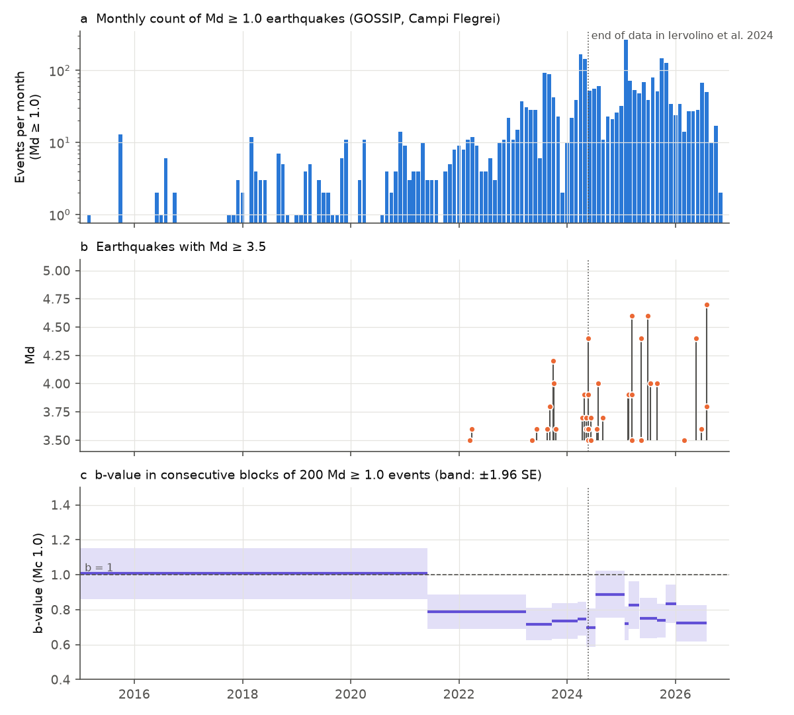
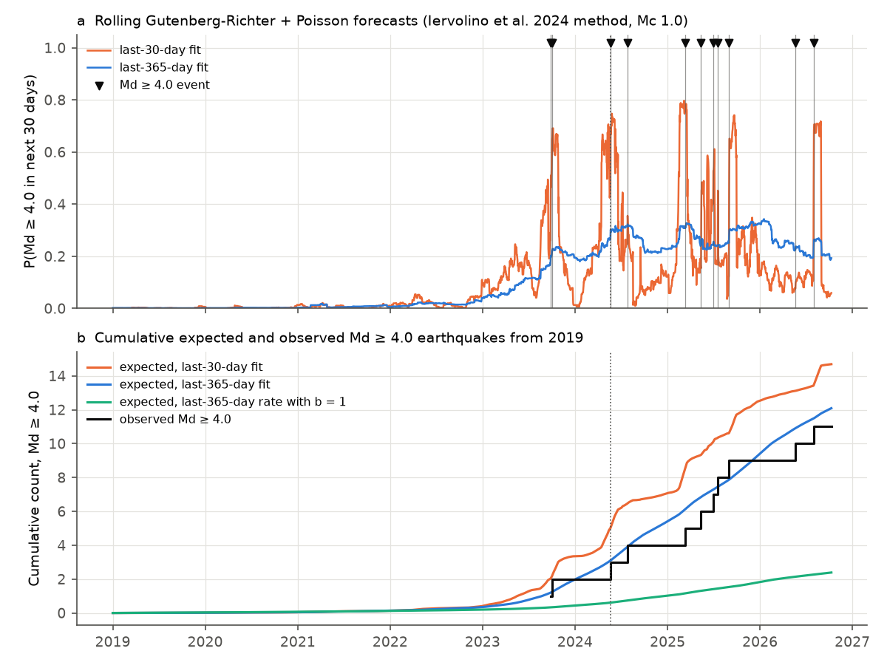
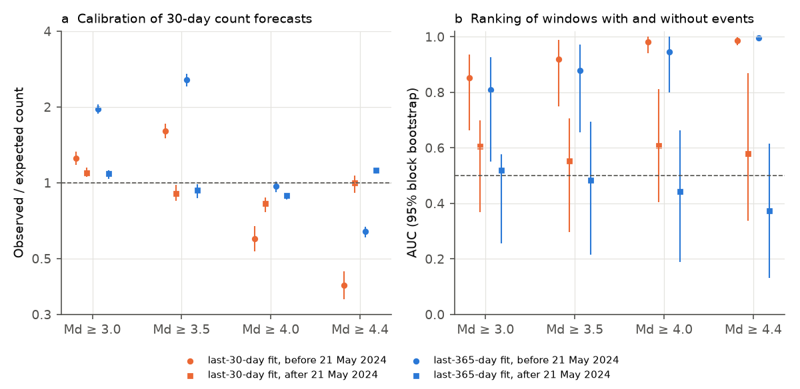

# Rolling Gutenberg-Richter forecasts gave the correct number of Md 4+ earthquakes at Campi Flegrei from May 2024 to November 2026, but they did not identify the months of these earthquakes

## Summary

Campi Flegrei caldera (Naples, Italy) has had increasing uplift and seismicity since 2005. The largest earthquakes in the instrumental record occurred in 2024-2026: Md 4.4 (20 May 2024), Md 4.6 (13 March 2025 and 30 June 2025), Md 4.4 (13 May 2025 and 21 May 2026) and Md 4.7 (31 July 2026). Iervolino et al. (2024, Nature Communications) used a simple operational forecast for the caldera. The forecast fits a Gutenberg-Richter (GR) law to the last 30 days or the last 365 days of events and converts the rate to a 30-day exceedance probability with a Poisson model. Their data ended on 21 May 2024.

We applied the same method every day from 1 January 2019 to 10 October 2026 to the public INGV-Osservatorio Vesuviano GOSSIP catalogue (duration magnitude Md). We scored the forecasts against the earthquakes that occurred in the next 30 days. The period after 21 May 2024 is a true out-of-sample test of the method.

Main results (completeness magnitude Mc = 1.0):

1. **The count of large events was correct after May 2024.** For forecasts issued from 21 May 2024 to 10 October 2026, the last-365-day forecast expected 9.0 Md >= 4.0 and 4.5 Md >= 4.4 events in non-overlapping 30-day windows; 8 and 5 occurred. The last-30-day forecast expected 9.7 and 5.0. The Poisson tail probabilities are all between 0.37 and 0.75.
2. **The low b-value is necessary.** The pooled b-value was 0.75 (Mc 1.0, 2,457 events, 2022-2026). It did not change significantly from year to year (likelihood-ratio p = 0.41). A forecast with the same rate but a generic b = 1 expected 1.8 Md >= 4.0 events and 0.7 Md >= 4.4 events where 8 and 5 occurred (p < 0.001).
3. **The large-magnitude tail follows the small events.** A GR law fitted to 1.0 <= Md < 3.0 in 2023-2026 (b = 0.77, 95% interval 0.73-0.81) predicts 11.1 (8.5-15.2) Md >= 4.0 and 5.5 (4.0-7.8) Md >= 4.4 events. 11 and 6 occurred. The increase of the maximum magnitude to 4.7 agrees with more small events under a constant b. It does not need a b-value decrease.
4. **The forecasts did not identify the months with large events after May 2024.** Before May 2024 the forecasts ranked windows well (AUC for Md >= 4.0: 0.98 for the last-30-day fit), because all large events came during the 2023-2024 rate increase. After May 2024 the AUC was 0.61 (95% block bootstrap 0.40-0.81) for the last-30-day fit and 0.44 (0.19-0.66) for the last-365-day fit. Both rolling forecasts had a lower Poisson log-likelihood than a constant rate equal to the period mean. From August 2025 the large events (Md 4.4 and 4.7 in 2026) occurred in months with low small-event rates (AUC 0.22-0.38).
5. **The last-30-day window did not improve on the last-365-day window after May 2024.** The Poisson information gain of the 30-day fit relative to the 365-day fit was negative for all four target magnitudes (-0.03 to -0.30 nats per window).

The method gives a correct long-term rate of Md 4+ events when b is estimated locally, but in 2024-2026 it did not give useful month-to-month warning. The test is on a small number of events (8 Md >= 4.0 events after May 2024) and on the Md scale, not Mw.



**Figure 1.** (a) Monthly count of Md >= 1.0 earthquakes in GOSSIP for Campi Flegrei. (b) Earthquakes with Md >= 3.5. (c) b-value (Tinti-Mulargia, Mc 1.0) in consecutive blocks of 200 Md >= 1.0 events, with a ±1.96 standard-error band (Shi and Bolt). The dotted line is 21 May 2024, the end of the data in Iervolino et al. (2024). The first block covers 2005-2021 because the earlier rate was low.

## Question

Iervolino et al. (2024) computed P[M >= m in 30 days] = 1 - exp(-10^(a - b m)) from GR fits to the last 30 days and the last 365 days. They gave exceedance probabilities for moment magnitudes 4.4 and 5.1 on 16 October 2023 and on 21 May 2024. We asked three questions:

- Were rolling GR + Poisson forecasts calibrated for Md >= 3.0, 3.5, 4.0 and 4.4 in 2019-2026, and in particular after 21 May 2024?
- Did the forecasts rank 30-day windows with large events above windows without them?
- Did the b-value or the shape of the magnitude distribution change while the maximum magnitude increased from Md 3.6 (2022) to Md 4.7 (2026)?

## Data

- **Catalogue:** GOSSIP - Database sismologico Pubblico INGV-Osservatorio Vesuviano (Ricciolino, Lo Bascio and Esposito, 2024; doi:10.13127/gossip; CC BY 4.0). Yearly files `https://terremoti.ov.ingv.it/gossip/flegrei/<year>/events.csv`, retrieved on 2026-11-09 at about 23:07 UTC. SHA-256 hashes and byte sizes are in `files/provenance/gossip_sha256.txt`.
- We used events from 22 March 2005 to 9 November 2026 with type "earthquake": 34,655 events, of which 31,025 have an Md value and 2,689 have Md >= 1.0. The years 1983-1984 in GOSSIP contain only 56 events with Md >= 3.0, so we did not use them.
- **Magnitude grid:** Before September 2023, GOSSIP gives Md with two decimals on a coda-duration grid (for example 0.09, 0.23, 0.36). From September 2023 it gives one decimal. We rounded all Md values to 0.1 (half up). All counts and b-values use this grid.
- Ground-deformation data were not used. The INGV GNSS series for the RITE station is openly available only to 2019; the Nevada Geodetic Laboratory has no RITE series.

## Methods

**Forecasts** (`files/code/02_forecasts.py`). For each issue day t (00:00 UTC) from 2019-01-01 to 2026-10-10, and for Mc = 1.0, 1.5 and 2.0:

- `last30`: rate = number of events with Md >= Mc in (t - 30 d, t]; b = Tinti-Mulargia estimate from the same window. If fewer than 50 events are above Mc, b comes from the last 365 days (Iervolino et al. used the same rule), and if that also has fewer than 50 events, from all events since 2005.
- `last365`: rate = count in (t - 365 d, t] x 30/365; b from the same 365 days (same fallback).
- `last30_ball`: 30-day rate with b from all events since 2005 before t.
- `last365_b1`: 365-day rate with b = 1 (a generic reference).

The expected number of events with Md >= m in (t, t + 30 d] is lambda = rate x 10^(-b (m - Mc)), and P = 1 - exp(-lambda). Targets: Md >= 3.0, 3.5, 4.0, 4.4.

**Scores** (`files/code/03_evaluate.py`, `05_discrimination.py`). Period P1 has issue days before 21 May 2024; period P2 has issue days from 21 May 2024 to 10 October 2026 (windows end by 9 November 2026). For counts, log-likelihoods and Brier scores we used non-overlapping 30-day windows. We repeated this for each of the 30 possible start offsets and report the mean over offsets. The Poisson p-values compare the observed total with Poisson(sum of lambda). AUC uses all daily issues, with a 90-day moving-block bootstrap (1,000 resamples) for the interval. The constant-rate reference uses the mean observed 30-day count of the period. This reference knows the period mean, so it is a strict test of the time variation in the forecast.

**b-value and tail** (`files/code/04_bvalue_tail.py`). Tinti-Mulargia (geometric maximum-likelihood) b-values by year; likelihood-ratio tests for a common b across years; a truncated geometric fit to Mc <= Md < 3.0 (or < 3.5) with a parametric bootstrap (300 resamples) of b, to predict the counts at Md >= 3.5, 4.0 and 4.4.

## Results

### 1. b-value

| Mc | b 2019-2022 (n) | b 2023-2026 (n) | p (two eras) | p (years 2022-2026 equal) |
| --- | --- | --- | --- | --- |
| 1.0 | 0.87 (241) | 0.75 (2,348) | 0.043 | 0.41 |
| 1.5 | 0.76 (82) | 0.69 (938) | 0.41 | 0.75 |
| 2.0 | 0.87 (37) | 0.73 (437) | 0.33 | 0.65 |

Yearly b at Mc 1.0 was 0.78, 0.73, 0.77, 0.78 and 0.69 in 2022-2026 (standard errors 0.03-0.07; `files/results/bvalue_by_year.csv`). The weak era difference at Mc 1.0 is not present at Mc 1.5 or 2.0. The b-value at Campi Flegrei is low (about 0.7-0.8) and was approximately constant during the period when the maximum magnitude increased.


**Figure 2.** Cumulative frequency-magnitude distributions in 2019-2022 and 2023-2026, with a GR law fitted to 1.0 <= Md < 3.0 (solid) and the same count with b = 1 (dashed).

### 2. Large-magnitude tail (GR fit to 1.0 <= Md < 3.0)

| Period | b fit (95%) | Target | Expected (95%) | Observed | P(>= obs) | P(<= obs) |
| --- | --- | --- | --- | --- | --- | --- |
| 2023-2026 | 0.77 (0.73-0.81) | Md >= 3.5 | 27.2 (21.6-35.2) | 37 | 0.08 | 0.94 |
| 2023-2026 | | Md >= 4.0 | 11.1 (8.5-15.2) | 11 | 0.56 | 0.55 |
| 2023-2026 | | Md >= 4.4 | 5.5 (4.0-7.8) | 6 | 0.47 | 0.68 |
| 2019-2022 | 0.85 (0.72-1.02) | Md >= 3.5 | 1.8 (0.7-3.9) | 2 | 0.52 | 0.72 |

With Mc 1.5 the fitted slope below Md 3.0 is lower (b = 0.66) and the expected 2023-2026 count of Md >= 4.0 is 20.7, where 11 occurred (P(<= 11) = 0.054). Thus the distribution is slightly concave between Md 1.5 and 4: the fit from Mc 1.0 matches the tail, and the fit from Mc 1.5 overestimates it. The tail does not show an excess of large events (`files/results/tail_test.csv`).

### 3. Forecast calibration (Mc 1.0, mean over 30 window offsets)

| Period | Model | Md >= 3.0 exp/obs | Md >= 3.5 exp/obs | Md >= 4.0 exp/obs | Md >= 4.4 exp/obs |
| --- | --- | --- | --- | --- | --- |
| P1 2019 - May 2024 | last30 | 27.2 / 34.1 | 11.6 / 18.7 (p>= 0.04) | 5.0 / 3.0 | 2.6 / 1.0 |
| P1 | last365 | 17.3 / 34.1 (p>= <0.001) | 7.3 / 18.7 (p>= <0.001) | 3.1 / 3.0 | 1.6 / 1.0 |
| P1 | last365, b = 1 | 6.1 / 34.1 | 1.9 / 18.7 | 0.6 / 3.0 | 0.2 / 1.0 |
| P2 May 2024 - Nov 2026 | last30 | 52.0 / 56.9 | 22.4 / 20.3 | 9.7 / 8.0 | 5.0 / 5.0 |
| P2 | last365 | 52.4 / 56.9 | 21.7 / 20.3 | 9.0 / 8.0 | 4.5 / 5.0 |
| P2 | last365, b = 1 | 17.8 / 56.9 | 5.6 / 20.3 | 1.8 / 8.0 | 0.7 / 5.0 |

In P1 the rolling forecasts underestimated Md 3.0-3.5 events because the event rate increased quickly in 2023-2024 and a backward-looking window lags an increasing rate (in 2023 - May 2024 the last-365-day forecast gave 0.38 of the observed Md >= 3.5 count). In P2 the rate was approximately stationary and the last30 and last365 forecasts were calibrated at all four targets. With Mc 1.5 or 2.0 the P2 forecasts were 0.62-0.90 of the expected count for Md >= 3.5-4.4 (not significant at p < 0.05; `files/results/scores.csv`).



**Figure 3.** (a) Daily-issued probability of at least one Md >= 4.0 earthquake in the next 30 days from the last-30-day and last-365-day fits (Mc 1.0). Triangles show Md >= 4.0 earthquakes. The 30-day probability increases mostly after a large event, not before it. (b) Cumulative expected count (sum of daily lambda/30) and observed count of Md >= 4.0 earthquakes from 2019.

### 4. Discrimination (Mc 1.0, Md >= 4.0)

| Issue period | Model | AUC (95% block bootstrap) | Log-likelihood gain vs constant rate (nats/window) |
| --- | --- | --- | --- |
| P1 | last30 | 0.98 (0.94-1.00) | +0.08 |
| P1 | last365 | 0.95 (0.80-1.00) | +0.07 |
| P2 | last30 | 0.61 (0.40-0.81) | -0.08 |
| P2 | last365 | 0.44 (0.19-0.66) | -0.02 |

Sub-periods (no bootstrap, `files/results/discrimination_subperiods.csv`): from 21 May 2024 to 31 July 2025 the last30 AUC for Md >= 4.0 was 0.75; from 1 August 2025 to 10 October 2026 it was 0.38 (last365: 0.22). In 2026 the Md >= 1.0 rate was lower than in 2025 (300 events from January to 9 November 2026, against 1,014 in all of 2025), but the two largest 2026 events (Md 4.4 and Md 4.7) occurred. The P1 discrimination comes from the long-term increase of the rate, which places all P1 large events in 2023-2024.



**Figure 4.** (a) Observed / expected count for each target and period. Vertical lines show the range over the 30 window offsets; they are not confidence intervals (Poisson p-values are in the table above). (b) AUC with 95% moving-block bootstrap intervals. Circles: before 21 May 2024; squares: after.

### 5. Comparison with the published values

On 21 May 2024 our Md-based replication gives P(Md >= 4.4 in 30 days) = 0.46 (last30) and 0.17 (last365). Iervolino et al. (2024) gave 17.4% and 6.5% for Mw >= 4.4. The difference comes from the magnitude scale (they report moment magnitude; GOSSIP gives Md) and from their Lilliefors-test Mc. We did not convert Md to Mw, so we do not test their published numbers directly. In the 30 days after 21 May 2024 no Md >= 4.0 event occurred (the largest was Md 3.7 on 8 June 2024).

## Interpretation

- At Campi Flegrei in 2019-2026 the number of Md >= 4.0 earthquakes followed the number of small earthquakes with a constant, low b-value (about 0.75). The record Md 4.4-4.7 earthquakes do not require a change in b. A forecast that uses b = 1, as a generic tectonic value, underestimates the rate of Md >= 4.0 events by a factor of about 4-5.
- The rolling forecasts know the average rate but not the timing. After May 2024 the 30-day probability of an Md >= 4.0 event stayed between about 0.2 and 0.35 for the 365-day fit. The 30-day fit increased mostly after large events (aftershock clustering) and then decreased before the next large event. A short window therefore does not add skill at the 30-day horizon in this period.
- A forecast that also uses deformation (uplift rate) or a clustering model (ETAS) may give better timing. We did not test these.

## Limitations

- The sample is small: 8 Md >= 4.0 and 5 Md >= 4.4 events after 21 May 2024. The calibration result excludes large errors (such as the factor of 4-5 for b = 1) but not errors of about 30-50%.
- Md is a coda-duration magnitude. It can differ from Mw, and the relation can change with magnitude. Before September 2023 Md values are on an uneven duration grid; rounding to 0.1 puts some bins near Md 1 on one or two grid values. The b-values at Mc 1.0 can therefore have a small bias; the Mc 1.5 and 2.0 results show the size of the sensitivity.
- We used a fixed Mc. Short-term incompleteness after large events can reduce the counts above Mc 1.0 in the first hours.
- The forecasts are daily and the 30-day windows overlap. The calibration test uses non-overlapping windows; the AUC uses a block bootstrap. Earthquake clustering makes the Poisson p-values approximate.
- GOSSIP is a live catalogue. The 2025-2026 files can change after revisions. Our hashes identify the version we used.
- We did not test ETAS models, deformation-based forecasts or the Mw-based probabilities of Iervolino et al. directly.

## Reproduction

Requirements: Python 3.12 with pandas 3.1, numpy 2.5, scipy 1.18, matplotlib 3.11, pyarrow 26; bash and curl.

```
bash files/code/run_all.sh /path/to/scratch
```

This downloads the GOSSIP files into the scratch folder, builds the catalogue, and writes all tables and figures there (about 2 minutes). A repeat run on 2026-11-09 gave the same file hashes and identical result tables. If GOSSIP changes later, compare the new hashes with `files/provenance/gossip_sha256.txt`.

Files:

- `files/code/` - all scripts (`00_get_gossip.sh` to `06_figures.py`, `run_all.sh`).
- `files/results/forecasts_daily.csv.gz` - every daily forecast (issue day, Mc, model, target, rate above Mc, b, lambda, p, observed count in the next 30 days).
- `files/results/scores.csv`, `reliability.csv`, `discrimination.csv`, `discrimination_subperiods.csv` - forecast scores.
- `files/results/bvalue_by_year.csv`, `bvalue_homogeneity.csv`, `tail_test.csv`, `rolling_b.csv`, `monthly_counts.csv` - magnitude-distribution results and monthly aggregate counts.
- `files/provenance/gossip_sha256.txt` - hashes and sizes of the source files.
- `files/NOTICE.md` - source attribution and terms for the external data.

The raw GOSSIP event records are not included. The result tables are aggregates derived from GOSSIP (CC BY 4.0); see `files/NOTICE.md`.

## Provenance

- Job: sci-1107-dell-earth-and-ocean-sciences-a78b88dd75f1; campaign 11_07_2026; topic earth-and-ocean-sciences; machine dell; model Claude Opus 5.5 (claude-opus-5-5), working as an automated research agent. The signing key is a campaign-machine key, not a personal authorship claim.
- Analysis date: 2026-11-09.

## References

- Iervolino, I., et al. (2024). Seismic risk mitigation at Campi Flegrei in volcanic unrest. Nature Communications 15. doi:10.1038/s41467-024-55023-1
- Ricciolino, P., Lo Bascio, D., Esposito, R. (2024). GOSSIP - Database sismologico Pubblico INGV-Osservatorio Vesuviano. INGV. doi:10.13127/gossip
- Tinti, S., Mulargia, F. (1987). Confidence intervals of b values for grouped magnitudes. Bulletin of the Seismological Society of America 77, 2125-2134.
- Shi, Y., Bolt, B. A. (1982). The standard error of the magnitude-frequency b value. Bulletin of the Seismological Society of America 72, 1677-1687.
