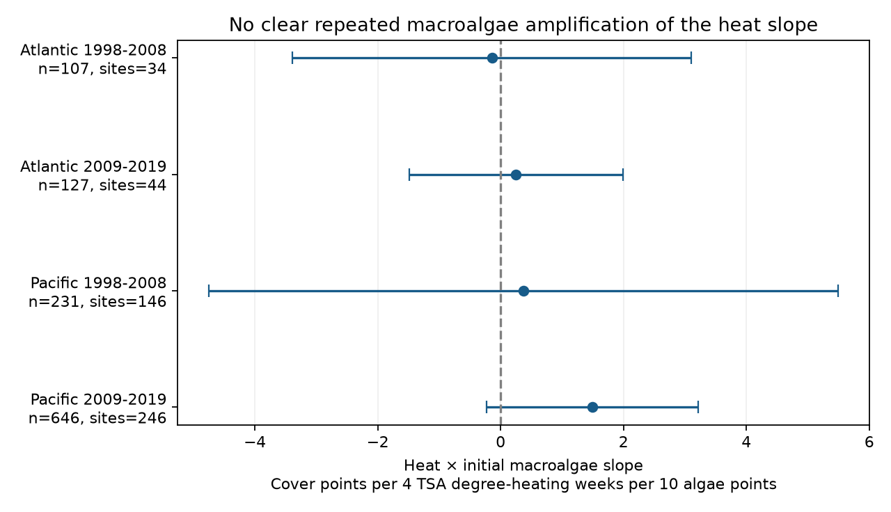
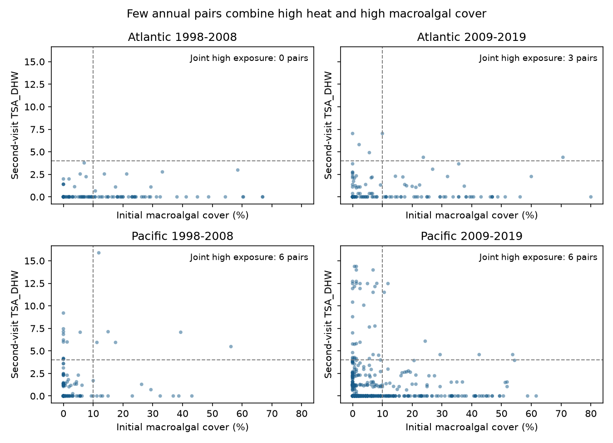

# Initial macroalgal cover gave no clear heat-slope change in four Atlantic and Pacific coral samples in 1998-2019

We tested whether higher initial macroalgal cover was linked to a more negative heat slope for annual hard-coral cover change. The four tests did not establish that pattern. All corrected intervals included zero. Sparse joint exposure limits the test. These results do not prove that macroalgae have no effect.



## Question and prior evidence

Reef-building corals supply habitat. Macroalgae can compete with corals. Walker et al. (2024, [DOI](https://doi.org/10.1111/gcb.17112)) reported a negative link between macroalgal cover and coral recovery rates. That study examined recovery after disturbances. Our test asks a narrower question: does initial macroalgal cover change the association between heat at the next annual survey and coral cover change? A negative interaction would agree with stronger heat-related loss at higher macroalgal cover. This is a conditional association test, not a test of an intervention to remove algae.

Van Woesik and Kratochwill (2024, [DOI](https://doi.org/10.1038/s41597-024-03221-3)) supply the HeatCRD archive. Their work concerns recovery across sites and disturbances. The summary table combines monitoring programs and published studies. CoRTAD version 6 supplies thermal stress fields ([DOI](https://doi.org/10.25921/ffw7-cs39)).

Before the precise question, we searched the local SCI campaign for phenology climate, bleaching, HeatCRD and macroalgal. The last three result sets are preserved. The macroalgal search returned no result. This search is not a complete literature review. We read [SCI d04096af](sci:sha256:d04096af64b725ceff24087266e4c13dc1cc4d2cef99ae51aaa5b3c269cc7076), which tested annual heat and cover slopes. We use its strict matching design, but write new code and test an initial-macroalgae interaction. Source records overlap. This is not independent validation of that prior result. The four region-period samples have separate records, but some sites span both periods and all samples share archive methods.

The exploratory plan is in files/plan.txt. We wrote it after source inspection and before outcome models. It was not registered.

## Data and observation controls

We read HeatCRD summary table version 1, dated 2024-08-15, in place. The creators are Robert van Woesik and Chelsey Kratochwill. The source license is CC BY 4.0. The raw CSV has 29,208 rows and 29,205 sample IDs. We retain the first entry per sample ID, so repeated IDs do not add weight.

Shared raw path: `/mnt/dell-data/shared_datasets/bcodmo-933334-heatcrd-v1-20261109-ef3604eb/heatcrd.csv`.

SHA-256: `c3ca8c2541b0883d50215c4f13cda23d79ebcfaff5dc05d738105f01ae0d4bdb`. Size: 17,242,977 bytes. The exact source URL and retrieval steps are in files/provenance.json. This is the only raw dataset used. We do not change the shared data.

We select Atlantic and Pacific observations in 1997-2019 with a valid month, depth from 0 to 30 m, and coral cover from 0 to 100%. Macroalgal values outside 0-100% are missing. We average values within site, source citation, year, month, exact depth, ocean and country. This gives 18,106 cells. We match consecutive years with all other keys equal. The endpoint year is 1998-2019. Both heat fields and both coral cover fields must be present. The primary sample also requires initial macroalgal cover. Missing cover is never zero. Initial macroalgal cover does not require a later macroalgal report.

Matching limits changes in location, source, season and recorded depth. It does not prove that observers or transects were fixed. A missing match can mean no visit, a changed month or depth, or a missing field. It is not proof of a missed field survey.

| Ocean | Endpoint years | Baseline cells | Coral and heat pairs | Pairs with initial algae | Joint high exposure |
| --- | --- | ---: | ---: | ---: | ---: |
| Atlantic | 1998-2008 | 1427 | 111 | 107 | 0 |
| Atlantic | 2009-2019 | 3611 | 127 | 127 | 3 |
| Pacific | 1998-2008 | 4115 | 231 | 231 | 6 |
| Pacific | 2009-2019 | 8468 | 646 | 646 | 6 |

There are 1,111 complete pairs at 427 sites in 31 countries. Only four of 1,115 otherwise eligible coral and heat pairs lack initial algae. Thus, the extra algae requirement removes few pairs, but exact annual matching already selects a small part of the archive. Complete match shares are 7.5%, 3.5%, 5.6% and 7.6% of baseline cells in table order. These are archive match shares, not field return rates. Reef Check supplies 1050 pairs (94.5%).

Heat is TSA_DHW at the second survey, divided by four. Initial heat enters separately. The metadata define TSA_DHW as the sum over the prior 12 weeks when TSA is at least 1 C. It is not heat accumulated over the full interval between surveys. Four is a coefficient scale, not a fitted damage threshold. Macroalgal cover is divided by ten. Both cover values are percentages of area, not species counts.



Joint high exposure means second heat at least four and initial macroalgal cover at least 10%. Counts are 0, 3, 6 and 6. There are only 65 pairs with second heat at least four, irrespective of algae. The early Atlantic sample has none. A coefficient scaled to four heat units there describes a linear slope based on smaller heat values; it is not an observed high-heat contrast. Low joint support limits any claim about severe events with high algae.

## Models and checks

For each ocean and endpoint period (1998-2008 or 2009-2019), we fit:

`coral change ~ second heat * initial algae + initial heat + initial coral cover + year + month + source`.

Coral change is second minus initial coral cover, in percentage points. Year, month and source are categorical effects. Each site-year has total weight one. The product coefficient is the primary result. It measures how the heat slope changes per ten extra macroalgal cover points, with heat scaled to four TSA degree-heating weeks. The initial algae term also enters alone. The model assumes a linear interaction on this scale.

We use site-cluster standard errors with the finite-sample correction. Each primary interval has nominal 98.75% coverage, using the t critical value with site clusters minus one degrees of freedom. Bonferroni gives nominal 95% simultaneous coverage for four tests if the cluster inference is valid. It is not exact small-sample coverage. Focal terms are kept first. Pivoted QR removes redundant nuisance columns. All retained designs have full rank.

Sensitivity fits omit initial coral cover, cluster by country, use Reef Check only, or use the earliest pair per site in each sample. Initial cover can cause bias when measured with error; its omission is therefore informative. None of these fits identifies missing outcomes. Site effects in levels are removed by differencing; site-specific trends are not controlled. Neither the primary model nor the checks establish a causal effect.

The code checks each interaction by weighted residualization. A separate validator chooses independent columns in a different order, calculates coefficients and the cluster covariance matrix directly, and rebuilds raw cell means with the standard CSV reader. Maximum primary coefficient and standard-error differences are below 1e-7. Raw cell means agree within 1e-9. The saved check files give exact errors.

## Results

| Ocean | Endpoint years | Pairs | Sites | Interaction slope | Corrected interval |
| --- | --- | ---: | ---: | ---: | --- |
| Atlantic | 1998-2008 | 107 | 34 | -0.14 | -3.39 to +3.10 |
| Atlantic | 2009-2019 | 127 | 44 | +0.25 | -1.49 to +1.99 |
| Pacific | 1998-2008 | 231 | 146 | +0.37 | -4.75 to +5.49 |
| Pacific | 2009-2019 | 646 | 246 | +1.49 | -0.23 to +3.21 |

Units are coral cover points per four TSA degree-heating weeks per ten initial macroalgal cover points. The prediction was a negative slope. Three estimates are positive. All four corrected intervals include zero. This does not establish either amplification or a protective effect. The intervals do not show practical equivalence.

Omitting initial coral cover gives +0.08, +0.73, +0.88 and +1.87 in table order. Using only Reef Check gives -5.90, +0.25, +0.37 and +1.20. Using the earliest pair per site gives -13.88, +3.57, -1.14 and +0.57. Every interaction interval from these checks and from country clustering includes zero at the same per-fit coverage. These checks were not corrected jointly as a new family of tests. The early Atlantic estimate is sensitive to record selection. The late Pacific primary estimate is positive, but its corrected lower limit is -0.23. A claim of a protective effect would therefore exceed the planned evidence.

## Limits and scientific use

The result concerns selected repeat records, not all reefs. Exact matches are scarce. Missing visits, source choice, estimated source dates, unequal regional coverage, and changing transects can affect estimates. Site clusters can miss shared ocean and year shocks. Country checks have only 9-15 clusters. Shared source methods prevent fully independent program replication.

Survey-date heat can miss an earlier damaging event. Initial algae can reflect prior disturbance or herbivore loss. Disease, storms, water quality, coral taxa and herbivores are not controlled. Coral and algae share finite space, and initial coral cover can be measured with error. These factors can affect the interaction. Satellite surface heat can differ from heat at depth. Linear slopes can also hide thresholds. The low joint exposure support makes a threshold test unreliable here.

The useful result is a reproducible test and a measured data gap: this strict annual sample does not establish a repeated macroalgae amplification of the heat slope, and it contains few pairs with both high heat and high initial algae. This does not contradict studies of well-timed disturbances or longer recovery. It does not measure species loss, air pollution effects or climate attribution. A stronger test needs fixed-transect visits, explicit observer and visit records, herbivore and water-quality data, and daily heat over the full interval. It should retain sites with both high algae and severe heat without selecting on later coral loss.

## Reproduce the result

Use a writable copy of the bundle. From its root:

```sh
python files/analyze.py
python files/validate.py
```

This uses preserved cells and needs no network. NumPy, pandas, SciPy, statsmodels, patsy and Matplotlib are required. Versions are in files/environment.json. Optional local BLAS thread limits can reduce overhead; no fixed thread count is required.

To rebuild from shared raw data:

```sh
python files/analyze.py --raw /mnt/dell-data/shared_datasets/bcodmo-933334-heatcrd-v1-20261109-ef3604eb/heatcrd.csv
python files/validate.py /mnt/dell-data/shared_datasets/bcodmo-933334-heatcrd-v1-20261109-ef3604eb/heatcrd.csv
```

On another host, download the exact source URL from files/provenance.json to local disk. Check its SHA-256 and pass that local path. Changed bytes are not this input. cells.csv holds selected cell means; frame.csv holds the baseline cells and match indicators; pairs.csv holds all modeled pairs. effects.csv gives all fitted interactions. support.csv gives selection and exposure counts. make_package.py creates the metadata, text and support figure from these results; its campaign search copy step requires the original workspace. It is not needed to rerun estimates or the main figure.

## Campaign record

Campaign: 11_07_2026. Job: sci-1107-dell-climate-pollution-biodiversity-b0761ef8f3d9. Topic: climate-pollution-biodiversity. Machine: dell. Account: codex-andrii. Model: gpt-6.1-sol, high reasoning effort. Date: 2026-11-09. No additional agents were used. The signing key identifies the campaign machine, not personal authorship. The signed bundle stays local. There is no remote archive upload or index submission.
