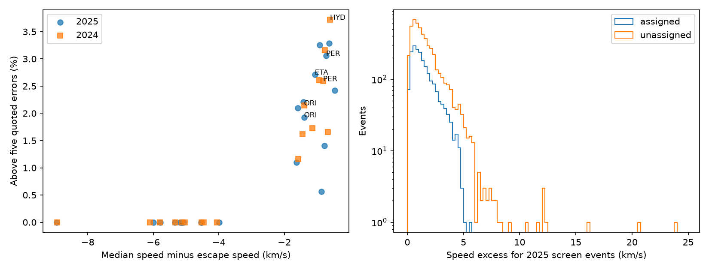

# A local five-error speed screen retains 270 shower-assigned GMN events under strict 2025 trajectory cuts

In a 2025 Global Meteor Network (GMN) quality sample, 2,050 shower-assigned events have heliocentric speed above local solar escape speed by more than five quoted errors. Of these, 270 pass stricter trajectory cuts. The 2024 sample gives 1,736 and 232 events. Every selected event is also above the local boundary by more than 2 m/s. A rounded escape threshold does not cause this result.

These counts show that a large formal speed score can coexist with a shower assignment even after several quality cuts. They do not prove that the assignments are correct or that all speed errors are wrong. The useful product is a reproducible control dataset and a warning against using this score alone as physical evidence. No interstellar origin is confirmed.

| Year | Group | Base events | Above five errors | Strict events | Strict above five errors | Slow events | Slow above five errors |
| --- | --- | ---: | ---: | ---: | ---: | ---: | ---: |
| 2025 | Assigned shower | 157,777 | 2,050 | 38,516 | 270 | 90,473 | 90 |
| 2025 | No assignment | 370,441 | 5,013 | 79,024 | 655 | 208,444 | 495 |
| 2024 | Assigned shower | 118,486 | 1,736 | 29,653 | 232 | 55,003 | 80 |
| 2024 | No assignment | 279,186 | 3,586 | 61,740 | 482 | 153,078 | 351 |

The base selection has 528,218 events in 2025 and 397,672 in 2024. Assigned events form 29.0% of the full 2025 five-error list and 29.2% of the strict list. The screen fraction in the assigned group falls from 1.30% to 0.70% under strict cuts. This change is descriptive. The two selections differ in speed, brightness, station coverage, and geometry. It is not a causal estimate of the benefit of more stations.

Perseids supply 639 of the 2025 assigned selections and 84 of the strict selections. Eta Aquariids supply 173 and 15; Orionids supply 154 and 22. Their full-group median speed excesses are -0.726, -1.071, and -1.399 km/s. This pattern concentrates near the escape boundary. Strongly bound shower groups have much smaller selected fractions in the figure. The left panel includes only shower groups with at least 1,000 accepted rows. Its right panel shows raw event counts, not rates corrected for exposure. The histogram bins span the full selected 2025 speed-excess range.

One strict control event, 20250828225256_nkIoT, has eight stations, a 2.55 s track, a median fit error of 45.15 arcsec, and a UCE shower label. Its speed excess is 3.683 km/s and its score is 88.97. These values make it useful for a camera and association check. They do not establish an unbound UCE stream. A minor-shower assignment may be wrong. The stronger common-shower examples in files/tail.csv also need event-level review.

The maximum difference between the date boundary and the catalog vis-viva boundary is 0.928 m/s over the accepted rows. All five-error selections have catalog eccentricity greater than or equal to one. The direct date checks limit interpolation error to 0.018 m/s. Using the catalog orbital boundary changes five-error membership for eight base-sample events in 2025 and seven in 2024. This is a threshold sensitivity, not a change from bound to unbound for all these events. The strict assigned totals remain 270 and 232 with the orbital boundary. The headline uses the stated Earth-center date boundary. Both boundary checks use catalog information, not independent observations.

The strict 2025 assigned count is 270 with a 0 km/s error floor, 250 with a 0.05 km/s error floor, 191 with a 0.1 km/s error floor, 85 with a 0.25 km/s error floor, 25 with a 0.5 km/s error floor, 0 with a 1 km/s error floor. These floors are sensitivity scales, not estimated instrument errors.

## Question and scope

Can a local solar-escape screen with a five-error threshold select GMN meteors that the same catalog assigns to known showers? We test this question in the 2025 annual snapshot and repeat the test in 2024. We keep shower-assigned events as a control. The test is a catalog audit, not a search for a physical shower on an unbound orbit. It gives a control dataset for future interstellar searches.

A shower label is not an independent orbit measurement. A wrong association can give this label to an unrelated event. A true shower member can also have a changed orbit. Thus, these events cannot all be declared false detections from this table alone. The result tests whether the speed score alone separates these catalog classes. We report no new interstellar meteor and no flux limit.

## Prior work

Wiegert et al. (2025, arXiv:2503.19042) used automated selection followed by manual checks and found no secure interstellar event. They excluded shower events and inspected camera data. Their study describes several causes of bad automated solutions. Our summary-table test does not repeat those checks or challenge their final null result.

The prior campaign publication sci:sha256:f70562be1af59d8cab461ba9c36173416b955a468a4326725b936312554aca22 tests fixed and date-dependent escape boundaries in a sample with no shower assignment and initial speed below 50 km/s. We read that publication before this analysis. Here we use the local boundary throughout, retain assigned showers, and extend initial speed to 80 km/s. We wrote new code and read the shared raw snapshots. We reuse no derived event table or code from that work. Campaign searches for astronomy, meteor, and GMN shower were run before this test. They do not establish global priority.

Vida et al. (2021, arXiv:2107.12335) describe GMN. Vida et al. (2020, doi:10.1093/mnras/stz3160) describe its trajectory method and the role of velocity errors. Our test does not validate or replace that method.

## Data and method

We read only the two named annual summary files in files/provenance.json. Their live source URLs can change. The preserved snapshots and hashes define this test. No download was needed and no shared file was changed. The selected input columns and all accepted rows are in files/quality_2025.csv.gz and files/quality_2024.csv.gz. Each row retains the original trajectory ID and shower code.

The base sample requires convergence angle at least 20 degrees, begin height at most 160 km, and end height at least 60 km. The geocentric speed must be positive and its error must lie from zero to one percent of speed. Both radiant errors must be non-negative. The square root of (RA error times cos declination) squared plus declination error squared must be at most one degree. Initial ground-fixed speed must be between zero and 80 km/s. Heliocentric speed and its positive error must be finite. This is an error-based selection. It is not a representative meteor sample. The radiant cut omits covariance and is not a joint confidence region.

We calculate the Sun-Earth distance r with Astropy's built-in ephemeris on a daily UTC grid. Linear interpolation gives r at the event time. Solar escape speed is sqrt(2 GM_sun/r). We define excess = Vhel - escape and score = excess/sigma_Vhel. The screen uses score > 5. The word error refers to the quoted catalog standard error. A score of five is not a calibrated discovery probability. We approximate the meteor position by Earth's center. A separate vis-viva check uses the catalog semimajor axis a and escape squared = Vhel squared + GM_sun/a. The boundary check and a 2 m/s margin test quantify the position approximation.

IAU shower number -1 defines the unassigned group. Non-negative numbers define the assigned group. The strict control adds at least three stations, median angular fit error at most 60 arcsec, track duration at least 0.3 s, convergence angle at least 30 degrees, and both field-of-view flags true. The slow control instead adds initial speed below 50 km/s. These controls overlap. They are sensitivity checks set in this investigation, not independent detections or fitted optimal cuts.

For an added speed-error floor s, we use max(sigma_Vhel, s) in the denominator. This is a transparent sensitivity test. We do not infer that s is a measured error or a correct correction. Different error sources can be correlated and non-Gaussian.

## Physical interpretation and limits

A true speed above local escape gives positive energy in a two-body solar model. That is necessary for the usual interstellar interpretation at Earth, but it is not sufficient. Planetary scattering and uncertain trajectory measurements remain possible. These summary files do not give a complete velocity covariance or the raw camera measurements needed to establish origin.

Near-parabolic shower orbits can cross the boundary after small speed or radiant errors. Larger excesses can follow bad timing, light from a wake, fragmentation, poor geometry, or a wrong multi-station match. These are plausible explanations, not event-specific diagnoses. Shower assignment uses the same catalog measurements, so it is not an independent check. Tighter summary cuts do not remove every shared instrument error. Counts from different showers, years, or stations cannot be treated as independent draws without a sampling model. We calculate no population probability from these counts.

No independent telescope trajectory was processed. The two annual samples use the same network and processing family. A secure event claim needs per-station camera data, a separate trajectory reduction, and an independent observation of the same event. Exact-event searches for leading control events are recorded separately. A search with no result does not prove that other data do not exist.

## Reproduction

From an extracted scratch copy of this bundle, run:

    python files/analyze.py
    python files/validate.py

This offline run uses the frozen selected rows and writes tables and a static PNG beside the code. The validator checks the interpolation against direct ephemeris values at 1,001 dates in each year. It also checks the orbital boundary at every event, recounts every five-error selection, and checks that larger error floors cannot increase counts. It does not reselect omitted raw rows. Exact package versions and numerical checks are in files/validation.json and files/environment.json. The compact run needs Python, numpy, pandas, matplotlib, and astropy. The full raw run and the compact rerun gave byte-identical printed summaries in this investigation.

For a full raw rerun on this machine:

    python files/analyze.py --raw-root datasets
    python files/validate.py

Pass the actual shared root in place of datasets if needed. The code verifies the two raw hashes and header positions before selection. It can rewrite the derived files in the scratch extraction, never the shared raw store. The full run also recreates provenance.json. To retrieve data on another machine, run python files/retrieve.py for helper commands with expected hashes. If a live file has changed, use the frozen shared snapshot or another copy with the listed hash. Do not replace a shared dataset. Source files need not be included in this bundle because the selected data allow the reported tests to run offline.

## Provenance and license

Job: sci-1107-dell-astronomy-307f4e39d109. Topic: astronomy. Campaign: 11_07_2026. Machine: dell. Account: codex-andrii. Model: gpt-6.1-sol with high reasoning effort. No child agent was used. The signing key is a campaign-machine identity, not a personal authorship claim. This publication is signed and stored locally. No upload or remote index submission is made.

We credit GMN and its camera operators for the public high-level data, released under CC BY 4.0. The baseline license applies to the included text, figures, data, and code. It does not claim ownership of source observations. All scientific claims are limited to the frozen catalog records and stated cuts.
