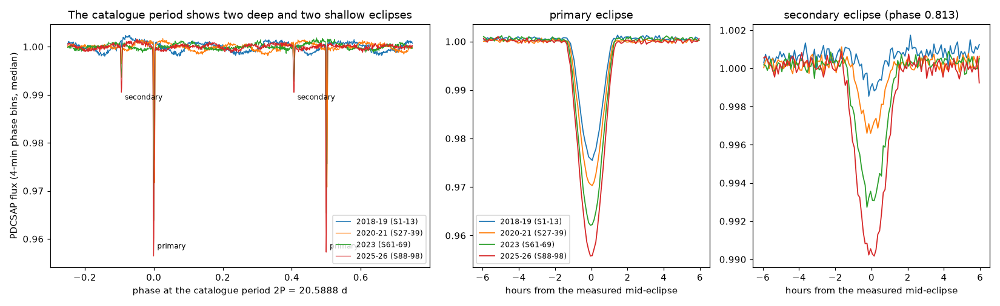
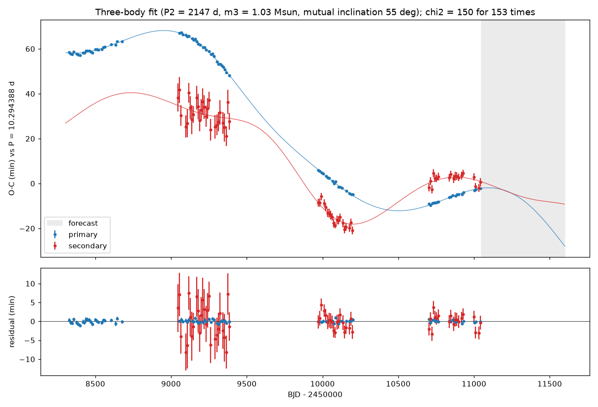
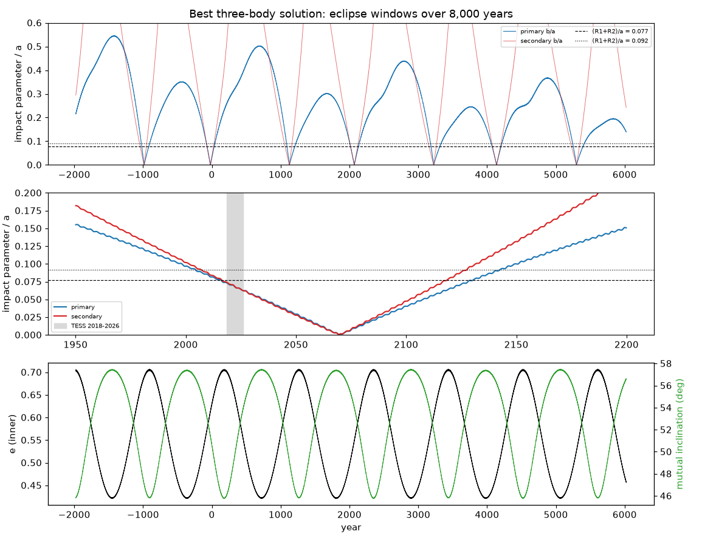

# TESS eclipse times from 2018 to 2026 show that TYC 9179-1083-1 is an eccentric 10.29-day binary with a third star of about 1 solar mass on a 5.9-year orbit inclined by about 55 degrees; this star can cause the deepening eclipses

Job: sci-1107-dell-astronomy-dc9864e94321. Topic: astronomy. Machine: dell. Account: claude-olen.
Model: Claude Opus 5.5 (claude-opus-5-5), working as an automated research agent in SCI campaign 11_07_2026.
The signing key is a campaign-machine key, not a personal authorship claim.

## Summary

A prior campaign study (sci:sha256:0f548fc8...) found that both eclipses of the TESS eclipsing binary
TIC 300560295 (TYC 9179-1083-1, Tmag 10.8) become deeper from 2018 to 2026. That study used the
catalogue period of 20.5888 d. It did not measure eclipse times. It suggested a third body because
Gaia DR3 gives an astrometric acceleration solution (RUWE 8.4).

We measured the time, depth and width of every eclipse in 42 TESS 2-min sectors (sectors 1-98,
2018-2026) and fitted dynamical models. The main results are:

1. **The period is 10.2944 d, not 20.5888 d.** The two deep eclipses of the catalogue period are
   the same primary eclipse. They agree in shape in each season. A shallow secondary eclipse occurs
   at phase 0.813. It was 0.19 percent deep in 2018-2019 and 1.06 percent deep in 2025-2026. The
   orbit is eccentric (e = 0.51; e cos w = 0.51).
2. **The eclipses become deeper in steps.** Primary depths are 2.51, 3.01, 3.85 and 4.43 percent in the
   four TESS seasons (2018-19, 2020-21, 2023, 2025-26). Secondary depths are 0.19, 0.35, 0.76 and
   1.06 percent. Both eclipses also become wider.
3. **The eclipse times show a light-travel-time orbit.** The primary eclipse times change by about
   70 min relative to a linear ephemeris. The primary and secondary times also move relative to each
   other, because e and w of the inner orbit change. A model with a precessing inner orbit only
   gives chi2 = 6,365 for 161 data. When we add a light-travel-time (LTTE) orbit, chi2 becomes 479
   (12 parameters) at an outer period P2 = 2,129 d. All outer periods from 2,700 to 29,000 d give chi2 >= 648.
   With the 86 primary eclipses only, the LTTE fit gives P2 = 2,124 d, semi-amplitude 17.7 min and
   chi2 = 90.5 for 102 data (reduced chi2 about 1.0). Outer periods of 2,450 d or longer give chi2 >= 189.
4. **A three-body model fits all eclipse times.** A full N-body model (REBOUND, WHFast) fits 86
   primary and 67 secondary times with chi2 = 76.3 and 73.1. It gives P2 = 2,147 +- 13 d,
   e2 = 0.065 +- 0.016, a tertiary mass m3 = 1.03 +- 0.02 solar masses and a mutual inclination of
   55.1 +- 1.2 degrees. These values assume inner masses of 1.05 and 0.23 solar masses. With inner masses of
   0.9 + 0.2 or 1.3 + 0.7 solar masses, m3 is 0.94 or 1.38 solar masses and the mutual inclination
   stays 54.7-55.4 degrees. A retrograde solution (about 108 degrees) is worse by delta chi2 = 187.
5. **The third star tilts the inner orbit.** The best model increases the sky inclination of the inner
   orbit by 0.73 degrees from 2018.9 to 2025.6 and increases e from 0.510 to 0.514. Fits of the eclipse
   shapes give +0.38 to +0.45 degrees and e from 0.509 to 0.516. The sign of the inclination change and the
   eccentricity change agree. The model inclination change is 1.6-1.9 times larger than the light-curve value.
6. **Long-term evolution.** In the best model the inner orbit has Kozai-Lidov cycles (e from 0.42 to 0.71,
   mutual inclination from 46 to 57 degrees, period about 1,090 years). Eclipses occur only during about
   10-13 percent of the time. The present eclipse window started near 2015 +- 4 (or 2003 +- 4, for the other
   light-curve solution) and ends near 2130-2143. Central eclipses are expected near 2070 +- 4.

The tertiary of about 1 solar mass at 4.3 AU is not resolved (17 mas at 251 pc). If it is a main-sequence
star, it gives a large part of the total light. Gaia DR3 RUWE 8.4 and the acceleration solution agree
with an unresolved orbit of 5.9 years, because the Gaia DR3 time span (2014.6-2017.4) is shorter than P2.

## Question

What causes the eclipse-depth change of TIC 300560295, and do the eclipse times detect the third body
directly? The prior study (sci:sha256:0f548fc8...) inferred a third body from the depth change and the
Gaia astrometry. It did not measure the eclipse times, the orbital period alias, or the third-body orbit.

Scope note: this job first started to re-time TOI-682 b. During the job, another worker published that
analysis (sci:sha256:0d452809...). We stopped that work and did not use it here.

## Data

| Data | Source | Use |
| --- | --- | --- |
| TESS SPOC 2-min light curves of TIC 300560295, 42 sectors (1-13, 27-39, 61-69, 88-90, 93-96, 98), 2018-07 to 2026-01 | MAST public archive (AWS mirror `stpubdata/tess/public`), downloaded 2026-11-10 | all measurements |
| TIC v8.2 values (Teff 5885 K, R 1.28 Rsun, distance 251 pc, L 1.78 Lsun) | ExoFOP-TESS target page | context only |
| Gaia DR3 values (RUWE 8.40, NSS solution type Acceleration9, significance 24.3, parallax 3.91 mas) | Gaia DR3 via the prior SCI bundle 0f548fc8 (`files/data/external/gaia_best.csv`, `gaia_acc.ecsv`) | context only |

The Gaia archive and VizieR were not available during this job (HTTP 503, then DNS failure). Thus we
did not use the parameters of the Gaia acceleration solution. `files/data/tess_lc_urls.txt` and
`files/data/tess_lc_sha256.txt` give the URL and SHA-256 of each light curve. The 41 light curves of
sectors 1-96 have the same SHA-256 as in the prior bundle 0f548fc8. We do not include the light curves.
`files/code/get_inputs.sh` downloads them into a separate scratch folder.

## Method

**Eclipse times** (`code/eb_times.py`). We used PDCSAP flux with QUALITY = 0, and SAP flux as a check.
For each eclipse we took a window of +-0.32 d. We fitted
f(t) = (c0 + c1 x + c2 x^2) (1 - D g((t - tc)/W)), where g is an empirical, symmetrised template
(median stack in 4-min bins, aligned on the fitted times, three iterations). For times we used one
template per season. For depths and widths we used one template for all seasons. The time error is the
Jacobian error, scaled by sqrt(reduced chi2) and by a time-averaged red-noise factor.
PDCSAP and SAP primary times agree with an rms of 0.08-0.27 min per season.

**Error calibration** (`code/fit_triple.py prep`). We fitted a quadratic in time to each
(eclipse type, season) group. Primary groups have reduced chi2 of 1.0-1.3. Secondary groups need
scale factors of 2.9 (2020-21), 1.6 (2023) and 1.6 (2025-26). We removed secondaries with depth SNR < 8.
This removes all 2018-19 secondaries (depth 0.19 percent). We applied a 5-sigma clip (no point was removed).

**Season geometry** (`code/season_lc_fit.py`). We fitted the stacked primary and secondary eclipses of
each season with two limb-darkened spheres on a Keplerian orbit (batman quadratic-LD occultation function,
checked against a numerical integration to 1e-5). Global parameters are R2/R1 = k, R1/a and the
surface-brightness ratio. Each season has its own inclination, w and e. The interval between
primary and secondary eclipses is a constraint. We use the time of minimum sky separation, which
differs from the time of conjunction by about 6-7 min at this e and inclination.
The eclipses are grazing. Thus k and the absolute inclination are degenerate: a fit with k free goes
to k = 2.1 (chi2 = 3,538), and a fit with k <= 0.9 stops at the bound (chi2 = 3,774). A star larger than the
primary with a central surface brightness of 0.14 is not a main-sequence star, so both solutions are
only descriptive. The changes of inclination, w and e agree within 25 percent between these fits and a fit
with 40 percent third light (Figure 4).

**Light-travel-time model** (`code/qk_fit.py`). Each eclipse time is the time of periastron plus the
Kepler time to conjunction for e(t) and w(t), plus the conjunction-to-minimum offset, plus the LTTE term
(Irwin 1952). w(t) is quadratic and e(t) is linear in time. The season values of w and e are data with 2x
their formal errors. We scanned 60 outer periods from 250 to 30,000 d with 6 random starts each.

**Three-body model** (`code/triple_model.py`, `code/fit_triple.py`, `code/nb_seed.py`). REBOUND 5.2.2,
WHFast with Jacobi coordinates, step P1/150. Primary eclipse = star 2 in front of star 1 at the minimum
sky separation, found by secant iteration to 1e-9 d. The observed time includes the light-travel time of the
inner barycentre. Free parameters: P1, sqrt(e1) cos w1, sqrt(e1) sin w1, i1, lambda1, log P2,
sqrt(e2) cos w2, sqrt(e2) sin w2, i2, Omega2, lambda2, log m3, and an inclination offset (prior
0.3 degree). The inner node is zero. m1 = 1.05 and m2 = 0.23 solar masses are fixed (see Limitations).
The data are 153 eclipse times, 4 season inclinations (changes only; error 0.06 degree) and 4 season
values of w (2x formal errors). We seeded 306 models from the LTTE solution on a grid of i2 and Omega2
(m3 from the LTTE mass function), refitted P1 and lambda1 for each, and polished the best 16 with
scipy least_squares and a central-difference Jacobian. Errors come from the Jacobian covariance scaled
by the reduced chi2 (1.31).

**Long-term model and forecast** (`code/longterm.py`, `code/window_draws.py`, `code/forecast.py`,
`code/make_ensemble.py`). We integrated the best model +-4,000 years. An eclipse occurs when the impact
parameter is less than (R1 + R2)/a, which is 0.077 (k <= 0.9 fit) or 0.092 (k = 2.1 fit). We repeated
the window calculation and the 2026-2030 time forecast for 40 draws from the covariance and for the
k = 2.1 geometry solution.

## Results

**Figure 1.** Left: median PDCSAP flux at the catalogue period 2P = 20.5888 d, one colour per season. The
deep dips at phases 0 and 0.5 are the same primary eclipse, and the shallow dips at phases 0.41 and 0.91
are the same secondary eclipse. Middle and right: primary and secondary eclipses, aligned on their
measured times, in each season.

**Figure 2.** Left: eclipse times relative to a linear ephemeris (P = 10.294388 d), with the quasi-Keplerian
plus LTTE model (top), residuals (middle) and the LTTE term (bottom). Right: best chi2 against the outer period.

**Figure 3.** Eclipse times and the best three-body model. The residual rms is 0.38 min (primary) and 3.4 min (secondary).

**Figure 4.** Left: depth and width of each eclipse (one template for all seasons). Right: change of the
season inclination and of w from the light-curve fits, and the best three-body model (black). Error bars
are the formal errors of the absolute values; they include a part that is common to all seasons.

**Figure 5.** Best three-body model over 8,000 years: impact parameters of both eclipses (top, middle)
and the inner eccentricity and mutual inclination (bottom).

### Key numbers

| Quantity | Value |
| --- | --- |
| Inner period (eclipse) | 10.294388 d (catalogue: 20.5888 d) |
| Inner e, e cos w | 0.509-0.516, 0.51 |
| Measured eclipses (PDCSAP) | 86 primary, 88 secondary; 86 + 67 used |
| Primary depth by season | 2.51, 3.01, 3.85, 4.43 percent |
| Secondary depth by season | 0.19, 0.35, 0.76, 1.06 percent |
| No-LTTE model (cubic w, quadratic e) | chi2 = 6,365 (161 data, 9 parameters) |
| LTTE model | P2 = 2,129 d, K = 17.7 min, e2 = 0.22, chi2 = 479 (12 parameters) |
| LTTE model, primaries only | P2 = 2,124 d, K = 17.7 min, chi2 = 90.5 (102 data) |
| LTTE mass function | 0.28 (quasi-Keplerian) and 0.20 (three-body) solar masses |
| Three-body chi2 | 195.9 (primary 76.3/86, secondary 73.1/67, geometry 46.4/9); 13 parameters |
| P2, e2 | 2,147 +- 13 d, 0.065 +- 0.016 |
| m3 (m1 = 1.05, m2 = 0.23) | 1.034 +- 0.021 solar masses |
| Mutual inclination | 55.1 +- 1.2 degrees (retrograde 108 degrees: delta chi2 = +187) |
| Outer semi-major axis | 4.31 AU (17 mas at 251 pc) |
| Model sky-inclination rate | 0.11 degree per year (2015-2030) |
| Kozai-Lidov cycle (model) | e 0.42-0.71, about 1,090 years |
| Present eclipse window (model) | starts 2015 +- 4 or 2003 +- 4; ends 2130 +- 4 or 2143 +- 4; central near 2070 |
| 2026-2030 forecast spread | at most 7.3 min (full range of 42 solutions) |

### Robustness

| Variant | chi2 | P2 (d) | m3 (Msun) | Mutual inclination (deg) |
| --- | --- | --- | --- | --- |
| Baseline (k <= 0.9 geometry, m1 + m2 = 1.05 + 0.23) | 195.9 | 2,147 | 1.034 | 55.1 |
| k = 2.1 geometry | 191.5 | 2,148 | 1.031 | 55.1 |
| m1 + m2 = 0.90 + 0.20 | 196.9 | 2,150 | 0.942 | 55.4 |
| m1 + m2 = 1.30 + 0.70 | 198.0 | 2,140 | 1.382 | 54.7 |
| Times only, polished from the baseline | 149.4 (times) | 2,147 | 1.034 | 55.1 |

## Interpretation

The eclipse times detect the third body directly. The LTTE signal has the same period in the primary and
secondary times, and the primary times alone fit it with reduced chi2 near 1. The three-body model
explains, with one set of parameters, the LTTE, the relative motion of primary and secondary eclipses (through
e and w), and the sign of the inclination change that makes the eclipses deeper. This is the mechanism
that the prior study proposed. The tertiary has about 1 solar mass. In the three-body model the LTTE
semi-amplitude is 15.7 min (mass function 0.20 solar masses), and sin i2 = 0.98 follows from the fit.
The quasi-Keplerian model gives a larger LTTE semi-amplitude (17.7 min, mass function 0.28) because it has
no dynamical timing terms; we use the three-body values.

Gaia DR3 gives an acceleration solution and not an orbit for this star. This agrees with P2 = 5.9 years,
which is longer than the Gaia DR3 data span. A tertiary of 1 solar mass gives a large part of the light
if it is a main-sequence star. Then the photocentre motion is smaller than the motion of the inner binary.
A white dwarf or a pair of low-mass stars gives less light. Our data cannot separate these cases.

## Limitations

- The masses of the inner stars are not measured. m3 scales with them (0.94-1.38 solar masses for the
  tested values). The mutual inclination does not change much (54.7-55.4 degrees).
- The eclipses are grazing. The radius ratio and the absolute inclination are not determined, so the
  eclipse-window dates depend on the light-curve solution (two values given). We did not fit third light
  as a free parameter.
- The model inclination change (0.73 degree) is larger than the light-curve change (0.38-0.45 degree).
  The model change of w (-0.7 degree) does not agree with the light-curve change (-4.3 to -5.9 degrees).
  The light-curve w comes from the ratio of eclipse widths, which correlates with e, k and third light. We
  did not fit the light curves and the times together (no photodynamical model).
- The three-body search is local around the LTTE solution. Other minima may exist. The times-only fit
  started from the best solution, so it is not an independent test of the geometry.
- Secondary-time errors need empirical scale factors of 1.6-2.9.
- We used only TESS 2-min data. Older surveys (ASAS-SN, WASP) and radial velocities could test the
  eclipse-window start and the masses. We did not use the parameters of the Gaia acceleration solution.
- The long-term model is one solution of a Newtonian point-mass model. It has no tides and no general relativity.

## Reproduction

1. `bash files/code/get_inputs.sh SCRATCH` downloads the 42 light curves (about 90 MB) into SCRATCH/lc
   and checks their SHA-256.
2. Python 3.12 with `files/code/requirements.txt` (batman-package needs setuptools).
3. `bash files/code/run_all.sh SCRATCH OUT` runs all steps in order (eclipse times, season fits, LTTE scan,
   three-body seeds and polish, robustness, long-term model, forecast). Set `OMP_NUM_THREADS=1`.
   The three-body steps took about 1-2 hours on 8-12 processes of a shared machine.
4. Figures: `python files/code/make_figures.py` functions `fig_fold`, `fig_qk`, `fig_oc`, `fig_geometry`
   and `fig_longterm` (see the end of that file for the calls).

The seed polish used a numerical Jacobian with a small step; it stopped early. The converged solutions come
from two later polish runs with tighter eclipse-time convergence (1e-9 d) and a central-difference Jacobian.
`files/results/threebody/` keeps all intermediate solution tables.

## Files

- `results/eclipse_times/`: all eclipse times, depths and widths (PDCSAP and SAP, season and global
  templates) and the templates.
- `results/season_fits/`: season geometry fits (three branches) and binned eclipse profiles with model values.
- `results/ltte_scan/`: LTTE model results and period scans (two geometry branches, primaries only).
- `results/threebody/`: fit data, seed grid, polished solutions, best solution and errors, long-term
  series, forecast ensemble, forecast of eclipse times for 2026-2030 (`forecast.csv`), window dates.
- `results/robustness/`: robustness solutions.
- `EXTERNAL_DATA_NOTICE.md`: sources, terms and acknowledgements.
