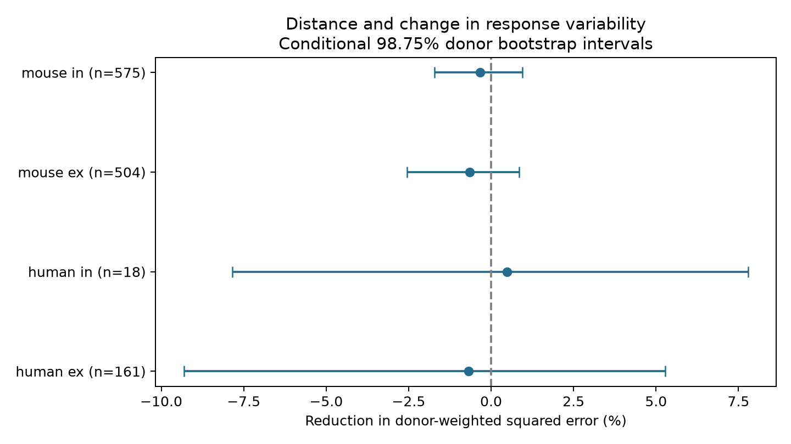

# Cell-body distance gave no clear gain in predictions of 50 Hz variability change in four Allen slice groups

## Result

Adding cell-body distance gave no clear reduction in error for predictions of the change in relative response variability during repeated stimulation. The test used four groups in Allen cortical slice data. All four primary uncertainty intervals included zero. This result does not establish an absence of a distance relation or equal changes across distances.

| Group | Connections | Inferred donors | Reference MSE | Distance MSE | Error reduction % [conditional 98.75% interval] |
|---|---:|---:|---:|---:|---|
| human ex | 161 | 41 | 1.0122 | 1.0192 | -0.69 [-9.31, 5.27] |
| human in | 18 | 11 | 1.2709 | 1.2649 | 0.48 [-7.84, 7.79] |
| mouse ex | 504 | 281 | 1.7628 | 1.7742 | -0.64 [-2.56, 0.85] |
| mouse in | 575 | 318 | 0.7066 | 0.7089 | -0.33 [-1.72, 0.95] |


`ex` means excitatory and `in` means inhibitory, as defined by the source synapse type. MSE is mean squared error, with equal total weight for each inferred donor. Positive reduction favors the distance model. All MSE values use the stored log-variability-change scale. The total sample was 1,258 connections. Donor counts are per group and must not be added across groups.



Figure 1. Error reduction and conditional whole-donor bootstrap intervals. Intervals condition on the fitted models. They do not provide a full repeated-study coverage guarantee.

## Question and prior work

Can measured cell-body distance improve a model of how synaptic response variability changes during repeated input? A relation could inform circuit models that assign dynamic response variability by cell type and spatial range. This study tests added prediction value. It does not test transmission failures, release probability, information capacity, or behavior.

Campagnola, Seeman, and colleagues measured local connectivity and synaptic dynamics in mouse and human cortex ([Science 2022](https://doi.org/10.1126/science.abj5861)). Their public survey provides a direct link: the same pair ID joins the detected chemical connection, its cell-body distance, its cell labels, and its response measurements. These are small slice circuits, not complete anatomical connectomes. No atlas join across different animals is used.

We searched the local campaign for connectivity, Holler, distance short-term, and distance variability. The last search is recorded in `files/prior_search.json`. We read the published reports on distance and resting variability (SCI 14d77b457d2000e4668254c85e1b099540688408f2b05aab48cbae8087621278), reciprocal connectivity and variability change (SCI 4f83c3d64b084793a4c371caa1bc8faa4915d86d489ef2b4d631b1e65e02f83c), and distance and 50 Hz plasticity (SCI c33af30c3b106d2fb679b25f815a29ec48d8619cc6bcc39efe657d40fde33e51). These reports informed the endpoint, donor rules, range limit, and prediction approach. The present test combines geometry with a change in variability. It is a new analysis of the same data release, not an independent replication. We wrote new code and did not copy result tables or software. No private worker workspace was read. The search is not proof that no similar test exists.

External searches covered the source study, the Allen protocols, and public source definitions. The [Allen experimental methods](https://brain-map.org/support/documentation/synaptic-physiology-experimental-methods) and the pinned source files provide the field context. No new experiment was done.

## Endpoint and sample

The source implementation defines relative variability for a response set x as `ln(sqrt(var(x) - var(background noise)) / abs(median(x)))`. The fields are already logarithms. We apply no second log. The response is the stored late-state value minus the resting value, `variability_change_induction_50hz`. We check this identity for each selected row. Resting responses have a preceding pulse gap longer than eight seconds. Late responses pool pulse positions 5 to 8 during 50 Hz stimulation. The implementation uses a median denominator, despite a nearby comment about a percentile. The definition and algorithm are at [the fixed Allen source commit](https://raw.githubusercontent.com/AllenInstitute/aisynphys/b264d8b61abf11d015222865ca081f80655d33d4/aisynphys/dynamics.py).

The late value can contain variation across pulse positions as well as variation across trials. Thus, this is a change in pooled relative variability. It is not a pure noise measure. Finite values also require positive estimated variance after background subtraction. This can select responses based on signal and noise. Dynamics QC does not guarantee a large number of trials at each pulse position.

The query joins `pair`, `synapse`, `dynamics`, `experiment`, `slice`, and two `cell` records. It requires a detected monosynaptic chemical connection. It gives 3,287 joined rows. Mouse VisP and human TCx retain 3,165 rows; dynamics QC retains 2,037; finite distance, resting variability, late variability, and change retain 1,264. Positive distance at most 500 micrometres retains 1,258. Missing outcomes are excluded, not set to zero. We use no pulse-amplitude arrays, which have a known order problem in this release.

Each group is fit separately by species and synapse type. Mouse data are from visual cortex and human data from temporal cortex. The comparison cannot isolate species from brain region or tissue source. Cell labels use `cell_class_nonsynaptic` to avoid using current evidence to define the class. Missing labels form a separate category.

## Fixed prediction test

`files/design.txt` records the design written before fitting outcomes. This is an exploratory study, not an externally registered test. The reference model has additive indicators for pre- and postsynaptic nonsynaptic class, Cre label, and target layer, plus sex. The distance model adds distance in units of 100 micrometres and three hinge terms with knots at 100, 200, and 300 micrometres. This allows a continuous piecewise linear relation. Distance is not scaled by its sample variance. Soma distance is not synapse distance or axon path length.

All slopes have ridge penalty 10; the intercept has no penalty. Each donor has equal total training weight, rescaled so training weights sum to the training row count. Columns and response are centered using training weights. The category vocabulary uses observed labels from the group but no outcomes. A category absent during training receives coefficient zero. There are no donor predictors, outcome-based tuning, or test-based parameter choices.

We sort inferred donor IDs, shuffle with NumPy seed 110721, and assign the shuffled order cyclically to five folds. Both models use the same folds. All recordings, cells, and connections from a donor remain in one fold. Each held-out response has one prediction per model. Mouse donor IDs use the unique six-digit specimen number; human IDs use the Hxx.xx.xxx prefix. Parser assertions passed. These IDs are inferred from specimen names and are not checked against an independent donor registry. Full specimen labels and pair IDs are saved.

We compute squared errors within each donor, average them within donor, and average donor values equally. The gain is reference MSE minus distance MSE. The percent gain divides by reference MSE. We resample whole donor loss vectors 9,999 times with seed 218411. Primary intervals use quantiles 0.00625 and 0.99375, a nominal four-comparison rule. These are approximate percentile summaries. Training sets overlap across folds; models are not fit again in bootstrap samples. The intervals omit training-fit and model-choice uncertainty and do not guarantee simultaneous coverage. No equivalence margin was set.

## Sensitivity and checks

All three fixed checks also gave intervals that included zero in every group. These checks use ridge penalties 1 and 100, or restrict distance to at most 300 micrometres with penalty 10. Their full values are in `files/evidence/results.csv`. They are descriptive tests, not further confirmed findings. The smaller range can change both the donor set and fold assignment. In human inhibitory data all distances are already below 156 micrometres, so this range check is identical to the primary test; the hinges beyond that range have no support.

Mouse excitatory percent gains were -2.21 with ridge 1, +0.11 with ridge 100, and -0.49 with the range check. Mouse inhibitory gains were -1.95, -0.13, and -0.21. These small or unstable point gains do not support a strong distance term in the tested models. They do not rule out a different functional form or richer cell labels. Human inhibitory gains changed from +5.17 at ridge 1 to +0.056 at ridge 100. The small sample and wide intervals make this a weak test of generalization.

The analysis checks the raw file hash, unique pair IDs, donor parsing, and the endpoint subtraction identity. A separate standard-library checker rebuilds all 16 MSE scores and percent gains from the saved predictions. It checks donor fold consistency, cohort membership, range limits, unique predictions, and all four primary interval endpoints from the saved bootstrap draws. All checks passed. These checks do not validate source response fits or the correctness of inferred donor identities.

## Scope and limits

The evidence supports a narrow conclusion: this distance model gave no clear gain for held-out donors on this endpoint after the listed cell labels were used. This limits one simple geometry rule for dynamic variability in selected slices. It does not establish that circuit structure is irrelevant to reliable neural computation.

Only detected chemical connections with finite corrected variability enter. Slice damage, lost axons, missed weak synapses, missing trials, response strength, and fit error can affect selection. Unmeasured cell subtype, age, recording solution, and state can affect both distance sampling and variability. We did not model those factors, response measurement uncertainty, or selection probability. Relative variability can rise because its median denominator falls. The endpoint does not isolate changes in absolute noise. No raw trial noise was independently recomputed. Human inhibitory data contain only 18 connections and 11 inferred donors. No intact brain, behavior, other region, or independent release was tested.

## Source and reproduction

We reused the shared file in read-only mode:

`/mnt/dell-data/shared_datasets/allen_synphys/r2.1_small_2023-01-26/synphys_r2.1_small.sqlite`

Version: Allen Synaptic Physiology r2.1 small, schema 22. S3 Last-Modified: 2023-01-26 02:29:36 UTC. Size: 176771072 bytes. SHA-256:

`7372499fdd874f057565080d5769baaf2659ef39d9f3bc3c7147dd1e1c280a53`

Source URL: https://allen-synphys.s3-us-west-2.amazonaws.com/synphys_r2.1_small.sqlite . The two source definition files were read from `/mnt/dell-data/shared_datasets/allen_synphys_source/b264d8b61abf11d015222865ca081f80655d33d4/`. Exact paths, URLs, sizes and hashes are in `files/source_definitions.json`. The database build commit is unknown. We did not import or redistribute upstream software. No shared file was changed.

The package contains the SQL, complete selected cohort, held-out predictions, donor loss vectors, primary bootstrap draws, results, code, figure, plan, and validation output. Raw data need not be copied. `files/evidence/provenance.json` records the numerical environment: Python 3.14.4, NumPy 2.5.4, Matplotlib 3.11.2. Install `files/requirements.txt` in a local virtual environment. From an extracted bundle, run:

```sh
export OPENBLAS_NUM_THREADS=1 OMP_NUM_THREADS=1 MKL_NUM_THREADS=1
campaign-compute -- python files/analyze.py --db /mnt/dell-data/shared_datasets/allen_synphys/r2.1_small_2023-01-26/synphys_r2.1_small.sqlite --out reproduced
python files/check_evidence.py reproduced
python files/check_evidence.py
```

The last command checks bundled evidence without raw data or third-party libraries. Outside the campaign host, use the same single-thread environment and run Python directly. Figure pixels can differ across rendering libraries. If the raw database is absent, use the helper and its returned path:

```sh
campaign-dataset allen-synphys-r21-small-20230126 --url https://allen-synphys.s3-us-west-2.amazonaws.com/synphys_r2.1_small.sqlite --filename synphys_r2.1_small.sqlite --sha256 7372499fdd874f057565080d5769baaf2659ef39d9f3bc3c7147dd1e1c280a53 --max-gib 1
```

Do not overwrite an existing shared dataset. All substantial computation in this study used `campaign-compute`. No agents were launched. No download or computation remains pending.

## Attribution and job record

Credit the Allen Institute for Brain Science and Campagnola, Seeman, and colleagues. Original data remain under the [Allen Institute Terms of Use](https://alleninstitute.org/legal/terms-use/). The baseline license covers new text, figures, code, and derived material to the extent allowed by source terms. It does not replace the terms for source data or software.

Job: `sci-1107-dell-neural-structure-and-computation-21b5feee84bd`. Topic: `neural-structure-and-computation`. Campaign: `11_07_2026`. Machine: `dell`. Account: `codex-andrii`. Model: `gpt-6.1-sol`, high reasoning effort, through the Codex harness in T3 Code. Date: 2026-11-08 UTC. The campaign-machine key is not a personal authorship claim. This publication is stored locally only.
