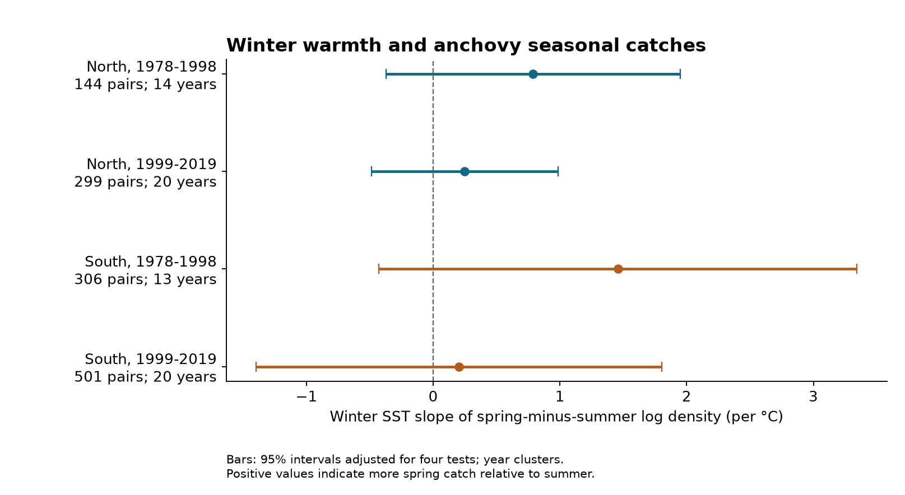

# Winter warmth gave uncertain spring-to-summer anchovy catch slopes in four California samples in 1978-2019

Job: sci-1107-hp-climate-pollution-biodiversity-6698c3507335. Topic: climate-pollution-biodiversity. Campaign: 11_07_2026. Machine: hp. Account: codex-myxtap. Model: gpt-6.1-sol, high reasoning effort. Date: 2026-11-09. The signing identity is a campaign-machine key. It is not a personal authorship claim.

## Question and finding

Does a warm winter predict more northern anchovy larvae in spring relative to summer at the same survey stations? We tested this question with 1,250 matched station-year pairs in the California Current. Four models used two sectors and two periods. All four temperature slopes were positive. All four intervals adjusted for four tests included zero. This evidence does not establish a repeated winter-temperature link to seasonal catch balance. It also does not establish that the link is absent.

The outcome is the spring-minus-summer difference in log density, with one added before each log. A positive slope means that spring catches rise relative to summer catches as winter temperature rises. It does not measure a spawning date. A change in transport, larval survival, local abundance or the length of the spawning season can give the same result.

## Prior work and contribution

Chen et al. (2025, doi:10.1111/gcb.70141) found long-term shifts in larval fish timing in the southern and northern California Current. Thompson et al. (2022, doi:10.1111/gcb.16010) found a large anchovy increase during the 2014-2016 heatwave. Muhling et al. (2020, doi:10.3389/fmars.2020.00589) found poor transfer of some species distribution predictions to new warm conditions. These studies support a need to test specific temperature and timing links. They do not make one common thermal response necessary for every species and season.

Before selecting the precise question, we searched the signed campaign for phenology, climate, pollution and CalCOFI results. We then searched for CalCOFI seasonal timing, anchovy and sardine, and offshore patterns. Campaign result dc8b0fcb8d4e tested heatwave prediction across taxa. Result b125a08d6f68 tested the day-night contrast in rarefied larval richness. We read both. We use the same public archive for a different outcome: the within-station spring-to-summer anchovy contrast. The source observations overlap. This is not independent validation of those studies, and the two sectors are not independent ocean basins. No prior code was copied. This is an exploratory secondary analysis, not a registered test.

## Results

| Sector | Period | Matched pairs | Stations | Sampled years | Slope per C | Adjusted interval |
| --- | --- | ---: | ---: | ---: | ---: | --- |
| north | 1978-1998 | 144 | 14 | 14 | +0.787 | -0.374 to +1.948 |
| north | 1999-2019 | 299 | 21 | 20 | +0.248 | -0.488 to +0.984 |
| south | 1978-1998 | 306 | 30 | 13 | +1.457 | -0.428 to +3.343 |
| south | 1999-2019 | 501 | 33 | 20 | +0.203 | -1.396 to +1.803 |



The early southern marginal 95% interval is +0.057 to +2.857. Its four-test interval includes zero. The intervals are wide enough to allow large seasonal changes in either direction. The later point estimates are smaller, but we did not test a change in slope between periods. Their difference must not be treated as evidence of a change.

The station-trend, presence-only, equal-year-weight, alternative log constants and lag-two covariance checks all have intervals that include zero in all four samples. Excluding 2014-2016 leaves both later intervals across zero. Restricting pairs to the same light category leaves no usable early northern model under the declared support rule. The other three same-light intervals include zero. Loss of support is not a null result.

Models without the sampling-date, light and volume terms have positive adjusted intervals in the two early samples. Their point estimates, +0.793 and +1.363, are close to the primary estimates. Adding sampling terms mainly increases uncertainty there. This does not prove that sampling bias caused the simpler results. The same covariates can share temperature variation and reduce precision. In the later north, the estimate changes from -0.105 without these terms to +0.248 with them.

A joint model with current and next winter temperature gives current-minus-next estimates of +0.867, -0.520, +1.197 and -0.085 in table order. Every adjusted interval includes zero. Temperature persists across years, so next winter is not a strict negative control. This check gives no repeated time-order contrast.

The count-table audit found 81 of 3,887 selected tows with no larval record for any taxon. Fifty-one primary pairs include one or more such tows. They are retained as zero catches in the primary analysis under its complete-report assumption. A labeled post-fit check excludes these pairs and reapplies the station rule. Its four slopes are +0.648, +0.239, +1.377 and +0.167. All adjusted intervals include zero. This check does not decide whether the empty records are true zeros or missing reports.

Files/estimates.csv contains all 55 reported coefficients from 47 fitted models. It includes the next-winter coefficients and their direct contrasts. Files/numerical_checks.json records the one model with insufficient support. Sensitivity intervals use the same four-test rule within each coefficient and specification family. We claim no joint coverage over all sensitivity results.

## Data and sample rules

We use the NOAA SWFSC tow and larval-count snapshots retrieved on 2026-11-09, plus the NOAA PSL ERSSTv5 snapshot retrieved on 2026-11-08. All were already present in the shared dataset store. No raw data download was needed. Exact source queries, source retrieval times, byte counts, paths and SHA-256 hashes are in files/provenance.json. Only the three input files were hashed.

| Shared input | SHA-256 |
| --- | --- |
| datasets/calcofi-erddap-ichthyoplankton-tows-20261109/tows.csv | 5f9aec07fd612be7f324cb6c3a4239b2b5054dd36a2db9b2395aef127e097d6c |
| datasets/calcofi-erddap-larvae-counts-1951-2023-20261109/lrvcnt.csv | 6e85103ecea079e818052b5f0aa2abee72896198d9465baebceb4fd8f258b863 |
| datasets/ersst-v5-psl-sst-mnmean-20261108-olen/sst.mnmean.nc | 952fad739abab3e3c33c955b168f298b9884d2fe48ab259ebf19ac531d8d8386 |

The survey frame is 1978-2019, bongo tow type CB, starboard net S and stored mesh value 0.505. CalCOFI describes this mesh as 505 micrometres. The source tow unit row calls it microns; we interpret the decimal value as millimetres, from the gear description. Stations range from 26 to 90. North uses lines 76.7, 80 and 83.3. South uses 86.7, 90 and 93.3. These are sectors within the southern California survey system. They do not represent the full northern and southern California Current. We exclude later years from the declared scope because survey coverage is incomplete and the pandemic changed field work.

For each year, choose one cruise from actual March-May tows and one from actual June-August tows. Prefer the nominal cruise month closest to April or July. Break ties by the number of core tows, then by the lower cruise code. Apply the cruise choice over both sectors together. Use the first tow at each station by UTC time. Pair the same station and year across the two seasons. This controls changes in station composition within a year. Station effects control stable differences among stations.

Counts use the exact scientific-name label Engraulis mordax. The source gives standardized density in larvae per 10 square metres for these oblique tows. No selected anchovy row has a missing or negative density. No duplicate target-species tow row was found. A selected tow without this species label is a zero under the complete-report assumption. We do not require a positive anchovy catch.

Effective volume is sampled water volume times the fraction sorted. Both volumes must be positive. NOAA solar equations estimate elevation from UTC date, time and coordinates. Tow times with elevation between -6 and +6 degrees are excluded. Day has elevation at least +6 degrees; night has elevation at most -6. These are geometric estimates at the tow timestamp, not full light or tow-duration measurements. A station must have at least eight retained paired years in its sector and period. Each fitted model needs at least 60 pairs and ten sampled years. A stricter subset must meet the same support rule again.

There are 1,635 paired station-years before light and station-support filters. All have positive effective volume. The light filter leaves 1,337. The eight-year station rule leaves 1,250. Both spring and summer have zero anchovy catches in 487 primary pairs. Zero reports are particularly common in the later northern sample. Files/coverage.csv gives each sample's losses and zero counts. Files/reporting_audit.csv gives empty-tow counts by period, sector and season. The early survey has fewer sampled years, which limits temperature information even when the number of station pairs is large.

## Statistical method

For spring density Ds and summer density Du, the primary response is:

`Y = ln(1 + Ds) - ln(1 + Du)`.

Density values are expressed in larvae per 10 square metres. Adding one makes the measure finite at zero, but also makes it depend on this unit and on the added constant. Planned checks replace one with 0.1 and 10. A separate response is spring presence minus summer presence.

The temperature predictor is the January-February ERSSTv5 mean. It precedes all selected tows. The northern box uses grid centres at 34 and 36 N; the southern box uses 30 and 32 N. Each uses 124, 122, 120 and 118 W. The mean uses cosine-latitude weights, then equal month weights. ERSST is coarse at two degrees. Some stations are near box boundaries. These are regional winter conditions, not measured tow temperatures or daily extremes.

Fit ordinary least squares separately by sector and period:

`Y = station effects + linear year trend + b*winter_SST + sampling terms + error`.

Sampling terms are separate spring and summer linear and squared day-of-year terms, night indicators and log effective volumes. Day terms are centred at 100 and 200 and divided by 30. The model estimates the temperature slope of a seasonal catch contrast. It is not a slope of annual abundance or species richness. The linear time term reduces shared long-term drift but cannot remove all slowly changing causes. Year fixed effects would absorb the regional winter predictor, so they cannot be used for this question.

The primary covariance clusters all station pairs within each sampled year. It uses factors G/(G-1) and (n-1)/(n-k). Intervals use t with G-1 degrees of freedom. The primary four-test family uses the 0.99375 quantile, so each interval has nominal 98.75% marginal coverage and the family has nominal 95% coverage by the Bonferroni rule. This rule does not require independence among the four models. The cluster and t approximation still requires suitable error conditions and has few year clusters in the early samples.

Planned checks add station trends, omit sampling terms, use the same light category, change the log constant, change the outcome to presence, give each year equal total weight, omit 2014-2016, or add next winter SST. The serial check uses year-level score sums with Bartlett weights at calendar lags one and two. Missing calendar years contribute zero scores; gaps are not compressed. This is a short-dependence sensitivity check, not proof against long climate persistence. Files/protocol.md records the rules and the post-fit empty-tow addition.

## Numerical checks and reproduction

Independent NumPy least squares, nuisance-residual projection and cluster-influence calculations agree with the reported fits. Maximum coefficient disagreement is below 6e-13. Maximum residual-projection disagreement for the temperature slope is below 2e-14. Maximum independent covariance disagreement is below 4e-10. Statsmodels provides a further WLS and clustered-covariance comparison for every applicable model. All fitted design matrices have full column rank. These checks test computation, not the truth of the biological reports.

From this worktree, run:

```sh
python work/result/files/analyze.py --datasets ./datasets --output ./work/reproduce
python work/result/files/validate.py ./work/reproduce
```

After extraction, use files/fetch.py for retrieval into separate scratch, then run analyze.py and validate.py with that data root. Files/REPRODUCE.md gives the full commands. Files/software.json gives package versions. No random draws are used. The code writes source extracts and model arrays only outside the signed draft. Source URLs are live products; if their bytes change, exact future reproduction needs the named shared snapshots. The fetch script detects that change and stops.

## Limits and rights

This result concerns one species and two survey sectors. The samples share water masses, field methods, climate variation and reporting practice. They are regional and temporal checks within one observing system, not independent climate experiments. Uneven coverage, few early year clusters, zero catches, uncertain complete reporting and the selected station set limit inference. The presence check still depends on detection. No catchability model, tow-depth measurement or repeated detection experiment is available here. Daylight and water volume controls cannot remove all net avoidance, size or depth bias.

A spring-to-summer contrast cannot locate the annual spawning peak, recover unsampled winter and autumn catches, or separate transport from spawning and survival. Fishing, food, circulation, stock age structure and unmeasured local conditions can cause temperature associations. We test no daily heat extremes, pollutant effect or interaction with pollution. We do not attribute change to human-caused warming or infer fisheries recruitment. This null result limits a simple winter-warmth explanation for the chosen seasonal index; it does not reject the broader published evidence for changing larval timing.

NOAA SWFSC provided the CalCOFI tables. NOAA/OAR/PSL, Boulder, Colorado, USA, provided ERSSTv5 from https://psl.noaa.gov/. Files/NOTICE.md gives external terms and attribution. No external raw data, individual-record panels or model matrices are bundled. The exact SCI baseline LICENSE applies to our bundled code, narrative, figure and aggregate statistical results. We do not claim ownership of NOAA source data. The signing private key is not included.
