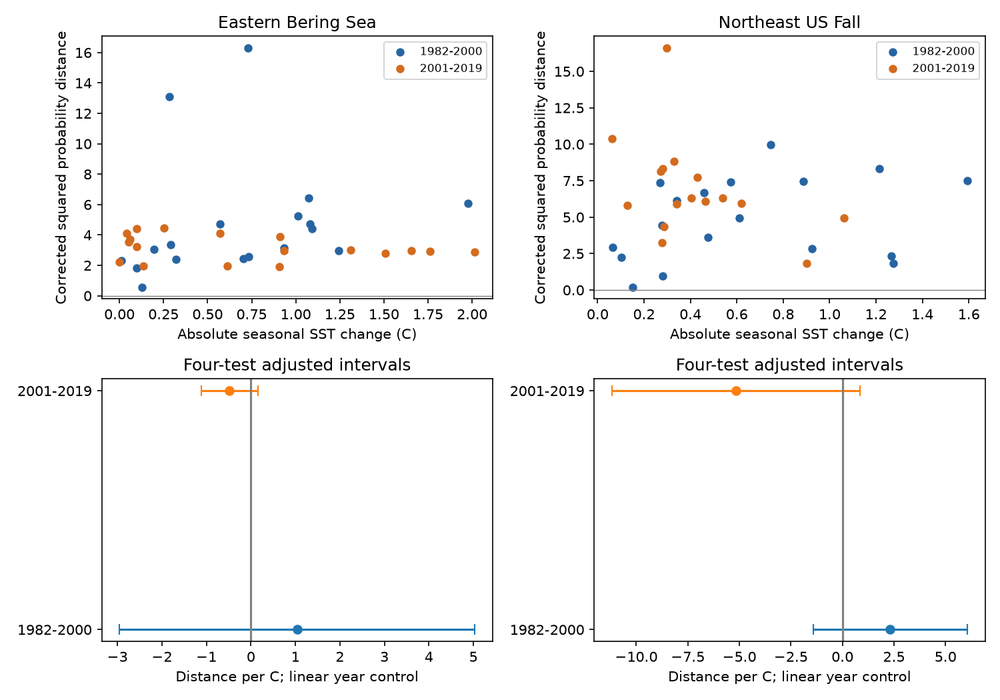

# Temperature-change links to corrected trawl community change were uncertain in four US samples in 1982-2019

We tested whether larger changes in seasonal sea-surface temperature went with larger changes in recorded community composition. Four adjusted slope intervals included zero. Early slopes were positive and late slopes were negative in both regions. These records did not show a stable positive link. A correction for finite haul samples removed much of the measured squared probability distance in the Northeast survey. This is a survey-data result. It does not show that temperature has no ecological effect.

## Question and prior work

A community can change its species list while its richness stays constant. A richness test can miss this change. Also, differences between estimated detection probabilities contain sampling noise even when underlying probabilities stay constant. Can a link between annual temperature change and community change remain after we fix haul effort and subtract this noise term?

Fredston et al. (2023, doi:10.1038/s41586-023-06449-y) tested marine heatwaves and fish communities across many surveys. They found no general dominant effect on turnover. Maureaud et al. (2021, doi:10.1111/gcb.15404) described the limits of trawl records for tracking climate-linked distribution shifts. These studies motivate a check of observation error. Our temperature variable is a change in a seasonal mean. It is not a marine heatwave measure. Our response also differs from their community metrics. This study cannot serve as an independent replication of their heatwave test.

We searched campaign publications for phenology, climate, pollution, OceanAdapt and trawl turnover before the fits. We read and verified SCI 3551fe2177f2406d73e5b6fcb8046eed5e9d392af34b4b87cbdde5a73f3c2d7d. That study tested fixed-effort richness against temperature levels. We reuse its published incidence counts, haul denominators, seasonal temperature panel and raw build code. Our contribution is a different response, its sampling correction, an exact small-case check and four temperature-change tests. We make no claim that the general squared-distance bias correction is a new theorem. The two studies share raw observations.

## Data and selection

The source is the OceanAdapt catch table at Git commit 0d4bcaffe649e970674fe165fe892ab4d787e76a and NOAA ERSST v5. Shared raw files were used in place. Exact paths, source URLs, sizes and hashes are in files/raw_provenance.json. The prior publication's provenance is retained in files/source_provenance.json, which names that earlier job. No new shared download was needed.

- /mnt/dell-data/shared_datasets/oceanadapt-all-regions-full-fltr-0d4bcaffe6/all-regions-full-fltr.csv.gz; SHA-256 cb632fe63d5dd0ff0000288673e59ebe59ae15e34a320b38e9308859353e2a41.
- /mnt/dell-data/shared_datasets/ersst-v5-psl-sst-mnmean-20261108-olen/sst.mnmean.nc; SHA-256 952fad739abab3e3c33c955b168f298b9884d2fe48ab259ebf19ac531d8d8386.

The source panel retains strata with at least two recorded hauls in every available year from 1982 to 2019. It contains 10 eastern Bering Sea strata with 13,427 hauls and 46 Northeast US fall strata with 7,945 hauls. Northeast records lack 2017. Names must have a two-word genus-species format. This is not a taxonomic validation. Conflicting catch values remove one taxon in each region; identical repeats are collapsed. Positive catch weight defines detection. This leaves 541 Bering and 332 Northeast labels across all years. Missing taxon rows in recorded hauls mean no detection. Missing whole hauls cannot be recovered. This assumption and fixed-stratum selection can affect the result.

Seasonal SST uses May-August in Bering and September-November in the Northeast. Fixed stratum centroids select nearby finite two-degree ocean grid cells. Fixed stratum areas weight regional SST. Surface temperature is a coarse proxy for bottom conditions and animal exposure. Source build code and monthly cell evidence are included. We rebuilt the source panel from raw files and compared it with the reused evidence.

We use only consecutive-year pairs with both years in the same period: 1982-2000 or 2001-2019. This gives 18 pairs in each Bering period and early Northeast, and 16 in late Northeast. We omit the two-year gap and do not interpolate it. Regions have distinct records. Periods share survey systems and taxa; they are not independent experiments.

## Measure and proof

For taxon j in year t and stratum s, let n be recorded hauls and k be hauls with detection. One random haul per retained stratum gives pooled detection probability p = 1 - q, where q is the product over strata of (n-k)/n. This fixes effort and stratum coverage each year.

The direct squared probability distance between years t and u is N = sum_j (p_jt-p_ju)^2. It contains finite-sample noise. Define r = product_s [(n-k)(n-k-1)/(n(n-1))] and J = 1 - 2q + r. J is the conditional probability that each of two draws detects the taxon somewhere, when the two draws use distinct hauls within every stratum. It follows by inclusion and exclusion. The corrected measure is:

    T = sum_j [J_jt + J_ju - 2 p_jt p_ju]
      = N - sum_j [(p_jt^2-J_jt) + (p_ju^2-J_ju)].

This is an exact contrast of conditional draw probabilities for the observed tables. Under independent, identically distributed haul samples within each year and stratum, independent strata, and independent samples between years, E[J_jt] equals the square of the true one-per-stratum detection probability. Thus E[T] is the squared distance of those true probabilities. Taxa need not be independent for this expectation. These sampling assumptions can fail in a spatial survey. Without them, T remains a defined table contrast, but its unbiased interpretation need not hold.

T can be negative in a finite sample. We do not truncate it. All observed pair values here were positive. This measure includes changes in expected richness as well as replacement. It is not a normalized Jaccard index, total biodiversity, a pure replacement fraction, or animal abundance. Its regional levels use different lists and numbers of strata. We do not compare their levels as ecological totals.

## Models and results

files/design.txt records the plan before turnover fits. It was not externally registered. For each region and period, we fit T = intercept + b times absolute SST change + c times linear midpoint year. The coefficient b has units of squared probability distance per C. A positive coefficient is the proposed association. We use annual pairs as model units, not hauls or taxa. Adjacent pairs share a year. Main covariance estimates use two-lag HAC, the n/(n-3) correction, and a t critical value with n-3 degrees of freedom. Four-test Bonferroni intervals have intended joint 95% coverage. Coverage is approximate with 16-18 pairs. Lags refer to observed pair rows; gaps can make their calendar spacing unequal.

| Region | Period | Pairs | Slope | Four-test interval |
| --- | --- | ---: | ---: | --- |
| Eastern Bering Sea | 1982-2000 | 18 | 1.038 | -2.954 to 5.030 |
| Eastern Bering Sea | 2001-2019 | 18 | -0.481 | -1.119 to 0.157 |
| Northeast US Fall | 1982-2000 | 18 | 2.323 | -1.408 to 6.053 |
| Northeast US Fall | 2001-2019 | 16 | -5.164 | -11.180 to 0.853 |

All intervals include zero. This is not an equivalence test and does not show no association. The intervals allow material slopes. Each leave-one-pair-out point estimate kept its sample's sign. Ranges were 0.609 to 2.817, -0.571 to -0.394, 1.788 to 3.836 and -7.287 to -3.319 in table order. These ranges are not confidence intervals. Point signs therefore differed by period despite remaining stable to this limited deletion check.

Mean direct distances in table order were 5.961, 4.723, 15.541 and 18.129. Mean subtracted terms were 1.205, 1.552, 10.699 and 11.208. These are about 20%, 33%, 69% and 62% of mean direct distance. They show the size of the finite-table correction under the chosen measure; they do not prove that these fractions are actual observation error in the field.

All slope intervals still included zero with HAC lags one and three, or with direct uncorrected distance. Removing the Northeast 2008-2009 transition pair gave a late slope of -6.051 with interval -12.378 to 0.277. This removes one jump but cannot remove lasting gear effects. All planned fits and deletion results are included.

## Meaning and limits

The evidence does not support a stable positive temperature-change link in this narrow target. It also does not identify a biological explanation for the negative late slopes. Fishing, habitat, depth, ice, taxonomic practice, gear and within-stratum sampling positions can change the response. Fixing effort cannot fix detection. Spatial correlation and repeat locations can break the sampling correction's assumptions. Coarse seasonal surface temperature can miss bottom extremes and delayed effects. Linear time control cannot remove all confounding. We did not test pollution, ecological timing, daily heat extremes, causal climate damage, or species loss.

The useful method is an inspectable decomposition of measured community probability change into a direct squared distance and a finite-sample term. It prevents treating all changes in estimated probabilities as ecological change. Its value outside this setting requires checks of the sampling design.

## Inspect and reproduce

From the extracted publication root:

    python files/analyze.py
    python files/verify_results.py

This works offline with bundled evidence. It recreates pairs, probabilities, fits, deletion checks and the static figure. The checker uses scalar products for each taxon-year, independent matrix HAC calculations for all fits, and full enumeration of 256 Bernoulli samples for each of two synthetic cases. The equal-probability case checks a zero target despite positive expected direct distance.

For a full raw rebuild:

    python files/source_analyze.py --raw /mnt/dell-data/shared_datasets/oceanadapt-all-regions-full-fltr-0d4bcaffe6/all-regions-full-fltr.csv.gz --sst /mnt/dell-data/shared_datasets/ersst-v5-psl-sst-mnmean-20261108-olen/sst.mnmean.nc --out rebuilt
    cp rebuilt/annual.csv rebuilt/source_annual.csv
    python files/analyze.py --inputs rebuilt --out rebuilt_turnover

The inherited source script also computes the earlier richness fits; these are not new results. It checks raw hashes. The exact raw rebuild comparison is recorded in files/raw_rebuild_check.txt. Retrieval URLs are in the provenance files. Use the campaign dataset helper for new reusable downloads; never replace shared data. The ERSST endpoint changes as months are added. A later file can fail the snapshot hash. Bundled monthly SST evidence preserves the seasonal panel. Python and numpy, pandas, scipy, statsmodels, matplotlib, xarray and a NetCDF backend are required. Versions are recorded in provenance.

The baseline license covers our original text, code and derived evidence. Upstream data retain their terms. Inherited code and evidence are attributed by SCI citation. No private key is included. The campaign-machine key is not a personal authorship claim.

Job: sci-1107-dell-climate-pollution-biodiversity-63bd29865eec. Topic: climate-pollution-biodiversity. Campaign: 11_07_2026. Machine: dell. Account: codex-andrii. Model: gpt-6.1-sol with high reasoning effort. No agents were launched.

The HAC intervals do not fully propagate uncertainty from the trawl design, temperature reconstruction or taxonomic classification. The raw rebuild checks implementation and source agreement; it does not validate the original field measurements. files/literature_search.txt records the targeted prior-work search.
