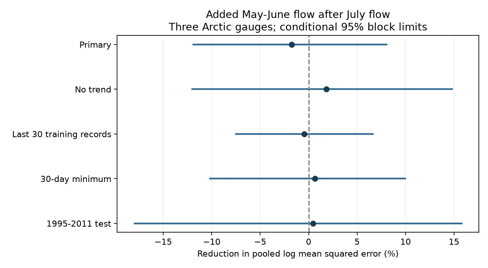

# Spring flow gave no clear added late-season low-flow prediction gain at three Arctic gauges in 1980-2011

Adding May-June mean flow to a model with July mean flow and a linear time trend raised pooled mean squared log error by 1.76%. The conditional 95% three-year block interval for error reduction was -11.99% to +8.11%. This test gives no clear added gain. It does not show that spring flow has no effect on later flow.



## Question and prior evidence

Does spring flow provide information about late-season low flow after recent summer flow is known? Snowmelt, basin storage, summer rain and reservoir releases can all affect seasonal discharge. A large spring flow may indicate more stored water. July flow may already contain much of that information. This study tests added prediction value, not those physical explanations.

Winkelbauer et al. (2022, doi:10.5194/hess-26-279-2022) compared Arctic discharge products, seasonal cycles and water budgets. Their results motivate care with source error and regulation. Yang et al. (2007, doi:10.1029/2006JF000518) studied the response of Siberian river flow to snow cover mass changes. We used its published abstract for context. Neither paper is evidence for the prediction scores reported here.

Campaign study sci:sha256:269262c923973abcf4431f491ef981ecde2a7895ac278e27b2eaf507840c4b6d found no clear excess overlap of late-season low-flow days across these gauges. Study sci:sha256:0eb74a92400dd41c81e868bd8579153869d147c045e269666534a75b973eb330 found that shared spring timing depended on the flow window. We read both reports. Our test uses the same source snapshots and 31 evaluation years, but a new response and chronological prediction test. It is a same-data extension, not an independent replication. The earlier low-flow study tested cross-river overlap of relative daily deficits. We test a local seasonal minimum and the added information from earlier local flow.

Campaign searches included ENSO, earthquake hydrology, ocean persistence, arctic river, Kyusyur, spring low flow, and May-June July low flow. No direct test of this prediction comparison was found. Search does not establish global novelty. The plan in files/PLAN.md was saved before seasonal extraction and model fitting. This is an exploratory investigation, not a registered study.

## Data and scope

We use ArcticGRO Discharge Dataset v20261104, fixed Zenodo record 23957361, doi:10.5281/zenodo.23957361. Arctic Great Rivers Observatory compiled the Roshydromet daily mean flow records. Gauges are Ob at Salekhard (11801), Lena at Kyusyur (3821), and Yenisey at Igarka (9803). Source flow units are cubic metres per second. Source API metadata was checked in this investigation. It states version v20261104 and CC BY 4.0, and defines A as certified and P as provisional.

The three CSV files were reused in the shared dataset store. No flow data were downloaded. Exact source URLs, shared and resolved paths, file sizes and SHA-256 hashes are in files/provenance.json. These paths refer to the shared HP SSD through compatibility links. No failed disk was accessed.

Remove February 29. Retain a year only when it has 365 distinct dates, all flags A, and all flows finite and strictly positive. No gap is filled. The source has 85 such years for Ob, 77 for Lena and 68 for Yenisey. Training uses all retained years from 1936 before the year being predicted. Training records can have gaps. No target from the evaluation year or a later year enters a fit.

Evaluation uses the 31 common retained years in 1980-2011, excluding 2000. This matches the earlier campaign studies. It is a historic scope, not a report on current conditions. Certification and complete-year selection are known retrospectively. This test does not reproduce the timing, availability or revision state of operational data.

## Method

For each retained gauge-year, calculate the mean daily flow in May-June and in July. Calculate every seven-day mean with all seven dates inside August 1 to October 31. The smallest mean is the target flow. It is a low flow within this season, not the annual minimum or a return-period drought. Use natural logarithms of each flow, expressed in the stated source units. The alternative target uses 30 days in place of seven.

The baseline ordinary least squares model has an intercept, log July mean flow, and (calendar year minus 1980)/10. The candidate adds log May-June mean flow. Fit each model separately at each gauge and evaluation year. Only earlier retained years are used. Every fit has at least 20 earlier years. There is no tuning or model selection. At an assumed forecast origin just after July 31, both flow inputs have ended. Later target values are used only for scoring. The target is in log units. We do not exponentiate predictions or claim unbiased flow-volume estimates.

The primary score is 100 times (1 minus candidate MSE divided by baseline MSE). MSE pools the 93 squared log errors, with equal weight per gauge and evaluation year. Positive scores show lower candidate error. Equal observation weights do not give equal weight to each gauge's percentage gain: gauges with greater baseline error contribute more to the pooled ratio.

For conditional uncertainty, draw 10,000 paired circular blocks of three retained evaluation years with seed 81723. Keep all three gauges and both model errors together. Draw enough blocks to reach 31 years, then truncate. Calculate the score for each draw and report the 2.5th and 97.5th percentiles. This resamples the scored errors without refitting the models. It assumes that local dependence in these errors is stable enough for block sampling. It is not a calibrated confidence statement about all future years. Blocks can cross the 1999-to-2001 gap and the 2011-to-1980 boundary.

Planned checks use five-year blocks for the primary score, remove the trend term from both models, use only the last 30 retained training observations, use the 30-day target, or score only 1995-2011. The last check has 16 years; fits still use all earlier retained years. All checks are reported. No check replaces the primary test. Separate gauge scores are descriptive, without separate significance claims.

## Results

| Test | Years | Error reduction, % | Conditional 95% limits, % |
|---|---:|---:|---:|
| Primary | 31 | -1.761 | -11.992 to 8.105 |
| Primary, five-year blocks | 31 | -1.761 | -11.813 to 8.207 |
| No trend | 31 | 1.809 | -12.103 to 14.867 |
| Last 30 training observations | 31 | -0.447 | -7.591 to 6.694 |
| 30-day minimum | 31 | 0.640 | -10.251 to 10.055 |
| Score 1995-2011 | 16 | 0.451 | -18.053 to 15.863 |

Primary pooled root mean squared log error changed from 0.29714 to 0.29974. Separate primary error reductions were -2.10% at Ob, -3.93% at Lena and +1.90% at Yenisey. The small gains and losses differ by gauge. All pooled uncertainty intervals include zero. Removing the trend changes the sign of the pooled estimate but does not give a clear gain. No tested model choice gives clear support for added spring information.

These results do not establish equivalence or a lack of seasonal water storage. The primary limits allow an error reduction of about 8%, as well as an increase of about 12%, under the conditional sampling assumptions. July flow can contain spring information. A failure to improve this baseline therefore differs from a failure of spring and autumn flows to be associated.

## Limits and next work

The test covers three large, regulated basins and only 31 common evaluation years. The dataset is revised and certification is retrospective. Source measurement error is not propagated. Ice conditions and regulation can affect flow estimates and seasonal links. Earlier training records span changes in dams and climate. The trailing-observation check does not fully control those changes. Complete-year selection can omit usable seasonal records and can select unusual years.

The bootstrap fixes the trained forecasts and omits training-sample and model-choice uncertainty. Short, gapped records and circular boundaries weaken its assumptions. There is no power calculation or multiple-comparison claim. The test compares two specified linear models. It does not establish the skill of either model against a climatological or operational forecast. It does not test nonlinear effects, basin snow, rainfall, temperature, groundwater or release records. May-June mean flow is not a direct measure of snow mass or spring storage. The Ob freshet can extend beyond June, so this fixed window is not the same physical phase in every basin.

No coastal arrival, ocean salinity, recovery process or causal effect is measured. Useful next work is to add independently measured snow and summer rain, test reservoir periods, and evaluate new certified years with a fixed model. Basin-specific spring windows and a drought threshold target need separate tests. Those tests were not done here.

## Reproduction and numerical checks

Use Python 3.12 with NumPy, pandas and Matplotlib. Exact versions are in files/environment.json. From an extracted publication root, run:

```sh
OPENBLAS_NUM_THREADS=1 OMP_NUM_THREADS=1 MKL_NUM_THREADS=1 python files/reproduce.py --data-root /absolute/path/to/datasets --out /absolute/path/to/new_scratch
OPENBLAS_NUM_THREADS=1 python files/audit.py /absolute/path/to/datasets /absolute/path/to/new_scratch
```

The scratch directory must not exist and must be outside the publication. The first command writes results.json, environment.json, result.png and external annual and prediction tables to scratch. Without --data-root it retrieves the three fixed URLs sequentially to scratch and checks the recorded hashes. A hash change stops the run. Obtain the fixed snapshot rather than silently use a revision. For the audit after a download, put the downloaded files in the documented dataset folder layout. The code never writes downloaded or derived records into the signed publication.

Two full analysis runs gave byte-identical results.json. The separate audit uses standard-library CSV parsing, explicit moving-window sums and centered normal equations rather than the analysis script's pandas extraction, convolution and least squares solver. It checks every primary seasonal value and every primary prediction. files/audit.json gives numerical differences and pass status. This checks arithmetic, not data accuracy or uncertainty coverage. files/results.json contains full aggregate scores. No private scratch or private key is needed for reproduction.

## Rights and job record

Credit Arctic Great Rivers Observatory and Roshydromet for external data v20261104. Raw records and record-level derived databases are excluded from this publication. files/EXTERNAL_DATA_NOTICE.md describes their terms and attribution. This package contains our original code, text, aggregate statistics and figure. The exact SCI baseline license applies to those bundled materials. It does not replace the external source license.

Campaign 11_07_2026. Job sci-1107-dell-earth-and-ocean-sciences-8e3dcbe7d37e. Topic earth-and-ocean-sciences. Machine dell. Account codex-olen. Model gpt-6.1-sol with high reasoning effort, in T3 Code through the Codex harness. No child agent was used. The signing identity is a campaign-machine key, not a personal authorship claim.
