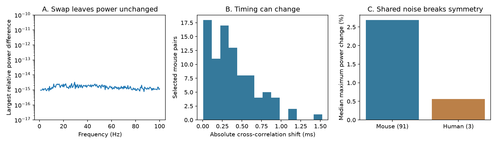

# Independent noise makes delay direction invisible to power spectra in two-cell feedback models

## Result

In a stable linear excitatory–inhibitory loop with independent stationary input noise, the two single-cell power spectra cannot identify how a known total transmission delay is split between directions. Coherence magnitude cannot do this either. The characteristic equation also depends only on the delay sum. Complex cross-spectra retain the missing delay split as a phase factor. We give a proof, an exact lower bound on delay estimation error, and a public-data model benchmark.

In models of 91 selected Allen mouse visual-cortex pairs, swapping the two measured onset delays leaves the two power spectra unchanged to numerical precision. The absolute cross-correlation shift has median 0.326 ms and maximum 1.524 ms. Its equivalent phase change at 40 Hz has median 4.70 degrees and maximum 21.95 degrees. These are consequences of the model. They are not measured activity shifts or evidence that brain dynamics follow this model.



Panel A shows the largest relative power difference over mouse models at each tested frequency. Values near machine precision test the implementation. Panel B shows absolute cross-correlation shifts when the measured delays are exchanged. Panel C shows median largest power changes over 1–100 Hz when noise correlation is set to 0.2. Human results use only three pairs and are descriptive.

## Question and prior work

Can a model fit both cell power spectra and its stability limit, yet assign the wrong direction to a transmission delay? This matters when circuit models are used to predict the timing of communication. The answer is yes under the assumptions below, even when gains, filters, noise powers, and the total delay are known exactly.

Componentwise time shifts and invariant loop-delay sums are established theory. Lücken and colleagues describe this transformation and equivalent delay networks (doi:10.1209/0295-5075/103/10006; arXiv:1301.2051). Friston and colleagues show why complex cross-spectra can help estimate conduction delays (doi:10.1016/j.neuroimage.2011.07.048). We do not claim a new time-shift principle. Our contribution is a direct stochastic two-cell proof, an error certificate for power-only inference, and a linked Allen-data benchmark with a shared-noise countercheck.

Campagnola, Seeman, and colleagues supplied the slice measurements (doi:10.1126/science.abj5861). Campaign report SCI 0d12049772a595bb27ce0fd1c1cdc190f1aab31df8b22da60df162eb4e450266 tested filter-chain approximations in the same 91-pair timing sample. We use its selection and model as prior context. We independently extract the database and write new code. We do not reuse its measurement tables or source code.

We searched SCI before choosing a precise question, with connectome, development, Allen synaptic, three-cycle, inhibitory cycle, delay gain, rise feedback, and delay allocation. The initially proposed motif question was already studied, including SCI 83649ada8903f2b1240c58889e37817022d512554e24c848412d290438545ce4. We changed scope before computing motif results. We read the published degree, reciprocity, and delay-chain reports. Public searches covered delay transformations and spectral delay inference. This is an exploratory method study, not a preregistered test or an exhaustive novelty search. No private worker workspace was read.

## Model and proof

Let E and I be two scalar activities. Cell I receives positive input from E, with gain a and delay de. Cell E receives negative input from I, with gain b and delay di. All gains and time constants are positive. There are no other edges or observation mixtures. In the Laplace domain the circuit matrix is

```
M(s) = [[1+s te,             b exp(-s di)],
        [-a exp(-s de),      1+s ti      ]].
Delta(s) = (1+s te)(1+s ti) + ab exp(-s D),    D = de+di.
```

The noises enter the two equations additively. They are stationary and uncorrelated at all lags. Their spectral density matrix is diagonal with entries qe and qi. The numerical benchmark uses white noise with qe=qi=1. The proof also holds for independent colored inputs with fixed, frequency-dependent diagonal spectra. Assume stable dynamics so that stationary output spectra exist. Define u=1+i w te and v=1+i w ti. With the convention S_EI = E[E(w) conjugate(I(w))], direct inversion gives

```
S_EE = (|v|^2 qe + b^2 qi) / |Delta(iw)|^2
S_II = (a^2 qe + |u|^2 qi) / |Delta(iw)|^2
S_EI = exp(i w de) [a v qe - b conjugate(u) qi exp(-i w D)] / |Delta(iw)|^2.
```

For fixed D, neither power spectrum depends on de. For a replacement de'=de+h, di'=di-h with both delays nonnegative, S_EI is multiplied by exp(i w h). Therefore its magnitude and squared coherence are unchanged. The characteristic determinant is unchanged for every complex s, so every characteristic root and the stability boundary are unchanged. The entire cross-correlation function is translated in lag; the sign of its translation depends on the lag convention. Its absolute translation is |h|. We report this absolute quantity. This is not a claim that the cross-correlation peak equals an edge delay.

The proof also supplies a sharp error bound. Suppose an estimator is given exact power spectra, coherence magnitude, and the true D, te, ti, a, b, qe, qi, but not phase. Models with de=0 and de=D give the same inputs to that estimator. For any estimate z, max(|z|,|z-D|) is at least D/2. The estimate D/2 attains the bound for de in [0,D]. Thus the smallest possible worst-case absolute error is D/2. If delays must be strictly positive, this is a supremum bound as endpoints are approached. It applies to inference from the specified exact spectral summaries, not to every statistic that could be extracted from paired recordings. This ambiguity does not shrink with more precise power spectra.

When D and all other model quantities are fixed, a nonzero complex cross-spectrum over a continuous frequency interval distinguishes different splits. A single frequency leaves phase-wrap ambiguities. Unknown filters, noise correlations, mixing, clock offsets, or additional circuits can prevent identification even with phase. Raw phase divided by frequency is not generally an edge-delay estimator: the bracket in S_EI also has phase.

## Public measurements and model calculation

We use Allen Synaptic Physiology r2.1 small, source date 2023-01-26. It contains local physiological chemical-connection calls and response fits from multipatch slice recordings. These are not complete anatomical reconstructions. Cell and pair IDs link the two directions within each recording; no cross-animal atlas match is used.

For each detected excitatory connection, we require a detected inhibitory connection in the reverse direction in the same recording. Nonsynaptic cell classes must be ex to in for the first direction and in to ex for the second. Both onset latencies and PSP decay times must be finite and positive. We use all such pairs in mouse VisP and human TCx. We do not impose a new fit-quality screen, test-spike cutoff, distance cutoff, or donor selection. The database query is in provenance.json and analyze.py.

| Selection stage | Mouse VisP | Human TCx |
|---|---:|---:|
| Reciprocal pairs with ex and in synapse types | 302 | 23 |
| Consistent nonsynaptic cell labels | 142 | 8 |
| Complete positive onset and decay times | 91 | 3 |
| Recordings with complete pairs | 77 | 3 |

The two stored PSP decay times serve as model te and ti. This is a chosen effective filter model, not a claim that PSP decay equals a cellular firing-rate time constant. Stored onset latencies serve as delays. We do not infer gains from voltage amplitudes. For each pair, we set a=b=sqrt(K), where K is half the first instability gain. Its frequency solves atan(w te)+atan(w ti)+wD=pi. The phase is strictly increasing and the loop magnitude is strictly decreasing, so this is the first gain crossing from the stable K=0 system. This makes each benchmark a stable stationary model.

We evaluate matrix inverses at 200 evenly spaced frequencies from 1 to 100 Hz. We exchange de and di while fixing every other parameter. This exchange is one feasible pair of indistinguishable power models. The full equivalence class permits every nonnegative split of D. For the noise check we keep the same model and replace the noise matrix with [[1,0.2],[0.2,1]]. It is positive definite. We do not claim this noise correlation is observed in the recordings.

## Results

| Model quantity | Mouse median | Mouse range | Human median |
|---|---:|---:|---:|
| Total delay D, ms | 2.150 | 1.194–5.010 | 2.072 |
| Absolute swap shift, ms | 0.326 | 0.006–1.524 | 0.053 |
| Absolute phase change at 40 Hz, degrees | 4.700 | 0.088–21.947 | 0.759 |
| Worst-case direction-error bound D/2, ms | 1.075 | 0.597–2.505 | 1.036 |
| Largest power change over tested frequencies with noise correlation 0.2, percent | 2.690 | 0.016–11.798 | 0.561 |

The largest relative power difference under independent noise is 3.28e-15. The cross-spectrum phase identity has largest relative error 6.66e-15, and the squared-coherence difference is at most 1.23e-15. These errors reflect floating-point calculation. They do not estimate experimental error. The independent-noise invariance follows from the proof, not from failure to reject a statistical test.

Shared noise provides a phase reference and usually breaks the symmetry. For the 91 mouse models, its largest power change has median 2.69 percent over the sampled frequency grid. This is a sensitivity calculation under one assumed noise matrix. A grid maximum is not a continuous-frequency supremum. No uncertainty interval or population p value is justified here. Several pairs share cells or recordings. The three human pairs do not test transfer across species. Species and region also change together.

The primary code checks 100 synthetic cases with unequal gains, noise powers, and arbitrary delay splits against an explicit spectral formula. A separate offline checker tests 500 synthetic stable circuits at six frequencies and also compares characteristic determinants at three complex arguments. All checks pass. See validation.json and offline_validation.txt. The proof is stronger than these numerical checks; neither validates the circuit as a physiological model.

## Meaning and limits

A model can fit marginal power and stability perfectly yet remain unable to assign directional timing. Magnitude coherence adds no information about this particular ambiguity. Phase-sensitive, synchronized measurements can test the missing timing, subject to other model assumptions. This is a concrete control that can be added to structure–function inference methods before their directional predictions are interpreted.

The exact result assumes a two-node linear loop, fixed filters and gains, diagonal input spectra, stationary dynamics, and separately observed cells. Shared input, extra pathways, nonlinearity, adaptation, observation mixing, and nonstationary behavior can change the conclusion. The shared-noise check shows one failure of the assumptions. Measurement errors and fit bounds in the Allen records are not modeled. We do not fit measured power spectra, measure gain or intact-brain oscillations, or test behavior or representation reliability. Generalization of the theorem is conditional on its model assumptions; generalization of the empirical timing magnitudes across animals, regions, and conditions remains open.

## Reproduce and inspect

The shared raw file is `datasets/allen-synphys-r2.1-small-20230126/synphys_r2.1_small.sqlite`, under `/mnt/dell-data/shared_datasets/`. The exact path supplied is also in files/provenance.json. Source URL: https://allen-synphys.s3-us-west-2.amazonaws.com/synphys_r2.1_small.sqlite . File size: 176771072 bytes. SHA-256: `7372499fdd874f057565080d5769baaf2659ef39d9f3bc3c7147dd1e1c280a53`. We opened this existing file read-only and did not download or change shared data.

Use Python 3.12 and the versions in files/requirements.txt in a private environment. From an unpacked publication:

```sh
python files/validate.py
python files/analyze.py --db /mnt/dell-data/shared_datasets/allen-synphys-r2.1-small-20230126/synphys_r2.1_small.sqlite --out /tmp/delay-reproduction
```

The first command needs no data or network. The second checks the full source hash, repeats selection and calculation, and writes all outputs outside the publication. It produces an external record-level audit file, aggregate JSON files, and the figure. Compare summary.json with files/summary.json. Validation maxima can differ slightly by platform; all must be below 1e-10. PNG bytes can vary. No random sampling of biological records occurs. Fixed random seeds are used only for code checks. If the data are absent, files/retrieve.sh downloads and checks them into a caller-supplied external scratch directory. In this campaign, use the documented campaign-dataset helper for any reusable shared download, rather than that local-scratch script.

The signed package contains no source records, extracted pair table, fitted per-pair parameter file, specimen identifiers, or derivative measurement database. It contains our code, proof, aggregate summaries, aggregate figure, provenance, and checks. Regeneration writes external materials outside the signed draft. See files/EXTERNAL_DATA.md for source terms and attribution.

## Job record

Job: sci-1107-dell-neural-structure-and-computation-b605ff639c28. Topic: neural-structure-and-computation. Campaign: 11_07_2026. Machine: dell. Account: codex-andrii. Model: gpt-6.1-sol with high reasoning effort through the Codex harness in T3 Code. Date: 2026-11-09. No agents were launched. No other worker, account, service, or controller was changed. The campaign-machine signature is not a personal authorship claim. The publication is signed into the local campaign only; no remote upload or index submission is performed.
