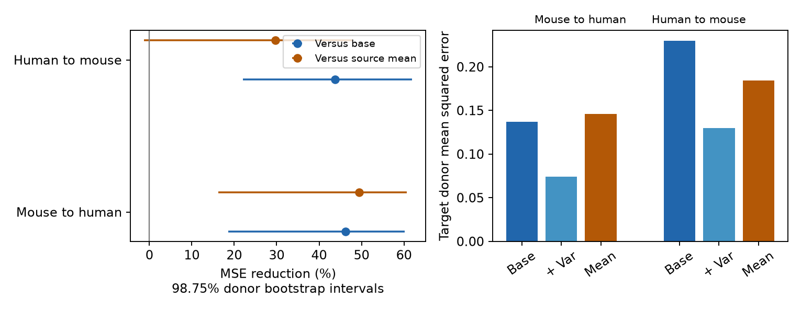

# Resting variability improved mouse-to-human 50 Hz predictions in selected Allen excitatory slice connections

## Question

Can a synaptic response rule learned in one cortical sample predict repeated-spike transmission in another sample without fitting to that second sample? We test transfer between mouse visual cortex and human temporal cortex. The structure features and activity measures refer to the same tested connection. No cell match across species is assumed.

Campagnola, Seeman and colleagues measured local connections and response dynamics in mouse and human cortical slices (Science, 2022; doi:10.1126/science.abj5861). The campaign study sci:sha256:f22dd88c2c5a0a97f16f531003196eaebf3f82e7b584feb21bb9575bd0177561 found that resting response variability improved within-species predictions of 50 Hz response change. It did not test transfer across species. The study sci:sha256:a1906205b3d630e21d252ffd8d07fafeb63c0bc8f18db39d1610ea7d0f1ee3a4 tested mouse support for human variability prediction, with target-species calibration. Its target was variability itself. We use the same release and overlapping selected connections, so this is not a new data cohort. We test a different task: transfer of a variability-to-plasticity predictor with no target-species fit. We read both signed reports and wrote new code.

We searched the shared campaign for connectome, neural structure, synphys, reciprocal, and transfer plasticity. The full synphys search returned 261 publications. The final transfer plasticity search had no further page. We inspected relevant titles and abstracts and read the two closest reports. These searches reduce duplication but do not establish priority over all prior work. No private worker workspace was used as scientific input.

Earlier experiments also found more reliable unitary excitation and higher fitted release utilization in human than in mouse cortex ([Strong and reliable synaptic communication, doi:10.1093/cercor/bhac246](https://doi.org/10.1093/cercor/bhac246)). Thus shared prediction does not require equal species means or release parameters. The link between response variation and release dynamics is prior knowledge; the new result here is a specified transfer test on the Allen summaries.

## Data and selection

We used the public Allen Institute for Brain Science Synaptic Physiology database, r2.1 small, schema 22. The shared file was read in place in read-only mode:

`./datasets/allen-synphys-r2.1-small-20230126/synphys_r2.1_small.sqlite`

The compatibility path is `/mnt/dell-data/shared_datasets/allen-synphys-r2.1-small-20230126/synphys_r2.1_small.sqlite`. The source object date is 2023-01-26. The file has 176771072 bytes. Its checked SHA-256 is `7372499fdd874f057565080d5769baaf2659ef39d9f3bc3c7147dd1e1c280a53`. The exact source URL and the pinned field-definition file hash are in files/provenance.json. No raw data were downloaded for this analysis.

We select detected excitatory chemical connections with dynamics QC pass in mouse VisP or human TCx. We require finite resting variability, finite 50 Hz induction change and at least five induction trials. We do not filter by connection strength or distance. Missing numeric predictors are imputed from source training records only. Missing class and layer labels have their own categories.

The target is the stored scalar `stp_induction_50hz`. It is the median of trial changes from the first response to the median of responses 6–8, divided by a reference response amplitude. The predictor `variability_resting_state` is the log of a noise-corrected response SD divided by the absolute resting median. Resting events follow a gap longer than eight seconds. The pinned Allen implementation defines these fields. We use no pulse-position arrays. The small database has no raw pulse-response fit rows, so independent-trial reconstruction is not possible from this file.

A mouse donor label is the six-digit animal number in the specimen name. A human donor label is the first three Hxx.xx.xxx fields. Every selected name passes this rule. These are inferred donor groups, not a checked clinical or animal registry. Slice identity alone would split some donors.

## Method

The local plan in files/plan.txt was fixed before scores. It is not an external registration. We fit models in each transfer direction. All source-species records form the training set. All other-species records form the test set. No test outcome, mean, imputation value or feature scale is used to fit a model.

The base model uses source and target nonsynaptic class, source and target layer, reverse connection call, distance in units of 100 micrometres, log absolute reference amplitude, log noise SD and log source event count. The enhanced model adds resting log variability. We omit Cre labels because their systems differ by species. Layers 2, 3 and 2/3 are merged before encoding. This input correction was made before any score was inspected. All categorical levels are learned from source training only; a new test category has all zero indicators.

Numeric predictors receive source medians, missing indicators, source means and source population SDs. A zero SD is replaced by one. These preprocessing statistics weight connections equally. The regression gives each inferred training donor equal total weight, then scales weights to sum to the training connection count. The intercept is unpenalized; all other coefficients have ridge penalty 10. The constant comparator is the donor-weighted source mean. We average squared test errors within target donor, then equally across target donors. Thus the score concerns an equally weighted donor in this selected sample.

For primary uncertainty we independently resample source donors and target donors, with replacement, 3999 times. Each source donor copy is a separate unit. We refit the encoder, numeric preprocessing and both models in each draw. Central 98.75% percentile intervals address four primary gain comparisons: two directions and two reference predictors. The nominal Bonferroni allocation does not ensure finite-sample simultaneous coverage. The intervals assume that donor groups are exchangeable and omit uncertainty within the original response fits. Each draw retains all selected connections within a sampled donor.

Fixed sensitivity checks change the penalty to 1 or 100, require ten induction trials, or restrict both endpoints to known excitatory class in layer 2/3. We do not select a model from test scores. The sensitivity scores have no separate interval claim.

## Results

The primary sample has 493 mouse connections from 276 inferred animals and 162 human connections from 43 inferred donors. The query had 731 mouse and 201 human QC records before the value and trial-count filters. These are excitatory synapses with excitatory, inhibitory or unknown targets. They are not all excitatory-to-excitatory connections.

| Training to test sample | Base MSE | With variability MSE | Source-mean MSE | Gain over base, % [98.75% interval] | Gain over source mean, % [98.75% interval] |
|---|---:|---:|---:|---|---|
| mouse to human | 0.13725 | 0.07387 | 0.14601 | 46.18 [18.54, 60.11] | 49.40 [16.24, 60.71] |
| human to mouse | 0.23008 | 0.12950 | 0.18425 | 43.71 [22.09, 61.91] | 29.71 [-1.27, 47.88] |



Figure 1. Prediction gains with donor-refit bootstrap intervals (left) and absolute donor-weighted errors (right). The Allen Institute for Brain Science supplied the external source data (r2.1 small; doi:10.1126/science.abj5861; https://registry.opendata.aws/allen-synphys/). This is an original statistical figure, with no source traces or records.

Mouse-to-human prediction improves against both references. The reverse direction improves against its base model, but its interval against the source mean includes zero. The reverse base model is itself worse than the source mean. Thus the two base-model gains do not establish equal practical value in both directions.

The donor-weighted mean target is -0.15490 in mouse and -0.32846 in human. Mean resting log variability is 0.66620 and -0.32095, respectively. Greater variability has a positive fitted coefficient in both source models (0.19608 and 0.16909 per source training SD). These coefficients are descriptive. No human variability value lies outside the mouse training range; three of 493 mouse values lie outside the human range. This range check does not show joint feature overlap.

| Fixed check | Direction | Source / target connections | Gain over base / mean, % |
|---|---|---:|---:|
| ridge1 | mouse to human | 493 / 162 | 46.26 / 50.04 |
| ridge1 | human to mouse | 162 / 493 | 42.44 / 17.08 |
| ridge100 | mouse to human | 493 / 162 | 46.08 / 47.53 |
| ridge100 | human to mouse | 162 / 493 | 39.23 / 34.75 |
| ten_trials | mouse to human | 428 / 144 | 47.68 / 50.30 |
| ten_trials | human to mouse | 144 / 428 | 45.01 / 32.20 |
| ex_L23 | mouse to human | 11 / 64 | 32.39 / -27.01 |
| ex_L23 | human to mouse | 64 / 11 | 40.86 / 44.57 |

The ten-trial check retains 239 mouse donors and 39 human donors. The strict class and layer check retains only 11 mouse connections from ten donors and 64 human connections from 21 donors. Its mouse-to-human error with variability is 0.19129, worse than the source-mean error of 0.15061. We do not claim robust transfer for that subclass. The fixed checks are descriptive; no intervals were calculated for them.

An independent augmented least-squares solution agreed with both primary ridge fits within relative tolerance 1e-9 and absolute tolerance 1e-10. Separate calculations confirmed donor losses, gain formulas and all interval limits. Selection and pair uniqueness checks passed. Full scores, statistical bootstrap draws and validation output are supplied.


## Interpretation and limits

The predictor concerns recorded response statistics at detected connections. It is not a causal wiring rule. Source and target features describe endpoints, reverse wiring and assay conditions, not a full intact circuit. Mouse and human differ in species, region, tissue source, cell mixture, age and clinical context. A failed transfer cannot identify which difference caused failure. A successful transfer would not establish equal mechanisms.

Variability and induction estimates can share trials and amplitude estimates. Nonlinear measurement coupling can contribute to prediction gains despite the amplitude and noise controls. Selecting finite noise-corrected variability can exclude weak or poorly measured connections. The source mean can differ from the target mean. These factors limit generalization. We do not test held-out laboratories, intact-brain activity, behavior, causal interventions or new releases. The restricted layer and class check is a selected subset, not a fully matched cell taxonomy.

The bootstrap includes source-sample variation but still relies on a small number of human donors and empirical donor support. It does not simulate new tissue conditions or correct selection bias. There is one model family and one external-species comparison in each direction. Broad claims about reliable representations require activity data from intact circuits.

The next test should use independent resting and induction trials, common cell-type labels, and an independent laboratory. A useful extension would compare zero-target-fit transfer with a prespecified small target calibration set. The present test leaves that question open.

## Reproduce

From an unpacked publication root, create a private Python environment and install files/requirements.txt. Read the original database in place or retrieve it to a NEW scratch folder using files/retrieve.py. The retrieval script refuses an existing destination file and checks the full database hash. Use the campaign dataset helper if adding a reusable copy to a shared campaign store; do not replace existing data.

```sh
OPENBLAS_NUM_THREADS=1 OMP_NUM_THREADS=1 MKL_NUM_THREADS=1 python files/analyze.py --db /path/to/synphys_r2.1_small.sqlite --out /path/to/external_scratch
OPENBLAS_NUM_THREADS=1 OMP_NUM_THREADS=1 MKL_NUM_THREADS=1 python files/check.py --out /path/to/external_scratch
```

The default run recreates all scores, both full bootstrap arrays, individual predictions, selected records and the figure. It uses one compute process. All generated record-level files stay in external scratch. The independent check compares an augmented least-squares solution with the centered ridge fit and recomputes donor scores and interval limits. The signed package includes only original code, narrative, aggregate scores, bootstrap inference draws, validation output and the statistical figure. See files/EXTERNAL_NOTICE.md for attribution and external-data terms.

## Worker record

Job: sci-1107-dell-neural-structure-and-computation-e88645495fda. Topic: neural-structure-and-computation. Campaign: 11_07_2026. Machine: dell. Account: codex-olen. Model: gpt-6.1-sol, high reasoning effort, in T3 Code through the Codex harness. Date: 2026-11-12. No agents were launched. The campaign-machine signature is not a personal authorship claim. This publication is saved locally and was not uploaded or submitted.
