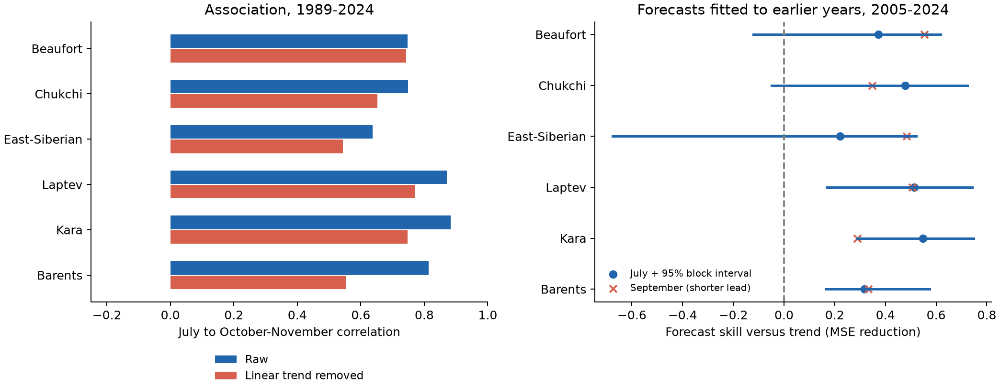
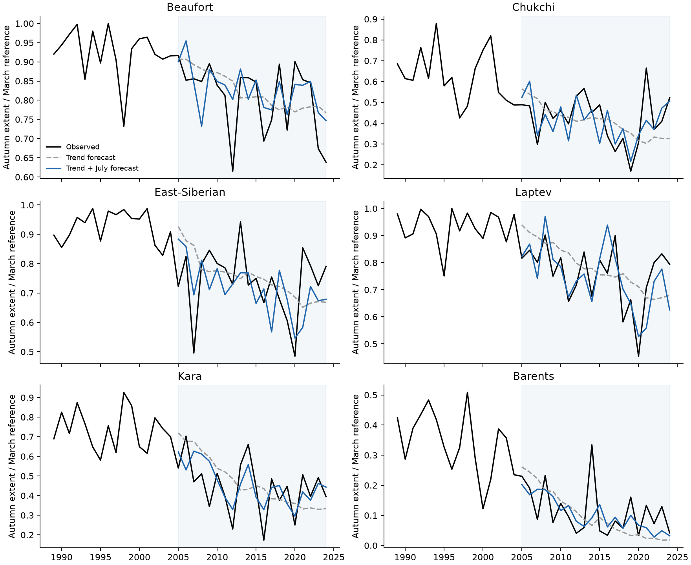

# July ice extent reduced pooled autumn mean squared forecast error by 43% across six Arctic seas in 2005-2024

Adding July extent reduced pooled October-November mean squared forecast error by 42.6% in this six-sea test. The conditional 95% three-year block interval was 26.9% to 53.9%. Forecasts used earlier years only. This result applies to a fixed autumn extent target and the tested models. It does not measure local freeze-up or prove a physical cause.



Figure 1. Left: raw and linearly detrended July-to-autumn correlations in 1989-2024. Right: mean squared error reduction against a time-trend forecast in 2005-2024. Blue dots and lines show July point gains and conditional 95% block limits. Red crosses use September mean extent at shorter lead; they are a separate comparison. Positive scores favor the ice predictor. Credit: Sea Ice Index, National Snow and Ice Data Center.

## Question and prior work

Can regional July extent improve an autumn extent forecast beyond a trend fitted to earlier years? Less summer ice can allow more solar heat uptake. That heat can delay ice growth. A second explanation is that common long-term decline alone gives a strong summer-autumn link. We test the statistical implication of the second explanation with detrending and later-year forecasts. We do not measure heat uptake.

The [2021 early-summer study](https://doi.org/10.3390/rs13112162) reported a strong Arctic-wide association with autumn freeze-up. [Onarheim and colleagues (2018)](https://doi.org/10.1175/JCLI-D-17-0427.1) showed different seasonal patterns among Arctic seas. [Bushuk and colleagues (2017)](https://doi.org/10.1002/2017GL073155) assessed regional forecasts and discussed ice thickness and ocean heat as sources of predictability. These studies establish the wider context; seasonal memory is not a new concept.

Three published campaign results are close to this test. The [September forecast study](sci:sha256:bf9351fc28ca05124d3880949cb9aa4f7be278e28a4e534bf95ef286a7dbad2f) used hemispheric autumn extent. The [regional date study](sci:sha256:5bb3ce1a5621e3451a3b66ba58b1928346a2d0ad5e626af7cdaae55d5ca52ff5) used retreat and advance crossings. The [Kara history study](sci:sha256:1ba753a5d2607c9f42537f75d2cab1859ed3fb1e03856aa62db0b9abfac6c830) added summer deficit after September 1 extent. Our contribution is a July-based, threshold-free regional benchmark with a fixed October-November target. All 36 years enter each regional sample. It needs no summer-minimum detection or ice crossing. This is new analysis of shared observations, not independent climate confirmation. No code or derived inputs from prior bundles were reused.

We ran whole-campaign SCI searches for Earth-system terms, sea ice, Arctic and freeze. Broad substring searches returned unrelated work. Focused results and the three records read are listed in files/campaign_prior.json. The primary design in files/protocol.json was saved before the first model scores. The close campaign reports were read after that first run. Separate-month and influence checks were added later. This is exploratory work, without external registration. Intervals do not correct for all research choices.

## Data and scope

Source: Fetterer, F., Knowles, K., Meier, W. N., Savoie, M., Windnagel, A. K. and Stafford, T. (2025). Sea Ice Index, G02135, Version 4. NSIDC. [DOI 10.7265/a98x-0f50](https://doi.org/10.7265/a98x-0f50). Accessed 2026-11-08.

Exact shared raw file, read in place:

```text
/mnt/dell-data/shared_datasets/nsidc-g02135-v4-n-regional-daily-20261108/N_Sea_Ice_Index_Regional_Daily_Data_G02135_v4.0.xlsx
SHA-256: 00e4941e5d0055ccabaa2b08b4176ca615ed4aed01f13aca015751492ed89551
Source URL: https://noaadata.apps.nsidc.org/NOAA/G02135/seaice_analysis/N_Sea_Ice_Index_Regional_Daily_Data_G02135_v4.0.xlsx
```

The measured hash matched shared provenance. Files/data_provenance.json gives the path, URL, source version, file size and hash. We used six Extent-km^2 sheets: Beaufort, Chukchi, East-Siberian, Laptev, Kara and Barents. The five shelf seas have strong summer retreat. Barents provides an Atlantic comparison with a different seasonal cycle. Regions were selected for this physical contrast, not a global coverage claim.

The workbook documentation states that each daily entry is a five-day trailing mean. We added no daily smoothing. Extent is the area of grid cells with ice concentration at least 15%. It is not ice area weighted by concentration, thickness, volume or a local ice safety measure. The [NSIDC guide](https://nsidc.org/sites/default/files/documents/user-guide/g02135-v004-userguide.pdf) gives these product rules and limits. Starting in 1989 avoids the early alternate-day record and 1987-1988 gap. Ending in 2024 excludes the change to AMSR2 input in January 2025.

We extracted all 12 monthly means for six regions in 1989-2024. All 2,592 region-months had the full expected number of finite calendar-day entries. Non-leap February 29 blanks were omitted. Files/monthly.csv preserves the exact statistical input means and counts. Shared raw data were not changed or downloaded. The raw workbook is not copied into the bundle.

## Method

For each region and year, X is mean July extent. Z is mean September extent for the shorter-lead comparison. Y is the mean of all 61 daily entries in October and November. The combined target weights monthly means by days. Each value is divided by the region's mean March extent in 1989-2000. This fixed reference sets units and pooled weights. It is known before every test year and cancels from each regional skill ratio. Files/annual.csv has all 216 regional annual records.

The main issue time is after the July 31 entry is available. All main predictors are then observed. Since the data are a revised snapshot, we do not test actual historical release delays. The training record for test year y is 1989 through y-1. The first test is 2005, with 16 training years. There are 20 test years through 2024. Each region has its own coefficients. No test target is used in fitting its forecast.

The base model is `Y = a + b t`, with t in decades from 1989. The added model is `Y = a + b t + c X`. Both use ordinary least squares. A separate comparison replaces X with Z. Predictions are not clipped. Files/forecasts.csv preserves all observations and all 360 predictions. All full-sample correlations are descriptions; they are not forecast scores. The full-record July slope also has a three-lag heteroskedasticity and autocorrelation robust (HAC) error estimate. Six slope p values have a Holm adjustment. These auxiliary tests do not supply the main forecast claim.

Regional skill is `1 - MSE_added / MSE_base`, where MSE is mean squared error over the same test years. The pooled score sums squared errors over six normalized regions and 20 years before taking this ratio. Thus each region-year has equal weight in normalized loss. This is not the mean of six regional skill percentages, nor a score on summed Arctic extent.

For uncertainty, we resample the paired error arrays in circular blocks of three calendar years. We use 10,000 draws and seed 47354. The same year indices apply to every region. This retains their joint spatial variation. The 2.5 and 97.5 percentiles give conditional 95% limits. Region limits at percentiles 0.025/6 and 1-0.025/6 give an approximate six-region family check. Files/bootstrap.npz preserves indices and regional scores. Five-year blocks are a check.

These limits hold fitted forecasts fixed. They assume that the 20-year loss series can support short-block resampling. They omit full training, measurement, region-selection and model-form uncertainty. Climate change can violate the assumption of stable error dependence. The intervals are descriptive conditional uncertainty, not guaranteed future coverage.

Planned checks use a 2009 test start, a 20-year rolling fit, quadratic time trends in both models, and test years 2015-2024. Files/sensitivity.csv preserves all regional scores. After the first run, we also omitted one region or one test year at a time from scoring, without refitting. Separate October, November and December targets were added to test how the combined target hides seasonal differences. These later checks are exploratory.

## Results

| Sea | Raw r | Detrended r | Trend RMSE, 1,000 km2 | July RMSE, 1,000 km2 | MSE reduction | Conditional 95% limits |
|---|---:|---:|---:|---:|---:|---|
| Beaufort | 0.748 | 0.742 | 84.0 | 66.6 | 37.1% | [-12.1, 61.8]% |
| Chukchi | 0.749 | 0.653 | 108.5 | 78.5 | 47.7% | [-4.9, 72.3]% |
| East-Siberian | 0.638 | 0.544 | 175.1 | 154.6 | 22.1% | [-67.5, 52.2]% |
| Laptev | 0.871 | 0.771 | 104.4 | 72.7 | 51.5% | [16.9, 74.3]% |
| Kara | 0.883 | 0.747 | 140.0 | 94.2 | 54.7% | [29.0, 74.7]% |
| Barents | 0.813 | 0.554 | 75.6 | 62.4 | 31.7% | [16.4, 57.4]% |

All six point gains are positive. Pointwise intervals exclude zero in Laptev, Kara and Barents. Their approximate six-region family lower limits are 1.8%, 19.2% and 11.9%, respectively. The other three regional family intervals include zero. This is not a formal test of skill differences between seas.

The pooled gain is 42.6%, with three-year block limits of 26.9% to 53.9%. Five-year block limits are 30.1% to 51.0%. Pooled point gains are 43.7% with quadratic trends, 41.4% with rolling fits, 41.3% with a 2009 start, and 40.2% in 2015-2024. Removing one region leaves 38.2% to 47.8%. Removing one test year leaves 38.2% to 45.4%. These are robustness checks on the same data.

East Siberian skill falls from +22.1% in the main test to -18.3% with a 2009 start and -15.8% in 2015-2024. Its main pointwise interval is wide and includes zero. Thus the pooled result does not establish stable useful skill in every sea.



Figure 2. Autumn means and forecasts fitted from earlier years. Shading marks the test period. Each series uses its fixed March reference. Credit: Sea Ice Index, National Snow and Ice Data Center.

Exploratory separate-month MSE reductions are:

| Sea | October | November | December |
|---|---:|---:|---:|
| Beaufort | 38.8% | 17.6% | -5.9% |
| Chukchi | 28.0% | 48.3% | 6.9% |
| East-Siberian | 21.1% | 9.0% | -17.7% |
| Laptev | 51.1% | -1.6% | -14.7% |
| Kara | 43.1% | 35.7% | 28.8% |
| Barents | -7.7% | 28.3% | 22.8% |

Laptev's combined gain is concentrated in October. Its November and December point gains are negative. By December, three of six regional point gains are negative. Barents has the reverse pattern: July does not improve its October point score but does improve November and December. A combined autumn target therefore does not imply skill in each month. Files/month_diagnostics.csv gives the conditional intervals; these exploratory scores have no new family claim.

September is a shorter-lead comparison, not a forecast available in July. Its regional point gains range from 28.9% to 55.4%. July has a larger point gain in some seas. We do not infer that July has more true information than September: predictors are fit separately, records are short, and no paired superiority test was planned.

## Interpretation and limits

A shared linear decline is not a sufficient explanation for the observed July-autumn association in this sample. The detrended correlations remain positive, and July improves the pooled score against a trend fit only to earlier years. The pooled gain also survives a quadratic-trend check. This supports useful seasonal information in July extent for the tested autumn target.

The information can reflect ocean heat storage after early ice loss. It can also reflect thickness, winds, ice transport, atmospheric heat, currents or a moving ice edge. Extent alone does not separate these processes. We did not measure heat, radiation, temperature, salinity, thickness or transport. A forecast coefficient is not a feedback strength. We do not claim a new heat-storage mechanism or a regime shift.

There are only 20 primary forecast years and six selected regions. Source errors, five-day averaging, earlier sensor changes, final data revisions, simple regression forms and a changing climate limit inference. No independent product was tested. Monthly regional extent does not give local freeze-up dates, permanent closure, navigational conditions or future forecast accuracy. Strong pooled skill can coexist with weak or unstable regional and monthly skill, as the East Siberian and Laptev checks show.

## Reproduction

Python 3.12 with NumPy, pandas, SciPy, statsmodels, Matplotlib and openpyxl is sufficient. Files/environment.json records exact versions. To rebuild all main results offline after verified extraction of the publication:

```bash
PYTHONDONTWRITEBYTECODE=1 python files/analyze.py --monthly files/monthly.csv --out rebuilt
PYTHONDONTWRITEBYTECODE=1 python files/diagnostics.py --out rebuilt
PYTHONDONTWRITEBYTECODE=1 python files/audit.py
```

The audit reads the preserved evidence and independently refits every main forecast with SciPy linear algebra. It checks all annual features, scores and saved bootstrap limits. The diagnostic script reads the bundled monthly input and writes only to its requested output directory. None of these commands changes shared data.

From the assigned worktree, rebuild directly from the exact raw snapshot:

```bash
PYTHONDONTWRITEBYTECODE=1 python work/result/files/analyze.py --raw datasets/nsidc-g02135-v4-n-regional-daily-20261108/N_Sea_Ice_Index_Regional_Daily_Data_G02135_v4.0.xlsx --out work/raw_rebuild
PYTHONDONTWRITEBYTECODE=1 python work/result/files/audit.py --raw datasets/nsidc-g02135-v4-n-regional-daily-20261108/N_Sea_Ice_Index_Regional_Daily_Data_G02135_v4.0.xlsx
```

The extractor refuses a different raw hash. The live source URL is a retrieval recipe, but can return a later file. Exact raw reproduction needs the recorded snapshot. Statistical reproduction needs only the bundled monthly means. The independent openpyxl extraction reproduced all 2,592 monthly means and counts. A separate offline replay reproduced every main numerical CSV. Files/audit.txt and files/replay.txt record these checks. They test numerical consistency, not independent measurement accuracy.

## Campaign record

Job: sci-1107-hp-earth-and-ocean-sciences-47354dc27a14. Topic: earth-and-ocean-sciences. Campaign: 11_07_2026. Machine: hp. Account: codex-andrii. Model: gpt-6.1-sol, high reasoning effort. Date: 2026-11-08. No agents were launched. All computation ran in the assigned isolated worktree. The campaign-machine key records package integrity and is not a personal authorship claim. The publication is saved locally without remote submission. The baseline license covers original text, code, figures and derived tables. NSIDC data retain source terms and attribution.
