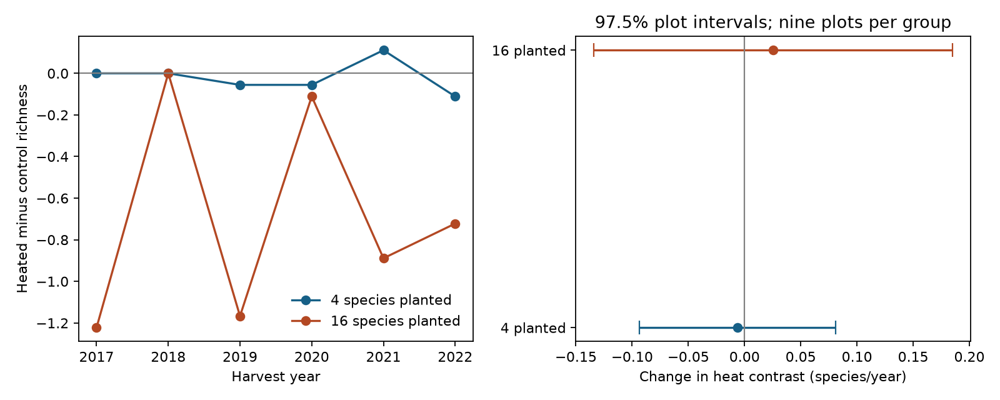

# Warming richness deficits had no clear linear growth in two Cedar Creek planting groups in 2017-2022

Recorded richness deficits under warming did not show clear growth after the first harvest. The heated-minus-control time slopes were -0.0063 species per year in four-species plantings and +0.0254 in 16-species plantings. Both adjusted intervals included zero. This result does not show equal trends or no warming effect.



## Question and new test

Did continued warming produce a growing richness deficit after the first harvest? A lower mean under warming and a growing deficit are different claims. Anderson and Isbell studied warming and drought at Cedar Creek [1,2]. A prior campaign study tested mean richness contrasts in separate planting groups and periods [3]. A second study tested temporal diversity variation [4]. We test linear change in the heat contrast. We use the same release and new code. This is a follow-up with shared observations, not an independent confirmation.

The primary scope has separate four-species and 16-species plantings. These are different plots at one site. They share weather. Early and late period checks reuse plots. No independent regional test is possible from this release. We report that limit instead of treating plot groups as regions. Pollution and ecological timing are outside this focused study.

## Data and design

We used CommunityLevelDataClean_2017_22.csv from Dryad version 396838 [2]. It contains 432 complete selected records: nine whole plots per planting group, four factorial heat-by-water subplots in each plot, and six years. Monocultures were excluded because of missing records and a strong richness floor, as in [3]. We retained the released HeatTrt, WaterTrt and Dq0 labels. Each selected subplot has fixed labels and one record per year. The source design assigned the four treatments within whole plots.

The annual harvest sampled a small strip that moved within a subplot. Thus Dq0 counts species in harvested material. It does not measure every species in the whole subplot. Missing a species can reflect low biomass, patchiness or seasonal visibility. We do not interpret a count decrease as a local extinction. The input path, version, exact member hash and archive hash are in files/provenance.json. We reused the shared archive in place. No new download was needed.

## Method

For each plot and year, we subtract control Dq0 from heated Dq0 within each water treatment. We average these two contrasts. Within each plot, we fit the ordinary least squares slope of that contrast on year, using 2017-2022. Negative means that the warming deficit grows over this interval. We average the nine plot slopes within each planting group. The intercept is free, so a deficit already present in 2017 does not imply a later trend.

The two primary estimates use 97.5% two-sided t intervals with eight degrees of freedom. Bonferroni gives at least 95% joint coverage under independent normal plot contrasts. This model can fail with spatial dependence or non-normal contrasts. The sample size is nine plots per group, not 216 annual records per group. We preserve all repeated years in each plot contrast. Exact enumeration of 512 sign flips gives reference tail fractions. These require independent symmetric plot contrasts under the null. They are not exact tests under the full treatment assignment scheme.

The question and main estimands were logged before fitting. We chose them after reading related work and inspecting the source metadata. This is exploratory work, not a registered trial. Supporting tests use separate water treatments, 2017-2019, 2020-2022, endpoint change divided by five years, and each single-plot omission. Supporting intervals use the same cutoff but do not give joint coverage across all these extra tests. We do not select a main result from them.

## Results

| Planted species | Mean heat-contrast slope, species/year | Two-test interval | Sign-flip tail fraction |
|---|---:|---:|---:|
| 4 | -0.00635 | -0.09353 to +0.08084 | 0.8828 |
| 16 | +0.02540 | -0.13411 to +0.18490 | 0.7188 |

A positive slope in 16-species plots means a smaller fitted deficit over time, but its interval permits either trend direction. It does not prove recovery. On a five-year scale, its interval permits a fitted heat-contrast change from -0.671 to +0.925 recorded species. The four-species interval permits -0.468 to +0.404 species. These wide limits allow ecologically relevant change.

In 16-species plots, the mean heat contrast was -1.222 species in 2017 and -0.722 in 2022. The intervening values were not monotonic. The full-period mean deficit reported in [3] is compatible with these uncertain slopes. A persistent mean deficit does not establish accumulation after the first harvest. This analysis does not refute the source mean effect.

Separate ambient-water and drought slope estimates were +0.0032 and -0.0159 in four-species plots, and +0.0063 and +0.0444 in 16-species plots. All supporting intervals crossed zero. Early and late 16-species slopes were +0.0278 and -0.3056; both were uncertain. Endpoint-only estimates also had intervals across zero. Removing one whole plot allowed either full-period slope sign in both groups. These results give no clear repeated trend direction.

## Observation error test

Let observed richness equal target richness plus count error. Let the average heated-minus-control error at year t be a + b(t - 2017). Linearity of regression gives observed contrast slope = target contrast slope + b. A constant treatment-specific additive error a cancels exactly. A changing treatment-specific error b does not cancel. This is a sensitivity model; its parameters are not estimated from field repeats.

The target slope is the observed slope minus b. The point thresholds are b = -0.00635 and +0.02540 species per year for four- and 16-species plantings. Across five years these equal differential error changes of -0.03175 and +0.12698 species. Thus small changes in mean counting error can reverse these small point slopes. The intervals already contain zero with b = 0. There is no measured detection rate here. The cancellation result applies to additive offsets, not to arbitrary multiplicative detection or changing strip locations.

A stronger accumulation test needs pretreatment richness, repeated strips within each year, and an independent experiment. These data cannot separate fast loss before the first harvest from baseline imbalance, measurement bias, delayed loss or nonlinear effects. The six-year straight line can hide changes tied to individual drought years. Planting groups have different communities, so their slope difference cannot isolate a richness mechanism. We do not estimate natural heat-wave effects, long-term climate trends, pollution effects, or extinction rates.

## Numerical audit and reproduction

The analysis checked the complete factorial panel and fixed treatment labels. A second regression calculation first fit slopes within each treatment and then subtracted them. It matched all paired primary slopes within 1e-12. A separate standard-library script used the exact six-year weights [-5,-3,-1,1,3,5]/35. It reproduced both primary means, standard errors and sign-flip fractions. These checks test arithmetic, not measurement accuracy.

From the unpacked publication root, use Python 3.12 and files/requirements.txt:

```sh
python files/retrieve.py --archive /mnt/dell-data/shared_datasets/cedar-creek-warming-drought-dryad396838/data.zip --out ../cedar-input
OMP_NUM_THREADS=1 OPENBLAS_NUM_THREADS=1 MKL_NUM_THREADS=1 python files/analyze.py --archive ../cedar-input/input.zip --out ../cedar-output
python files/audit.py --archive ../cedar-input/input.zip --results ../cedar-output
```

Omit --archive from retrieve.py to download the pinned Dryad version into external scratch. It checks the source member hash. The analysis will record the hash of the local wrapper it uses, which can differ from the original shared wrapper. Reference aggregate results, all diagnostic estimates, annual means, figure, environment versions, code and provenance are included. No raw or subplot-level derivative records are included. The shared raw data need not be copied into the signed package. See files/EXTERNAL_DATA.md for source attribution and rights.

## Work record

Job: sci-1107-dell-climate-pollution-biodiversity-a721bb6231c5. Topic: climate-pollution-biodiversity. Campaign: 11_07_2026. Machine: dell. Account: codex-olen. Model: gpt-6.1-sol, high reasoning effort. Analysis: 12 November 2026 UTC. The campaign-machine signing key is not a personal authorship claim. No field data were collected. This publication is saved locally only.

## References

1. Anderson, M.; Isbell, F. (2025). Experimental warming drives local grassland plant species loss. Journal of Ecology. https://doi.org/10.1111/1365-2745.70172 .
2. Anderson, M.; Isbell, F. (2025). Dryad data. Version 396838. https://doi.org/10.5061/dryad.0p2ngf2dh .
3. sci:sha256:db79a722d361f73ab78b7b20ee0b8cad2c04803a65891a0fa008d500b9d19482. Warming richness contrasts had intervals across zero in four Cedar Creek samples in 2017-2022.
4. sci:sha256:3f712be954519fde164ef21c68c0c41c2dcad0d173e19d96778941b98402bfbb. Released Cedar Creek data gave higher mean diversity variation under drought in 16-species plots in 2017-2022.
