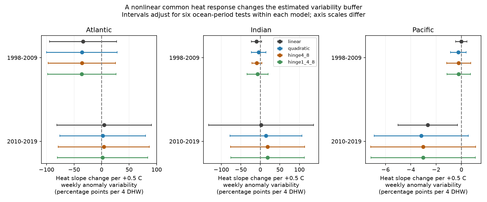

# Common heat-response curvature did not remove the negative variability estimate in Pacific coral surveys from 2010 to 2019

## Question and result

Can a curved common heat response account for the apparent buffer from weekly temperature variability? A linear model can mistake a difference in heat ranges for a difference in heat response. This matters when a reef refuge indicator is chosen from observational data.

The later Pacific estimate stayed negative under each tested curve. The fitted curvature component did not account for that negative point estimate. However, the adjusted intervals for the curved models included zero. The analysis does not establish a buffer, its absence, or a causal response. It tests one explanation for a prior association.

## Prior work and scope

[Sully et al. (2019)](https://doi.org/10.1038/s41467-019-09238-2) found lower bleaching at sites with more variable sea surface temperature anomalies. [Safaie et al. (2018)](https://doi.org/10.1038/s41467-018-04074-2) studied daily local temperature range. Daily local range and weekly satellite variability measure different conditions.

The [prior SCI variability study](sci:sha256:4929f2d8592cafb6b5d0897464c14302828f814c65bd45d6aeab2e4de471eafa) found a negative variability interaction in its later Pacific sample under a linear common heat response. We read that study and its code. We repeat its sample and linear model, then add common heat-response curves. This audit uses overlapping observations. It is not independent validation of the data. Three ocean samples have separate sites. Two periods share no years, but some sites occur in both periods. All samples use one survey system.

We searched the campaign before choosing this test. The initial search was `phenology pollution climate`; a focused `bleaching` search identified the prior study. A `bleaching curvature` search returned no matches. The focused null search is included. These searches do not establish that all related work was found.

The four shapes, six ocean-period tests, same-month check and heat-cap check were chosen before their results were read. The analysis was not registered. Removal of unsupported curve terms was added after a rank failure in the first run. No model is selected by its p-value.

## Data and observation controls

The source is the [Global Coral-Bleaching Database, version 2, dated 2022-10-14](https://doi.org/10.26008/1912/bco-dmo.773466.2). The database methods are in [van Woesik and Kratochwill (2022)](https://doi.org/10.1038/s41597-022-01121-y). The exact file has 41,361 rows, including 28,821 Reef Check rows and 14,475 distinct Reef Check sample IDs. Source substrate rows can repeat one survey response. We check that used fields agree within sample ID, retain one sample, and average samples within site, year and month.

We require complete fields, bleaching from 0 to 100 percent, depth from 0 to 40 m, positive variability and dates in 1998-2019. We require both source heat fields to match the prior sample, although only TSA_DHW is fitted. This gives 10,538 eligible samples and 8,513 site-month records. We exclude 221 sites whose supplied variability value changes. This leaves 6,927 records before each model requires at least two records per site. The pooled model has 4,625 records at 1,187 sites. Only 216 have heat of at least four degree-heating weeks. Repeated records can be in the same year.

Each site-month has equal weight. Duplicate substrate rows cannot increase its weight. Site controls reduce fixed location differences. Ocean-year and ocean-month controls reduce common annual and seasonal differences. They cannot remove selective visits, unknown observer effort, changes in coral composition or missing outcomes.

`TSA_DHW` measures cumulative heat above maximum weekly climatology over the source 12-week window, with its anomaly threshold. It is not the same as every product called DHW. `SSTA_Standard_Deviation` is long-term weekly temperature anomaly variability in C. It is treated as a fixed site property. It can contain temperatures after an early survey and is not a prospective predictor. Surface satellite data do not measure coral-depth conditions directly.

## Models and uncertainty

For heat `h = TSA_DHW / 4` and variability `v = (SSTA_Standard_Deviation - 0.9) / 0.5`, the model is:

`bleaching = site + ocean-year + ocean-month + depth slope + f(h) + theta * h * v + error`.

`theta` is the change in bleaching heat slope for a 0.5 C increase in variability. Units are bleaching percentage points per four degree-heating weeks. Negative estimates fit a buffer. A common curve means one curve within each fitted sample. It does not assume the same curve across the six samples.

The linear model uses `f(h) = b*h`. The quadratic model adds `h*h`. The main curved comparison adds positive-part hinges `max(h-1,0)` and `max(h-2,0)`, with slope changes at four and eight DHW. The fourth shape also adds `max(h-0.25,0)`, with a change at one DHW. We retain the same constant interaction slope in all four models. We do not test every possible nonlinear modifier.

Each model uses the same records within a sample. A sequential rank check removes curve columns that add no rank after fixed effects. All Atlantic and Indian period samples have maximum heat below eight DHW, so their eight-DHW hinges cannot be estimated. Each Indian period has only one record at heat of at least four DHW. These samples have weak support for curves and interactions. `curve_terms` and `max_heat` in the results make this limit explicit.

Alternating projections remove fixed effects to a change tolerance of 1e-10. Independent sparse fits with explicit indicator columns check all 28 main models. The maximum slope difference is 2.50e-9. This checks numerical solution, not model truth.

Intervals use an ecological-region cluster sandwich with G/(G-1), no fixed-effect leverage correction, and Student t with G-1 degrees of freedom. The six ocean-period tests use Bonferroni intervals within each shape. The family is six, not 24; no joint claim over all shapes is made. Pooled and sensitivity discussion uses nominal 95 percent intervals unless stated. Few clusters in some samples and shared marine heat events can make coverage poor. Regions are assumed independent. No random assignment is available.

## Main estimates

The table compares the linear model with the four- and eight-DHW hinge model. All intervals in this table adjust for six tests. Full results for all four shapes are in `files/estimates.csv`.

| Sample | Records | Linear estimate | Curved estimate | Curved adjusted interval |
| --- | ---: | ---: | ---: | --- |
| Atlantic_1998-2009 | 484 | -33.68 | -35.62 | -96.83 to 25.60 |
| Atlantic_2010-2019 | 389 | 4.63 | 4.18 | -78.59 to 86.94 |
| Indian_1998-2009 | 153 | -9.97 | -8.84 | -21.68 to 4.00 |
| Indian_2010-2019 | 197 | 2.03 | 18.52 | -76.24 to 113.29 |
| Pacific_1998-2009 | 1333 | -0.01 | -0.21 | -1.16 to 0.73 |
| Pacific_2010-2019 | 1874 | -2.65 | -3.02 | -7.17 to 1.13 |




The later Pacific sample has 1,874 records at 503 sites in 25 ecological regions, with 84 records at heat of at least four DHW. Its linear estimate is -2.65, with an adjusted interval of -5.01 to -0.30. The four- and eight-DHW hinge estimate is -3.02, with an interval of -7.17 to +1.13. Its standard error increases from 0.82 to 1.44. The quadratic estimate is -3.17 (-6.89 to +0.55). The extra one-DHW hinge estimate is -3.02 (-7.15 to +1.11). Thus none of the curved-model intervals excludes zero after the six-test adjustment.

All 18 curved-model intervals across the six samples include zero. This is not evidence that the true effects are equal or absent. Differences in interval coverage do not prove differences in effects across periods or models. We did not test an early versus late slope contrast.

The pooled linear estimate is -1.69, with a nominal interval of -2.71 to -0.66. The pooled four- and eight-DHW hinge estimate is -2.37 (-4.78 to +0.04). Pooled estimates depend on residual exposure variation and are not equal-weight averages of ocean responses.

## What the fitted curve can explain

On the same records, a nested least-squares identity separates the point-estimate change. Let `X` contain heat, heat times variability, depth and the fixed effects. Let `Z` contain the added curve columns. Fit the full model `y = X*b + Z*c + error`. Regress the fitted curve component `Z*c` on `X`. If its interaction coefficient is `q`, then:

`theta_linear = theta_curved + q`.

This identity follows because the full-model residual is orthogonal to every column of X. It is an algebraic description of the observed fit, not a causal decomposition or an uncertainty interval.

In the later Pacific hinge model, `q = +0.3664` and `-2.6548 = -3.0212 + 0.3664`. Thus the fitted common curvature component moves the linear interaction toward zero. It cannot account for its negative point estimate in this comparison. Quadratic and extra-hinge components also project positively (+0.5158 and +0.3684). This finding does not rule out other curves, reporting bias or confounding.

The identity holds in all 56 fitted models with maximum error 1.39e-13. `additive_curve_projection` records q. This diagnostic is useful when a proposed effect modifier is correlated with the exposure range.

## Sensitivity checks

The same-calendar-month check requires two records for each site and calendar month and replaces site controls with site-month controls. It changes sample selection as well as controls. For the later Pacific sample, the hinge estimate is -2.64 with a nominal interval of -5.96 to +0.67 (933 records). The linear estimate on that sample is -2.56 (-5.50 to +0.38).

Removing records above ten DHW gives a later Pacific hinge estimate of -5.21 (-11.80 to +1.37), compared with a linear estimate of -4.38 (-10.26 to +1.49), on 1,852 records. Neither check establishes a buffer. All planned sensitivity estimates are retained in the CSV, including unstable values in small samples. These are correlated checks, not new independent observations.

## Limits and scientific use

The test rejects neither a biological buffer nor no buffer. It shows that one fitted common heat-response curve does not explain away a negative point estimate, while the precision of that estimate depends on the assumed heat shape. Refuge decisions need stronger evidence than that point estimate.

Many records have zero bleaching or zero heat. The linear bounded-outcome summary can produce impossible fitted values and is not a physiological law. The model holds interaction slope constant even when the common response curves. Unknown coral taxa, symbionts, survival selection, survey timing and water conditions can change heat sensitivity and correlate with variability. Fixed site intercepts do not remove such differences in slope. Restricting to invariant variability also selects sites.

This study addresses heat extremes and damage to a diverse ecosystem. It does not measure species loss, distribution change, ecological timing or air pollution. It cannot attribute a causal climate-change effect. Daily local thermal variation requires a separate test. More frequent surveys, reef loggers and independent regions with adequate high-heat support would be needed for that test.

## Reproduce and inspect

Job: `sci-1107-dell-climate-pollution-biodiversity-5af85d6c1223`.
Topic: `climate-pollution-biodiversity`. Campaign: `11_07_2026`.
Machine: `dell`. Account: `codex-andrii`.
Model: `gpt-6.1-sol`, high reasoning effort. Date: 2026-11-09.
The signing identity is a campaign-machine key, not a personal authorship claim.

The exact shared dataset path, source URL, version, byte count and SHA-256 are in `files/provenance.json`. The source SHA-256 is `78cc014b1e7887f26f4c44a40d4d9213212f3c6217541c6a1b69e723b61bfacb`. The source metadata page states CC BY 4.0. Credit is retained in `files/EXTERNAL_DATA_NOTICE.txt`. Raw records and the generated panel remain outside this signed publication. Bundled evidence consists of our aggregate estimates, counts, figure and numerical checks.

From this folder, with the shared source present:

```bash
python files/analyze.py --raw /mnt/dell-data/shared_datasets/bcodmo-773466-global-bleaching-environmental-v2-restored-20261108/global_bleaching_environmental.csv --scratch /tmp/coral-curvature-records --out /tmp/coral-curvature-results
python files/validate.py
```

The validation script checks bundled results, the nested-fit identity, count agreement and rounded coefficient agreement with the prior publication, independent numerical fits and the display image. It needs Pillow as well as the analysis libraries. `files/environment.json` records versions.

If the shared source is absent, retrieve to a new local path outside this folder:

```bash
python files/retrieve.py /tmp/coral-source/global_bleaching_environmental.csv
python files/analyze.py --raw /tmp/coral-source/global_bleaching_environmental.csv --scratch /tmp/coral-curvature-records --out /tmp/coral-curvature-results
```

The source hash is enforced. Downloads are not written into the draft or shared store. The retrieval script refuses to replace an existing destination. Compare the regenerated `estimates.csv` with the bundled file; small numerical changes can occur with library versions. No API key is needed.
