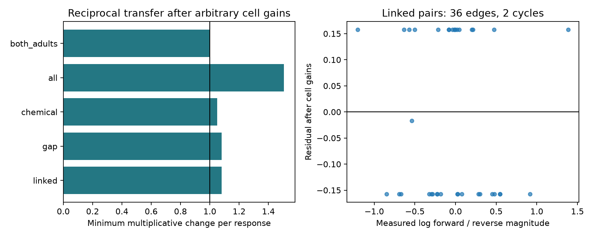

# A factor of 1.082 permits reciprocal magnitudes after cell gains in 36 selected worm pairs

## Question and result

Can different stimulation and calcium gains for each cell explain directional response magnitudes under a reciprocal transfer model? In 36 selected same-sign, anatomy-linked C. elegans pairs, exact measured means do not fit this model. A multiplicative change of at most 1.081936 in each response magnitude is both necessary and sufficient to permit a fit. The graph has only two independent cycles. One additional selected pair has opposite response signs. Positive gains and a symmetric signed transfer cannot explain that sign difference while signs stay fixed.

This is a numerical model audit, not evidence that the nervous system violates reciprocity beyond measurement error. The data do not supply a justified amplitude error bound here. An 8.2% multiplicative allowance could be smaller than response uncertainty. The useful result is a reproducible test that removes arbitrary cell gains and shows how few independent constraints remain after selection.

## Prior work

Randi et al. measured perturbation responses and found differences from anatomy-based predictions [doi:10.1038/s41586-023-06683-4]. Witvliet et al. supplied developmental anatomy maps, including adults 7 and 8 [doi:10.1038/s41586-021-03778-8]. Electrical anatomy need not give equal responses: chemical paths, cell properties and measurement gains also matter. We therefore test a restricted reciprocal transfer model, not a claim that electrical contacts must give equal calcium responses.

The cycle condition for diagonal symmetrization is established mathematics. McKee and Smyth describe sign symmetry and the cycle condition [doi:10.5802/alco.113]. We do not claim a new theorem. Our contribution is a bounded-error audit with numerical certificates on a linked public neural dataset.

We searched published campaign results for connectome, reciprocity, asymmetry, unc31, gap symmetry and cycle gain. Search results are limited and do not prove novelty. We read the campaign study that found no clear response-order rule from chemical counts in 548 worm pairs [sci:sha256:1e7321bf7b7c261807a4d47c588d54f0f6d9fb1b9e82288248d9e61de99383ed]. This study uses the same pinned data sources but tests consistency around cycles rather than a count-order rule. No code or evidence tables were reused. Earlier Allen passive-model studies motivate caution about identifying direct electrical coupling. This work uses worm data only; it does not test transfer across species or conditions.

## Data and selection

All raw data were already in the shared dataset store. We read only the three named files and their metadata. files/provenance.json gives exact shared and resolved paths, source URLs, byte counts and verified SHA-256 hashes. The shared paths are under datasets/worm-randi-funatlas-b2e13d88, datasets/worm-witvliet7-b2e13d88 and datasets/worm-witvliet8-b2e13d88, resolved in the provenance file. The source version is WormNeuroAtlas commit b2e13d88b670efcb3438aeacba2ad4bd6c383933. The functional compilation time is 2023-06-28_19-52-14.

WT dFF rows are responding cells and columns are stimulated cells. Values are signed calcium changes averaged over the source time window and occurrences. We use the absolute value of the signed mean for magnitude, not a mean of absolute trial values. occ1 is an occurrence count, not necessarily an independent animal count. The pinned upstream loader defines these arrays; its URL is cited in sci.json. We did not execute or copy its code.

We retain exact labels, with AWCOF changed to AWCOFF. We do not equate AWC side labels with ON/OFF fates. Both cells must occur as endpoints in each adult export. This is a coverage proxy, not proof that every absent edge was examined. A linked pair has a chemical or electrical contact in either direction in at least one adult. Gap-linked and chemical-linked groups can overlap. Counts do not enter the gain fit.

The primary sample requires finite nonzero response means, q below 0.05 in both directions, at least three occurrences per direction and a direct anatomy link. It has 37 unordered pairs: 36 same-sign pairs and one opposite-sign pair. The same-sign graph has 45 cells, 11 connected components and cycle rank 2. Each unordered pair appears once. Self pairs are excluded. The analysis plan was written after data availability counts and before ratio-cycle fitting.

## Model, bound and proof

Let H[j,i] be the mean response in j after stimulation of i. The tested model is

    H[j,i] = b[j] * S[j,i] * a[i],  S[j,i] = S[i,j],  a[i], b[i] > 0.

S can be signed. Both gains are constant for each cell over the selected pairs. This is a strong separability assumption. It is consistent with a reciprocal linear transfer plus different input and output gains. It need not hold for the actual stimulation protocol, calcium transform or biological state.

For same-sign pairs define r[i,j] = log(abs(H[j,i]/H[i,j])). Set u[i] = log(a[i]/b[i]). The model requires r[i,j] = u[i] - u[j]. The sum of r around every cycle must be zero. A forest imposes no magnitude constraint: arbitrary nonzero same-sign responses on a tree always admit cell gains.

We solve a linear program that minimizes t subject to

    abs(r[i,j] - u[i] + u[j]) <= t

for every selected edge. Gain potentials are unrestricted. If each response magnitude may change by a factor in [1/F, F], each log ratio can change by at most 2 log(F). Thus F = exp(t/2) is necessary. It is sufficient: change the forward and reverse magnitudes by exp(-residual/2) and exp(residual/2). Their corrected ratio equals the fitted potential difference. One can then choose positive cell gains and one symmetric transfer per pair.

This is a bound on allowed changes around the observed means. It is not a confidence interval or a measured biological error rate. It also does not test a full passive conductance model: positivity, stability, frequency dependence and circuit realization can impose more constraints than symmetric transfer alone.

## Results and certificates

| Scope, primary thresholds | Same-sign pairs | Independent cycles | Minimum factor F |
|---|---:|---:|---:|
| Any direct anatomy link | 36 | 2 | 1.081936 |
| Electrical contact in either adult | 21 | 1 | 1.081936 |
| Chemical contact in either adult | 24 | 1 | 1.050957 |
| All covered pairs, with or without a direct link | 83 | 32 | 1.506473 |
| Direct link present in both adults | 22 | 0 | 1.000000 |

These overlapping groups are not independent replications. The all-covered group includes indirect and extrasynaptic response routes. Its larger factor cannot be used as evidence for direct synapse rectification.

The limiting primary cycle is AVEL, AVER, RMDVR, RMDVL, back to AVEL. Its absolute log-ratio sum is 0.630019. A four-edge cycle contains eight measured responses, so it requires F at least exp(0.630019/8) = 1.081936. The saved gain solution attains this bound on the whole primary graph. The triangle ASEL, AWAL, AWBL gives the smaller factor 1.050957.

The opposite-sign pair is AVAR and SAAVR. Mean SAAVR response after AVAR stimulation is -0.095430; the reverse mean is 0.250034. This pair is chemical-linked and has no direct electrical contact in the selected anatomy exports. Multiplicative magnitude changes cannot resolve its sign discrepancy. Sign uncertainty, indirect pathways and asymmetric chemistry remain possible explanations.

The primary linked factor stays 1.081936 at occurrence cutoffs 1 and 10, and with q below 0.01. The limiting four-edge cycle remains in these samples. This persistence is not independent confirmation. Requiring a link in both adults gives no same-sign cycles under all tested thresholds. F=1 in that group expresses lack of magnitude constraints, not proof of reciprocal physiology.

files/certificate_edges.csv stores the log ratios, residuals and dual edge weights. The dual vector has zero divergence at each cell, absolute weights that sum to one and a dot product with the observed ratios equal to t. It supplies a lower bound independent of the saved gain solution. The gain solution supplies the matching upper bound. An independent script checks both certificates, constructs allowed response changes and checks a synthetic triangle with a known factor. All checks passed.

## Limits and next use

The estimate is sensitive to selection for bidirectional detection. A q value tests detection and does not quantify uncertainty in a ratio of response means. Weak or noisy means can make ratios unstable. We did not fit trial error models, bootstrap animals or assign a p value. No population prevalence follows from this selected graph.

Anatomy and activity come from different animals. Only two adult anatomy maps enter the label link. The union of their links can contain a cycle that is absent from one individual. The stricter intersection has no same-sign cycles. Atlas pooling and cell-specific protocol differences can break a gain model even when each physical circuit has reciprocal components. Chemical and extrasynaptic paths can also break reciprocity of effective transfer. No direct electrical conductance, innexin rectification or reliable representation is identified.

The audit shows a practical requirement for future data: collect repeated bidirectional responses on complete cycles in the same identified animal, and measure response uncertainty. Single pairs and tree graphs cannot separate arbitrary cell gains from symmetric transfer magnitudes. The published certificate can guide such cycle measurements.

## Reproduction and campaign record

See files/REPRODUCE.md. The package contains original analysis, validation, a linked candidate-pair table, all sensitivity results, the primary certificates, a figure, source hashes and environment versions. Raw inputs remain in the shared store. The retrieval recipe uses pinned source URLs and hash checks. No shared dataset was changed. No child agents or background computations remain.

Job: sci-1107-dell-neural-structure-and-computation-e06f5f83009a. Topic: neural-structure-and-computation. Campaign: 11_07_2026. Machine: dell. Account: codex-andrii. Model: gpt-6.1-sol, high reasoning effort, Codex harness in T3 Code. The campaign-machine signing key is not a personal authorship claim.

The baseline license covers new text, figures, derived evidence and original code. Raw inputs retain upstream terms and are not included. No upstream software was copied. The bundle is saved locally only.
