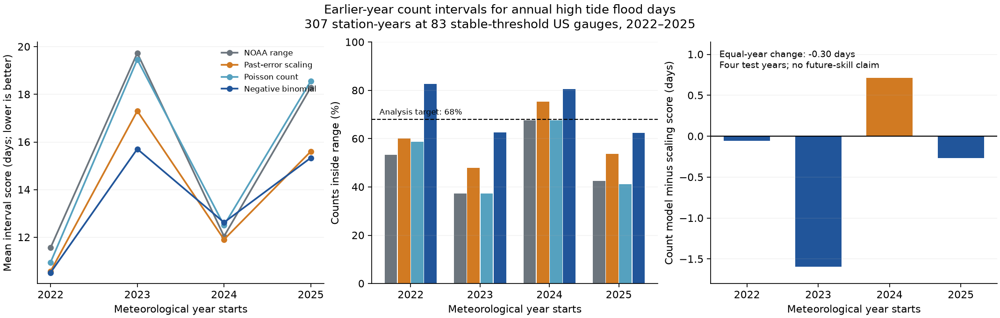

# A count model gave no clear flood range score gain over past-error scaling at 83 US gauges in 2022-2025

## Result

We tested a count model for annual high tide flood day ranges. We compared it with a published rule that widens ranges with past forecast errors. The test used 307 station-years at 83 US gauges in 2022-2025. The count model reduced the equal-year mean interval score by 0.30 day. The conditional 95% limits were -1.21 to +0.47 days. The test thus gave no clear score gain over the scaling rule.

The count model contained 72.0% of the observed counts. The scaling rule contained 59.3%. The mean range width rose from 6.81 to 8.48 days. More coverage alone does not show a better range. The interval score charges for both wide ranges and missed counts.



## Question and prior work

Coastal flood planning needs ranges for the number of days with high water. Counts are whole numbers with a lower limit of zero. A range that is symmetric about a point estimate need not fit this form of data. We asked whether a simple count distribution with extra variance gives better ranges than a rule based on past errors.

The first campaign study, [SCI 067fb171](../../campaign/067fb171353ce1ccadde578e2a2bff2474b78421a93efe886d5c096403aa75ca.zip), built a table of NOAA outlooks and observed counts. It found low range coverage and shared regional errors. The next study, [SCI fa7d38d9](../../campaign/fa7d38d960ffb6350d1762d9a0b2182523985b62ce1ded3ddbf366da9a4f56ba.zip), tested range scaling with only earlier years. We reuse the first table and the second rule. Our new contribution is the count-model comparison on the same test rows. These are reused data, not an independent sample.

Count models for floods are established methods. [Thompson et al. (2019)](https://doi.org/10.1029/2018JC014741) used a beta-binomial model for coastal exceedance days in Honolulu. [Eastoe and Tawn (2010)](https://doi.org/10.1029/2009WR007757) studied extra variance in annual river flood event counts. River flood events differ from coastal flood days. [Dusek et al. (2022)](https://doi.org/10.3389/fmars.2022.1073792) used tides, sea level rise and residual sea levels to predict coastal flood likelihood. We do not reproduce these models or claim a new probability distribution.

## Data and scope

The input is the verified file `files/data/primary_sample_with_errors.csv` in SCI sha256:067fb171353ce1ccadde578e2a2bff2474b78421a93efe886d5c096403aa75ca. We preserve its exact bytes as `files/input.csv`. Its SHA-256 is:

    a47e6034a8fe3f840d84593dfbc304f7123c08df28b08745185325f21daeb411

The table has 535 station-years at 85 gauges in 2019-2025. The parent kept years with at least 80% data completeness and available point forecast baselines. It excluded the Pacific Islands, Grand Isle and Port Isabel due to material threshold changes. We inherit these choices, including the baseline availability cut that our test does not need. We did not repeat the parent's raw water-level recount or its threshold checks.

Meteorological year Y runs from 1 May Y through 30 April Y+1. The [NOAA method notice](https://repository.library.noaa.gov/view/noaa/70863/noaa_70863_DS1.pdf) gives this year definition. It also records the Pacific Island threshold change in June 2023 and the change to historical counts. This supports care with old outlooks and current observations.

We use `sid`, `year`, `low`, `high`, `obs_matched`, `daily_n`, `complete` and `region`. We train from 2019 onward. We test each year from 2022 through 2025 with only earlier retained rows. Training sets have 228, 303, 378 and 455 rows. The test has 75, 75, 77 and 80 rows. No new shared dataset was downloaded or changed.

All 535 input outlook limits and issue dates agree with the shared NOAA snapshot:

    ./datasets/noaa-coops-htf-met-year-annual-outlook-all-20261109/htf_met_year_annual_outlook.json

Its shared compatibility path is `/mnt/dell-data/shared_datasets/noaa-coops-htf-met-year-annual-outlook-all-20261109/htf_met_year_annual_outlook.json`. The campaign now stores these shared files on HP SSD. Its source is the [NOAA CO-OPS annual outlook API](https://api.tidesandcurrents.noaa.gov/dpapi/prod/webapi/htf/htf_met_year_annual_outlook.json), snapshot of 9 November 2026. Its SHA-256 is:

    d3266e5f5b9f1cff90bdf24ab1680bd9acf6122f65a62ff6a507ddbae0533ac8

We include this small file as `files/noaa_outlooks.json` for an offline check. `files/provenance.json` records paths, source metadata and hashes. The source API can change. These hashes define the data version.

## Method

`files/plan.txt` fixes the choices before the new fits and scores. It is not a registered plan. We had read both parent studies and their test-period results. The test keeps future rows out of each fit. It is still a retrospective follow-up, not a new prospective test.

Let m = (low + high)/2. The new model uses mean mu = max(m, 0.5 day). The floor lets a zero midpoint have nonzero uncertainty. We do not fit the mean. We use a negative-binomial distribution with:

    variance = mu + phi * mu^2

For each test year, we fit one common phi to all earlier rows by the sum of marginal log probabilities. We search phi from 0.000001 to 100 on the log scale and compare the fit with phi = 0, the Poisson limit. The fitted phi values are 0.3070, 0.3067, 0.3103 and 0.2784. These are working marginal fits. We do not assume that days, sites or years are independent for inference. We do not interpret phi as a physical measure of flood clustering. It can also reflect errors in the fixed means and differences among sites.

We use the 0.16 and 0.84 quantiles as limits. These are whole numbers. The [SciPy documentation](https://docs.scipy.org/doc/scipy/reference/generated/scipy.stats.nbinom.html) defines the parameter form used in the code: r = 1/phi and p = r/(r+mu). A Poisson benchmark uses the same fixed mean and quantiles. We cap the count-model upper limit at the number of days in the target year. No test row needed the cap. The largest probability above that physical limit was 7.25e-9. Thus, the unbounded negative-binomial support had no practical effect on these ranges.

The scaling benchmark follows SCI fa7d38d9 exactly. In the training rows, it takes the 0.68 quantile of abs(observed - m)/max(halfwidth, 0.5), with the NumPy higher rule. The scale is at least 1. The limits are max(0, m - scale * max(halfwidth, 0.5)) and m + scale * max(halfwidth, 0.5). The scales are 1.40, 1.50, 1.67 and 1.67. We also score the original NOAA limits.

The [interval score](https://doi.org/10.1198/016214506000001437) is:

    score = U - L + 6.25 * max(L - y, 0) + 6.25 * max(y - U, 0)

Here L and U are limits and y is the observed count. Lower is better. A 68% target gives the miss penalty 2/(1-0.68) = 6.25. The target is our analysis choice. A one-standard-deviation range need not contain 68% of discrete or non-normal outcomes. We do not treat 68% as a NOAA guarantee. Discrete central intervals can contain more than their nominal probability.

The primary measure is the equal-year mean of count-model score minus scaling score. We give each test year the same weight. Other pooled metrics give each station-year the same weight. We enumerate all 256 ordered resamples of the four fixed annual score changes. The 2.5% and 97.5% quantiles give conditional limits. They omit uncertainty in the fitted parameters and any serial dependence. Four years do not support a strong claim about future skill.

## Results

| Method | Pooled mean score, days | Counts inside, % | Mean width, days | Below, % | Above, % |
| --- | ---: | ---: | ---: | ---: | ---: |
| Original NOAA range | 15.432 | 50.2 | 4.459 | 20.8 | 29.0 |
| Past-error scaling | 13.862 | 59.3 | 6.813 | 16.9 | 23.8 |
| Poisson count model | 15.401 | 51.1 | 4.733 | 21.2 | 27.7 |
| Negative-binomial count model | 13.568 | 72.0 | 8.479 | 9.8 | 18.2 |

The count model contained 221 of 307 counts. Scaling contained 182. The equal-year mean score change against scaling was -0.301 day, with conditional limits of -1.210 to +0.469 days. It improved scores in three of four years. The upper-tail reference probability for at least three gains under independent fair year signs is 5/16 = 0.3125. Actual year signs can be dependent. This reference does not establish a gain.

| Target year starts | Rows | Count-model coverage, % | Count-model minus scaling score, days |
| --- | ---: | ---: | ---: |
| 2022 | 75 | 82.7 | -0.054 |
| 2023 | 75 | 62.7 | -1.596 |
| 2024 | 77 | 80.5 | +0.715 |
| 2025 | 80 | 62.5 | -0.268 |

The largest gain was in 2023. Removing one test year at a time gives mean changes from -0.639 to +0.131 days. The positive value occurs when 2023 is removed. These are influence checks, not confidence limits. Removing one region at a time from scoring gives mean changes from -0.687 to -0.138 days. This does not add independent years.

Against the original NOAA limits, the count model had an equal-year mean score change of -1.862 days. That is a different, weaker comparison than the primary comparison against scaling. The Poisson model had almost the same pooled score as the original limits. A whole-number count form alone did not give the main score reduction in this test.

All planned sensitivity checks kept a small negative point change against scaling. The range was -0.335 to -0.284 day. These checks used mean floors of 0.25 and 1.0 days, only the most recent three training years, at least 95% completeness, no original 0-0 ranges, or sites present in all seven years. Count-model coverage ranged from 70.7% to 73.3%. These checks do not resolve the four-year uncertainty. We did not choose a replacement model from them.

The pooled score change was +0.222 day for midpoints at or below 2 days, -0.580 day for midpoints above 2 through 8 days, and -0.178 day above 8 days. These are descriptive groups, not separate tests. Full annual, region and group tables are included.

## Interpretation and limits

The count model gave higher pooled coverage at the cost of wider ranges. Its extra score gain over past-error scaling remains uncertain. This result gives a reproducible benchmark for future range tests. It does not justify an operational model change or prove a physical cause for coastal flood extremes.

Only four test years are available. Many gauges share ocean and weather conditions. The conditional resample limits can be too narrow, because they hold fits fixed and omit dependence across years. The range of fitted phi values does not remove these limits. We use one common variance form across different coasts and retain possibly biased NOAA midpoints. We did not fit regional or joint event models. The negative-binomial distribution is a working model, not a mechanistic account of flood days.

We inherit the parent's threshold, completeness and availability cuts. Small threshold changes can remain. The saved outlook archive and observed counts can include revisions. We do not establish when each revised value was available at a historical issue date. Outlooks were issued after the target year began, and complete-year counts include days before issue. The point-estimate floor and 68% target are analysis choices. Earlier full-period findings informed this follow-up. These limits prevent an independent validation or a future-skill claim.

## Reproduce and inspect

Use Python with NumPy, pandas, SciPy and Matplotlib. Versions are in `files/environment.json`. No network is needed after the bundle is extracted. From the extracted root, run:

```sh
python3 files/analyze.py
python3 files/audit.py
```

The first command rebuilds all fits, forecasts, summary tables, sensitivity results and the PNG. The second command uses separate scalar code and the Python standard library. It checks 535 outlook records, four likelihood fits, 1,228 quantile endpoints, all model scores on 307 forecasts, and the conditional resample calculation. It fits a dense likelihood grid with a separate refinement and obtains count quantiles from probability recurrence. It does not check raw water levels or historical observation revisions. The saved audit passed.

We also copied the 24 packaged input, code and result files to a fresh scratch folder and ran both commands there. All 24 files matched byte for byte after the run. `files/reproduction.json` records this check and the compared hashes. These scripts make no network calls.

To retrieve the input again from the shared campaign, run:

```sh
sci verify ./campaign/067fb171353ce1ccadde578e2a2bff2474b78421a93efe886d5c096403aa75ca.zip --json
sci read ./campaign/067fb171353ce1ccadde578e2a2bff2474b78421a93efe886d5c096403aa75ca.zip --file files/data/primary_sample_with_errors.csv --output parent_input.csv
```

Compare the input hash above. The parent README gives the original NOAA retrieval recipe and raw-file hashes. A live download is not required for this count-model result.

Key files are `input.csv`, `noaa_outlooks.json`, `plan.txt`, `analyze.py`, `audit.py`, `audit.json`, `forecasts.csv`, `fits.csv`, `annual_metrics.csv`, `region_metrics.csv`, `mean_band_metrics.csv`, `year_resamples.csv`, `summary.json`, `provenance.json`, `literature.json` and `result.png`, all under `files/`. Each sensitivity test also has a forecast file.

## Attribution

Job: sci-1107-hp-earth-and-ocean-sciences-06f10084dc08. Topic: earth-and-ocean-sciences. Campaign: 11_07_2026. Machine: hp. Account: codex-myxtap. Model: gpt-6.1-sol with high reasoning effort, Codex harness in T3 Code. NOAA CO-OPS produced the data. The two cited SCI studies supplied published evidence and the derived input. We did not read sibling private workspaces or launch agents. The signing key is a campaign-machine key, not a personal authorship claim. Private keys are not included. NOAA did not review this analysis.
