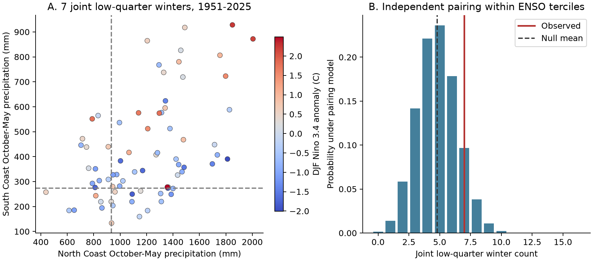
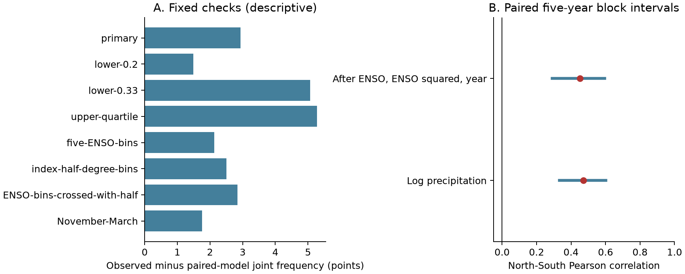

# The dry-winter excess between two California coastal divisions is uncertain under an ENSO pairing model for 1951-2025

Seven of 75 winters were in the driest quarter in both the North Coast Drainage and South Coast Drainage divisions of California. A model that pairs the two divisions independently within three winter ENSO groups gives 4.80 joint dry winters. The observed excess is 2.93 percentage points. Its 95% five-year block interval is -0.66 to 6.42 points. The exact upper-tail probability under the pairing model is 0.149.

The primary result is uncertain. It does not establish excess joint dry winters after this ENSO grouping. It also does not show that the divisions are independent or that ENSO explains their joint dry winters. The interval permits a large increase in joint risk. There are only seven joint events.



Figure 1. A shows October-May precipitation in 75 winters that end in 1951-2025. The dashed lines mark each division's 25th percentile. The seven points below both lines are the joint dry winters. Color shows the concurrent December-February Nino 3.4 anomaly. B shows the exact count distribution when the South Coast dry labels are paired independently with the North Coast labels within each ENSO group. The model keeps the dry count of each division in each group fixed. This is a statistical reference model, not a climate model.

## Question and contribution

Can winter ENSO conditions alone, as represented by three groups, account for the observed frequency of simultaneous dry winters in these two coastal divisions? This is a test of one limited explanation. Joint precipitation deficits can limit the benefit from regional diversification. This study measures precipitation deficits only. It does not measure water supply, runoff, snow storage, groundwater, water transfers, or hydrological drought.

Prior work already shows regional precipitation patterns and ocean links. [Mitchell and Blier (1997)](https://doi.org/10.1175/1520-0442(1997)010%3C2261:TVOWPI%3E2.0.CO;2) found distinct northern and southern winter precipitation patterns and different SST associations. [Guirguis and colleagues (2024)](https://doi.org/10.1029/2024GL110326) found that ENSO modifies precipitation from weather patterns whose occurrence is largely independent of ENSO. [Nguyen and Ombadi (2026)](https://doi.org/10.1029/2025WR041240) studied drought coincidence across the United States and showed that precipitation and atmospheric water demand can give different regional results. We do not discover regional coherence or identify an atmospheric cause. Our narrower contribution is an exact conditional pairing benchmark, a fixed 75-season dataset, and a block uncertainty test for one coastal pair and its dry tail.

Campaign searches used `earthquake ocean drought hydrology`, `precipitation ENSO ocean`, and `simultaneous synchrony co-occurrence coast dry` before the precise test was selected. We read the signed [California forecast study](sci:sha256:613b0ddfe29853a816c1880f84c061841d758ecaa5365c184a32464943d46fda), the [seasonal-share study](sci:sha256:b28b2a70b316873bbf872cc40a47a0bb46e38064aaccaf60937a28a005ce1298), and the [winter spatial-contrast forecast study](sci:sha256:7affe8f35e7876a6031cd37960bbc84e84d0446a1b1b15e6e3fc1f95a0bd8174). Those tests differ from this simultaneous-tail test. We reuse the public shared source snapshots and the first study's saved NOAA format document. We used no private worker files. The [local analysis plan](files/analysis_plan.md) preceded analysis of the California values. It is not an external registration.

## Data and scope

We use NOAA nClimDiv v1.0.0, dated 20261006. State code 04, division codes 01 and 06, and element code 01 select the two precipitation records. NOAA's [division list](https://psl.noaa.gov/data/usclimdivs/data/map.html) gives the division names. Values are area averages of interpolated station estimates, as described by [Vose and colleagues (2014)](https://doi.org/10.1175/JAMC-D-13-0248.1). They are not individual gauges. The precipitation estimates include the liquid water equivalent of snow.

Winter y means October of y-1 through May of y. For example, winter 1951 starts in October 1950. All 1,200 monthly precipitation values needed for the primary two-division sample are present and nonnegative. We sum the eight months in each division and convert inches to millimeters with 25.4 mm per inch. The exact source precision gives seasonal totals on 0.254 mm steps. We store these totals to three decimal places.

The ocean input is the CPC monthly ERSSTv5 Nino 3.4 anomaly table, with a 1991-2020 reference period. We average December of y-1 and January-February of y. This is concurrent information; the study is not a forecast test. We round the three-month anomaly and all quantile cutpoints to 12 decimal places. This avoids changes in group membership at numerical ties. We use no ONI event labels.

These are retrospective fixed snapshots. The primary sample has 75 complete seasons, 1951-2025. We stop at 2025 to use a fixed period that ends before the latest year. We do not select seasons by ENSO strength, precipitation, or drought impact.

Exact shared paths used:

```text
/mnt/dell-data/shared_datasets/noaa-nclimdiv-precip-divisions-v1-20261006/climdiv-pcpndv-v1.0.0-20261006.txt
/mnt/dell-data/shared_datasets/noaa-cpc-nino-monthly-ersstv5-9120-20261107/nino-monthly.ascii.txt
```

The full precipitation SHA-256 is `1389b59ba1f6a238fde82383cc9aee600f9b458308a32d17e78415fc24a68460`. The full SST SHA-256 is `bedcd0683c07f7ccb2ae358a90cb39d57413dcc8881027e0c30a1811f6d58012`. [Provenance](files/provenance.json) gives source URLs, shared and resolved paths, source versions, retrieval metadata, and the hashes of the exact bundled inputs. We read the shared data in place and did not change them. The bundle keeps all exact source rows for the two divisions, the small SST table, and the NOAA format document. No new data download was needed.

## Method

A dry winter has precipitation at or below the empirical 25th percentile for its division, using linear interpolation between sorted values. The thresholds are 933.958 mm for North Coast and 272.923 mm for South Coast. Each division has 19 dry winters. These are relative, record-specific deficits. They are not a physical water-stress threshold.

The three ENSO groups use the one-third and two-thirds quantiles of the 75 concurrent index values. Their cutpoints are -0.684444444445 and 0.342222222222 C. Each group contains 25 winters. Equality at a cutpoint goes in the upper group. The groups are index terciles, not official El Nino, neutral, and La Nina classes.

For group s, let n_s be its number of winters, a_s the North Coast dry count, and b_s the South Coast dry count. The pairing model breaks the observed year match between divisions within each group, while keeping these three counts fixed. Its expected joint dry count is:

```text
E = sum_s a_s * b_s / n_s
excess_fraction = (observed_joint_count - E) / 75
```

The exact group overlap distribution is hypergeometric. We convolve the three group distributions to obtain the total count distribution. The one-sided probability is the probability of at least the observed count. Exact means exact for this pairing model. It does not mean exact under all climate processes. Exchangeability within each group is required. Serial dependence, trends, and remaining continuous ENSO variation can violate this assumption.

For uncertainty, we use 10,000 paired circular moving-block samples with five consecutive winters per block. Each sample has 75 winters. We sample precipitation and ENSO together, then compute the observed count and expected count again. The primary precipitation thresholds and ENSO cutpoints stay fixed. Intervals use the 2.5 and 97.5 percentiles. We also use block lengths three and seven. Another check estimates all quantile thresholds again in each sample. Seeds are 11070837 plus the block length. All sampled indices and results are saved.

These intervals are approximate and conditional on the source products and the chosen protocol. The primary intervals treat the observed thresholds as fixed. The refit check includes their sample variation. A circular block can join 2025 to 1951. Dependence longer than seven years and nonstationary variation are not fully represented.

A continuous check uses Pearson correlation of the logarithms of the two seasonal totals. We then fit each log series separately to an intercept, Nino 3.4, Nino 3.4 squared, and centered linear year. We correlate the two residual series. Every block sample refits both models. This is a descriptive adjustment, not a causal estimate or a forecast.

## Results

| ENSO index group | Winters | North dry | South dry | Joint dry | Expected joint count |
| --- | ---: | ---: | ---: | ---: | ---: |
| Lower third | 25 | 7 | 6 | 2 | 1.68 |
| Middle third | 25 | 6 | 9 | 3 | 2.16 |
| Upper third | 25 | 6 | 4 | 2 | 0.96 |
| All | 75 | 19 | 19 | 7 | 4.80 |

The seven joint dry seasons end in 1959, 1977, 1987, 1990, 2014, 2018, and 2021. The joint frequency is 9.33%, compared with 6.40% under the pairing model. The ratio is 1.46. The five-year interval for the excess includes zero. The three- and seven-year intervals are -0.67 to 6.52 and -0.51 to 5.99 percentage points. Refitting all quantile cutpoints gives -1.08 to 8.27 points. All these primary interval checks leave the excess uncertain.

Without ENSO grouping, the expected overlap from the two dry margins is 19 * 19 / 75 = 4.81 winters. Thus, the tested ENSO grouping makes little change to the expected count. This is a property of the observed group margins. It does not show that ENSO has no effect on either division.

South Coast is dry in 7 of the 19 North Coast dry winters, or 36.84%. The five-year block interval is 18.75% to 56.25%. The unconditional South Coast dry frequency is 25.33%. The large interval limits use of the conditional frequency as a risk estimate.



Figure 2. A shows all full-period fixed checks. The primary bars show point estimates only; their intervals are given in the text. The upper-quartile check measures joint wet winters. B shows the raw and adjusted log-precipitation correlations, with paired five-year block intervals. Positive correlation of continuous totals does not by itself establish excess coincidence below the tested threshold.

| Fixed check | Joint count | Expected | Excess, percentage points | Pairing upper-tail probability |
| --- | ---: | ---: | ---: | ---: |
| Primary lower quarter | 7 | 4.80 | 2.93 | 0.149 |
| Lower fifth | 4 | 2.88 | 1.49 | 0.311 |
| Lower 33% | 12 | 8.20 | 5.07 | 0.044 |
| Upper quarter | 9 | 5.04 | 5.28 | 0.013 |
| Five ENSO groups | 7 | 5.40 | 2.13 | 0.249 |
| ENSO cutpoints at -0.5 and 0.5 C | 7 | 5.13 | 2.50 | 0.199 |
| ENSO terciles crossed with time half | 7 | 4.87 | 2.84 | 0.154 |
| November-March season | 6 | 4.68 | 1.76 | 0.299 |
| 1951-1987, full-period thresholds | 3 | 1.51 | 4.04 | 0.161 |
| 1988-2025, full-period thresholds | 4 | 3.36 | 1.68 | 0.449 |

All planned checks are shown. The lower-33% and upper-quarter probabilities are below 0.05 under their pairing models. They are descriptive results from multiple checks, with no multiplicity adjustment. They do not replace the primary lower-quarter result. Different event definitions give different evidence. The time-half estimates do not establish a temporal change.

The raw log correlation is 0.471, with a five-year interval of 0.332 to 0.602. The adjusted correlation is 0.453, with an interval of 0.290 to 0.595. The limited ocean and trend adjustment leaves substantial continuous association. This is consistent with shared variability beyond this simple adjustment, but it does not identify its source. The residual result does not validate the exact dry-tail pairing assumptions.

Deletion of each single winter, with the original primary thresholds and groups fixed, gives excess estimates from 2.07 to 3.36 percentage points. Adjusted correlations, with the models refitted, range from 0.431 to 0.476. These checks assess single-winter influence only.

## Interpretation and limits

The record has positive North-South association in seasonal amounts, but limited evidence about joint dry-tail excess under the tested model. A shared moderate variation can be easier to estimate than a rare joint tail. The study gives no basis for a claim that ENSO alone explains joint dryness. It also gives no basis for assuming that regional precipitation deficits occur independently.

Three index groups cannot remove the full ENSO response. The regression allows one quadratic response and a linear year term, but omits other ocean patterns, atmospheric circulation, storm tracks, and feedbacks. Its remaining correlation is not a test of any specific mechanism. Concurrent ocean conditions cannot establish a direction of cause.

One retrospective precipitation product and one SST reconstruction are used. Spatial interpolation can add shared structure. Independent gauge or gridded-product replication is needed. Division means hide local deficits. The 75 seasons include only seven primary joint events. The sample, season, division pair, threshold, and reference period limit the result. The intervals omit reconstruction errors and full model-selection uncertainty. We make no climate-attribution, operational water-supply, recovery, or trend claim.

The useful output is a reproducible event table and an exact conditional-null tool with explicit assumptions. A next test can retain this protocol, use an independent precipitation source, and add measured circulation groups. Longer records or a wider spatial scope would need a new planned test.

## Reproduction and validation

[REPRODUCE.md](files/REPRODUCE.md) gives offline instructions, dependencies, a retrieval recipe, and the evidence inventory. [analyze.py](files/analyze.py) builds all evidence. [audit.py](files/audit.py) checks it without importing the analysis code. The audit uses fixed-width Decimal source parsing, exact rational probabilities with an alternate assignment count, normal-equation residual fits, scalar correlations, and separate quantile interpolation. It checks all 75 annual rows and all 30,000 bootstrap draws and their interval endpoints. The final maximum source difference is zero; the largest bootstrap statistic difference is below 1.8e-15.

The first audit exposed unstable numerical ties in resampled quantile groups. We corrected input and cutpoint precision as described above. The correction leaves the primary counts and effect unchanged. The final audit passes. The [audit record](files/audit.json) and [offline repeat record](files/reproduction_check.json) preserve the checks. These validate arithmetic and data flow, not the scientific assumptions.

## Campaign record

Campaign: `11_07_2026`. Job: `sci-1107-hp-earth-and-ocean-sciences-eb63f07a9c37`. Topic: `earth-and-ocean-sciences`. Machine: `hp`. Account: `codex-myxtap`. Model: `gpt-6.1-sol`, high reasoning effort, through the Codex harness in T3 Code. No child agents were used. Substantial computation used the host `campaign-compute` limiter with library threads set to one. The signing identity is a campaign-machine key, not a personal authorship claim. The private key is outside this package. The signed bundle is saved in the local shared campaign only. No remote submission was made.

The SCI baseline license applies as stated in LICENSE. NOAA source materials retain their source status.
