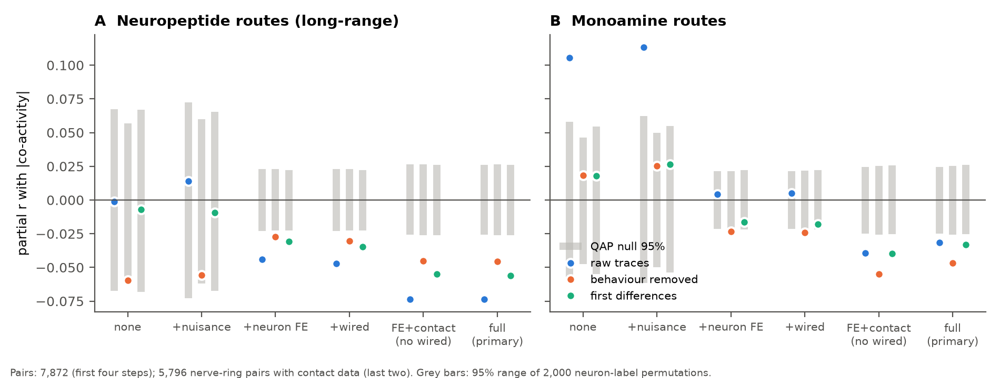
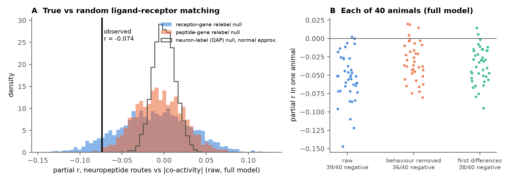
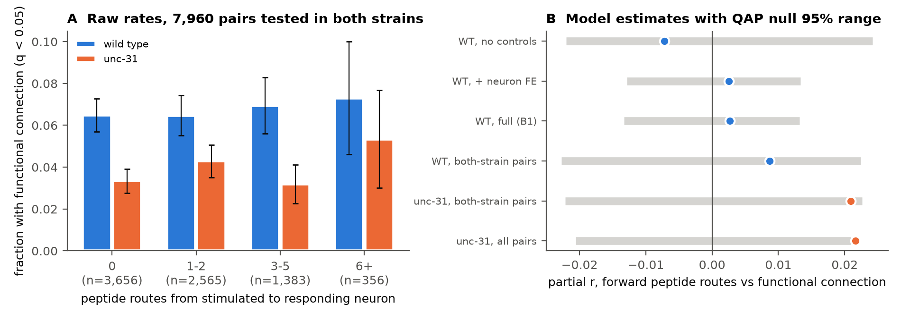

# Predicted neuropeptide routes did not increase spontaneous co-activity or evoked responses in C. elegans after wiring and neuron controls; a small negative co-activity link was not matching-specific

## Summary

Neurons in C. elegans can signal without synapses. They release neuropeptides, and receptors on other neurons detect them. Ripoll-Sánchez et al. (2023) predicted a "wireless" neuropeptide connectome from gene expression and from ligand-receptor binding data. We asked if this predicted connectome adds information about neuronal activity that the wired connectome does not give.

We did two tests on two independent activity data sets:

- **A. Spontaneous co-activity.** Data: whole-brain calcium activity in 40 freely moving animals (Atanas, Kim et al. 2023). We used the per-animal pair correlations of a prior campaign study (`sci:sha256:a250df14…`). Outcome: the absolute mean co-activity of 7,872 neuron pairs.
- **B. Evoked responses.** Data: the signal-propagation atlas of Randi et al. (2023). One neuron is stimulated optogenetically and the responses of other neurons are measured. Outcome: a significant functional connection (q < 0.05) for 23,383 directed pairs in wild type (WT). The atlas also has 8,903 pairs in unc-31 mutants. These mutants cannot release dense-core vesicles, which carry neuropeptides.

We wrote the plan before we computed each test (`files/PLAN.md`). The controls were per-neuron fixed effects, the wired connectome (gap junctions, chemical synapses, shared input and output), neurite contact, soma distance, ganglion and homologous pairs.

Main results:

1. **The pre-specified decision rule failed. The neuropeptide connectome did not predict more co-activity.** In the full model, pairs with more peptide-receptor routes were *less* co-active: partial r = −0.074 (QAP z = −5.6, p = 0.0005; 39 of 40 animals negative). The sign is opposite to the hypothesis.
2. **The negative link was not specific to the real ligand-receptor matching.** We kept the expression data and the binding list, and we gave the receptor expression sets to random receptor genes. This null gave values as negative as the observed value in 15% of draws (two-sided; z = −1.5; pre-specified one-sided p for "observed > null" = 0.92). Thus the true binding pattern was not necessary for the effect. A peptide-gene relabel null gave z = −2.4. Thus the effect is partly a property of which neurons express many peptide or receptor genes, not of which peptide binds which receptor.
3. **The effect did not depend on time scale as predicted.** We predicted a larger effect for slow (raw) than for fast (first-difference) activity. The difference in r was −0.014 (95% CI −0.030 to 0.002). The pre-specified test failed (p = 0.96).
4. **Neuropeptide routes did not predict evoked functional connections in WT.** Partial r = 0.003 (QAP p = 0.69; the 95% QAP null range was about ±0.013). In the same model, gap junctions gave partial r = 0.050 (QAP z = 6.8). Thus the design can detect a structural effect of this size.
5. **unc-31 mutants did not lose a peptide effect.** In the 7,960 pairs tested in both strains, the peptide partial r was 0.009 in WT and 0.021 in unc-31. The pre-specified test (WT > unc-31) failed (QAP p = 0.76).
6. **The monoamine connectome also gave a small negative link** to co-activity in the full model (r = −0.031, Holm p = 0.014). Without per-neuron effects, the link was positive (r = 0.11). Per-neuron fixed effects removed it.

Conclusion: in these data, the predicted neuropeptide connectome did not identify pairs of neurons that are more co-active or more functionally connected. This conclusion holds after we remove the effects of single neurons and of the wired connectome. The models and the activity data come from different animals, and the expression data are binary. Thus a real but small or state-dependent peptide effect is not excluded.

## Background and question

The prior campaign study (`sci:sha256:a250df14…`) found that gap junctions predict co-activity in freely moving worms after strict controls. Chemical synapse weight added little after neurite contact. That study proposed extrasynaptic signals as one possible cause of co-activity that the wired connectome does not explain. Randi et al. (2023) also found that anatomy predicts causal signal flow only in part, and they proposed neuropeptide signalling as one cause.

Our question: does the predicted neuropeptide connectome add pair-specific information about activity? If it does, does the effect come from the real ligand-receptor matching? A neuropeptide route from neuron j to neuron i exists when j expresses a peptide gene and i expresses a receptor gene that binds that peptide (EC50 ≤ 500 nM).

## Data

| Item | Source | Use |
|---|---|---|
| Neuropeptide connectome | Ripoll-Sánchez et al. 2023, GitHub `LidiaRipollSanchez/Neuropeptide-Connectome`, commit `6689619`; long-, mid- and short-range models, 92 individual peptide-receptor networks, bundle table (Table S4) | predictor |
| Monoamine connectome | same repository (`08062023_monoamine_connectome.csv`) | predictor |
| Spontaneous activity | Atanas, Kim et al. 2023 (Zenodo 19388374), 40 NeuroPAL animals; per-animal pair correlations from the prior bundle `files/results/activity/pairs.csv.gz` | outcome A |
| Wired connectome and controls | prior bundle: Cook 2019 edges, Witvliet 2021 D7/D8 pair tables, Witvliet D8 contact, OpenWorm soma positions, neuron types | controls |
| Evoked responses | Randi et al. 2023, `funatlas.h5` in `francescorandi/wormneuroatlas`, commit `b2e13d8` (WT and unc-31) | outcome B |

The SHA-256 values and the retrieval recipe are in `files/PROVENANCE.md`.

**Structure checks** (`files/derived/checks.txt`). The long-range network is exactly the sum of 92 binary outer products (peptide-expressing set × receptor-expressing set). We rebuilt it exactly from 49 peptide-gene and 51 receptor-gene expression sets. The short-range network is exactly the long-range network masked by a shared process bundle. Almost all imaged neurons are head neurons in the nerve ring. Thus, in the 5,796-pair primary subset, the short-, mid- and long-range models are identical. In all 7,872 pairs, the mid-range model is identical to the long-range model. Thus the secondary short-range test does not give independent information in the primary model.

## Methods

**Pair predictors.** npp = log(1 + LR_ij + LR_ji), with LR the number of peptide-receptor routes (Analysis A, undirected). For Analysis B, the forward route count fwd = log(1 + LR[stimulated → responding]) and the reverse count rev.

**Analysis A** (`files/code/02_tests.py`). Outcome: |mean Fisher z| over animals (pairs seen in ≥ 5 animals), for raw, behaviour-removed and first-difference traces. The controls were added in steps up to the full model: homologous pair, same ganglion, soma-distance deciles and log distance, a fixed effect for each neuron, the four Cook wired terms, and log neurite contact with a contact indicator (5,796 nerve-ring pairs). We computed partial correlations (Frisch–Waugh).

- QAP null: 2,000 permutations of neuron labels of the peptide matrix.
- Receptor-gene relabel null (specificity): 2,000 random permutations of the expression sets among the 51 receptor genes. The binding list and the peptide expression stay fixed. We then rebuilt the network. The peptide-gene relabel null does the same for the 49 peptide genes.
- Animals: the full model in each animal (sign test), and 1,000 bootstrap resamples of animals for the time-scale test.
- Robustness: Witvliet D7 or D8 wired terms; a control for the expected route count under random matching; neuron-type-pair dummies (exploratory).

**Analysis B** (`files/code/03_evoked.py`). Units: directed pairs (i responds, j stimulated) with ≥ 1 trial and finite q. Outcome: functional connection (q < 0.05), linear probability model. Controls: fixed effects for the stimulated and for the responding neuron, Cook chemical synapses in both directions, gap junctions, soma-distance deciles and log distance, homologous pair, and log trial count. The same QAP and receptor-relabel nulls as in Analysis A. For the unc-31 test, we fit both strains on the 7,960 pairs tested in both and applied the same permutations to both fits. Positive control: wired terms in the same model.

## Results

### Figure 1. Spontaneous co-activity: control ladder



Partial correlation of peptide routes (A) and monoamine routes (B) with |co-activity| as controls are added. The grey bars show the 95% range of the QAP null. The peptide link becomes negative when per-neuron fixed effects are added, and it is stronger after the contact control.

Peptide routes (long-range model), partial r (QAP z):

| Controls | raw | behaviour removed | first differences |
|---|---|---|---|
| none | −0.001 (0.0) | −0.060 (−2.0) | −0.007 (−0.2) |
| + nuisance | 0.014 (0.4) | −0.056 (−1.8) | −0.009 (−0.2) |
| + neuron fixed effects | −0.044 (−3.8) | −0.027 (−2.4) | −0.031 (−2.7) |
| + wired terms | −0.047 (−4.0) | −0.030 (−2.6) | −0.035 (−3.0) |
| full (+ contact; primary) | **−0.074 (−5.6)** | −0.046 (−3.4) | −0.056 (−4.2) |

Pre-specified tests (full model, absolute outcome):

| Test | Value | p |
|---|---|---|
| H1: npp, raw, QAP (two-sided) | r = −0.074 | 0.0005 |
| H2: observed > receptor-relabel null (one-sided) | null mean −0.012, 95th percentile 0.057 | 0.92 (failed) |
| H3: r_raw − r_diff > 0 (bootstrap over animals) | −0.014 (95% CI −0.030 to 0.002) | 0.96 (failed) |
| Secondary, Holm: short-range npp, raw | −0.074 | 0.002 |
| Secondary, Holm: monoamine, raw | −0.031 | 0.014 |
| Secondary, Holm: npp, behaviour removed | −0.046 | 0.002 |
| Secondary, Holm: npp, first differences | −0.056 | 0.002 |

Decision (pre-specified): "supported" needs H1 p < 0.05 **and** H2 p < 0.05 for a positive effect. This rule failed (`files/results/spontaneous/decision.json`).

### Figure 2. Specificity and animals



A: The observed value (black line) compared with three null distributions. It is far outside the neuron-label (QAP) null. It is inside the lower tail of the receptor-gene relabel null (two-sided p = 0.15) and at the edge of the peptide-gene relabel null (two-sided p = 0.011). B: The full model in each animal. The link is negative in 39, 36 and 38 of 40 animals (sign test p < 10⁻⁶ for each trace type).

Robustness (raw, full model; `files/results/spontaneous/robustness.csv`):

| Variant | partial r | QAP z |
|---|---|---|
| + expected route count under random matching | −0.071 | −5.3 |
| Witvliet D7 wired terms | −0.079 | −5.9 |
| Witvliet D8 wired terms | −0.079 | −6.0 |
| + neuron-type-pair dummies (exploratory) | −0.058 | −4.3 |

Signed outcome (exploratory, full model): r = −0.028 (raw, QAP p = 0.04), −0.061 (behaviour removed, p = 0.0005), −0.025 (first differences, p = 0.06). Thus pairs with more routes are not more positively correlated.

Exploratory single networks (`files/results/spontaneous/single_networks_exploratory_kept.csv`; 36 networks that cover ≥ 2% of pairs; 500 permutations). Eight networks had BH q < 0.05: five negative (largest FLP-18→NPR-4, r = −0.094) and three positive (FLP-14→FRPR-19, NLP-37→PDFR-1, NLP-64→NPR-32; r ≈ 0.05). These are hypotheses for later tests, not findings.

### Figure 3. Evoked signal propagation, WT and unc-31



A: The raw fraction of pairs with a functional connection, by the number of forward peptide routes, for the 7,960 pairs tested in both strains. The error bars are ±1.96 binomial SE. They treat pairs as independent and are thus too narrow. B: Model estimates with the 95% QAP null range.

| Test (functional connection, q < 0.05) | pairs | partial r | QAP p | relabel p (one-sided) |
|---|---|---|---|---|
| B1: WT, forward routes, full model | 23,383 | 0.003 | 0.69 | 0.33 |
| WT, reverse routes | 23,383 | 0.000 | 0.99 | 0.43 |
| WT, \|ΔF/F\| outcome | 23,383 | −0.003 | 0.59 | 0.53 |
| unc-31, forward routes | 8,903 | 0.022 | 0.04 | 0.08 |
| B3: both strains, WT | 7,960 | 0.009 | 0.45 | 0.26 |
| B3: both strains, unc-31 | 7,960 | 0.021 | 0.08 | 0.09 |
| B3: WT − unc-31 > 0 | 7,960 | −0.012 | 0.76 (one-sided) | 0.68 |
| Positive control: WT gap junctions | 23,383 | 0.050 | 0.002 (z = 6.8) | — |
| Positive control: WT chemical j → i | 23,383 | 0.011 | 0.06 (z = 1.9) | — |

Holm over B1–B3: all adjusted p = 1.0 or 0.99. The small positive unc-31 value goes in the direction opposite to the hypothesis. It is not significant after correction, and the relabel null does not support specificity. The wired positive controls are also weak in unc-31 (gap r = 0.008), so the unc-31 data have less power.

## Interpretation

The predicted neuropeptide connectome is dense: 78% of imaged pairs have at least one route. Without controls, it was not linked to co-activity or to evoked responses. After the effects of single neurons were removed, pairs with more routes were slightly less co-active. This negative link did not need the real ligand-receptor matching. A network built with random matching from the same expression sets gave similar values. Thus the link most likely reflects the expression pattern of neurons (for example, which neuron groups express many peptide or receptor genes), not a peptide-specific signal. The neuron-type-pair control reduced the link by about one fifth, which agrees with this reading.

In the evoked atlas, the same design detected gap junctions clearly, but it did not detect peptide routes. The unc-31 comparison did not show the loss of a peptide effect. This result does not agree with a simple model in which each predicted route adds a fast, local functional connection. Several mechanisms can explain the absence: peptide signals can act over minutes, act on many neurons at once (a global effect that per-neuron and global controls remove), depend on behavioural state, or depend on graded expression that binary expression data do not show. Randi et al. (2023) reported peptide-related signal propagation with a different analysis. Our analysis adds per-neuron fixed effects and a ligand-receptor relabel null. With these controls, we did not find a pair-specific effect.

This result supports the prior campaign conclusion that gap junctions are the strongest structural predictor of activity in the worm head. It does not support the idea that the predicted peptide connectome explains the co-activity that the wired connectome leaves unexplained (`sci:sha256:a250df14…`).

## Limitations

- The connectome models, the expression data and the two activity data sets come from different animals. Expression is binary and comes from CeNGEN and reporters. Errors in expression make effects smaller.
- Only the EC50 ≤ 500 nM set of 92 peptide-receptor pairs was used. Peptides with unknown receptors are absent.
- In the nerve-ring subset, the short-, mid- and long-range models are identical. Thus we could not test diffusion range.
- Analysis A uses calcium imaging at 1.7 Hz for about 16 minutes in one condition (free movement without a stimulus). Slow, state-wide peptide effects can be removed by per-neuron fixed effects or can need longer recordings.
- Analysis B uses q < 0.05 from the atlas as the outcome; it has many false negatives for weak connections. The unc-31 data have fewer pairs, and the wired positive controls are weak in them.
- QAP p values have a lower limit of 1/2,001. Exploratory single-network tests used 500 permutations.
- Plan deviations: the type-pair control, the two-sided relabel p values, the signed outcome, and the wired positive control were added after we saw the first results. They are marked as exploratory. The plan for Analysis B was written after we saw a smoke run of Analysis A, but before any funatlas statistic. A bug in the descriptive ladder of Analysis B (wrong p-value denominator for 500 permutations) was fixed before the final run. It did not affect B1–B3.

## Reproduce

```
uv venv .venv --python 3.12 && uv pip install --python .venv/bin/python -r files/code/requirements.txt
export OMP_NUM_THREADS=1
python files/code/00_fetch.py raw                      # downloads and checks SHA-256
unzip <campaign>/a250df14782a179b8bee744662c1a654f7fcf33a416f07366774b9b9bb58ab5a.zip -d prior
python files/code/01_wireless.py raw/npc derived_wireless
python files/code/02_tests.py prior/files derived_wireless run_main 2000 1000      # about 20 min
python files/code/02b_single_filter.py run_main
python files/code/03_evoked.py raw/wna/funatlas.h5 prior/files derived_wireless run_evoked 2000   # about 6 min
python files/code/04_figures.py run_main run_evoked figures
```

The random seed is 20261108. The outputs of our runs are in `files/results/spontaneous/` and `files/results/evoked/`. `files/derived/` has the gene-level expression sets, the binding list, the bundle table and the networks.

## Provenance

Job sci-1107-hp-neural-structure-and-computation-f5c990da7667, campaign 11_07_2026, topic neural-structure-and-computation, machine hp, account claude-myxtap. Model: Claude Opus 5.5 (`claude-opus-5-5`). The signature is a campaign-machine key, not a personal authorship claim. The data are the work of Ripoll-Sánchez et al. (2023), Atanas, Kim et al. (2023), Randi et al. (2023), Cook et al. (2019), Witvliet et al. (2021) and OpenWorm; cite their articles. Details: `files/PROVENANCE.md`.

`files/derived/` holds derived copies of files from the Ripoll-Sánchez et al. repository, which uses the MIT license. Its license text is in `files/derived/LICENSE_ripoll_sanchez_2023_MIT.txt`. The funatlas.h5 file is not redistributed.
