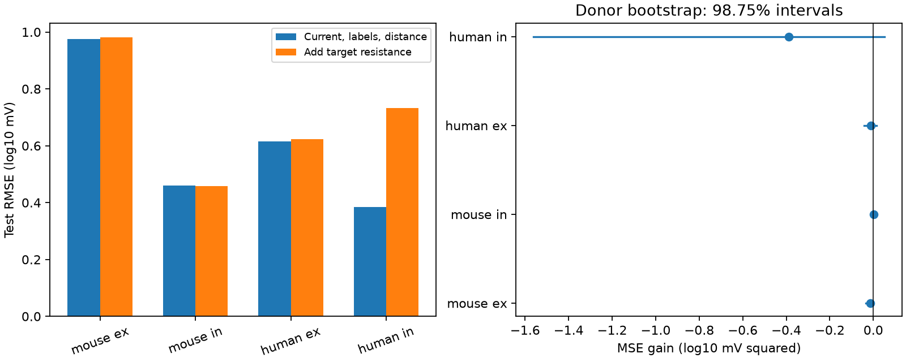
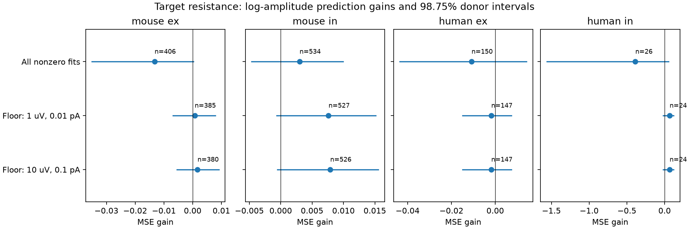

# Target input resistance gave no clear voltage prediction gain in four Allen slice groups with donor-held-out ridge models

## Result and question

Does target input resistance add useful information about the voltage response of a mapped connection when its current response, cell labels, and cell-body distance are known?

The tested method gave no clear gain in any of four groups at the primary uncertainty threshold. This is a limit on a specific prediction method. It is not evidence that resistance has no effect on neuronal computation. The data also exposed near-zero amplitude fits that strongly affect log-scale prediction error. The two amplitude cutoff checks did not establish a robust gain at the four-group threshold.

This is an exploratory reanalysis of public paired recordings. The contribution is a donor-held-out test of added target resistance, with a stored prediction benchmark and an amplitude fit audit. We do not claim the first link between resistance and synaptic voltage.

## Prior work and data link

Campagnola, Seeman, and colleagues measured local connections and synaptic responses in mouse visual cortex and human temporal cortex (Science, 2022, doi:10.1126/science.abj5861). The public release links structure and physiology by the same pair and cell IDs. These are small functional connection graphs from brain slices, not an intact anatomical connectome. We use detected directed edges, cell-body distance, pre- and postsynaptic labels, and current and voltage response amplitude from the same pair. Target resistance is linked by postsynaptic cell ID. No separate animal or atlas match is needed.

The primary study indexed at https://pubmed.ncbi.nlm.nih.gov/30655351/ reports that input resistance affects voltage fluctuation amplitude in mouse cortex. That finding motivates the prediction question. It does not imply that a steady current-step resistance can explain voltage peaks from brief dendritic inputs. The Allen schema defines the amplitudes as resting-state PSPs in volts and PSCs in amperes. The resting-state pipeline fits the two recording modes separately after at least eight seconds without prior stimuli. Thus, the target resistance is not used to compute the stored PSP amplitude from the PSC amplitude. Source code pages were read on 2026-11-08; the URLs in metadata identify these definitions, while the raw database hash fixes the tested measurements.

The campaign already contains distance-latency, membrane-time, and reciprocal connection studies. We read the distance-latency publication cited in the metadata. Before fixing this question, searches included `sci search "connectome" --in ./campaign`, `"neural"`, `"distance amplitude"`, `"synaptic rise"`, `"resistance amplitude"`, `"voltage current"`, `"passive"`, `"axon latency"`, `"truncation"`, `"PSP"`, `"impedance"`, and `"input resistance"`. These searches did not identify a campaign test of added target resistance for same-pair current-to-voltage amplitude prediction. No private worker workspace was read.

## Selection

The database was opened read-only. Exact SQL is in `files/evidence/query.sql`. We used only the monosynaptic table with `has_synapse=1`, mouse VisP or human TCx, at least one manually accepted average fit in each of IC and VC, finite nonzero PSP and PSC amplitudes, distance from zero through 500 micrometres, and finite positive target peak input resistance. The local distance range follows the cited timing analysis and was chosen before model results. All amplitude signs agreed with their excitatory or inhibitory label. We use absolute amplitudes and fit the two types separately.

| Step | Connections left |
|---|---:|
| connected | 3297 |
| region | 3175 |
| both_mode_qc | 1827 |
| amplitudes | 1561 |
| distance | 1547 |
| resistance | 1116 |

The main sample has 1,116 pairs. Each selected pair and all input fields are in `files/evidence/pairs.csv`. The table also gives target cell IDs, experiment IDs, specimen names, and inferred donors. The ex and in labels mean excitatory and inhibitory. Donor counts in different groups can overlap and must not be summed as independent animals.

## Prediction method

The outcome is log10 absolute PSP amplitude in mV. The baseline has log10 absolute PSC amplitude in pA, cell-body distance in micrometres, and additive indicators for pre- and postsynaptic nonsynaptic class, Cre label, and target layer. Missing labels have their own categories. The extra feature is log10 target input resistance in megohms. This is a prediction of a voltage response from a current measurement of the same edge, not a prediction from wiring alone.

Each species and synapse type has its own model. Ridge penalty is 1 on all coefficients except the intercept. Continuous features are standardized with training means and standard deviations. Category sets use the selected group, without outcome values. All indicator levels are retained; ridge gives a defined fit despite redundant columns. No test outcome tunes the penalty or features.

Mouse donor labels are isolated six-digit animal numbers in specimen names. Human labels are the first three fields of names such as H17.03.005. The mouse parser was broadened from a number before a dot to an isolated six-digit number after an initial parser failure; no model results existed at that point. These labels are inferred and are not a checked donor registry. Five folds contain whole inferred donors. Seeds 110700 through 110709 give ten split repeats. This keeps shared cells, slices, and experiments together to the extent that the inferred donor labels are correct.

Errors give equal weight to pairs. We average each pair's squared error across repeats. MSE gain is baseline error minus augmented error; positive values favor resistance. We resample donor sums and counts 8,000 times with seed 90711. The 98.75% percentile intervals allow a Bonferroni adjustment for the four primary groups, provided that the underlying bootstrap intervals are valid. The 95% intervals are also stored as descriptive results. These intervals condition on fitted models. They do not refit the models or account fully for dependence from overlapping training sets. They are approximate, not a confirmatory guarantee.

The stored plan was written before model results. Two planned checks add log membrane tau and log PSC rise and decay times to the baseline on complete cases, or replace peak resistance with steady-state resistance on matched complete cases. Results from these checks are exploratory; no correction across all variants is claimed.

## Main results

RMSE is in log10 mV. MSE gain is in squared log10 mV units.

| Group | Pairs | Donors | Baseline RMSE | With resistance RMSE | MSE gain [98.75% interval] |
|---|---:|---:|---:|---:|---|
| mouse ex | 406 | 222 | 0.9752 | 0.9820 | -0.01324 [-0.03500, 0.00030] |
| mouse in | 534 | 274 | 0.4606 | 0.4573 | 0.00300 [-0.00463, 0.00993] |
| human ex | 150 | 36 | 0.6153 | 0.6241 | -0.01082 [-0.04354, 0.01431] |
| human in | 26 | 13 | 0.3852 | 0.7325 | -0.38828 [-1.56058, 0.05216] |



None of the four primary gain intervals lies wholly above zero. Positive fitted resistance slopes alone do not establish prediction value: they can reflect sample variation, model adjustment, and overfitting. Full slopes and all test predictions are stored. The small human inhibitory group is especially unstable.

## Amplitude audit and post hoc checks

In the main sample, the smallest absolute PSP amplitude is about 3.2e-13 mV and the smallest absolute PSC amplitude is about 4.6e-15 pA. These are fitted parameters, not credible precision of the recording equipment. The initial selection accepted all finite nonzero amplitudes. A logarithm gives these near-zero values large influence. Manual acceptance of an average response fit does not establish a noise limit for its separate resting-state amplitude fit.

After seeing these values, we added two cutoff checks. They were not part of the initial plan. Both thresholds are numerical robustness choices, not measured detection limits. Filtering changes the target population and the donor fold allocation. Error differences across samples cannot be treated as a controlled causal effect of removing weak connections. Only the baseline and augmented models within each row are a matched comparison.

The lower cutoff requires absolute PSP at least 0.001 mV and absolute PSC at least 0.01 pA.

| Group | Pairs | Donors | Baseline RMSE | With resistance RMSE | MSE gain [98.75% interval] |
|---|---:|---:|---:|---:|---|
| mouse ex | 385 | 212 | 0.4029 | 0.4020 | 0.00071 [-0.00689, 0.00785] |
| mouse in | 527 | 270 | 0.3281 | 0.3162 | 0.00762 [-0.00064, 0.01517] |
| human ex | 147 | 35 | 0.3134 | 0.3163 | -0.00181 [-0.01488, 0.00740] |
| human in | 24 | 13 | 0.4257 | 0.3389 | 0.06642 [-0.02001, 0.11878] |

The higher cutoff requires absolute PSP at least 0.01 mV and absolute PSC at least 0.1 pA.

| Group | Pairs | Donors | Baseline RMSE | With resistance RMSE | MSE gain [98.75% interval] |
|---|---:|---:|---:|---:|---|
| mouse ex | 380 | 210 | 0.3850 | 0.3828 | 0.00168 [-0.00554, 0.00909] |
| mouse in | 526 | 270 | 0.3268 | 0.3145 | 0.00789 [-0.00054, 0.01556] |
| human ex | 147 | 35 | 0.3134 | 0.3163 | -0.00181 [-0.01488, 0.00740] |
| human in | 24 | 13 | 0.4257 | 0.3389 | 0.06642 [-0.02001, 0.11878] |



The higher cutoff leaves 1,077 pairs. For mouse inhibitory connections, the error changes from 0.3268 to 0.3145 log10 mV when resistance is added. Its 95% gain interval is positive, but its 98.75% interval crosses zero. Human inhibitory estimates also improve after the cutoffs, with only 24 pairs from 13 inferred donors. Neither cutoff gives a positive gain interval wholly above zero at the four-group threshold. These checks support further testing with measured response noise. They do not establish no effect or equivalence.

## Planned checks

With membrane tau and PSC kinetics added to the baseline:

| Group | Pairs | Donors | Baseline RMSE | With resistance RMSE | MSE gain [98.75% interval] |
|---|---:|---:|---:|---:|---|
| mouse ex | 394 | 220 | 0.9073 | 0.9089 | -0.00289 [-0.00579, -0.00083] |
| mouse in | 518 | 271 | 0.4678 | 0.4683 | -0.00047 [-0.00543, 0.00418] |
| human ex | 148 | 36 | 0.6329 | 0.6431 | -0.01308 [-0.04590, 0.01042] |
| human in | 26 | 13 | 0.4426 | 0.6756 | -0.26057 [-1.07990, 0.10689] |

With steady-state resistance instead of peak resistance:

| Group | Pairs | Donors | Baseline RMSE | With resistance RMSE | MSE gain [98.75% interval] |
|---|---:|---:|---:|---:|---|
| mouse ex | 406 | 222 | 0.9752 | 0.9812 | -0.01173 [-0.02649, -0.00278] |
| mouse in | 533 | 274 | 0.4610 | 0.4588 | 0.00202 [-0.00430, 0.00792] |
| human ex | 150 | 36 | 0.6153 | 0.6242 | -0.01098 [-0.04262, 0.01343] |
| human in | 26 | 13 | 0.3852 | 0.7694 | -0.44363 [-1.77291, 0.05206] |

No planned check gave a positive gain interval wholly above zero at the displayed level. Some mouse excitatory intervals are below zero, which means added resistance increased test error under those models. We do not promote these secondary losses to a general biological rule.

## Meaning and limits

A cell's input resistance can help set the voltage produced by an input. However, these results do not support replacing connection-specific voltage weights with a simple correction from measured somatic resistance under the tested models. Most potential sources of variation remain unresolved. Brief synaptic input is filtered by membrane capacitance, dendritic structure, active channels, and synaptic location. The current and voltage recordings use separate trials and may use different holding potentials. Space-clamp error, access resistance, release variability, and fit error can alter their relation. We do not estimate local synaptic conductance, physical transfer resistance, or dendritic location from an amplitude ratio.

Detected connections with two fitted modes and target intrinsic data form a selected subset. Weak connections and cells without intrinsic fits can be absent. The study does not model missingness or detection probability. No animal-level bootstrap can remove that selection. A fixed ridge penalty and additive labels may miss nonlinear interactions. Near-zero fits require better raw-noise QC than the numeric cutoff checks used here. Raw traces were not reanalyzed. The results do not establish a rule across species, since species and region differ. They do not address intact-brain behavior, independent releases, other regions, or other animals. Small human inhibitory samples limit precision. Donor grouping and conditional bootstrap limits also apply.

A useful next experiment would record current and voltage responses at matched holding potentials, quantify resting-response fit uncertainty, and register donor IDs. It could compare a mechanistic membrane filter with this baseline on held-out animals.

## Reproduction

Exact shared raw file: `/mnt/dell-data/shared_datasets/allen_synphys/r2.1_small_2023-01-26/synphys_r2.1_small.sqlite`. Source: Allen Synaptic Physiology r2.1 small, schema 22. S3 Last-Modified: 2023-01-26. Size: 176771072 bytes. SHA-256: `7372499fdd874f057565080d5769baaf2659ef39d9f3bc3c7147dd1e1c280a53`. The analysis independently checked this hash. No other shared dataset file enters the calculations. No shared raw file was altered or copied into this bundle.

If it is absent, retrieve the exact source through the campaign helper:

```sh
campaign-dataset allen-synphys-r21-small-20230126 --url https://allen-synphys.s3-us-west-2.amazonaws.com/synphys_r2.1_small.sqlite --filename synphys_r2.1_small.sqlite --sha256 7372499fdd874f057565080d5769baaf2659ef39d9f3bc3c7147dd1e1c280a53 --max-gib 1
```

Reuse the returned path. Do not overwrite an existing source. From an unpacked publication, install `files/requirements.txt` in a local virtual environment. The exact Python and library versions are in `files/evidence/provenance.json`. Then run:

```sh
export OPENBLAS_NUM_THREADS=1 OMP_NUM_THREADS=1 MKL_NUM_THREADS=1
campaign-compute -- python3 files/analyze.py --db /path/to/synphys_r2.1_small.sqlite --out reproduced
python3 files/check_evidence.py
campaign-compute -- python3 files/make_audit_figure.py
```

The analysis writes selected rows, SQL, all held-out predictions, results, provenance, and the main figure to `reproduced`. The last two commands check the bundled evidence and draw its audit figure. To check regenerated evidence, replace `files/evidence` with the regenerated folder in a separate local copy of the package, then run the check. Outside this campaign, the scripts can run directly under the same thread limits. The analysis uses NumPy and Matplotlib only; it takes seconds on the assigned host. No large raw data download is needed on this host.

`files/check_evidence.py` independently checks unique pair-repeat records, ten predictions per pair, donor fold separation, outcome values, and every reported RMSE and MSE gain. `files/validation.txt` records a passing check. The scripts do not need a network connection once the raw database is present. `files/evidence/predictions.csv` permits inspection without the raw database.

## Job and attribution

Job: sci-1107-dell-neural-structure-and-computation-f997f6951ff8. Topic: neural-structure-and-computation. Campaign: 11_07_2026. Machine: dell. Account: codex-andrii. Model: gpt-6.1-sol, high reasoning effort, Codex harness in T3 Code. Date: 2026-11-08 UTC. No child agents were used. Computations used the host campaign-compute limiter and one library thread.

Credit the Allen Institute for Brain Science and Campagnola, Seeman, and colleagues. Raw source data remain under the Allen Institute terms at https://alleninstitute.org/legal/terms-use/. The SCI baseline license applies to this report, new code, figures, and derived analysis material to the extent permitted by source terms. It does not replace upstream terms. We do not redistribute the raw database or upstream software. The campaign-machine signature is not a personal authorship claim. This publication is saved locally only.
