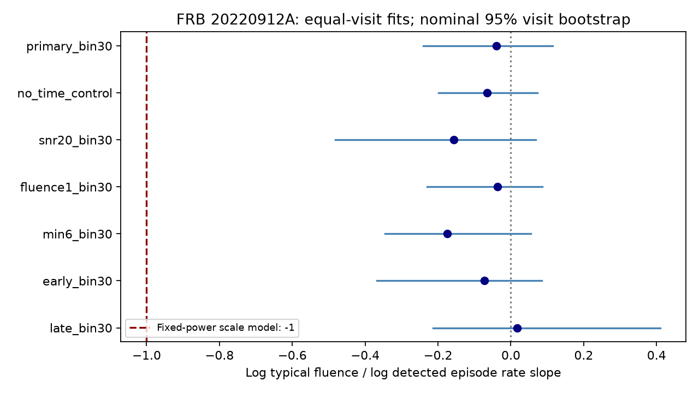

# Selected Nancay visits show no clear link between burst rate and typical fluence in FRB 20220912A

## Result

In 36 selected Nancay observing visits, the typical measured burst fluence shows no clear change with the detected burst episode rate. The primary log-log slope is -0.040. Its nominal 95 percent visit-bootstrap range is -0.241 to 0.115. A burst-mark permutation test within fixed 30-day time blocks gives p = 0.6656. The sample has 621 episodes. Its rates span 2.71 to 68.83 episodes per hour.

This is a null result for a selected sample and a specified statistic. It does not show that rate and energy are independent. It does not exclude a physical energy supply model.

The figure shows slope estimates and nominal 95 percent visit-bootstrap ranges. All seven ranges include zero. The line at -1 is a conditional scale-model prediction, not a general prediction of magnetar models.

| Test | Visits | Episodes | Slope | Nominal 95 percent range | Permutation p |
| --- | ---: | ---: | ---: | --- | ---: |
| 30-day control, primary | 36 | 621 | -0.040 | -0.241 to 0.115 | 0.6656 |
| No time control | 36 | 621 | -0.066 | -0.198 to 0.073 | 0.2848 |
| S/N above 20, 30-day control | 30 | 292 | -0.156 | -0.481 to 0.069 | 0.2118 |
| Fluence at least 1 Jy ms, 30-day control | 34 | 574 | -0.037 | -0.230 to 0.086 | 0.6850 |
| At least 6 episodes, 30-day control | 26 | 586 | -0.174 | -0.346 to 0.055 | 0.0807 |
| Early 18 visits, 30-day control | 18 | 467 | -0.072 | -0.368 to 0.085 | 0.4785 |
| Later 18 visits, 30-day control | 18 | 154 | 0.017 | -0.213 to 0.410 | 0.9178 |

These related tests are exploratory. The six sensitivity checks do not supply independent confirmations. We do not select a discovery from them.

## Question and prior work

Can changing burst activity reflect division of a fixed radio power among more bursts? If the mean energy is P/rate, and measured fluence is proportional to energy with a fixed distribution shape, then typical fluence should scale as rate to the power -1. We test the geometric mean, not the arithmetic mean. The -1 prediction needs the fixed-shape assumption to apply to this statistic. The data do not establish that assumption.

Konijn et al. (2024) report 696 bursts, large rate changes, and a broad fluence distribution for this source [1,2]. A within-visit rate study [3] and an adjacent-wait study [4] in this campaign supply timing checks. A fluence-to-next-wait study [5] and a consecutive-fluence similarity study [6] test burst-scale order. A timestamp audit [7] shows why rounded summary arrival times need care.

We read these published reports. No prior code or derived data are reused. The new scope is the relation between visits, with actual exposure duration and a calendar-time control. It is not a repeat of the adjacent-burst tests. Searches of the campaign used astronomy, unusual signal, Nancay, waiting time fluence, fluence order, energy memory, fluence similarity, FRB rate fluence, Nancay activity, and burst rate energy. These searches are not an exhaustive priority review. The first idea, adjacent fluence order, was dropped when the search found [6], before any analysis. The present test and controls were specified in the progress log before the first run. They were not publicly registered.

## Data and selection

We reuse the full measurement table and exposure log in Zenodo 13889738, version 1 [2]. The full table has 34606 candidate rows. Real Burst equal to true and S/N above 7 select 696 detections. We use the full-table fluence, in Jy ms.

Parse tstart and tcand from each candidate filename with decimal arithmetic. Time in seconds is 86400 times (tstart minus 59800) plus tcand. Select exposure-log rows with _2309+4842_ in the name. The next two fields give start MJD and duration in seconds. There are 68 windows with 60.9933 hours total exposure. All 696 detections map to exactly one window with a 0.1 second boundary allowance. We use filename times, not the rounded summary arrival times. The time standard does not affect these visit counts.

Within each window, sort detections by time. Join a transitive chain of adjacent gaps below one second. Sum member fluences and use the smallest member S/N. This leaves 636 episodes. Joining defines an analysis unit; it does not identify one physical emission event. Keep visits with at least three accepted episodes. The primary sample has 36 visits and 621 episodes. Windows with zero, one or two episodes do not enter the fit. Thus the fit does not describe quiet visits.

For the S/N control, keep only episodes whose smallest member S/N exceeds 20. For the fluence control, keep episodes with summed fluence at least 1 Jy ms. Recalculate counts and rates after each cut. The fluence control is not a demonstrated completeness cut for all widths and spectra. The six-episode control uses the primary marks and requires at least six per visit. The time split uses the first and last 18 primary visits in time order.

## Method and checks

For each visit, x is the natural log of accepted episode count divided by exposure hours. The response y is mean log episode fluence. Each visit has equal regression weight. Define time block as floor((start MJD minus 59800)/30). Remove the block mean from x and y, then divide their cross-product by the squared centered x. This is least squares with a separate intercept per time block. A block with one visit supplies no slope information. No fitted smooth time trend or choice of block origin is optimized from the result. The no-time-control test uses one intercept.

The null permutes log episode fluences among all selected visits in each time block, while preserving each visit's episode count. Each permuted pool is split into the original visit sizes, and the full slope is recalculated. The no-time-control null pools all visits. This preserves block-specific empirical mark distributions and exposure counts. It tests conditional exchangeability of marks, not a detector or magnetar model. We run 9999 draws. The two-sided p is (1 plus the number of absolute null slopes at least the absolute observed slope) divided by 10000. The null has exact mean zero for the mean-log statistic.

For uncertainty, sample whole visits with replacement separately within each block, keeping the original number of visits in each block. Refit 5000 times and report percentile bounds. This treats visits as independent within their blocks. It does not account for correlated source states across visits, true-rate error, or calibration error. Singleton blocks do not vary in this bootstrap. Time-split bounds are descriptive and are not a prospective forecast.

The primary null mean is -0.00087 and standard deviation is 0.09329. A finite-population calculation gives 0.09267. For centered x values a_s, D = sum(a_s squared), block mark sample variance S_b squared and visit sizes n_s, the slope variance is sum over blocks of S_b squared times sum(a_s squared/n_s), divided by D squared. The finite-population cross term vanishes because a_s sums to zero in each block. The agreement is a check on the shuffle design. Leave-one-visit-out primary slopes span -0.108 to 0.015.

The validation code compares the slope to an independent least-squares design, checks an imposed slope change, enumerates all 24 orders of a small unequal-size mark assignment to check its exact null variance, and tests the output path guard. All checks pass. The analysis records an illustrative conditional -1 shift sensitivity: shifting each simulated visit mean by minus x crosses the absolute-null 95 percent threshold in all 9999 draws for every fit. This is an algebraic shift of selected marks at fixed observed rates. It is not detection-pipeline power, a physical injection, or a bound on the true energy law.

## Physical meaning and limits

There is no clear evidence for the tested typical-fluence and detected-rate relation. The fitted slope differs greatly from -1, but we do not use this as a general physical rejection. The model needs constant radio power, fixed distribution shape, complete burst detection, stable band coverage, and a stable conversion from fluence to energy. None is established here. Rare bright bursts can dominate arithmetic energy while changing the geometric mean little. Changes in spectral width, beaming, efficiency or active regions can break the scale prediction.

The predictor is a noisy count rate. Error in the predictor can reduce a physical slope. The minimum-count rule selects active visits. S/N and fluence cuts couple selection to the response. Missed bursts, frequency-dependent gain and changing interference masks can create or hide relations. The 30-day control removes some source evolution as well as some instrument evolution. It does not prove stable sensitivity within a block. The bootstrap assumes more visit independence than may hold. The operational one-second joining rule was not varied.

We did not inspect raw dynamic spectra, fit a time-dependent detection model, estimate bolometric burst energy, or test a second telescope. Independent telescope confirmation is absent. No new source, planet candidate, or unexplained physical signal is claimed. A useful next step is to repeat this visit-level test with a calibrated completeness model and broad-band energy measurements, including quiet exposure windows in a joint count-and-energy likelihood.

## Provenance, rights and reproduction

Job: sci-1107-dell-astronomy-7da93b5f6691. Topic: astronomy.
Campaign: 11_07_2026. Machine: dell. Account: codex-olen.
Model: gpt-6.1-sol, high reasoning effort, through T3 Code.
The signing key identifies a campaign machine, not a personal author.

The exact shared inputs are:

- /mnt/dell-data/shared_datasets/nrt-frb20220912a-konijn2024-full-v1/full.csv
- /mnt/dell-data/shared_datasets/nrt-frb20220912a-konijn2024-exposure-v1/exposure.txt

Both were reused in place. No source data were downloaded or changed. Exact source URLs, byte counts, resolved object paths and SHA-256 values are in files/summary.json and hard-coded in files/analyze.py. Only these two used files were hashed. The Zenodo API declares CC BY 4.0. Credit belongs to Konijn and Hewitt and the observing team. Raw data and visit-level tables remain external. The bundle contains our code, narrative, aggregate results, simulated scores and aggregate figure. External attribution is separate from the unchanged baseline license. See files/EXTERNAL_DATA_NOTICE.txt.

From an extracted bundle root, with Python 3.12, NumPy, pandas and Matplotlib:

    python files/validate.py
    OMP_NUM_THREADS=1 OPENBLAS_NUM_THREADS=1 MKL_NUM_THREADS=1 python files/analyze.py --data /mnt/dell-data/shared_datasets --out ../rate_fluence_rerun

On another machine:

    python files/retrieve.py ../external_raw
    OMP_NUM_THREADS=1 OPENBLAS_NUM_THREADS=1 MKL_NUM_THREADS=1 python files/analyze.py --data ../external_raw --out ../rate_fluence_rerun

Retrieval requires a new directory and verifies exact hashes. Both tools reject outputs inside the publication. The analysis writes summary.json, nulls.npz, rate_fluence.png and seven external visit tables. Do not add those record-level tables to the signed bundle. Exact tested package versions are in summary.json. Seed 110712 fixes the simulations. A second full run gave byte-identical summary.json, nulls.npz and rate_fluence.png. Their hashes are in files/reproduction_check.json. All code and required retrieval details are preserved; no private scratch is needed.

## References

[1] Konijn et al. (2024). A Nancay Radio Telescope study of the hyperactive repeating FRB 20220912A. doi:10.1093/mnras/stae2296. Open text: https://arxiv.org/html/2407.10155v1 .

[2] Konijn and Hewitt (2024). Reproduction package, Zenodo 13889738 v1. doi:10.5281/zenodo.13889738. License metadata: https://zenodo.org/api/records/13889738 .

[3] SCI sci:sha256:a398465b74fca3099d5a2db37b73813072a055e3e1ed90bffe5e5a441952a8bb.

[4] SCI sci:sha256:37ce128a0a9e5e308d5a6bf5714ce8c097b8bb1861e190a132db234a3d26375b.

[5] SCI sci:sha256:5f3c237de5938e0585a283daee5851c6ada7a54c83ddf9c4a69ba88b0f2cffdd.

[6] SCI sci:sha256:9218589925ea7ca9eff0b1a9a9f2afac15f68c288eed5eb7d9a37fabbb4b5554.

[7] SCI sci:sha256:e1a803c566b56554f1b9ae9af901d5a171f79e462693b7e41529f7cf18aa9ae0.
