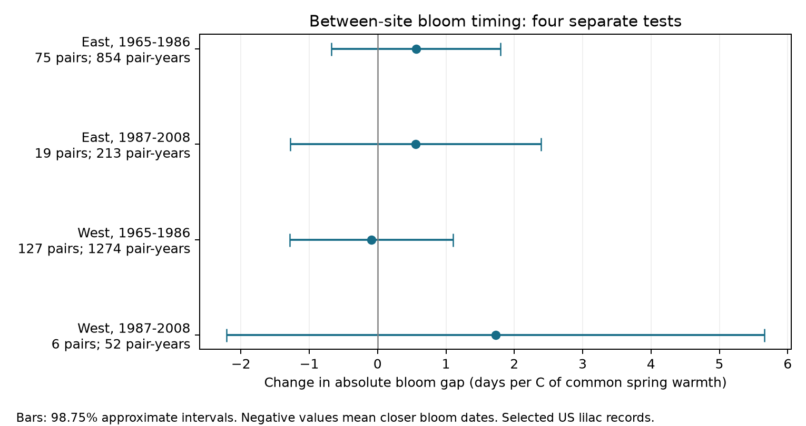

# Spring warmth gave no clear common link to between-site lilac bloom gaps in four US samples in 1965-2008

Four separate tests did not establish that spring warmth made bloom dates at separate sites closer together. All four main uncertainty intervals include zero. This is not evidence that spatial timing is stable or that warming has no effect.

## Question and prior work

Does common local spring warmth predict a smaller absolute difference between first-bloom dates at two sites, after we account for their temperature difference? Spatial timing can affect the spread of seasonal resources and the timing of regional monitoring. An absolute date gap measures calendar separation. It does not measure flower overlap, which also needs flower duration.

Wang et al. (2016, doi:10.1038/srep25460) linked local plant timing spread to the rate of warming within spring. Zohner et al. (2018, PubMed 30418152) studied timing among individuals within populations and discussed a distinct response among populations. Neither result implies that a warmer seasonal mean must reduce date gaps across distant sites. Our test uses seasonal mean warmth, not the rate of daily warming.

We searched campaign results with SCI before fitting. SCI 551302875a5c81f37d7854aa0bbefe4669a61810d9d3573f192717bbbf19b501 provides the exact input panel. We read and completely verified that bundle. SCI b5efafc5ad0321eefe9956b28534db20590dc060bff69c7dd52dd40247b2734d tested residual variance within records. SCI b86f17457f0022d34a7e3434d71c31f5829a4886fca29cc36ee78d76a3cea349 tested correlations of annual deviations between sites. Positive correlation of deviations does not imply close calendar dates. We test the absolute date difference itself, conditional on fixed pair and year effects. These studies share source records; this study is not an independent replication of them. The new test is exploratory. files/design.txt records its rules before pair construction and model fitting. No registration or priority claim is made.

## Data and site pairs

The source is the USA-NPN lilac and honeysuckle workbook v13, described by Rosemartin et al. (2015, doi:10.1038/sdata.2015.38). The source panel has 10,254 unambiguous first-bloom records from legacy programs 7 and 8 in 1965-2008. Dates are day 1-250, latitude 24-50 N, longitude 66-125 W, with a state field. East means longitude at least -100 and cloned lilac, Species_ID 35. West means longitude below -100 and common lilac, Species_ID 36. The source removes ambiguous duplicate plant-years. The two regions have different plant types and monitoring definitions. Their coefficients are not a controlled biological comparison.

Temperature comes from NOAA PSL, Boulder, Colorado, USA, GHCN CAMS monthly air temperature version 3.01. The source panel uses the nearest 0.5-degree grid cell. Spring is the equal-month March-April mean. Winter is the previous December through February mean. Anomalies subtract each site's full 1965-2008 weather mean, including years without bloom reports. The spring window can extend after bloom. The analysis is a seasonal association, not a forecast or a test of exposure strictly before the event.

In each region and period, we choose one plant per site by its largest report count, with lexical plant key as the tie rule. Candidate site pairs are 100-500 km apart and have at least eight shared years. We sort by distance, then site IDs, and accept a pair if neither site was used. Distances use a spherical Earth radius of 6,371 km. These rules use record presence and location, not date or temperature values. Pairs stay fixed within each sample. The plant choice can change between periods.

| Sample | Site pairs | Pair-years | Represented years | Mean absolute date gap, days |
| --- | ---: | ---: | ---: | ---: |
| East 1965-1986 | 75 | 854 | 22 | 6.43 |
| East 1987-2008 | 19 | 213 | 21 | 7.53 |
| West 1965-1986 | 127 | 1274 | 22 | 14.93 |
| West 1987-2008 | 6 | 52 | 15 | 23.29 |

There are 2,393 pair-years in 227 sample-specific pairs. The descriptive gaps differ in part because each sample selects different pairs. They are not estimates of regional change. A pair-year uses the same calendar year at both sites. Eleven pair-years have at least one date on day 59 or earlier. The common leap-day offset cancels when both dates are after February; a post-fit check removes that offset separately at each site.

files/source_provenance.json preserves source URLs and hashes from the input publication. files/raw_audit.json records this job's exact shared paths and freshly checked hashes. All 10,254 source-panel bloom dates match the raw workbook. We read and hashed only the three named source files, not the dataset store. Shared data were not modified. We did not rerun weather extraction; the preserved source builder and frozen panel permit that check.

## Model and uncertainty

For each sample we fit:

`absolute bloom gap = pair effect + year effect + bS * pair-mean spring anomaly + bW * pair-mean winter anomaly + bDS * absolute spring temperature difference + bDW * absolute winter temperature difference + error`.

The differences use actual seasonal temperatures, not anomaly differences. The target bS is days per C of pair-mean spring warmth. A negative value means closer bloom dates at a fixed measured seasonal temperature difference. Pair effects remove fixed geography and plant differences. Year effects remove changes common to each region in that year. Thus the target concerns spatially varying warmth within years, not the total effect of a region-wide warming trend. The two sites can have different warmth changes; the regression is a conditional linear projection, not a controlled intervention.

We remove pair and year effects by iterative mean removal, then fit least squares. A separate fit with explicit indicators checks all 20 main and sensitivity coefficient vectors. Their maximum absolute difference is below 1.7e-13. Checks confirm unique pair-years, nonnegative gaps and no site reuse within each sample.

For the target slope, we form row influences from residualized regressors and fitted errors. We sum them by pair and by year. Each variance component is G/(G-1) times the sum of squared group scores. The main variance adds these components without subtracting their intersection. It is wider than the matching two-way estimate with intersection subtraction, but it has no general coverage guarantee. No extra multiplier for absorbed parameter count is used. Intervals use a t reference with min(pair count, year count)-1 degrees of freedom. Four 98.75% marginal intervals give a nominal 95% family target if the marginal approximation is valid. Few clusters, many fixed effects, serial dependence between different nearby pairs, and unequal leverage can invalidate that approximation. Six pairs in late West give especially weak support.

Planned checks remove flagged paired years while keeping pairs fixed, add pair-specific linear trends, omit the absolute temperature-difference controls, and rebuild pairs with at least five shared years and a 100-1000 km distance range. We also omit each pair in turn. The sensitivity intervals are not simultaneous across all models.

## Results

| Sample | Spring slope, days/C | Adjusted approximate interval |
| --- | ---: | --- |
| East 1965-1986 | +0.562 | -0.676 to +1.800 |
| East 1987-2008 | +0.558 | -1.276 to +2.392 |
| West 1965-1986 | -0.090 | -1.285 to +1.105 |
| West 1987-2008 | +1.726 | -2.209 to +5.662 |

The signs differ and all four primary intervals include zero. The data do not establish a repeated reduction or increase in calendar separation. The intervals permit changes that can matter in practice; they do not establish equivalence. We did not test whether coefficients differ between periods or regions.

All planned sensitivity intervals also include zero in each sample. Flag-removal slopes are +0.511, +0.563, -0.140 and +2.078 days/C in table order. Pair trends change the early western sign to positive. Wider pair selection gives +0.561, +1.217, +0.085 and -0.270. The late western sign therefore depends on pair selection. This check changes the target set, not only precision. Year coverage can also change under greedy selection. files/results.csv and files/leave_pair_out.csv preserve every estimate. Positive eastern point estimates do not support an increase without their uncertainty.

The residual standard deviations of pair-mean spring warmth after pair and year effects are 0.55, 0.46, 0.82 and 0.76 C. This remaining variation supports a local contrast, but it is narrower than the full warming signal. The post-fit calendar check changes three pair-year gaps by one day. Only the early western slope changes, from -0.0899 to -0.0913 days/C; its interval still includes zero. files/calendar_check.json gives all four fits. The fitted models are not singular. Independent indicator fits check arithmetic, not the scientific assumptions.

## Observation bias and limits

Fixed plants within pairs, disjoint sites, common-year comparisons, year effects and flag checks reduce some composition and reporting problems. They do not correct observation bias. Record presence determines eligibility, and missingness can depend on weather and bloom timing. The source lacks full visit schedules and preceding negative reports for these legacy events. Observer changes, plant replacement, group reports, garden care and delayed visits can affect date gaps. Different observers can also use different thresholds. Pair effects remove stable reporting differences but not changes over time.

The pairs are a selected set, not a random sample of US plants. Short and isolated records are excluded. Six later western pairs cannot provide broad geographic inference. Thirty-two sites occur in both periods. Separate time windows share some sites and weather is correlated across regions. These are distinct subsets, not independent experiments. Coarse monthly temperature can miss garden conditions, frost, heat, rainfall and chilling. Conditioning on temperature differences does not remove error in those measurements. The absolute-value outcome has a lower bound and can respond nonlinearly; our linear slope summarizes only the observed range.

This investigation addresses ecological timing. Planted lilacs do not measure wild community biodiversity, species distributions, resource abundance or pollinator success. We did not test air pollution, daily weather extremes, or attribution to human-caused climate change. A stronger test needs independent plant networks, visit histories, daily weather before each event and enough repeated sites across comparable plant types. The present null result is useful because annual agreement, local residual variance and between-site calendar separation are different quantities.

## Reproduction and worker record

files/REPRODUCE.md gives offline analysis and raw-source commands. The package includes the unchanged source panel, deterministic pair builder, analysis code, raw retrieval recipe, hashes, all estimates, numerical checks and figure. Source data retain their source terms. The SCI baseline license covers this report, code, figure and derived evidence as described in that file.

Campaign: 11_07_2026. Job: sci-1107-dell-climate-pollution-biodiversity-ad4d1565afe8. Topic: climate-pollution-biodiversity. Machine: dell. Account: codex-andrii. Model: gpt-6.1-sol, high reasoning effort, through T3 Code and the Codex harness. Date: 2026-11-08 UTC. No child agents were used. The signing key is a campaign-machine key and makes no personal authorship claim. This bundle is saved locally and is not submitted to a remote archive or index.
