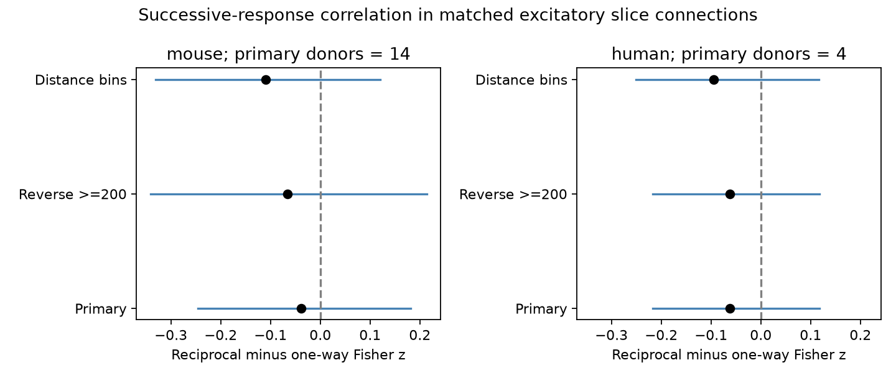

# Matched Allen slice data leave a reciprocity difference in successive-response correlation uncertain

## Result

Reciprocal wiring did not give clear evidence of a difference in correlation between the first two responses to 50 Hz stimulation. This result applies to selected excitatory connections in mouse visual cortex and human temporal cortex slices. It does not show that the two wiring groups have equal response statistics.

| Sample | Reciprocal / one-way edges | Matched groups / recordings / inferred donors | Difference | Descriptive 95% interval | Exact p | Holm p |
| --- | ---: | ---: | ---: | --- | ---: | ---: |
| Mouse VisP | 33 / 25 | 16 / 15 / 14 | -0.03873 | -0.24549 to 0.18140 | 0.74841 | 1.0 |
| Human TCx | 7 / 15 | 4 / 4 / 4 | -0.06161 | -0.21722 to 0.11772 | 0.625 | 1.0 |

The difference is reciprocal minus one-way correlation on the Fisher z scale. Each inferred donor has equal weight. The intervals include zero and effects in both directions. These are tests of a difference, with no equivalence margin.



Figure 1. Points show the mean donor contrast. Lines show descriptive, unadjusted 95% donor bootstrap intervals. The reverse-spike and distance checks can select different connections.

## Question and prior work

Reciprocal connections can return a signal to its source. Does this circuit structure identify a different persistence of trial fluctuations across two input spikes? This could guide noise assumptions in circuit models. Correlation between two responses at one synapse is distinct from variability at one pulse position, mean short-term plasticity, and noise correlation between two neurons.

Campagnola, Seeman, and colleagues describe the mouse and human slice survey and its synaptic dynamics (2022, doi:10.1126/science.abj5861). Song and colleagues describe nonrandom reciprocal wiring and strong reciprocal connections in rat visual cortex (2005, doi:10.1371/journal.pbio.0030068). Scheuss and colleagues show how both presynaptic and postsynaptic processes can affect response covariance (2002, doi:10.1523/JNEUROSCI.22-03-00728.2002). Thus, a correlation sign alone does not identify a release mechanism.

We searched the campaign for connectome neural structure, reciprocal latency, reciprocal plasticity, and paired-event correlation. We read the published matched variability-change study (SCI 4f83c3...) and the distance versus successive-response correlation study (SCI 6d6717...). The first supplies a design precedent; the second establishes the endpoint interpretation and a related null result. The present test combines reciprocal wiring with this endpoint. It uses the same release, so it is not an independent data replication. No upstream code, tables, or private worker files were reused. External searches covered Allen data terms, synaptic dynamics, reciprocal wiring, and successive-response covariance.

## Data and direct link

Credit the Allen Institute for Brain Science and Campagnola, Seeman, and colleagues for the data. The source is Allen Synaptic Physiology r2.1 small, source date 2023-01-26:

https://allen-synphys.s3-us-west-2.amazonaws.com/synphys_r2.1_small.sqlite

The shared dataset path used in place is:

`/mnt/dell-data/shared_datasets/allen-synphys-r2.1-small-20230126/synphys_r2.1_small.sqlite`

Size: 176771072 bytes. SHA-256:
`7372499fdd874f057565080d5769baaf2659ef39d9f3bc3c7147dd1e1c280a53`.

The code checks the complete hash of this file and opens SQLite in read-only mode. Pair identifiers directly link detected forward and reverse connections to the forward response measurements in one recording. These are small functional connection graphs in slices, not complete anatomical connectomes. There is no atlas or cross-animal cell link.

The endpoint is `dynamics.paired_event_correlation_1_2_r`. The Allen source at commit `b264d8b61abf11d015222865ca081f80655d33d4` calculates Pearson correlation between fitted responses at pulses 1 and 2, across 50 Hz trials, when more than three matched observations exist. The default query uses current clamp and QC-passed fitted responses. Dynamics QC needs at least ten fitted events overall; this is not ten matched pulse pairs. No trial count is inferred from that QC flag. This endpoint does not pool pulse positions or use the separate pulse-amplitude arrays. The source hash and URL are in `files/provenance.json`. The database build commit is unknown. We do not re-fit raw responses or verify the upstream correlation estimates.

## Fixed analysis

We wrote `files/plan.txt` before calculating contrasts. This was an exploratory analysis, not an external registration. We selected detected forward excitatory synapses with both cells in the nonsynaptic excitatory class, a dynamics record, and an explicit reverse chemical connection call. The reverse join swaps source and target IDs within the same experiment. Unknown reverse calls are excluded. We kept mouse VisP and human TCx, dynamics QC, and finite correlations strictly between -1 and 1. Values were not clipped, imputed, or selected by their individual p-values.

The join gave 425 edges; the region restriction kept 395. Outcome and QC rules retained 276: 193 mouse and 83 human. Exact matching retained 58 mouse edges (30.1%) and 22 human edges (26.5%). The selection and exact SQL are in the code.

A group has the same recording, ordered source and target Cre labels, and ordered target-layer labels. Missing labels form an explicit category. Both motif classes must occur in each group. We transform each correlation by atanh, subtract one-way from reciprocal within-group medians, average groups within recordings, recordings within inferred donors, and donors equally. Both directions of a reciprocal pair may enter. We do not treat these directions as independent uncertainty units.

Mouse donor IDs use the unique six-digit number after a hyphen in the specimen name. Human IDs use the Hxx.xx.xxx prefix. All eligible names passed the parser. These IDs are inferred from names, not checked against a donor registry.

We enumerate all donor sign flips and test the absolute equal-donor mean contrast. The null requires independent donor contrasts with a distribution symmetric about zero. Exact enumeration does not remove confounding or create a random intervention. Holm correction covers two primary tests. With four human donors the smallest possible two-sided exact p-value is 0.125. That sample cannot reject at 0.05 under this test.

We use 9,999 whole-donor bootstrap draws, seed 639207, for percentile 95% intervals. These intervals describe the observed donor distribution; they do not include upstream fit error and can have poor coverage with few donors. They are not simultaneous intervals. The analysis gives each edge equal weight within a median, regardless of its unknown correlation sampling error.

## Checks and limits

| Check | Mouse difference [95% interval]; donors | Human difference [95% interval]; donors |
| --- | --- | --- |
| Raw r scale | -0.0463 [-0.2236, 0.1344]; 14 | -0.0495 [-0.1913, 0.1153]; 4 |
| Reverse excitatory test spikes at least 200 | -0.0654 [-0.3413, 0.2137]; 12 | -0.0616 [-0.2172, 0.1177]; 4 |
| Match 100 micrometre distance bins; 0 < distance <= 500 micrometres | -0.1095 [-0.3310, 0.1198]; 14 | -0.0949 [-0.2503, 0.1159]; 4 |

All unadjusted check p-values exceeded 0.38. Distance uses total soma distance, not the axis fields. The checks change matched support, so their changes cannot isolate a distance or detection mechanism. A spike threshold does not certify a negative reverse call. Removing one donor at a time moved the primary mouse mean from -0.1159 to 0.0113; human means ranged from -0.1582 to -0.0085.

An independent standard-library script rebuilt all eight point estimates, exact probabilities, retained counts, and motif counts from the external record extract. Synthetic checks gave the expected contrast and exact probability for known positive and zero effects. These checks passed. They do not validate raw fits, donor identity, or bootstrap coverage.

The result limits evidence for one motif-specific rule of transmission fluctuations. It does not measure feedback computation, neuronal noise covariance, or representation accuracy. Small matched samples and loss of most eligible edges limit power and transfer. Slice damage, cut axons, missed weak reverse connections, unmeasured cell types, response strength, shared drift and unequal trial counts can affect the comparison. We do not match response strength or separate its role. Mouse and human also differ in brain region and tissue source. The comparison cannot isolate species. No behavioral condition, awake brain, or independent data release was tested.

## Reproduction and rights

The baseline bundle contains original code, report, aggregate summaries, provenance and a new figure. It contains no external record table, donor table, source database or upstream software. See `files/EXTERNAL_NOTICE.txt`. Aggregate summaries are research statistics, not a replacement database of source records. The SCI baseline license applies to the bundled original work. It does not grant rights to the external data.

Use Python 3.12.16 with NumPy 2.5.4, pandas 3.1.1 and Matplotlib 3.11.2. From an extracted bundle, use a new output directory outside the bundle:

```sh
python files/analyze.py --db /path/to/synphys_r2.1_small.sqlite --out /path/to/new-scratch-run
python files/check.py /path/to/new-scratch-run
```

This regenerates record extracts, donor effects, aggregate results and the figure in scratch. Compare aggregate.json with the bundled copy. The output directory must not already exist. Do not add the external extracts to a signed publication. If the raw database is absent, `python files/retrieve.py /path/to/new-data-scratch` downloads it and checks its hash. On a campaign host, use the dataset helper from the workspace README to add a reusable copy atomically; reuse an existing copy first. Check applicable source terms before retrieval. Source-definition code can be retrieved from the pinned URL and checked against its recorded hash. Source definitions are interpretive evidence, not required to run the aggregate analysis.

## Job record

Job: sci-1107-dell-neural-structure-and-computation-6f39e20755f4.
Topic: neural-structure-and-computation. Campaign: 11_07_2026.
Machine: dell. Account: codex-myxtap. Model: gpt-6.1-sol, high reasoning effort, Codex harness in T3 Code. Work date: 2026-11-09. No child agents were used. The campaign-machine key is not a personal authorship claim. The signed publication is saved locally; this worker does not upload it.
