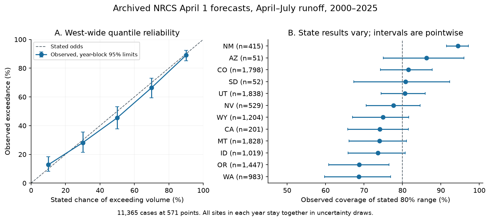
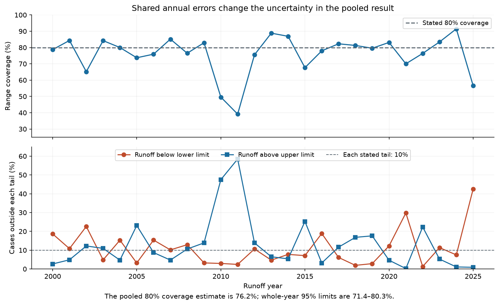
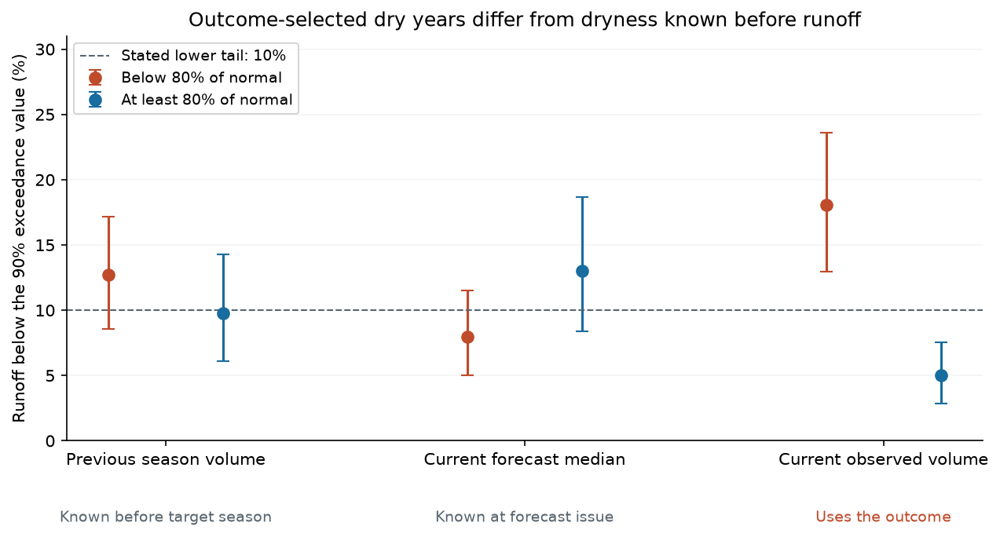

# Stated 80% NRCS April 1 ranges for April-July runoff covered 94% in New Mexico and 76% across 571 western US points in 2000-2025

Job: **sci-1107-hp-earth-and-ocean-sciences-2da4099c3814**. Topic: earth-and-ocean-sciences. Campaign: 11_07_2026. Machine: hp. Account: codex-olen. Model: gpt-6.1-sol, high reasoning effort. Analysis date: 2026-11-11. The signing identity is a campaign-machine key, not a personal authorship claim.

## Main result

We tested the five published probability levels in archived NRCS April 1 forecasts of April-July stream volume. We matched each forecast with the same station and adjusted-volume element in the NRCS Air and Water Database (AWDB). The primary sample has **11,365 forecast-years at 571 points in 12 western US states, from 2000 to 2025**.

The stated 80% ranges contained **76.2%** of observed volumes. A 95% bootstrap interval that keeps all sites in each year together is **71.4-80.3%**. Thus the primary test does **not** establish a West-wide coverage deficit. For 2013-2025 alone, coverage was **78.9% (73.6-83.4%)**. The stated 40% inner ranges contained 38.3% (34.5-41.9%). These results differ from a general claim that public hazard ranges are always too narrow.

The strongest state result has the opposite sign. At **23 New Mexico points**, the 80% ranges contained **392 of 415 volumes: 94.5%**. The pointwise year-block interval is 91.4-97.2%. An approximate simultaneous interval for the family of all 12 state estimates is **90.3-98.6%**. Both tails were rarely missed. This supports uncertainty ranges wider than the errors in this retained sample. It does not identify the production rule that caused the excess width.



Figure 1. West-wide quantile reliability and state coverage. Error bars are pointwise 95% year-block intervals. The state comparison was planned. The simultaneous state check was added after the state results were seen; it still separates New Mexico from 80%. The Oregon and Washington pointwise intervals exclude 80%, but their simultaneous intervals include it.

## Why this question matters

Water-supply forecasts support irrigation, reservoir, and hydropower decisions. NRCS publishes five volume estimates with exceedance probabilities of 90, 70, 50, 30, and 10%. The interval between the 90% and 10% exceedance volumes has a stated 80% chance of containing runoff. Both the lower and upper limits matter for decisions.

Earlier campaign work found narrow NOAA seasonal hurricane ranges and skilful but under-confident CPC ENSO probabilities. We extend that verification line to a different operational product. We do not assume that the direction of error will be the same.

This is not the first study of NRCS forecasts. Pagano, Garen, and Sorooshian (2004) tested nearly 5,000 operational forecast errors at 29 unregulated rivers, with a focus on median forecast skill. Pagano (2008) described the expected reliability of statistical probability forecasts. Goble and Schumacher (2023) tested the roles of soil moisture and later weather in western Colorado runoff errors. The public Hydrohistorian report card also verifies Colorado forecasts, including probability ranges and bias in years with low observed runoff. Our contribution is a fixed-date, fixed-period probability audit across western forecast points, with matched adjusted volumes, whole-year uncertainty, a state family check, and a test of dryness known before the target season.

## Main evidence

| Quantity | Stated value | Observed value | 95% year-block interval |
| --- | ---: | ---: | ---: |
| West-wide outer-range coverage | 80% | 76.2% | 71.4-80.3% |
| West-wide inner-range coverage | 40% | 38.3% | 34.5-41.9% |
| West-wide volume below lower limit | 10% | 11.0% | 7.6-14.9% |
| West-wide volume above upper limit | 10% | 12.8% | 8.3-18.4% |
| West-wide volume above median forecast | 50% | 45.5% | 37.8-53.3% |
| New Mexico outer-range coverage | 80% | 94.5% | 91.4-97.2% |
| New Mexico inner-range coverage | 40% | 56.6% | 47.5-64.6% |
| New Mexico volume below lower limit | 10% | 2.9% | 1.1-5.0% |
| New Mexico volume above upper limit | 10% | 2.7% | 0.3-5.7% |
| New Mexico volume above median forecast | 50% | 44.3% | 32.8-56.2% |

New Mexico has 12 low misses and 11 high misses, against 41.5 expected in each tail. Its central probability range also contains too many outcomes. A large error in one direction would not by itself explain this pattern. The median exceedance estimate has wide uncertainty and includes 50%.

New Mexico coverage was 96.6% in the retained 2000-2012 sample (145 cases) and 93.3% in 2013-2025 (270 cases). The early sample is sparse before 2006. Across all 26 years, New Mexico has retained data in 23 years. Coverage is 93.9% for its sites with at least 20 retained years. Only two New Mexico cases have a zero lower limit, so a zero floor cannot explain most of its coverage excess. These checks support persistence of the result within the archive; they do not prove that each site is miscalibrated.

Oregon and Washington coverage was about 68.7%. Their pointwise year-block limits are 60.8-76.5% and 59.8-77.0%. After the simultaneous check, the limits widen to 57.4-80.1% and 56.3-81.1%. We therefore do not claim a family-adjusted deficit for those states. The full state table is in `files/results/state_simultaneous.csv`.

## Shared years change the conclusion



Figure 2. Each year carries many forecasts with shared weather errors. Upper misses were common in 2010-2011, while lower misses were common in 2021 and 2025. Annual range coverage spans 39.1-91.5%.

If all 11,365 cases were independent, the binomial standard error of coverage would be 0.40 percentage points. The year-block bootstrap standard error is **2.30 points**, 5.75 times as large. Treating forecast points as independent would give false precision and turn an unresolved pooled gap into an apparent clear deficit. We use the larger uncertainty throughout.

The bootstrap does not explain the physical source of common errors. Future spring weather, snow measurements, model error, and flow adjustments can all produce common annual errors. It is not valid to call every shared error a failure of soil-moisture data.

## Prior drought gives mixed evidence

Before scoring, we specified a test of low-tail failure after a dry preceding April-July season. A preceding season is dry when its observed volume is below 80% of the normal archived with the current forecast. This uses a season completed before the new forecast, although the current database can contain later revisions.

On 11,108 cases with this information, low-tail failure was **12.7% after dry seasons** and **9.8% after other seasons**. The difference was **+2.9 percentage points (-0.8 to +6.9)**. Without 2020-2021, the difference was +3.2 points (-0.7 to +7.5).

A state-adjusted logistic model found a negative coefficient for previous volume divided by normal: -0.558 (-1.166 to -0.103), after adjustment for current forecast volume, state, and year. This is evidence of a conditional association. But a linear probability model with station fixed effects gave -0.034 (-0.091 to +0.017). The simple group contrast and the within-station check do not resolve the sign. These results do not support a firm claim that unmodelled drought memory is the main source of failures. They also do not establish that prior conditions have no value.



Figure 3. Low-tail failure depends on how dry conditions are defined. The red and blue points compare values below and at least 80% of the archived normal. The first two definitions use information available before or at forecast issue. The third uses the observed target runoff. Bars are pointwise year-block limits.

When the current forecast median was below 80% of normal, low-tail failure was 8.0% (5.0-11.5%). If cases were instead selected afterward because observed runoff was below 80% of normal, it was 18.1% (13.0-23.6%). Selection by the outcome changes the error distribution. A large positive forecast error in observed dry years is therefore not, by itself, proof of missing soil-moisture information. The two groups are different samples; this comparison does not measure a causal selection effect or refute the physical importance of soil moisture.

## Data and methods

We wrote `files/ANALYSIS_PLAN.md` before computing joined forecast scores. It is a local plan, not an independent registration. A later addition, also before scoring, recorded the newly found Colorado report card and the three dryness definitions.

We queried the AWDB REST API for each April 1 publication from 2000 through 2025. We selected SRVO forecasts for April 1-July 31 in the contiguous western states. We required final status, issue time no later than April 10, all five specified probability levels, and nonnegative ordered forecast volumes. We did not require sites to remain active in 2026. Forecast volumes in thousand acre-feet were converted to acre-feet. We required all four monthly SRVO values, matched by station triplet, element, and calendar year. No unadjusted gauge series was substituted.

The archive supplied 28,143 forecast records across periods and elements. Of these, 12,620 had another period or element, 462 were outside the selected states, 352 failed the issue-date limit, 1,854 lacked the required quantiles, and 46 had invalid quantiles. This left 12,809 eligible forecasts. Another 970 lacked complete outcomes and 474 had negative or nonfinite monthly values. The primary sample has 11,365 cases. Three old identifiers lack current monthly-data metadata. These counts and annual counts are preserved. Missing records and changing site membership can select the sample.

Closed ranges define coverage. Strict comparisons define tail exceedance. Only one case equals each outer boundary. We use 10,000 whole-year bootstrap draws with seed 20261111. A circular two-year block check gives pooled limits of 70.8-80.3%. Year means weighted equally give 76.0% coverage; sites with at least 20 retained years give 76.7% (72.0-80.7%). Using only forecasts issued by April 5 gives 76.2% (71.3-80.4%). The state simultaneous check uses the same resampled years for all states and the largest absolute centred statistic, scaled by each state's fixed bootstrap standard deviation. Its critical value is 2.827. This is an approximate bootstrap interval, not an exact family test.

The logistic diagnostic uses previous and current forecast volume divided by normal, each capped at 2, state indicators, and a linear time term per decade. The station model removes station means and uses the same continuous covariates. Both use 1,000 whole-year bootstrap draws. Models are diagnostic fits on the full sample. They are not forward prediction tests.

## Validation and changes after scoring

A separate standard-library parser reproduces all 11,365 cases, 8,662 hits, 1,247 low misses, and 1,456 high misses. It does not import the main analysis module.

The seasonal chart feed agrees with all 11,365 monthly sums within 1.93 acre-feet. Its small rounding differences change one range hit. The two feeds share the underlying agency database, so this checks extraction, not independent measurement truth. A manual check of nine points and 45 quantile values on page 24 of the April 2024 Colorado report found 44 exact matches and one difference of 0.3 thousand acre-feet, consistent with PDF rounding.

The simultaneous state interval, long-record subset, April 5 issue limit, chart-feed comparison, PDF audit, and negative-month check were added after the first scores. They are sensitivity checks, not independent confirmations. An export error involving a NumPy integer was fixed and the full computation was repeated; the case scores did not change.

Adjusted monthly volumes can be negative even when seasonal physical flow is positive. A check that accepts negative monthly adjustments but requires four finite months and a nonnegative seasonal sum retains 11,798 cases. Pooled coverage remains about 76%; New Mexico coverage is **93.8% (433 cases)**. Thus the primary negative-month rule does not explain the New Mexico result. Exact values and intervals are in `files/results/negative_month_sensitivity.json`.

## Limits and open questions

This is a test of current archived final forecasts against current archived volume estimates. We cannot prove that all forecast values are the original issued values. The issue-date cutoff and PDF check reduce this concern but do not remove it. We test uncertainty statements, not forecast skill against climatology, economic value, or the benefit of a proposed repair.

We have 26 calendar years, with fewer retained years at many points. Sites are spatially related and can be nested. Whole-year resampling retains that dependence but assumes years are exchangeable; two-year blocks do not cover every form of long-term dependence. State family intervals are approximate. Sample exclusions, sparse early New Mexico data, revisions, flow adjustments, and agency changes limit inference.

The New Mexico January 2024 report announced the introduction of the Multi-Model Machine-Learning Metasystem (M4). Only 41 retained New Mexico cases are from 2024-2025. Two seasons do not provide a firm calibration test of that newer system. The historical excess should not be assigned to one current production method.

The New Mexico result shows excess probability coverage in the retained archive. It does not identify a code error, the method used at every point, or a physical cause. Both early and later records support the sign, but only a production-method audit or an independent future test can resolve the source. Narrowing all western ranges would be unsupported: the state results have different signs, and the recent pooled range is near its target.

## Reproduction and files

All 57 raw files stay outside the signed publication. `files/sources.json` records exact URLs, versions, byte counts, SHA-256 hashes, and absolute shared paths. The primary shared directories start with `datasets/nrcs-awdb-apr1-`, `datasets/nrcs-awdb-srvo-monthly-`, and `datasets/nrcs-awdb-srvo-seasonal-aprjul-crosscheck-20261111`. See `files/NOTICE_EXTERNAL_DATA.md` for source rights and attribution. The raw files total 38.47 MB. No article text or third-party code is bundled.

From the extracted publication root, with Python 3.12 and the packages in `files/environment.json`:

```bash
# Use the shared immutable sources on the campaign machine.
bash files/code/reproduce.sh /mnt/dell-data/shared_datasets /tmp/nrcs_cases /tmp/nrcs_outputs

# Or retrieve external sources to a new directory, with strict hash checks.
python files/code/retrieve.py --manifest files/sources.json --scratch /tmp/nrcs_raw
bash files/code/reproduce.sh /tmp/nrcs_raw /tmp/nrcs_cases /tmp/nrcs_outputs
```

Use separate scratch and output directories, not the signed draft. The case table is written only to scratch. Live APIs can change; a hash mismatch is reported rather than silently accepted. The source manifest also permits byte-for-byte reuse of the shared snapshots. Code runs with one numerical-library thread and uses fewer than two CPUs. The bootstrap can take several minutes on a shared host.

`files/results/` contains aggregate scores, sample counts, uncertainty limits, model coefficients, and independent audit results. `files/figures/` contains three static PNG figures. `files/code/` contains the analysis, retrieval, separate audit, sensitivity checks, and figure generator. The manual PDF comparison can be checked by reading page 24 of the externally stored report and comparing its nine rows with the April 2024 API response. No private scratch is needed for reproduction once the external sources are retrieved.
