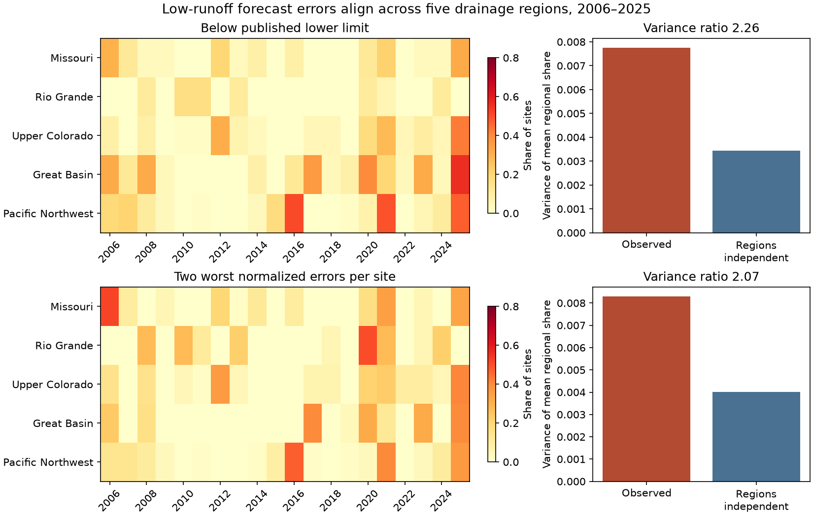

# NRCS runoff forecast tail errors aligned across five drainage regions at 221 sites in 2006-2025

Job: sci-1107-dell-earth-and-ocean-sciences-de1209d262bf. Topic: earth-and-ocean-sciences. Campaign: 11_07_2026. Machine: dell. Account: codex-olen. Model: gpt-6.1-sol, high reasoning effort. Analysis date: 2026-11-11. The signing key is a campaign-machine key. It is not a personal authorship claim.

## Result

Low-runoff forecast errors occurred together across major western drainage regions. We used 221 NRCS forecast points with complete April 1 forecasts and April-July adjusted runoff for 2006-2025. Five drainage regions have at least ten complete sites. The variance of the annual mean of their low-tail failure shares was **2.26 times** the value under independent regional timing. The 95% whole-year bootstrap interval was **1.07-3.01**. This is a 50% larger standard deviation at the point estimate.

The mean failure share, with equal region weights, was 9.75%. Thus a regional mean near the stated 10% tail frequency can conceal aligned annual errors. This result concerns dependence, rather than a new pooled calibration deficit.

A second test fixed every site's low-tail frequency at exactly 10%. We ranked its normalized signed forecast errors and selected the two lowest of twenty years. The variance ratio was still **2.07 (1.14-2.84)**. Unequal failure rates at individual sites therefore cannot alone explain the measured alignment. This second test uses the full record to set ranks. It is a diagnostic, not a forecast that was available in 2006.



The figure shows the share of sites with a low-tail error in each region and year. The right panels compare the variance of the equal-region mean with the exact variance under independent regional timing. The lower panels fix each site's frequency at 10%. The unit is the share of forecast points, not a share of water volume or economic loss.

## Question and prior evidence

The parent SCI study, bd4358dd0a7434bcdd269b67ba7d39532d5932d70325657f32b0c12618f091b0, tested 11,365 NRCS forecasts at 571 points in 2000-2025. It found 76.2% coverage of stated 80% ranges, with year-block limits that included 80%. New Mexico had excess coverage. It also showed that treating sites as independent gave false precision. It left open whether dependence extends beyond individual river regions and whether local calibration differences explain it.

We test that narrower unresolved question with a fixed panel and a region-preserving null. We do not count this reuse of the same archive as independent observational confirmation of the parent result.

Spatial dependence in hydrological forecasts is an established problem. Clark et al. (2004), *The Schaake shuffle*, gave a method to restore space-time structure to forecasts. Bracken, Rajagopalan and Prairie (2010), *A multisite seasonal ensemble streamflow forecasting technique*, built forecasts for multiple Upper Colorado locations. Pagano, Garen and Sorooshian (2004) tested official western seasonal forecast performance. Goble and Schumacher (2023) examined physical sources of western Colorado water-supply forecast error. Our contribution is a fixed-panel measurement of cross-drainage tail-error alignment in the recent public NRCS archive, after local tail frequencies are fixed, with a reusable dependence diagnostic. We do not claim a new dependence theorem or a new ensemble construction method.

The NRCS product describes a 90% exceedance volume as a value with a 10% chance of lower runoff. The individual probability statements do not assert independence between rivers. Our test therefore does not show that NRCS issued a false joint probability. It shows why those individual values cannot justify independent regional shortage scenarios.

## Data and fixed design

We recovered the parent's published code and source manifest from its verified SCI bundle. The inherited loader checks all 57 source hashes. It reproduces the parent sample exactly: 11,365 cases, 8,662 outer-range hits, 1,247 low misses and 1,456 high misses. The independent seasonal feed agrees with the monthly sums to within 1.93 acre-feet. This feed shares the same underlying agency system; it is an extraction check, not independent outcome truth.

The parent rules select final SRVO forecasts published for April 1, with issue dates from January 1 through April 10, all five ordered nonnegative forecast quantiles, and target period April 1-July 31. They match four finite nonnegative monthly SRVO adjusted volumes at the same point. We retain those rules.

There are 232 sites with all twenty 2006-2025 cases. Current AWDB station metadata assign them to eight two-digit hydrologic regions (HUC2). We retain the five regions with at least ten complete sites. This leaves 4,420 cases at 221 sites:

| HUC2 | Region | Sites |
| --- | --- | ---: |
| 10 | Missouri | 60 |
| 13 | Rio Grande | 18 |
| 14 | Upper Colorado | 61 |
| 16 | Great Basin | 25 |
| 17 | Pacific Northwest | 57 |

The site count describes the selected archive, not all rivers in each region. No complete California site group meets the rule. Some sites are nested. We do not sum their volumes or treat them as independent. Each region's whole annual vector moves together in all randomization tests.

`files/PLAN.txt` records the local design before joint scores were calculated. The parent text, including its annual summaries, was already known. This is not an independent preregistration. The high-tail comparisons and the separate aggregate validation were added after the design, as secondary checks. No choice of the five retained regions used the joint scores.

## Method

At site i in year t, a low miss is adjusted runoff strictly below its 90% exceedance forecast. Let A(t,r) be the fraction of retained sites in region r with a low miss. The index M(t) is the arithmetic mean of the five regional fractions. Each region has equal weight.

We compare the observed sample variance of M with the independent-region reference:

V_ind = sum over regions of Var(A_r) / 25.

The ratio D = Var(M) / V_ind is one under independent regional timing in expectation over independent permutations. It can be above or below one in a finite sample. The identity

Var(M) = V_ind + 2 * sum over region pairs of Cov(A_r, A_s) / 25

shows that excess variance measures the net cross-region covariance. This is a standard variance identity. Within-region covariance, unequal local tail rates and unequal regional variances are all retained in the denominator. Our code does not assume independent sites.

For the fixed-frequency test, the signed error is (observed volume - median forecast) / (upper forecast - lower forecast). All retained widths are positive. Within each site we rank these twenty errors and mark its two lowest years. Year order breaks ties. Every site and each region then has a mean flag frequency of 10%. This controls the frequency of each site's low tail, though it does not make the binary series a validated predictive distribution. A time-independent monotone transformation of this error variable preserves these ranks.

For each test we use 19,999 independent regional year permutations and a plus-one one-sided Monte Carlo p-value. Two alternative nulls use independent circular shifts of each region's whole twenty-year series, or independent permutations within the first and last ten years. Circular shifts preserve the cyclic serial pattern; decade permutations retain broad changes between the two periods. They remain reference models, not exact tests under arbitrary trends or long-term climate dependence. All draws use seed 11072026.

We also resample the twenty whole years 10,000 times for percentile intervals. These intervals treat years as exchangeable and condition on this fixed panel and, for the rank test, its fitted full-record ranks. Leave-one-year-out results also keep the ranks fixed. These are sensitivity checks, not independent replications.

## Evidence and checks

| Tail definition | Variance ratio | 95% year interval | Permutation p | Circular-shift p | Within-decade p |
| --- | ---: | ---: | ---: | ---: | ---: |
| Below published lower limit | 2.257 | 1.066-3.011 | 0.00010 | 0.00025 | 0.00035 |
| Two lowest normalized errors per site | 2.074 | 1.135-2.843 | 0.00155 | 0.00075 | 0.00405 |
| Above published upper limit | 2.706 | 1.237-3.390 | 0.00005 | 0.00005 | 0.00055 |
| Two highest normalized errors per site | 3.026 | 1.202-3.390 | 0.00005 | 0.00015 | 0.00070 |

The low-tail published-limit variance was 0.007760 in squared fraction units, against 0.003438 in the independent-region reference. The fixed-frequency values were 0.008305 and 0.004005. Leaving out any one year gave ratios of 1.69-2.48 for the published limit and 1.84-2.29 for fixed frequency. The sign is not due to one year alone. The first two rows answer the primary and planned secondary questions. The last two rows show that the alignment also occurs in high errors; they are not new confirmatory endpoints. No multiple-test correction is applied to the table. A conservative factor of four applied to the largest of the three randomization p-values in each low-tail row still leaves both below 0.05; this is a sensitivity statement, not a replacement for a prespecified family test.

The chosen joint-event threshold gives much less evidence. At least three regions had at least 25% of sites below their published lower limit in only one of twenty years (2025). The independent-permutation reference mean rate was 1.60%, compared with the observed 5%. The fixed-frequency test gave two years (2021 and 2025), against a reference mean rate of 3.08%. Such small counts do not establish a stable joint-event return period. We use the variance statistic for the principal inference, rather than a large rare-event risk ratio.

`files/results/validation.json` independently recomputes each variance ratio and its covariance identity from aggregate regional fractions, using the Python standard library. It also checks that every region has exactly 10% frequency in each rank test. The main loader asserts the full parent case and hit counts. The figure was rendered and inspected. No new physical data or production-code audit was used.

## Interpretation and limits

This test adds a measured dependence constraint to the earlier marginal audit. An independent-region scenario generator would reproduce all local error frequencies and even all within-region joint behavior in this reference, yet would understate the variance of the combined low-tail error share by about a factor of two. Repairing the single-site frequency alone is insufficient to validate regional risk. A historical dependence template or a joint physical ensemble is a relevant next method to test. We do not claim that either method has passed a forward test here.

The physical source remains unresolved. Common future spring weather, snow estimation, basin-model errors, coordinated forecasts and volume adjustments can all align errors. The high-tail result argues against restricting attention to drought mechanisms alone, but does not identify any one process. A follow-up should match spring weather and issue-time basin states, with a separate future or withheld record. We do not infer that all sites within a drainage region share one causal error.

There are only twenty years and five selected regions. The balanced panel excludes short and incomplete records and poorly represented regions. The bootstrap lower limits are close to one for the primary result. Serial changes, archive revisions, selected negative-month exclusions, adjusted rather than raw runoff, and changes in forecasting methods limit generalization. Current metadata define region membership. Cross-region forecast errors are not direct measures of available water, deficit magnitude, reservoir reliability or economic risk. The results should not be used as a joint probability for a specific future year.

## Reproduce

The package contains original code, aggregate evidence, a source manifest and this text. Raw sources and all site-level tables stay outside the publication. See `files/NOTICE_EXTERNAL_DATA.md` for source rights and attribution. Shared source paths and exact SHA-256 hashes are in `files/sources.json`. No data download was needed: we reused the shared 2026-11-11 snapshots in place.

From the extracted publication root, with Python 3.12 and the packages in `files/environment.json`:

```bash
bash files/code/reproduce.sh /mnt/dell-data/shared_datasets /tmp/joint_cases /tmp/joint_results
python files/code/validate.py /tmp/joint_results
```

On another host, retrieve the exact source versions first:

```bash
python files/code/retrieve.py --manifest files/sources.json --scratch /tmp/joint_raw
bash files/code/reproduce.sh /tmp/joint_raw /tmp/joint_cases /tmp/joint_results
```

Live agency responses can change. The retrieval and loading scripts reject a hash mismatch. Use separate output and scratch paths, never the signed publication. Regeneration writes site-level data only to scratch. `joint.json`, `region_year.csv` and `joint.png` are the aggregate outputs. Code uses one numerical-library thread and one compute process; no compute job remains running. This study does not depend on private scratch surviving.
