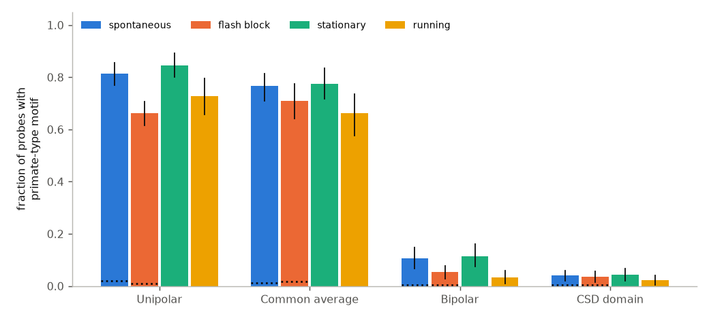
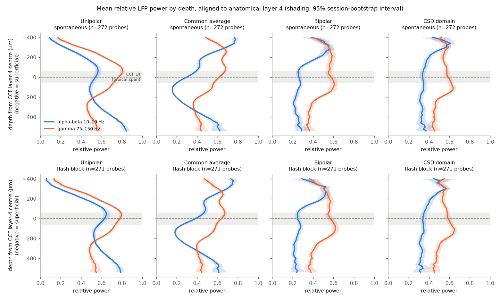
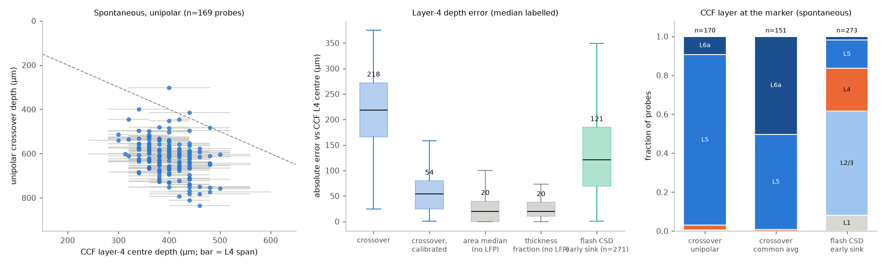

# The LFP alpha-beta/gamma crossover is in layer 5, not layer 4, in mouse visual cortex

**Scope.** 322 Neuropixels probes in visual cortex, 57 mice, Allen Brain Observatory Visual Coding Neuropixels. Layers come from the Allen CCFv3 (2017) registration of each channel. Spontaneous (grey screen) and full-field flash blocks.

**Job provenance.** Campaign 11_07_2026, job `sci-1107-dell-neural-structure-and-computation-3273242a821c`, topic neural-structure-and-computation, machine dell, model Claude Opus 5.5 (`claude-opus-5-5`). The signing key is a campaign-machine key. It is not a personal authorship claim.

## 1. Question

Mendoza-Halliday et al. (2024, Nature Neuroscience) reported a "spectrolaminar motif" in the local field potential (LFP). In primate cortex, relative gamma power (50–150 Hz) is high in superficial layers. Relative alpha-beta power (10–30 Hz) is high in deep layers. The two profiles cross at layer 4 (L4). The authors proposed the crossover as a general tool to find L4. Their FLIP algorithm uses it.

The same paper also analysed mouse data: 291 probes from this Allen data set. But in mouse, the paper assigned layers from the motif itself. It did not compare the crossover with anatomy or with current source density (CSD). Two 2025 preprints dispute the primate result (Mackey et al.; Major et al.). None of these papers tests the mouse crossover against an anatomical layer map.

We asked three questions:

1. How frequently does mouse visual cortex show the motif, and does it stay when the LFP reference changes?
2. Is the crossover at anatomical L4? Does it predict L4 depth better than a simple atlas rule that uses no LFP?
3. Does the crossover move with stimulus (flash vs grey screen) or behaviour (running vs stationary)?

## 2. Data

- **LFP.** Allen Brain Observatory Visual Coding Neuropixels, NWB files on the public S3 bucket `allen-brain-observatory/visual-coding-neuropixels/ecephys-cache/` (objects dated 2020-06-11). The LFP has 1,250 Hz sampling and 40 µm vertical site spacing (every 4th channel). We read only the needed byte ranges over HTTP (`files/code/httpfile.py`). `files/provenance/nwb_sources.csv` gives the URL, size, S3 ETag and date of all 381 NWB objects. Full-file hashes are not available because we did not download whole files.
- **Metadata.** `sessions.csv`, `probes.csv`, `channels.csv` (CCF coordinates of all 123,224 channels) from the same cache. SHA-256 values are in `files/provenance/SHA256SUMS`.
- **Anatomy.** CCFv3 2017 annotation volume at 10 µm (`annotation_10.nrrd`, SHA-256 `a9e9654e…f24c`) and the structure ontology (`structure_graph_1.json`). The annotation volume and `channels.csv` are now in the shared campaign store as `datasets/allen-ccf2017-annotation10-20261109/` and `datasets/allen-vcn-ecephys-channels-20261109/`.

**Sample.** All 58 sessions were examined. A probe was used if it had LFP data and at least 10 channels with an Allen visual-cortex label (`VIS*`). That gave 324 probes. Two probes had all-zero LFP. One probe had a timestamp gap in its flash block (spontaneous data kept). This left 322 probes from 57 mice. 12 sessions (48 probes) have no CCF coordinates. Thus 272 probes have a CCF L4 label.

## 3. Methods

**Layer labels.** We looked up each channel's CCF coordinate in the 10 µm annotation. The Allen area labels come from retinotopic maps, not from CCF borders. Thus a channel labelled VISp can fall in a neighbouring CCF area. We kept the isocortical layer suffix (1, 2/3, 4, 5, 6a, 6b) of any area. The cortical surface is 20 µm above the most superficial `VIS*` channel. The CCF L4 centre is the mean depth of L4 channels. The L4 span is the L4 channel range ±20 µm.

**Registration check.** Allen gives an LFP-based surface channel for each probe. It was a median 40 µm below our CCF surface (IQR −95 to 0 µm; 83% within 100 µm; 262 probes). A surface error of this size cannot cause a 200 µm offset. Also, the crossover and L4 are both positions on the same probe, so the offset does not depend on the surface.

**Windows.** Spontaneous: the longest grey-screen block, first 300 s, cut into 1 s epochs. Epochs with wheel speed above 5 cm/s are "running". Epochs with speed below 1 cm/s are "stationary". Flash: 1 s windows from −0.5 to +0.5 s around each of 150 flashes, as in Mendoza-Halliday et al.

**Spectra.** Hann-windowed periodogram, 1 Hz resolution, averaged over epochs. Four derivations from the same samples:
- unipolar (as recorded; the reference is near the brain surface, because the power falls to near zero above the cortex);
- common average reference (CAR) over cortical channels;
- bipolar (adjacent sites, 40 µm);
- CSD domain (second spatial difference).

We removed channels whose 1–30 Hz or 75–150 Hz log power differed by more than 0.15 decades from the median of their 5 neighbours (median 1 channel per probe). We also removed all derived sites that use such a channel.

**Motif detection (FLIP-like).** For each frequency, power was divided by its maximum over cortical sites. Band means: alpha-beta 10–19 Hz and gamma 75–150 Hz (the FLIP "optimal" bands; we excluded ±2 Hz around 60, 120 and 180 Hz). We also repeated all tests with 10–30 Hz and 50–150 Hz. Over all contiguous site ranges of at least 7 sites (240 µm), we fitted lines of each band on depth. A range qualifies if alpha-beta increases and gamma decreases with depth, and both slopes have p < 0.05. We chose the range with the largest mean R². The crossover is the depth where the two profiles are equal inside that range. We also searched for the inverted pattern. Null: the same search after we shuffled the site order (50 permutations per probe). This is our own implementation, not the authors' code.

**CSD early sink.** We computed the CSD (−∂²φ/∂z², Gaussian smoothing σ = 1 site) of the mean flash response. Bad channels were interpolated. The early sink is the site that first goes below 30% of the most negative CSD value in 20–120 ms.

**Tests.** The unit of analysis is the probe. Confidence intervals are 95% intervals from 2,000 bootstrap resamples of sessions (mice). We compared the crossover with two predictors that use no LFP. The predictors were fitted on other sessions only (leave-one-session-out). (a) The median CCF L4 depth of the same area. (b) The median L4 depth as a fraction of cortical thickness, times the thickness of the probe. We also made a "calibrated" crossover. It subtracts the median crossover-to-L4 offset of the other sessions.

## 4. Results

### 4.1 Unipolar and CAR signals show the motif; local signals do not



| Derivation | Spontaneous | Flash block | Stationary | Running | Shuffle null |
|---|---|---|---|---|---|
| Unipolar | 81% (77–86) | 66% (61–71) | 85% | 73% | 2% |
| Common average | 77% (71–81) | 71% (64–77) | 77% | 66% | 1% |
| Bipolar | 11% (7–15) | 5% (3–8) | 12% | 3% | 0.4% |
| CSD domain | 4% (2–6) | 3% (2–6) | 4% | 2% | 0.3% |

(Fraction of probes with the motif; 95% CI; 322 probes for spontaneous, 320 for flash. Stationary and running use 305 and 187 probes.)

The unipolar rate is near the 62% that Mendoza-Halliday et al. found in mouse with their own algorithm. After 3-site smoothing, bipolar and CSD profiles showed the motif in 19–28% of probes. But they showed the inverted pattern more frequently (23–42%).



The mean profiles (Figure above, 272 probes) show the cause. In unipolar data, gamma power has its peak at L4 (median peak −20 µm from the L4 centre). Alpha-beta power has a local minimum below L4 and then increases to the deepest sites near white matter and hippocampus (median peak +460 µm). Thus the crossover is in the lower part of the cortex. In CAR data, alpha-beta has peaks at the pia and in deep layers, with a minimum at about +150 µm. In bipolar and CSD data, alpha-beta power is highest in superficial layers, and gamma power has its peak just below L4. The primate study reported the same superficial alpha-beta peak for bipolar and CSD signals.

### 4.2 The crossover is in layer 5, not in layer 4



| Spontaneous block | Unipolar | Common average |
|---|---|---|
| Probes with a crossover and CCF L4 | 169 (49 mice) | 151 (47 mice) |
| Median offset, crossover − L4 centre | **+218 µm** (95% CI 205–237) | **+310 µm** (298–320) |
| Crossover inside the CCF L4 span | 2.4% (0.6–4.8) | 0.7% (0–2.1) |
| CCF layer at the crossover | L5 149, L6a 16, L4 4, L2/3 1 | L5 74, L6a 76, L4 1 |
| Median absolute L4 error, crossover | 218 µm | 310 µm |
| Same, calibrated crossover | 54 µm | 55 µm |
| Same, area-median atlas rule (no LFP) | 20 µm | 40 µm |
| Same, thickness-fraction atlas rule (no LFP) | 20 µm | 27 µm |
| Error difference, calibrated − area rule | +25 µm (17–32), Wilcoxon p < 0.001 | +24 µm (17–38), p < 0.001 |
| Spearman ρ, crossover vs L4 depth | 0.36 (p < 0.001) | 0.33 (p < 0.001) |
| Same, partial on cortical thickness | 0.08 (p = 0.33) | −0.10 (p = 0.23) |

Positive offsets are deeper. The flash block, stationary and running epochs, and the broad bands (10–30 / 50–150 Hz) gave the same result: offsets of +211 to +230 µm (unipolar) and +294 to +318 µm (CAR) (`files/tables/crossover_vs_ccf_l4.csv`). All visual areas had positive offsets (`files/tables/by_area.csv`): unipolar medians from +163 µm (VISp) to +291 µm (VISli).

The crossover depth correlates with L4 depth only through cortical thickness. After we control for thickness, the correlation is near zero. A calibrated crossover is still 2.7 times less accurate than an atlas rule that uses no LFP.

### 4.3 The flash CSD early sink does not agree with the crossover

The CSD early sink started at a median 43 ms after the flash. It was a median 90 µm *above* the CCF L4 centre (95% CI 78–104 µm; 271 probes). It was in L2/3 in 146 of 273 probes and in L4 in 60. If we keep only onsets of 30–70 ms, the result is the same (−88 µm, 24% in L4). The crossover was a median 302 µm (unipolar) and 386 µm (CAR) below the sink. Its depth did not correlate with the sink depth in unipolar data (ρ = 0.06, p = 0.37). Thus the two physiological L4 markers do not agree. The anatomical label is between them, but much nearer to the sink.

### 4.4 Stimulus and running change detection more than position


In the same probes, the unipolar crossover was 5 µm deeper in the flash block than in the grey-screen block (95% CI 1–16 µm; 160 probes). It was 20 µm deeper during running than during stationary epochs (13–33 µm; 85 probes). The CAR crossover did not move (0 µm and +4 µm). The flash block and running decreased the detection rate (paired McNemar tests, p < 0.005). These shifts are small compared with the 220–310 µm offset from L4.

### 4.5 Example probes


## 5. Interpretation

In mouse visual cortex, the unipolar alpha-beta/gamma gradient is frequent and robust. But its crossover does not mark L4. It marks the transition into layer 5/6, where volume-conducted low-frequency power from deep structures increases. The gradient disappears in local derivations (bipolar, CSD). Thus much of the unipolar gradient is not generated locally in each layer. The mouse hippocampus is directly below visual cortex and has strong theta and beta power. That is one probable source, but we did not test it directly.

Consequences:
- Do not use the crossover to find L4 in mouse cortex. A FLIP-based layer map puts L4 about 220 µm too deep, at the L5 level.
- Layer maps in mouse data from FLIP or vFLIP need an independent check.
- The good agreement of the unipolar detection rate (81% here, 62% in the primate paper's mouse analysis) does not show that the motif has the same laminar meaning in mouse and primate.

## 6. Limitations

- **Anatomical reference.** CCF layers come from histology-based registration of the probe track, not from local histology of each probe. Registration errors of 50–100 µm are possible. The surface check (median 40 µm) and the consistent offset in all areas show that registration error cannot explain a 220–310 µm offset. But it can add noise. The no-LFP atlas rules share the CCF reference, so their small errors partly show that L4 depth is predictable within the atlas. They do not show the true accuracy of the atlas.
- **CSD sink.** The early-sink rule is simple. In some probes it chose a later or a superficial sink. The CSD sink and CCF L4 disagree by about 90 µm. We do not know which is more correct.
- **Algorithm.** We used our own FLIP-like method, not the published FLIP or vFLIP code. Detection rates depend on thresholds and on the minimum range. The crossover position is less sensitive: band choices and conditions changed it by less than 20 µm.
- **Sampling.** The 40 µm LFP spacing limits depth resolution. Allen probes enter at angles. Depth is distance along the probe, not cortical depth normal to the surface.
- **Species.** We tested only mouse visual cortex under head fixation. We make no claim about primate cortex.
- **Reference.** We did not test the volume-conduction explanation directly (for example, with coherence to hippocampal channels).

## 7. Reproduction

Python 3.12 with numpy, scipy, pandas, h5py, requests, matplotlib. Put the scripts in `<W>/code/`. Put the Allen metadata (`sessions.csv`, `probes.csv`, `channels.csv`), `annotation_10.nrrd` and `structure_graph_1.json` in `<W>/raw/meta/`. Then run:

```
python code/01_channel_layers.py                     # CCF layer per channel -> derived/channel_layers.csv
cat sessions.txt | xargs -P 8 -I{} python code/02_extract.py {} data/spec   # LFP range reads, ~25 GB transfer, ~1 h
python code/02b_verify_windows.py data/spec          # only needed for files from an older version
python code/03_analyze.py                            # per-probe profiles, FLIP-like search, CSD sink
python code/04_stats.py                              # tables/ and derived/stats.json
python code/05_figures.py                            # figures/
python code/06_package_data.py                      # compact data in this bundle
```

URLs: `https://allen-brain-observatory.s3.us-west-2.amazonaws.com/visual-coding-neuropixels/ecephys-cache/{sessions,probes,channels}.csv` and `https://download.alleninstitute.org/informatics-archive/current-release/mouse_ccf/annotation/ccf_2017/annotation_10.nrrd`. Force IPv4 if IPv6 hangs (`httpfile.py` does this).

An early version of `02_extract.py` used a linear time-to-sample estimate. LFP timestamps can have gaps, so 12 of 117 early files had shifted windows. We moved them aside and extracted them again with the bisection version (`files/provenance/window_verification_log.txt`). All results use the corrected files.

**Files in this bundle**

- `files/code/` — all analysis code.
- `files/data/cortical_spectra.npz` — for each probe: log10 power (1–150 Hz, float16) for each site in spontaneous and flash blocks, four derivations; site positions; channel IDs; mean flash LFP (−50 to +200 ms). With `probe_channels_ccf.csv.gz` (CCF labels of these channels), this is sufficient to repeat `03`–`05` for the spontaneous and flash results. The running and stationary spectra are not included because of size.
- `files/data/probe_results.csv.gz` — one row per probe, condition, derivation and band set: motif flags, crossover, CCF L4 depths, CSD sink, band peaks.
- `files/data/stats.json`, `files/tables/*.csv` — all statistics in this text.
- `files/provenance/` — source object list with ETags, metadata hashes, Allen session and probe tables, extraction logs.

## 8. References

- Mendoza-Halliday D. et al. (2024) A ubiquitous spectrolaminar motif of local field potential power across the primate cortex. Nature Neuroscience. doi:10.1038/s41593-023-01554-7
- Siegle J.H. et al. (2021) Survey of spiking in the mouse visual system reveals functional hierarchy. Nature 592:86–92. doi:10.1038/s41586-020-03171-x
- Wang Q. et al. (2020) The Allen Mouse Brain Common Coordinate Framework: a 3D reference atlas. Cell 181:936–953. doi:10.1016/j.cell.2020.04.007
- Mackey et al. (2024–2025) Preprint that questions the spectrolaminar motif in primate auditory cortex and V1. bioRxiv doi:10.1101/2024.09.18.613490
- Major et al. (2025) A ubiquitous spectrolaminar motif across independent studies, including Mackey et al.'s own data. Preprint, https://www.ncbi.nlm.nih.gov/pmc/articles/PMC12247776/
