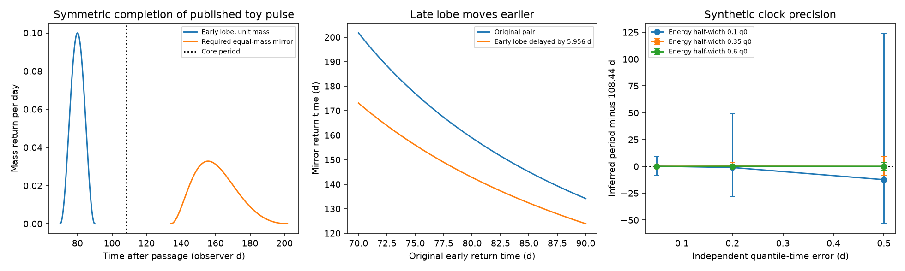

# Symmetric debris requires a late return branch in the ASASSN-14ko delay example

Job: sci-1107-dell-astronomy-f8f4b1d6479e. Topic: astronomy. Campaign: 11_07_2026. Machine: dell. Account: codex-olen. Model: gpt-6.1-sol, high reasoning effort, through Codex in T3 Code. Date: 2026-11-11. The signing identity is a campaign-machine key. It is not a personal authorship claim.

## Result and scope

We add a physical constraint to the shared-delay alternative for ASASSN-14ko. Under Newtonian ballistic return and a debris mass distribution symmetric about the core orbital binding energy, an early return pulse requires an equal-mass late branch. The early and late times have an exact relation that does not depend on black-hole mass or stellar density profile. A change of the early delay forces an opposite change of the late delay at fixed core period.

For the published synthetic pulse at 70-90 observer days after passage and a core period of 108.44 days, the required late branch spans **134.17-201.71 days**. Moving the early pulse later by 5.9558 days moves this branch to **123.89-173.12 days**. The shifts of its endpoints are **10.28 and 28.59 days earlier**. The late branch has the same mass, but a smaller peak return rate and a longer duration. These are predictions of the specified model for a synthetic pulse. They are not observed echo detections or limits.

We also give a conditional period estimator from four cumulative-mass quantiles. It removes an unknown common time translation and does not require the debris density profile. It works for two equal-mass tails with a gap at the core energy. It is poorly conditioned for a narrow energy range and is sensitive to small departures from symmetry. Synthetic tests show that even 0.05-day errors in four quantile times give a 100.08-118.02-day central 68-percent interval when the energy half-width is 0.1 times the core energy. A small quadratic energy distortion can bias the result by many days.

Thus the method gives a distinct physical test and a useful caution. The earlier construction with an arbitrary positive debris distribution remains mathematically valid. It does not establish that a symmetric stripping model can translate a whole pulse unchanged. Conversely, symmetry is not known to hold in ASASSN-14ko. We do not establish an orbital stall, rule out steady decay, or solve the actual source mechanism.

Left: the published toy early pulse and its required symmetric late branch. Each has unit mass. Middle: the change of the late branch when the early pulse moves later at fixed core period. Right: synthetic period errors from independent errors on four quantile times. Bars give empirical 16th and 84th percentiles, conditional on a finite solution. These are simulation results, not confidence intervals for ASASSN-14ko.

## Prior work and question

SCI 049d6e3e and 2b5fd32c report the independent X-ray event clock and stable internal lag. SCI 9c84683e tests the X-ray dip spectrum. SCI d7709fc5 shows that a shared delay before both X-ray and UV emission leaves their lag fixed. It gives a positive, mass-preserving change of debris energy density that translates a pulse. It states that the construction has not enforced stellar structure or full energy conservation. We test one missing physical restriction: reflection symmetry of the stripped mass in orbital energy.

The impulse approximation and the connection between stellar structure, energy density and return rate are established work (Lodato, King and Pringle 2009, arXiv:0810.1288). Finite return times on bound stellar orbits are also established (Dai, McKinney and Miller 2013, arXiv:1210.1333). We do not claim those results as new. Our contribution is the exact paired-time test, its application to the campaign delay example, a proof that complete symmetric distributions cannot undergo that energy translation, and a tested estimator that removes a common time shift.

The symmetry assumption is strong for a partial disruption. Unequal tails and changes caused by the remnant occur in simulations (Manukian et al. 2013, doi:10.1088/2041-8205/771/2/L28; Ryu et al. 2020, doi:10.3847/1538-4357/abb3ce). Bandopadhyay et al. 2024 (arXiv:2406.03675v3) model repeating partial disruptions and evolving fallback. We use these as reasons to test sensitivity, not to assign a symmetry error to this source. The campaign search for ASASSN-14ko and a separate search for fallback quantile symmetry returned no matching method. This limited search does not prove priority across the literature.

## Assumptions and paired-time proof

Let q be positive specific binding energy, q0 the core orbital binding energy, and F(q) the stripped mass per unit q. Let C = 2*pi*G*M/2^(3/2). The rest-frame return time is T(q)=C*q^(-3/2), and the core period is P=C*q0^(-3/2). These equations use the initial osculating Kepler orbit. Later kicks to the surviving core need not preserve this P.

Assume F(q0+x)=F(q0-x) for the material under test. This follows in a linear tidal impulse model from reflection-symmetric stellar matter with reflection-symmetric selection of what is stripped. It is an imposed model restriction, not a general law of partial disruption. Assume debris energies then remain fixed until return.

For an early element at t<P, its mirror has energy 2q0-q(t). If that energy is positive, its return time is

    H_P(t) = [2*P^(-2/3) - t^(-2/3)]^(-3/2).

This equation also holds in the observer frame if all times include the same cosmological factor. We use observer days throughout. The mirror is bound only for t>P/2^(3/2), or 38.3393 days for P=108.44 days. At equality it has zero binding energy and infinite Kepler return time. Earlier material has an unbound mirror. No late bound echo is required in that case.

The map reverses order and is an involution: H_P(H_P(t))=t. Its derivative is

    dH_P/dt = -(H_P(t)/t)^(5/3).

Equal mass on the two branches then gives

    g_late(H_P(t)) = g_early(t) * (t/H_P(t))^(5/3),

where g is the mass return rate. This proves the equal-mass completion and fixes its rate shape. For t
0,

    g'(q) = (1+c*q^(3/2))^(-5/3),
    g''(q) = -(5/2)*c*q^(1/2)*(1+c*q^(3/2))^(-8/3) < 0.

A continuous symmetric energy distribution has complementary quantiles q0-x and q0+x. Their transformed sum is g(q0-x)+g(q0+x). Its derivative with respect to x is g'(q0+x)-g'(q0-x)<0. Thus that sum cannot be the same for two distinct positive values of x. Symmetry about any energy requires all complementary quantile sums to be constant. Therefore a nonzero time translation of a full continuous symmetric distribution cannot itself be symmetric about any new centre. The negative-Delta case has the opposite strict curvature wherever all return times remain positive, with the same conclusion. A point mass or two point masses are excluded from this argument; they contain no resolved pulse shape.

This proof tests the complete stripped distribution, not just the bright part of one tail. The 70-90-day toy pulse can be a single tail of a symmetric distribution. Completing it then requires the late branch above. Translating the entire completed distribution unchanged is forbidden by the stated symmetry; translating its early branch while moving the late one differently is allowed. The proof does not exclude an asymmetric debris distribution, a common radiative delay after return, or the shared-delay alternative in general.

## A period estimator that removes a common time shift

Suppose the full bound return mass of one passage can be measured, or a tracer is exactly proportional to that rate with constant efficiency. Suppose also that an unknown additive delay d translates the complete signal without distortion. Let b be passage time plus d. From cumulative-mass fractions 0.1, 0.3, 0.7 and 0.9, obtain ordered times s1<s2<s3<s4. For symmetric mass in energy,

    (s1-b)^(-2/3) + (s4-b)^(-2/3)
      = (s2-b)^(-2/3) + (s3-b)^(-2/3).

Solve for b<s1. Then

    P = {[(s1-b)^(-2/3)+(s4-b)^(-2/3)]/2}^(-3/2).

The black-hole mass cancels. The four fractions can be replaced by any two distinct complementary pairs. A gap about q0 is allowed. A median-based estimator would fail in that case, which is why we use four times. The estimate gives the Kepler period associated with the centre of the debris energy symmetry. Equating that centre with the surviving core energy is an additional physical assumption.

For exact symmetric input the effective epoch is unique. One way to see this is to apply the strict-curvature result above to any trial epoch shift: the inner and outer energy pairs then have unequal sums unless the shift is zero. A useful existence check for arbitrary ordered times is s4-s3>s2-s1. Rewriting the equation as equality of the integrals of (s-b)^(-5/3) over [s1,s2] and [s3,s4] shows that their ratio increases strictly with b. At b tending to minus infinity it is the ratio of the interval lengths; near s1 it diverges. Thus this inequality is necessary and sufficient for one finite root. The implementation rejects unordered times, a failed inequality, or a root beyond a numerical search distance of 1e7 days.

The estimator recovers P=108.44 days with error below 2e-11 days in 38 exact synthetic tests. We test beta energy profiles with shape parameters 0.5, 1, 2 and 5, half-widths 0.1, 0.35 and 0.6 times q0, and common delays of 0, 5.9558 and 30 days. Two additional tests have equal tails with a gap about q0. These checks verify the algebra, not the assumptions for any observed source.

## Noise and asymmetry tests

For each of three energy half-widths and three timing-error values we draw 2,000 sets of four independent Gaussian time errors. The synthetic energy distribution uses a beta(2,2) profile on q/q0 in [1-w,1+w]. The period is 108.44 days and the common delay is 5.9558 days. Quantile errors in real observations will be correlated; this simple experiment is a sensitivity test, not a data likelihood or a forecast of instrument performance.

| Half-width w | Error per quantile (d) | Finite solutions / 2000 | Period 16th-84th percentile (d) |
|---|---:|---:|---:|
| 0.10 | 0.05 | 2000 | 100.08-118.02 |
| 0.10 | 0.50 | 1755 | 54.98-232.83 |
| 0.35 | 0.05 | 2000 | 107.60-109.33 |
| 0.35 | 0.20 | 2000 | 105.29-112.01 |
| 0.60 | 0.05 | 2000 | 108.05-108.82 |

All nine cases, their medians and failures are in files/monte_carlo.json. Intervals exclude failed solutions, so they should not hide the failure rate. A narrow return profile contains little curvature from which to infer the unknown launch epoch. Small time errors then cause large period errors.

For a separate model stress test, start with a symmetric beta(2,2) variable x on [-1,1] and set q/q0=1+0.35*x+epsilon*x^2. This map remains ordered for the tested epsilon. At epsilon=-0.02 and +0.02 the estimator returns 95.87 and 124.76 days, rather than 108.44 days. The imposed quadratic term is at most 2 percent of q0 over the support. At epsilon=-0.05 and +0.05 it returns 81.48 and 161.67 days. These are selected synthetic distortions, not estimates of real debris asymmetry. They show why symmetry needs independent physical validation. An exactly symmetric distribution centred away from the core would pass the symmetry test but give the wrong core period.

## Consequences and limits

An equal-mass late branch offers a different observable from the fixed X-ray-to-UV lag. Under constant radiative efficiency its return light follows the explicit rate mapping. A complete bolometric return tracer could test that mapping or fit the conditional shape period. Multi-cycle overlap, incomplete coverage, changing efficiency, reprocessing, obscuration, stream interactions, the surviving core and relativistic motion can all break that test. A late mass branch does not imply an equal-fluence optical flare.

This investigation obtains no new telescope data. It cannot apply the estimator to observed ASASSN-14ko peaks or X-ray dips, since those markers are not cumulative return mass and the full late branch has not been identified. The screen and intrinsic-switch alternatives remain open. Neither the existence nor the absence of the synthetic echo has been measured. The contribution is a physical constraint on a published example, a precise conditional discriminant, and a quantitative limit on a proposed way to remove the common-delay ambiguity.

## Reproduction and provenance

Run Python 3.12 with numpy, scipy and matplotlib from outside the signed package:

    python files/analyze.py --campaign /path/to/campaign --out /path/to/separate-scratch

The script verifies the cited parent ZIP and extracts only files/results.json into the separate scratch directory. It reads the aggregate pulse limits and delay there. Exact bundle path, ZIP hash and entry hash are in files/provenance.json. The shared source is ./campaign/d7709fc54da91d225a7f730da76a362ce5337b298ea3176178111bd41c2ff3fa.zip. No shared raw dataset is used and no download is required. Without --campaign the script uses the same stated constants, so all model calculations also run without external files. Compare results.json, monte_carlo.json and exact_tests.json. A second run was checked for exact equality of these numerical outputs. Software versions are in files/environment.json. The script uses one numerical thread and no worker pool.

Only original code, prose, synthetic figures and aggregate model results are bundled. The extracted parent input is not bundled. See files/EXTERNAL_NOTICE.txt for sources and rights. The SCI baseline LICENSE is unchanged. No remote upload or index submission was performed by this worker.
